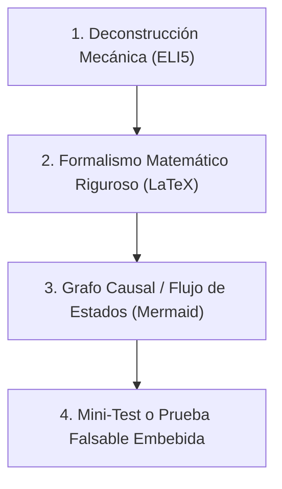

# Verificador Epistémico y Protocolo Feynman (UGV Voyager 3)

> *"El primer principio es que no debes engañarte a ti mismo, y tú eres la persona más fácil de engañar."* — Richard Feynman.

Este skill garantiza que cualquier concepto de ingeniería, modelo cinemático, algoritmo de estimación o análisis de fallas sea explicado y validado sin ambigüedades, tautologías ni cajas negras.

---

## 🎯 ¿Cuándo Activar Este Skill?
Activa este skill cuando:
1. Se derive o documente un modelo matemático de cinemática vehicular o control en el espacio de trabajo.
2. Se explique el funcionamiento de algoritmos de navegación local (ND, DWA, Pure Pursuit).
3. Se analicen datos experimentales de sensores (LiDAR SF40/C, IMU, GPS Neo-M8N).
4. Se documenten hitos técnicos en bitácoras o manuales.

---

## 🔬 Los 4 Pasos del Protocolo Feynman en Robótica

### 1. Deconstrucción Mecánica (ELI5)
* Describir la acción física que realiza el mecanismo o el sensor sin recurrir a términos técnicos abstractos ni nombres de librerías.
* Ejemplo: En lugar de decir *"Se aplica una proyección no holónoma"*, decir: *"Las ruedas delanteras no pueden girar más de $25^\circ$, por lo que el coche no puede esquivar un obstáculo de lado sin avanzar al mismo tiempo"*.

### 2. Formalismo Matemático Riguroso en KaTeX
* Expresar las leyes físicas y cinemáticas con fórmulas explícitas:
  $$\delta(t) = \arctan\left(\frac{L \cdot \omega(t)}{v(t) + \text{sign}(v(t)) \cdot \epsilon}\right)$$
* Definir cada parámetro con sus unidades en el Sistema Internacional ($m$, $rad$, $s$, $kg$).

### 3. Grafos Mermaid Obligatorios
* Visualizar el flujo de información o la máquina de estados finitos del algoritmo.
* Mapear los modos de fallo y cómo reacciona el sistema ante la falla.

### 4. Prueba Falsable Embebida
* Toda formulación debe incluir un caso de prueba numérico concreto con resultado esperado para verificar que no hay errores de signo ni inconsistencias dimensionales.
