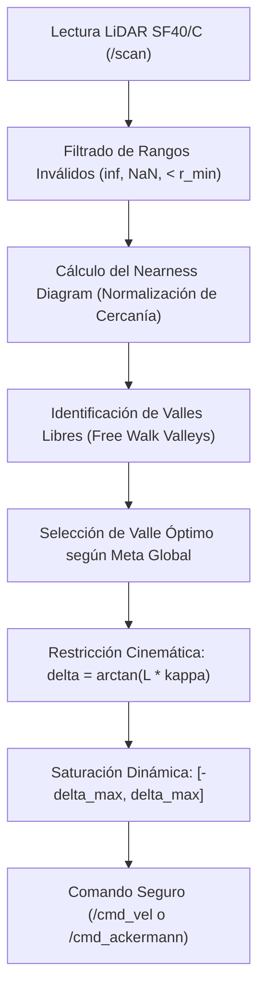

# Nearness Diagram (ND) Navigation for Ackermann UGVs Skill

Este skill guía la implementación, análisis y calibración del algoritmo de navegación reactiva **Nearness Diagram (ND)** adaptado a vehículos terrestres con cinemática **Ackermann** utilizando un escáner LiDAR rotativo 360° (**LightWare SF40/C**).

---

## 🎯 ¿Cuándo Activar Este Skill?
Activa este skill cuando:
1. Se desarrolle o ajuste el nodo [`nearness_diagram_ackermann_node.py`](file:///d:/Voyager/ros2_ws/src/voyager_navigation/voyager_navigation/nearness_diagram_ackermann_node.py).
2. Se procesen nubes de puntos o escaneos planos (`sensor_msgs/msg/LaserScan`).
3. Se produzcan oscilaciones de dirección o bloqueos frente a pasillos estrechos u obstáculos cóncavos.
4. Se sintonice el radio de seguridad $R_{\text{safety}}$ y los umbrales de discontinuidad.

---

## 🔬 Principio Físico y Matemático del Nearness Diagram (ND)

El algoritmo Nearness Diagram convierte las lecturas de distancia polar $(r_i, \theta_i)$ en una función de "cercanía" normalizada:

$$d_i = \frac{D_{\max} - \text{clamp}(r_i, D_{\min}, D_{\max})}{D_{\max} - D_{\min}}$$

Donde valores cercanos a $1.0$ indican máxima proximidad al obstáculo, y valores cercanos a $0.0$ representan espacio libre.

---

## ⚠️ Adaptación Crítica a Cinemática Ackermann

A diferencia de los robots diferenciales u omnidireccionales clásicos donde se aplica ND:
1. **Incapacidad de Giro Estático:**
   * No se pueden seleccionar orientaciones con un radio de curvatura menor al radio de giro mínimo del vehículo:
     $$R \ge R_{\min} = \frac{L}{\tan(\delta_{\max})} \approx 0.75\text{ m}$$
2. **Asimetría de la Envolvente de Colisión:**
   * Al girar las ruedas hacia la izquierda, el lateral derecho trasero describe un arco que barre un área exterior adicional (corte de cola). La zona de seguridad debe ser una elipse o envolvente poligonal extendida, no un círculo simétrico.

---

## 🔍 Checklist de Auditoría del Algoritmo
- [ ] ¿Se eliminan adecuadamente las lecturas reflejadas y los valores `NaN` / `inf` del SF40/C?
- [ ] ¿El radio de seguridad considera el ancho de vía ($0.30\text{ m}$) más un margen de tolerancia ($0.20\text{ m}$)?
- [ ] ¿Se frena la velocidad de avance proporcionalmente a la cercanía del obstáculo frontal más crítico?
- [ ] ¿Existe una máquina de estados para detectar y resolver callejones sin salida (maniobra de marcha atrás en $Y$ o reversa controlada)?
