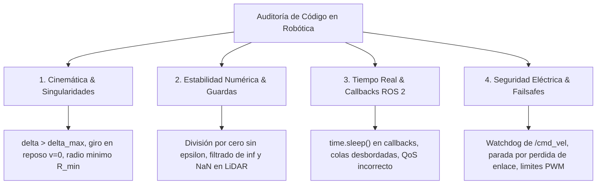

# Revisor de Código Especializado en Robótica Móvil y ROS 2

> *"La revisión de código en robótica física no es solo formateo y estilo: es auditar si el software respeta las leyes de la mecánica clásica, las limitaciones de los actuadores y la seguridad de la plataforma."*

Este skill ejecuta una **auditoría técnica adversarial en contexto limpio** sobre nodos de control, scripts de navegación, drivers de sensores y puentes de telemetría del Voyager 3.

---

## 🎯 ¿Cuándo Activar Este Skill?
Activa este skill cuando:
1. Se proponga o modifique código en `ros2_ws/src/`.
2. Se implemente un controlador cinemático, filtro de sensor o nodo de evasión reactiva.
3. Se detecten comportamientos erráticos en el vehículo (sacudidas de dirección, bloqueos en avance, saltos temporales).
4. Se prepare código antes de realizar pruebas de campo con el rover armado.

---

## 🔍 Matriz de Auditoría Crítica en Robótica Móvil

---

## 📋 Checklist de Auditoría Exhaustiva

### 1. Cinemática y Geometría
- [ ] **Límites de Ángulo:** ¿El ángulo de giro $\delta$ está saturado a $[-\delta_{\max}, \delta_{\max}]$ ($25^\circ$)?
- [ ] **Giro con Velocidad Nula:** ¿Se evita calcular curvaturas absurdas cuando el rover está detenido ($v \approx 0$)?
- [ ] **Radio de Giro Mínimo:** ¿El planificador respeta la restricción no holónoma de $R_{\min} \approx 0.75\text{ m}$?

### 2. Estabilidad Numérica y Guardas Epsilon
- [ ] **Denominadores Protegidos:** ¿Cualquier división por velocidad o distancia incluye $\epsilon = 10^{-7}$?
- [ ] **Filtrado Sensorial:** ¿Se comprueba `math.isinf()` y `math.isnan()` en los arreglos de distancia del LiDAR?

### 3. Rendimiento en ROS 2
- [ ] **Cero Bloqueos:** ¿No hay ningún `time.sleep()` dentro de callbacks de suscripción?
- [ ] **QoS Adecuado:** ¿El tópico `/scan` utiliza `BEST_EFFORT` con profundidad reducida?
- [ ] **Manejo de Excepciones:** ¿Se descarta el uso de `except Exception: pass` silencioso?

### 4. Seguridad Operacional
- [ ] **Watchdog de Comando:** ¿El nodo envía velocidad cero si no recibe datos sensoriales actualizados en $> 300\text{ ms}$?
- [ ] **Estado de Armado:** ¿Se verifica el estado del autopiloto antes de iniciar secuencias de movimiento autónomo?
