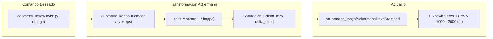

# ROS 2 Ackermann Steering & Kinematics Skill (UGV Voyager 3)

Este skill proporciona directrices, ecuaciones y plantillas para el diseño, verificación y ajuste de controladores cinemáticos para el chasis **Ackermann** del Voyager 3 en **ROS 2**.

---

## 🎯 ¿Cuándo Activar Este Skill?
Activa este skill cuando:
1. Se desarrolle o modifique un nodo puente entre `/cmd_vel` (`geometry_msgs/msg/Twist`) y comandos de dirección Ackermann.
2. Se calculen transformadas entre velocidades angulares $\omega_z$ y ángulos de giro $\delta$.
3. Se diseñen controladores de seguimiento de trayectoria (e.g. *Pure Pursuit*, *Stanley Controller*).
4. Se audite la estabilidad numérica y la prevención de bloqueos mecánicos del servo en `MAIN OUT 1`.

---

## 📐 Modelo Matemático Bicicleta

El modelo cinemático del UGV en el plano $2D$ referenciado al centro del eje motriz trasero (`base_link`) es:

$$\begin{aligned}
\dot{x} &= v \cos(\theta) \\
\dot{y} &= v \sin(\theta) \\
\dot{\theta} &= \frac{v}{L} \tan(\delta) = v \cdot \kappa
\end{aligned}$$

Donde:
* $v$: Velocidad longitudinal ($m/s$).
* $\delta$: Ángulo de giro de las ruedas delanteras ($rad$).
* $L$: Batalla (*wheelbase*, distancia entre ejes) $\approx 0.35\text{ m}$.
* $\kappa$: Curvatura instantánea de la trayectoria ($\text{m}^{-1}$).



---

## 🛠️ Implementación Canónica en Python (`rclpy`)

```python
import math
from typing import Tuple

def twist_to_ackermann(
    linear_v: float,
    angular_w: float,
    wheelbase_l: float = 0.35,
    max_steer_rad: float = 0.436,  # 25 grados
    eps: float = 1e-7
) -> Tuple[float, float]:
    """
    Convierte comandos de Twist (v, omega) a parametros de direccion Ackermann (v, delta).
    Incluye guarda numerica contra division por cero en reposo.
    """
    # En reposo casi total, no calcular angulos de giro absurdos
    if abs(linear_v) < 1e-3:
        return 0.0, 0.0
    
    # Calculo de curvatura con guarda de signo
    denom = linear_v + (eps if linear_v >= 0.0 else -eps)
    curvature = angular_w / denom
    
    # Angulo de direccion teorico
    delta = math.atan(wheelbase_l * curvature)
    
    # Saturacion estricta al rango mecanico del chasis
    delta_clamped = max(-max_steer_rad, min(max_steer_rad, delta))
    
    return linear_v, delta_clamped
```

---

## 🔍 Checklist de Verificación
- [ ] ¿Se cuenta con guarda $\epsilon = 10^{-7}$ en el cálculo de curvatura?
- [ ] ¿El ángulo $\delta$ está saturado incondicionalmente a $[-\delta_{\max}, \delta_{\max}]$?
- [ ] ¿Se previene el comando de giros puros cuando la velocidad lineal es nula?
- [ ] ¿Se incluye rampa de aceleración para proteger el tren motriz?
