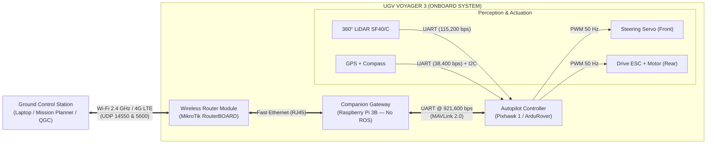

# UGV Voyager 3

> **Autonomous All-Terrain Rover with Ackermann Steering**  
> *Platform: Fible ALTU (EU H2020 RAWFIE Project)*  
> *Autopilot: Pixhawk 1 running ArduPilot (APM:Rover v3.4.2)*  
> *Companion Gateway: Raspberry Pi 3 Model B*

---

## 📌 Quick Navigation Index

| Section | Description | Direct Link |
| :--- | :--- | :--- |
| **Hardware Overview & BOM** | Complete Bill of Materials, component specs, and voltage distribution tree | [📖 Hardware Overview](documentation/hardware_description/hardware_overview.md) |
| **Communication Architecture** | Data flow: GCS ↔ Router ↔ Ethernet ↔ Companion Gateway ↔ Pixhawk | [📡 Communication Architecture](documentation/hardware_description/communication_architecture.md) |
| **Step 1: Network & Telemetry** | Wi-Fi/Ethernet setup, SSH access, and MAVProxy serial-to-UDP bridging | [🚀 01 — Network & Telemetry Setup](documentation/initial_setup/01_network_and_telemetry.md) |
| **Step 2: Mission Planner & Drive** | GCS UDP connection, pre-arm checks, arming, and manual driving without ROS | [🎮 02 — Mission Planner & First Movement](documentation/initial_setup/02_mission_planner_and_drive.md) |

---

## 🚜 System Overview

The **Voyager 3** is a rugged unmanned ground vehicle (UGV) engineered for outdoor autonomous missions and field research. It combines physical real-time motion control with a networked communication architecture.

---

## ⚙️ Key Technical Specifications

| Parameter | Specification | Details |
| :--- | :--- | :--- |
| **Drive Kinematics** | Ackermann Steering | Front-wheel steerable servo + rear-wheel traction motor |
| **Autopilot Unit** | Pixhawk 1 (PX4v3) | STM32F427 Cortex-M4 running ArduRover v3.4.2 |
| **Companion Gateway** | Raspberry Pi 3 Model B | Serial-to-Ethernet telemetry forwarding via MAVProxy (No ROS required onboard) |
| **Onboard Network** | MikroTik mAP 2nD | Fast Ethernet switch + 2.4 GHz Wi-Fi access point + optional 4G LTE |
| **Primary Perception** | LightWare SF40/C LiDAR | 360° laser scanner (0.2 m – 100 m range), **powered strictly at 12V DC** |
| **Global Navigation** | U-blox Neo-M8N GNSS | External GPS antenna with master I2C digital compass |
| **Ground Control Software** | Mission Planner / QGC | MAVLink telemetry stream over UDP port `14550` |
| **Power Supply** | 3S LiPo Battery | 11.1V – 12.6V DC nominal with independent step-down BECs |

---

## 🚦 Fast-Track Getting Started

To operate the rover immediately **without ROS** using Mission Planner:

1. **Power up the vehicle:** Connect the 3S LiPo battery via the main XT60 connector.
2. **Connect your PC to the rover network:** Associate with the `DroneLab` Wi-Fi hotspot or connect to the MikroTik router.
3. **Establish MAVLink forwarding:** Follow the [Network & Telemetry Setup](documentation/initial_setup/01_network_and_telemetry.md).
4. **Drive with Mission Planner:** Follow the [Mission Planner & Drive Guide](documentation/initial_setup/02_mission_planner_and_drive.md).
