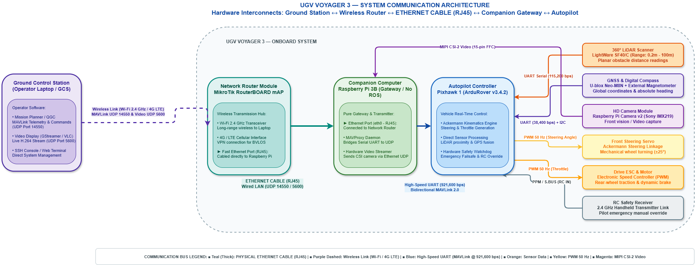

# UGV Voyager 3

> **Autonomous All-Terrain Rover with Ackermann Steering**  
> *Platform: Fible ALTU (EU H2020 RAWFIE Project)*  
> *Autopilot: The Cube Black (Pixhawk 2.1) running ArduPilot (APM:Rover v3.4.2)*  
> *Companion Gateway: Raspberry Pi 3 Model B*

---

## Quick Navigation Index

| Section | Description | Direct Link |
| :--- | :--- | :--- |
| **Documentation Suite Index** | High-level master index of all hardware, setup, and ROS 2 guides | [Documentation Index](documentation/README.md) |
| **Hardware Wiki & Index** | Complete 10-part component index, BOM, pinout tables, and voltage tree | [Hardware Documentation Index](documentation/hardware_description/README.md) |
| **The Cube Black Autopilot** | Pixhawk 2.1 carrier pinouts, heated triple IMU subsystem, STM32F427 FMU | [01 — The Cube Black](documentation/hardware_description/01_the_cube_black_autopilot.md) |
| **LightWare SF40/C LiDAR** | 360° laser scanner specs, 12V DC power rules, and ArduPilot proximity setup | [02 — LightWare SF40/C LiDAR](documentation/hardware_description/02_lightware_sf40c_lidar.md) |
| **Raspberry Pi 3B Gateway** | High-speed UART (`/dev/serial0` @ 921.6k), power isolation, MAVProxy bridge | [03 — Raspberry Pi 3B](documentation/hardware_description/03_raspberry_pi_3b.md) |
| **Communication Architecture** | Data flow: GCS ↔ Router ↔ Ethernet ↔ Companion Gateway ↔ Pixhawk | [Communication Architecture](documentation/hardware_description/communication_architecture.md) |
| **Step 1: Network & Telemetry** | Wi-Fi/Ethernet setup, SSH access, and MAVProxy serial-to-UDP bridging | [01 — Network & Telemetry Setup](documentation/initial_setup/01_network_and_telemetry.md) |
| **Step 2: Mission Planner & Drive** | GCS UDP connection, pre-arm checks, arming, and manual driving without ROS | [02 — Mission Planner & First Movement](documentation/initial_setup/02_mission_planner_and_drive.md) |
| **ROS 2 Environment Setup** | Complete ROS 2 Humble installation guide for Windows (WSL2) and Linux (Ubuntu 22.04) | [ROS 2 Installation Guide](documentation/ros2_setup/01_ros2_installation.md) |

---

## System Overview

The **Voyager 3** is a rugged unmanned ground vehicle (UGV) engineered for outdoor autonomous missions and field research. It combines physical real-time motion control with a networked communication architecture.

---

## Key Technical Specifications

| Parameter | Specification | Details |
| :--- | :--- | :--- |
| **Drive Kinematics** | Ackermann Steering | Front-wheel steerable servo + rear-wheel traction motor |
| **Autopilot Unit** | The Cube Black (Pixhawk 2.1) | STM32F427 Cortex-M4 + STM32F100, Heated Triple IMU (45°C) running ArduRover v3.4.2 |
| **Companion Gateway** | Raspberry Pi 3 Model B | Serial-to-Ethernet telemetry forwarding via MAVProxy (No ROS required onboard) |
| **Onboard Network** | MikroTik mAP 2nD | Fast Ethernet switch + 2.4 GHz Wi-Fi access point + optional 4G LTE |
| **Primary Perception** | LightWare SF40/C LiDAR | 360° laser scanner (0.2 m – 100 m range), **powered strictly at 12V DC** |
| **Global Navigation** | U-blox Neo-M8N GNSS | External GPS antenna with master I2C digital compass |
| **Ground Control Software** | Mission Planner / QGC | MAVLink telemetry stream over UDP port `14550` |
| **Power Supply** | 4S LiPo Battery | 14.8V – 16.8V DC nominal (handles motor current peaks without tripping) |

---

## Fast-Track Getting Started

> **Wi-Fi Connection Note:** The onboard router broadcasts an SSID named `Voyager 3`, but connecting directly to it is often tricky or blocked by network conflicts. The proven, reliable method is to create a mobile hotspot on your phone or laptop with the credentials below — the rover automatically connects to it:
> * **Name (SSID):** `DroneLab`
> * **Password:** `stavrospapas`
> * **Band:** 2.4 GHz

To start driving without ROS:

1. **Turn on your Hotspot:** Set the name to `DroneLab` and password to `stavrospapas` (2.4 GHz).
2. **Power up the Rover:** Plug in the 4S LiPo battery. The rover joins your hotspot automatically in ~30 seconds.
3. **Find the Rover IP:** Check your hotspot's connected devices list to see the rover's IP address.
4. **Start Telemetry & Drive:** Follow the [Network & Telemetry Setup](documentation/initial_setup/01_network_and_telemetry.md) and [Mission Planner Guide](documentation/initial_setup/02_mission_planner_and_drive.md).

---

## Operational & Bench Testing Notes

* **Direct Wi-Fi ("Voyager 3") vs. Hotspot:**  
  Although the onboard router emits its own Wi-Fi network named `Voyager 3`, connecting directly to it often fails or has DHCP assignment issues. Using the `DroneLab` mobile hotspot bypasses this problem completely.

* **Power Supply Warning (PC / ATX Power Supplies):**  
  Do not use standard PC / ATX computer power supplies for testing. When the steering servo or drive motor demands sudden current surges, the power supply's internal safety protection trips and immediately shuts down the entire system.  
  The vehicle is powered by a **4S LiPo battery** (14.8V nominal, up to 16.8V fully charged), which supplies high current spikes smoothly without shutting down.
