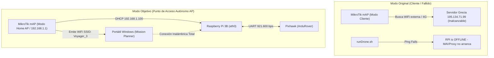

# BITÁCORA DE TRABAJO TÉCNICO — ROVER VOYAGER_3 (FIBLE ALTU)
**Fecha:** 18 de octubre de 2026  
**Entorno de prueba:** Makerspace / Laboratorio  
**Objetivo:** Conexión inicial, auditoría de a bordo, verificación de telemetría, diagnóstico de actuadores/red y planificación de conversión a Punto de Acceso (AP).

---

## 1. RESUMEN EJECUTIVO DE LA JORNADA

Durante la sesión se logró rescatar y enlazar por primera vez el vehículo autónomo **Voyager_3** (Fible ALTU / Consorcio H2020 RAWFIE) tras años de inactividad:
1. **Acceso total a la computadora de misión:** Logramos conectarnos por SSH como superusuario a la Raspberry Pi 3 Model B, tanto por WiFi como por cable Ethernet directo.
2. **Telemetría con el autopiloto validada:** Se estableció el enlace serie MAVLink a **921.600 baudios** con la Pixhawk 1 (PX4v3 corriendo ArduRover V3.4.2), cargando 679 parámetros y transmitiendo telemetría en tiempo real a Mission Planner por UDP 14550.
3. **Identificación de los bloqueos:** Se identificaron con precisión matemática los motivos por los cuales los motores/servos no respondieron a las órdenes de movimiento y por qué la red LAN no se configura automáticamente.
4. **Estrategia de red definitiva acordada:** Conversión del router MikroTik RouterBOARD integrado de modo *Cliente* a **Modo Punto de Acceso (AP)** para dotar al rover de una burbuja WiFi autónoma con DHCP propio.

---

## 2. HITOS TÉCNICOS ALCANZADOS

| Hito | Estado | Detalle Técnico |
| :--- | :--- | :--- |
| **Copia de seguridad física** | **COMPLETADO** | Imagen `sd.img` (31,914,983,424 bytes) extraída y protegida en modo solo lectura en `D:\Voyager\backup_sdbackup\`. |
| **Credenciales del Sistema** | **VALIDADO** | Usuario `pi` / Contraseña `raspberry` (verificado contra hash SHA-512 crypt de `/etc/shadow`). Permisos `sudo` completos. |
| **Enlace WiFi Hotspot** | **LOGRADO** | Conexión a red `DroneLab` (2.4 GHz) obteniendo IP `192.168.137.145`. |
| **Enlace Ethernet Físico** | **LOGRADO** | Conexión cable directo a 100 Mbps. Dirección IPv6 link-local `fe80::ad8c:6f66:3d82:3bb4%15` e IPv4 APIPA `169.254.174.253` (< 1 ms latencia). |
| **Enlace MAVLink / Pixhawk** | **LOGRADO** | MAVProxy comunicando en `/dev/serial0` @ 921.600 bps. Heartbeat de ArduRover V3.4.2, 679 parámetros leídos y guardados en `CONFIGURACION_PARAMETROS_PIXHAWK.parm`. |
| **Interfaz Mission Planner** | **LOGRADO** | Telemetría UDP puerto 14550 recibida en Windows: horizonte artificial, brújula, orientación e interfaz de control activos. |

---

## 3. DIAGNÓSTICO: ¿POR QUÉ NO SE MOVIERON LOS MOTORES Y SERVOS?

A pesar de que el software de control recibió los comandos, las ruedas no respondieron físicamente debido a dos causas concurrentes:

### A. Causas de Software y Lógica del Autopiloto (ArduPilot)
1. **Requisito de Armado Obligatorio (`ARMING_REQUIRE = 1`):**
   * En ArduRover, las salidas PWM hacia el servo de dirección (`MAIN OUT 1`) y hacia el motor (`MAIN OUT 3`) están eléctricamente inhibidas hasta que el autopiloto se encuentra en estado **ARMED**.
   * Al estar desarmado (`DISARMED`), el comando de radio virtual `rc 1 1650` es descartado por el planificador de seguridad.
2. **Bloqueo por Failsafe de Radio (`FS_THR_ENABLE = 1`):**
   * El autopiloto tiene configurada la parada de seguridad si no detecta una señal válida de radiofrecuencia (emisora física RC de 2.4 GHz).
   * Al no estar encendido el transmisor de radiocontrol, ArduRover fuerza el modo **`HOLD`** e impide el armado (provocando el error `COMMAND_ACK {command: 400, result: 4}`).
3. **Incompatibilidad de `DO_SET_SERVO` en Canales Principales:**
   * El intento de forzar el movimiento con `servo set 1 1650` devolvió `COMMAND_ACK {command: 183, result: 4}`.
   * En el código fuente de ArduPilot, `MAV_CMD_DO_SET_SERVO` está restringido a salidas auxiliares (cámaras, relés) y **se rechaza expresamente** en canales asignados a conducción primaria (`k_ground_steering`).

### B. Causa Eléctrica / Alimentación de Potencia del Chasis
* **Telemetría de Batería en Mission Planner:** La pantalla registró **`Bat1 0.00v 0.0 A`**.
* **Arquitectura de Alimentación de Pixhawk:**
  * El conector `POWER` de la Pixhawk y el puerto serie GPIO de la Raspberry Pi alimentan los microcontroladores y la lógica digital.
  * **El rail de servos (`MAIN OUT 1 a 8`) NO recibe corriente de la Raspberry.** Requiere alimentación externa de 5V–6V proporcionada por el variador electrónico (ESC) del coche o por un BEC dedicado.
  * Al marcar 0.00V, la batería de tracción del coche estaba desconectada o el interruptor general del variador (ESC) del chasis estaba apagado, dejando el servo sin energía mecánica para ejercer fuerza.

---

## 4. DIAGNÓSTICO DE LA RED LAN Y SOLUCIÓN DEFINITIVA: MIKROTIK EN MODO AP



### El Diagnóstico de lo Ocurrido:
1. **El bucle de bloqueo de `runDrone.sh`:** Al arrancar busca el router MikroTik (`192.168.1.1 is Active`), pero luego intenta hacer ping a `195.134.71.99` (Grecia). Al no tener salida a internet por módem 4G, aborta con `RPI is OFFLINE` y omite el arranque de MAVProxy.
2. **Ausencia de DHCP por cable directo:** Conectar PC y RPi directamente forzó direcciones APIPA `169.254.x.x`.
3. **Timeout del Hotspot de Windows 11:** El hotspot móvil de Windows se apaga a los 90 segundos por inactividad.

### 4.1. Dilema Arquitectónico para Enjambres (Swarm): Modo Cliente vs. Modo Punto de Acceso (AP)

Surge la cuestión de ingeniería sobre si conviene transformar el router MikroTik de su configuración actual (**Modo Cliente / Station**) a un **Punto de Acceso Autónomo (Modo AP)**, evaluando su impacto en operaciones multi-robot (*swarms*):

```mermaid
flowchart TD
    subgraph "Topología A: Enjambre Nativo (Modo Cliente + Router Base Station)"
        RouterBase["Router Central / Base Station (SSID: DroneLab)"]
        RouterBase <-->|192.168.1.10| R1["Robot 1 (Voyager 3)"]
        RouterBase <-->|192.168.1.11| R2["Robot 2"]
        RouterBase <-->|192.168.1.12| R3["Robot 3"]
        RouterBase <-->|192.168.1.250| GCS["Estación de Tierra (GCS / PC)"]
        R1 <-.->|Descubrimiento DDS / ROS 2 / MAVLink V2V| R2
        R2 <-.->|Comunicación Inter-Robot| R3
    end

    subgraph "Topología B: Robots como AP Individuales (Islas Aisladas)"
        AP1["Robot 1 (AP Propio: Voyager_3)"]
        AP2["Robot 2 (AP Propio: Voyager_4)"]
        PC2["Estación de Tierra"] -.->|Solo puede asociarse a 1 red WiFi| AP1
        AP1 x-.-x|Imposible comunicar V2V (Islas RF)| AP2
    end
```

#### Tabla Comparativa de Pros y Contras:

| Criterio | Modo Actual: Cliente (Station) | Modo Propuesto: Punto de Acceso (AP) |
| :--- | :--- | :--- |
| **Operación en Enjambre (*Swarm*)** | **Excelente / Nativa:** Todos los robots y el PC comparten la misma subred L2/L3 (`192.168.1.0/24`). | **Inviable sin hardware extra:** Cada robot crea una red WiFi independiente; el PC solo puede conectarse a uno a la vez. |
| **Comunicación Robot-a-Robot (V2V)** | **Directa y sin intermediarios:** Tópicos ROS 2 (FastDDS/CycloneDDS multicast), sockets UDP y comandos MAVLink inter-robot fluyen nativamente. | **Bloqueada:** Los robots actúan como emisores aislados y no pueden escucharse entre sí a nivel de enlace de datos. |
| **Control Centralizado Multi-Robot** | **Sí:** Una sola instancia de Mission Planner, QGroundControl o RViz puede monitorizar 5 rovers simultáneamente por sus identificadores de sistema (`SYSID`). | **No:** Obliga a cambiar manualmente de red WiFi en el PC para supervisar cada vehículo individualmente. |
| **Dependencia de Infraestructura** | **Alta:** Requiere que exista un router emitiendo la red (ej. `DroneLab`) o que el portátil active su zona móvil. | **Nula (100% Autónomo):** Enciendes el rover en cualquier entorno y ya dispone de WiFi propia inmediata. |
| **Facilidad en Banco de Pruebas** | Media (sujeto a timeouts del Hotspot de Windows si no hay router físico de pared). | **Máxima:** Conexión directa y desatendida para pruebas con un único vehículo. |
| **Acceso a Internet Exterior** | Sencillo (el router central puede proveer salida para sincronizar NTP o `apt update`). | Nulo (la red AP queda aislada a menos que se use un módem 4G interno con datos). |

#### Recomendaciones de Arquitectura según la Misión:
1. **Para Desarrollo y Pruebas Unitarias (1 solo robot):** El **Modo AP** es el más cómodo y ágil, eliminando cables y problemas de configuración en Windows.
2. **Para Pruebas de Enjambre (*Swarm*) en Laboratorio:** La solución óptima es mantener el **Modo Cliente (Station)** apoyado en un **router de bajo coste dedicado en el maletín** (ej. TP-Link o MikroTik de 20€) emitiendo `DroneLab`.
3. **Para Enjambre en Campo sin Router de Pared (Topología Maestro-Esclavo):**
   * El **Robot 1 (Líder)** se configura como **Punto de Acceso (AP)** emitiendo la red del enjambre (`Swarm_Base`).
   * Los **Robots 2, 3... y la Estación de Tierra** se configuran como **Clientes (Station)** conectándose al Robot 1. Esto permite tener enjambre total sin llevar equipos de red adicionales.

---

### La Solución de Arquitectura: Convertir MikroTik a Modo AP
En lugar de depender de redes exteriores o de la zona móvil del portátil, el **router MikroTik integrado en el propio coche pasará a funcionar como Punto de Acceso (AP)**:
* **Emisión WiFi propia:** El robot emite su propia red inalámbrica (`Voyager_3`).
* **Servidor DHCP activo en el rover:** El MikroTik asigna automáticamente `192.168.1.100` a la Raspberry Pi y `192.168.1.150` al portátil que se conecte por WiFi.
* **Autonomía total:** No requiere cables de red, ni internet, ni hotspots en Windows.
* **Reversibilidad:** El cambio entre modo AP y modo Cliente en RouterOS toma menos de 2 minutos a través de WinBox.

---

## 5. PLAN DE ACCIÓN Y PRÓXIMOS PASOS (NEXT STEPS)


### Fase 1: Conversión del MikroTik a Modo AP (WinBox)
1. Descargar `WinBox64.exe` desde mikrotik.com en el portátil.
2. Conectar cable Ethernet del portátil a un puerto libre del MikroTik.
3. Abrir WinBox, detectar el router por MAC y conectar (`admin` / sin clave o `stavrospapas`).
4. En **Quick Set**:
   * Cambiar a **`Home AP`**.
   * Nombre de red (SSID): **`Voyager_3`**.
   * Seguridad: WPA2, contraseña a elegir.
   * Red local: `192.168.1.1/24` con **DHCP Server habilitado** (`192.168.1.10 - 192.168.1.200`).
   * Aplicar configuración.
5. Conectar el portátil por WiFi a `Voyager_3`.

### Fase 2: Parche del Script de Inicio (`runDrone.sh`)
En la Raspberry Pi, modificar `/home/pi/runDrone.sh`:
* Cambiar `UseMaintenanceIP=1`.
* Establecer `Maintenance_GCS_IP="192.168.1.255"` (broadcast) o la IP del portátil.
* Comentar o puentear la función `CheckInternet` para que `OnlineStatus=1` sea inmediato y MAVProxy arranque solo en cada encendido.

### Fase 3: Alimentación del Chasis y Prueba de Actuadores (Banco Elevado)
1. Conectar la batería principal LiPo del coche.
2. Encender el interruptor general del variador ESC (verificar que en Mission Planner `Bat1` marque $> 7.4\,\text{V}$).
3. Verificar al tacto que el servo de dirección opone resistencia magnética dura (5V en rail de servos).
4. Desactivar en MAVProxy el bloqueo de radiofrecuencia:
   ```text
   param set ARMING_REQUIRE 0
   param set FS_THR_ENABLE 0
   mode MANUAL
   rc 1 1650
   ```
5. Probar giro izquierda (`rc 1 1350`), centro (`rc 1 1500`) y avance suave del motor (`rc 3 1560`).

### Fase 4: Prueba en Suelo con Mando / Teleoperación
1. Bajar el vehículo del soporte al suelo del makerspace.
2. Enlazar un mando USB/Bluetooth en Mission Planner (sección `Joystick`) o mediante teclado para teleoperar dirección y tracción de forma inalámbrica vía WiFi del MikroTik.

### Fase 5: Migración a ROS 2 y Mapeo SLAM
1. Conservar la microSD actual intacta como backup histórico.
2. Flashear en una nueva microSD: **Ubuntu Server 22.04 LTS (64-bit `arm64`)** + **ROS 2 Humble**.
3. Instalar **MAVROS 2** en `/dev/ttyAMA0` a 921.600 bps para teleoperación por `/cmd_vel`.
4. Conectar el LiDAR LightWare SF40 para generar el tópico `/scan` y desplegar **Nav2 / Slam Toolbox** para navegación y mapeo autónomo.
