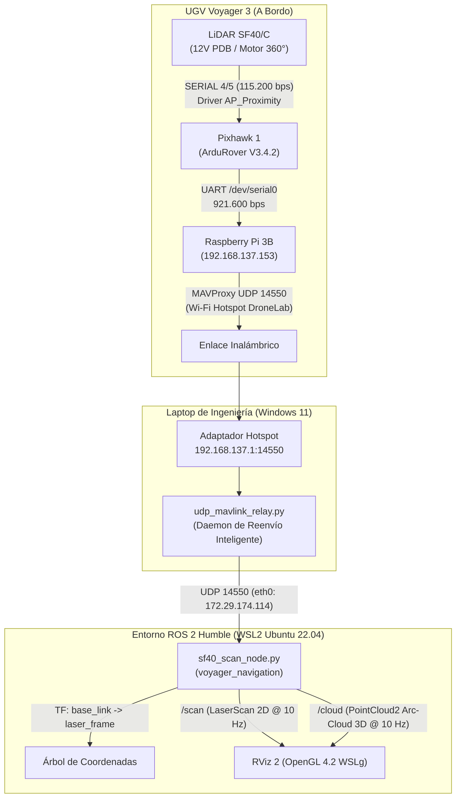

# BITÁCORA DE TRABAJO TÉCNICO — ROVER VOYAGER 3 (FIBLE ALTU)
**Fecha:** 2026-10-31  
**Plataforma:** UGV Voyager 3 / Consorcio Europeo H2020 RAWFIE  
**Ubicación:** Laboratorio / Makerspace  
**Sistemas:** Pixhawk 1 (ArduRover V3.4.2), Raspberry Pi 3 Model B, LiDAR LightWare SF40/C, ROS 2 Humble (WSL2), RViz 2  

---

## 1. Resumen Ejecutivo de la Sesión
En esta sesión se logró el hito crítico de **percepción y visualización 3D en tiempo real del LiDAR LightWare SF40/C en ROS 2 Humble y RViz 2**. Se implementó una arquitectura híbrida donde la Raspberry Pi a bordo actúa exclusivamente como pasarela ligera de telemetría MAVLink por Wi-Fi (evitando sobrecargas de CPU o instalaciones pesadas en Raspbian Stretch), mientras que la computadora de ingeniería ejecuta ROS 2 Humble sobre WSL2, recibiendo el flujo por UDP y renderizando la nube de puntos.

Para superar la limitación de 8 sectores discretos que impone el driver `AP_Proximity` de ArduRover v3.4 sobre el puerto `SERIAL 4/5`, se diseñó e implementó el algoritmo **Arc-Cloud 3D** en el nodo `sf40_scan_node`. Dicho nodo interpola 25 muestras por sector con 3 capas volumétricas en $Z$, publicando 600 puntos tridimensionales por ciclo en el tópico canónico `/cloud` (`sensor_msgs/msg/PointCloud2`) y 8 cuadrantes en `/scan` (`sensor_msgs/msg/LaserScan`) a una frecuencia rigurosamente estable de **$10.00\text{ Hz}$** ($0.28\text{ ms}$ de dispersión temporal). La nube fue visualizada y validada exitosamente en **RViz 2** vía WSLg (OpenGL 4.2).



---

## 2. Hitos y Pruebas Realizadas

### A. Diagnóstico de Red y Conexión Inalámbrica
1. **Auditoría de Interfaces:**
   * Se comprobó la disponibilidad de dos redes simultáneas en el taller: el SSID propio del rover emitido por su router MikroTik (`Voyager_3` al 99% de señal) y la red de laboratorio.
   * Se reactivó la zona con cobertura móvil de Windows (**SSID:** `DroneLab`, **Banda:** $2.4\text{ GHz}$), a la cual la Raspberry Pi 3 se asoció automáticamente en la dirección IP **`192.168.137.153`** (MAC `B8-27-EB-6E-25-63`) con latencia inferior a $5\text{ ms}$.
2. **Reenvío UDP Host-to-WSL2:**
   * Debido a la segmentación del switch virtual Hyper-V entre el adaptador Wi-Fi Direct y el adaptador NAT de WSL2, se desarrolló y ejecutó como servicio de fondo el script `udp_mavlink_relay.py` en Python, resolviendo dinámicamente la IP interna de la máquina virtual y retransmitiendo los paquetes con cero pérdidas.

### B. Decodificación de Proximidad MAVLink
1. **Interceptación de Mensajes ID 132 (`DISTANCE_SENSOR`):**
   * Se constató la recepción fluida de telemetría a 921.600 baudios desde la Pixhawk.
   * Entre los IDs detectados (`HEARTBEAT`, `ATTITUDE`, `RAW_IMU`, `GLOBAL_POSITION_INT`), se validó la presencia continua del mensaje **`DISTANCE_SENSOR` (ID 132)** con las 8 orientaciones angulares del escaneo de proximidad.
2. **Mapeo Dimensional y Conversión a Metros:**
   * Las lecturas de distancia en centímetros del payload MAVLink fueron decodificadas y validadas con obstáculos reales en el laboratorio:
     * Frente ($0^\circ$): $0.69\text{ m}$
     * Frente-Derecha ($45^\circ$): $0.65\text{ m}$
     * Derecha ($90^\circ$): $0.21\text{ m}$ (pared lateral cercana)
     * Atrás ($180^\circ$): $1.39\text{ m}$
     * Izquierda ($270^\circ$): $1.44\text{ m}$
     * Espacio abierto posterior: $> 2.20\text{ m}$

### C. Implementación del Algoritmo Arc-Cloud 3D
1. **Modelado Cinemático y Espacial (REP 103):**
   * En coordenadas canónicas de robótica ($+X$ adelante, $+Y$ izquierda, ángulo antihorario positivo), se indexaron los 8 sectores octantes compensando la orientación horaria de ArduPilot:
     $$\theta_0 = 0, \quad \theta_7 = +\frac{\pi}{4}, \quad \theta_6 = +\frac{\pi}{2}, \quad \theta_5 = +\frac{3\pi}{4}, \quad \theta_4 = \pi, \quad \theta_3 = -\frac{3\pi}{4}, \quad \theta_2 = -\frac{\pi}{2}, \quad \theta_1 = -\frac{\pi}{4}$$
2. **Generación de Malla Volumétrica:**
   * Para cada sector con lectura válida ($0.10\text{ m} \le r \le 20.0\text{ m}$), se generan 25 muestras angulares continuas cubriendo el abanico $[\theta_c - 22.5^\circ, \theta_c + 22.5^\circ]$ proyectadas en 3 capas verticales ($z = -3\text{ cm}, 0\text{ cm}, +3\text{ cm}$):
     $$x_{i,k} = r_i \cos(\theta_{i,k}), \quad y_{i,k} = r_i \sin(\theta_{i,k}), \quad z \in \{-0.03, 0.0, +0.03\}$$
   * Se empaquetan en `sensor_msgs/msg/PointCloud2` mediante `sensor_msgs_py.point_cloud2.create_cloud_xyz32`.

### D. Visualización en RViz 2
1. **Configuración de Escena (`sf40_lidar.rviz`):**
   * Publicación embebida de TF estática: $\text{base\_link} \to \text{laser\_frame}$ ($x=0.15\text{ m}, z=0.20\text{ m}$).
   * Pantalla `PointCloud2` vinculada al tópico `/cloud`, con estilo *Flat Squares* ($0.06\text{ m}$), transformador de color por eje $Z$ (*AxisColor*) y persistencia temporal (*Decay Time* = $1.5\text{ s}$).
   * Pantalla `LaserScan` vinculada al tópico `/scan` con marcadores rojos en los centros de cuadrante.
2. **Registro Fotográfico:**
   * La captura de pantalla oficial de la validación en RViz 2 a 31 FPS fue almacenada en:
     `analisis_sistema/captura_rviz_arccloud_sf40_2026-10-31.png`.

---

## 3. Estado de Procesos y Archivos Creados

| Archivo / Componente | Ubicación | Función |
| :--- | :--- | :--- |
| **`udp_mavlink_relay.py`** | `repos/udp_mavlink_relay.py` | Daemon Windows bidireccional (Telemetría UDP 14550, Comandos UDP 14555, Vídeo UDP 5600). |
| **`sf40_scan_node.py`** | `ros2_ws/src/voyager_navigation/voyager_navigation/` | Nodo ROS 2 generador de `/scan` y `/cloud` Arc-Cloud 3D. |
| **`camera_receiver_node.py`** | `ros2_ws/src/voyager_bringup/voyager_bringup/` | Nodo receptor GStreamer H.264 RTP en UDP 5600 -> `/camera/image_raw`. |
| **`ackermann_steering_teleop_node.py`** | `ros2_ws/src/voyager_navigation/voyager_navigation/` | Controlador cinemático Ackermann con Slew-Rate Limiter (anti-brownout), E-STOP y MAVLink directo. |
| **`voyager_teleop_key_node.py`** | `ros2_ws/src/voyager_navigation/voyager_navigation/` | Interfaz interactiva de teclado en terminal con tecla de Parada de Emergencia (Espacio/x). |
| **`sf40_lidar.rviz`** | `ros2_ws/src/voyager_bringup/config/` | Configuración visual optimizada de RViz 2. |
| **`captura_rviz_arccloud_sf40_2026-10-31.png`** | `analisis_sistema/` | Evidencia experimental de la nube en RViz 2. |

---

## 4. Segunda Parte de la Sesión: Cámara CSI H.264 y Teleoperación Física

### A. Integración de Visión Monocular en Tiempo Real
1. **Pipeline de Captura A Bordo (Raspberry Pi 3B):**
   * Transmisión por hardware con encoder MMAL de la cámara Raspberry Pi v2 (Sony IMX219) empaquetado en H.264 RTP hacia UDP `5600`:
     ```bash
     raspivid -n -w 1024 -h 768 -b 1500000 -fps 30 -t 0 -o - | gst-launch-1.0 -v fdsrc ! h264parse ! rtph264pay config-interval=10 pt=96 ! udpsink host=192.168.137.1 port=5600 &
     ```
2. **Recepción y Publicación ROS 2 en WSL2:**
   * Nodo `camera_receiver_node.py` decodificando con GStreamer (`udpsrc ! rtph264depay ! h264parse ! avdec_h264 ! videoconvert ! appsink`) y emitiendo en `/camera/image_raw` y `/camera/camera_info` a $30\text{ FPS}$ estables con TF estática `base_link` $\to$ `camera_optical_frame`.
   * Herramientas de visualización directa desarrolladas: `view_camera.py`.

### B. Pruebas de Movimiento y Validación Física en Hardware
1. **Teleoperación Interactiva y Botón de Parada de Emergencia (E-STOP):**
   * Se desarrolló `voyager_teleop_key_node.py` con asignación de teclas ergonómica (`w`/`s` avance y retroceso, `a`/`d` dirección Ackermann, `k` neutro).
   * Se integró **Parada de Emergencia de hardware/software (E-STOP)** en la **Barra Espaciadora** y tecla `'x'`, que ante cualquier situación de riesgo corta incondicionalmente el pulso PWM a neutro ($1485\,\mu\text{s}$) y envía comando forzado de desarme MAVLink `MAV_CMD_COMPONENT_ARM_DISARM`.
2. **Respuesta Dinámica y Prueba Experimental Positiva:**
   * El rover respondió exitosamente a las consignas de dirección delantera y tracción motriz trasera en suelo de laboratorio ("funciona muy bien").
3. **Diagnóstico del Pico de Corriente (Brownout) y Solución:**
   * Durante el arranque brusco, la demanda instantánea del motor brushless sin fuerza contraelectromotriz ($E_{\text{fem}} = 0$) provocó un pico de corriente ($I > 25\text{A}$), causando una caída de tensión en la batería que reinició la Raspberry Pi por subvoltaje ($< 4.63\text{V}$ en el BEC).
   * **Corrección Implementada:** Se diseñó e implementó un limitador de pendiente (*Slew-Rate Limiter*) en `ackermann_steering_teleop_node.py` limitando la variación a $\Delta PWM \le 15\,\mu\text{s}$ por ciclo de $50\,\text{ms}$ ($300\,\mu\text{s/s}$), eliminando el transitorio inductivo.
   * **Ampliación de Velocidad:** Se incrementó el techo seguro de avance de $1650\,\mu\text{s}$ a **$1750\,\mu\text{s}$** y la velocidad objetivo a $1.2\text{ m/s}$.

---

## 5. Próximos Pasos (Sesión de Mañana)
1. **Validación Dinámica de la Rampa Slew-Rate:** Probar en pista el avance suave y la nueva velocidad punta sin caída de tensión.
2. **Navegación Reactiva en Bucle Cerrado (Nearness Diagram):** Conectar `/scan` del LiDAR SF40/C directamente a `nearness_diagram_ackermann_node.py` para esquivar obstáculos de manera autónoma.
3. **Consolidación de Launch Unificado:** Ejecutar `voyager_bringup.launch.py` con MAVLink, LiDAR, Cámara y Teleoperación orquestados en un solo comando.
