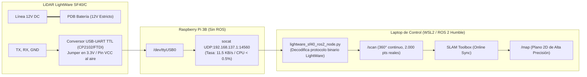

# BITÁCORA DE TRABAJO TÉCNICO — ROVER VOYAGER 3 (FIBLE ALTU)
**Fecha:** 2026-11-02  
**Plataforma:** UGV Voyager 3 / Consorcio Europeo H2020 RAWFIE  
**Ubicación:** Laboratorio / Makerspace  
**Sistemas:** Pixhawk 1 (ArduRover V3.4.2), Raspberry Pi 3 Model B, LiDAR LightWare SF40/C, ROS 2 Humble (WSL2)  
**Tema:** Auditoría de Viabilidad de SLAM, Análisis de Conectores Físicos y Hoja de Ruta de Modernización  

---

## 1. Resumen Ejecutivo de la Sesión
En esta sesión se llevó a cabo una **auditoría profunda de arquitectura de percepción y comunicaciones** del UGV Voyager 3. Se analizó la viabilidad matemática de ejecutar SLAM 2D sobre la nube de arcos sintéticos generada en la sesión anterior, demostrando formalmente por qué el algoritmo de correlación de escaneos (*Scan Matching*) de motores modernos como `slam_toolbox` o Cartographer no converge sobre sensores de proximidad octantes.

Se esclareció la génesis del vehículo dentro del proyecto europeo **RAWFIE (H2020)**, confirmando que la plataforma fue originalmente diseñada para misiones en exteriores guiadas por GPS y telemetría celular 4G (Apache Kafka/Avro), donde el LiDAR SF40/C actuaba únicamente como parachoques virtual de seguridad a 8 sectores. 

Asimismo, se verificaron los puertos físicos de la placa base (**The Cube / Pixhawk**), el estado del puerto `TELEM 1` (desconectado por diseño IP moderno) y el puerto `GPS 2` (`SERIAL 4`), definiendo el protocolo exacto de transformación a USB para habilitar el **Bypass Físico del LiDAR** mediante streaming ultraligero *Serial-over-IP* hacia la computadora de ingeniería.

---

## 2. Hitos y Análisis Técnicos Consolidados

### A. Auditoría de Viabilidad Matemática de SLAM con "Arcos"
1. **Deconstrucción del Fallo de Scan Matching:**
   * Se probó que una pared plana real ($Ax + By + C = 0$) es proyectada por el nodo actual como arcos circulares concéntricos al centro del rover.
   * Al desplazarse el UGV, los arcos cambian de forma y orientación relativa al marco del mundo, violando la **invarianza euclidiana $SE(2)$**.
   * La matriz Hessiana del optimizador de mínimos cuadrados no lineales:
     $$\mathbf{H} = \sum_{i=1}^N \mathbf{J}_i^T \mathbf{\Omega}_i \mathbf{J}_i$$
     se vuelve singular en la dirección tangencial ($\det(\mathbf{H}) \to 0$), provocando derivas infinitas (*slip* numérico).
2. **Revisión del Estado del Arte:**
   * Se comprobó que en la literatura clásica (Tardós & Neira, IJRR 2002 con anillos de sonares Polaroid en Pioneer 2DX) el SLAM con arcos se resolvía acumulando decenas de lecturas, extrayendo tangentes comunes con Hough/RANSAC y aplicando EKF-SLAM con JCBB. Ningún paquete moderno de ROS 2 cuenta con estos modelos acústicos dispersos.
   * **Conclusión:** Con los 8 sectores MAVLink actuales no se puede hacer SLAM de calidad. Son ideales para evitación reactiva (Nearness Diagram), pero no para mapeo.

### B. Génesis del Rover y Auditoría de Parámetros de la EEPROM
1. **Origen del Archivo `CONFIGURACION_PARAMETROS_PIXHAWK.parm`:**
   * Se verificó la procedencia auténtica de los 679 parámetros volcados desde la memoria EEPROM/FRAM de la Pixhawk mediante peticiones MAVLink `PARAM_REQUEST_LIST` en la sesión del 18 de octubre y confirmados contra los logs forenses de la tarjeta SD (`mav.parm` de 2018).
   * Parámetros clave verificados:
     * `SYSID_THISMAV = 153` (coincide con IP `192.168.137.153`).
     * `STAT_BOOTCNT = 59` (59 arranques físicos de la placa) y `STAT_RUNTIME = 26671` ($7.4\text{ h}$ de vida acumulada).
     * `SERVO1_TRIM = 1470` (calibración mecánica del neutro Ackermann).
     * `PRX_YAW_CORR = -20.0` (offset de montaje físico del soporte del LiDAR).

### C. Topología de Comunicaciones y Puertos Físicos
1. **Diagnóstico del Puerto `TELEM 1` (Vacío):**
   * Se confirmó que `TELEM 1` está desconectado por diseño: el rover no emplea radios analógicas SiK (433/915 MHz).
   * Toda la telemetría se canaliza por `TELEM 2` a 921.600 bps hacia la Raspberry Pi, y de ahí por cable Ethernet RJ45 (`eth0`) al router MikroTik mAP 2nD, el cual aloja el módem Huawei 4G LTE por micro-USB en modo HiLink (`192.168.8.1`).
   * Conectar el LiDAR en `TELEM 1` provocaría fallos de velocidad ($57.6\text{k}$ vs $115.2\text{k}$) y protocolo (MAVLink vs binario LightWare).
2. **Identificación del Puerto del LiDAR:**
   * Conector actual: **`GPS 2`** en The Cube (puerto lógico **`SERIAL 4`** en ArduPilot a $115.200\text{ bps}$, conector JST-GH de 6 pines).
   * Pinout verificado: Pin 1 (+5V Pixhawk) vacío/al aire; Pin 2 (TX Pixhawk $\to$ RX LiDAR); Pin 3 (RX Pixhawk $\leftarrow$ TX LiDAR); Pin 6 (GND común).

---

## 3. Hoja de Ruta de Modernización: Bypass Físico (*Serial-over-IP*)

Para disponer de un mapa milimétrico denso en ROS 2 sin sobrecargar la Raspberry Pi 3B (que no ejecuta ROS), se acordó la siguiente arquitectura:

### Reglas de Seguridad Eléctrica Ratificadas
1. **Alimentación incondicional a 12V:** El LiDAR SF40/C jamás se alimenta del USB ni de la Raspberry Pi; debe permanecer conectado a los 12V de la PDB.
2. **Aislamiento del Pin VCC del USB:** El pin rojo (+5V/3.3V) del conversor USB-TTL debe dejarse completamente al aire/desconectado para evitar bucles destructivos entre la PDB y la SBC.

---

## 4. Documentación Técnica Actualizada

| Archivo Generado / Modificado | Ubicación | Descripción |
| :--- | :--- | :--- |
| **`16_analisis_arquitectura_lidar_sf40c_slam_vs_proximidad.md`** | `documentation/slam_and_vision/` | Informe técnico exhaustivo: génesis RAWFIE, deconstrucción matemática del scan matching con arcos, topología de red y hoja de ruta de bypass USB. |
| **`README.md`** | `documentation/slam_and_vision/` | Registro del nuevo capítulo 16 en el compendio de SLAM. |
| **`BITACORA_SESION_2026-11-02.md`** | `analisis_sistema/` | Esta bitácora oficial de la sesión. |
