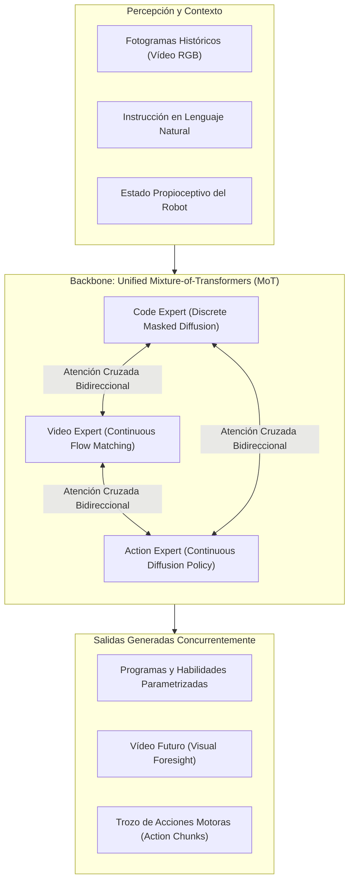

# Evaluación Técnica y Ficha de Referencia: Agentic World Action Models (AW-0)
**Documento Técnico:** `EVALUACION_TECNICA_AGENTIC_WAM_AW0.md`  
**Fecha de Análisis:** 2026-10-28  
**Plataforma de Referencia:** UGV Voyager 3 (Fible ALTU - RAWFIE / Pixhawk 1 + Raspberry Pi 3B + LiDAR LightWare SF40/C)  
**Marco Metodológico:** Protocolo Feynman de Verificación & Filosofía Ponytail++  

---

## 📌 1. Ficha Bibliográfica y Enlaces de Referencia

* **Título:** *Agentic World Action Models* (Framework AW-0)
* **Autores:** Zhuoyang Liu, Dantong Niu, Botong Zhang, Boning Shao, Jing Wang, Ruijie Zheng, Yuvan Sharma, Runyu Lu, Jiaming Liu, Renrui Zhang, Roei Herzig, Yutong Bai, Ken Goldberg, Danfei Xu, Yuke Zhu, Guanzhi Wang, Linxi "Jim" Fan, Trevor Darrell.
* **Afiliaciones:** UC Berkeley, NVIDIA, University of Pennsylvania.
* **Identificador arXiv:** [arXiv:2610.30136 [cs.RO]](https://arxiv.org/abs/2610.30136) (Versión 1 publicada el 21 de octubre de 2026).
* **Página Oficial del Proyecto:** [https://agentic-wam.github.io/](https://agentic-wam.github.io/)
* **Repositorio de Código:** [https://github.com/ZhuoyangLiu2005/agentic-wam](https://github.com/ZhuoyangLiu2005/agentic-wam)
* **Registro en Workspace:** Indexado en [`analisis_sistema/candidate_papers.json`](file:///d:/Voyager/analisis_sistema/candidate_papers.json) y volcado en [`analisis_sistema/all_papers_dump.txt`](file:///d:/Voyager/analisis_sistema/all_papers_dump.txt).

---

## 🔬 2. Deconstrucción Técnica de Agentic WAM (AW-0)

Los modelos de acción de mundo tradicionales (*World Action Models - WAMs*) generan predicciones visuales a futuro (*visual foresight*) para control robótico pero carecen de estructuras formales para la reutilización composicional de habilidades. A su vez, los sistemas agenticos de robótica basados en generación de código (*Code-as-Policies*) razonan simbólicamente pero carecen de grounding predictivo en la dinámica física de bajo nivel.

**AW-0** unifica ambos mundos mediante una arquitectura **Mixture-of-Transformers (MoT)** que acopla y desruida concurrentemente tres flujos generativos:

### Características Metodológicas Clave
1. **Rol Dual del Código:**
   * *Estructural:* El código generado actúa como scaffolding predictivo para condicionar el modelo de mundo en predicciones multi-paso.
   * *Operacional:* Representa programas ejecutables directamente reutilizables en bucles agenticos.
2. **Desruidado Concurrente en un Solo Paso Temporal:**
   * A diferencia de los modelos autorregresivos token a token (lentos e iterativos), AW-0 desruida simultáneamente código, vídeo y acciones mediante difusión y *flow matching*, alcanzando velocidades de inferencia reportadas de $\approx 0.23\text{ s}$ por paso en hardware de vanguardia (NVIDIA RTX 5090).
3. **Pipeline de Curación Automática de Habilidades:**
   * Utiliza modelos de frontera (VLMs como Gemini/Claude) para reetiquetar miles de horas de vídeo humano y trayectorias robóticas, abstrayendo rutinas recurrentes en una biblioteca congelada de habilidades.

---

## 🚜 3. Análisis de Factibilidad y Limitaciones en el UGV Voyager 3

Bajo el **Protocolo Feynman de Verificación** y las restricciones físicas del vehículo, se evalúa la viabilidad técnica de desplegar AW-0 en el estado actual del proyecto:

### A. Restricción Computacional y de Memoria (Inviabilidad On-Board)
* **Requisito AW-0:** La ejecución concurrente de difusión para vídeo, código y políticas de acción requiere una GPU con aceleración por hardware de tensores (*Tensor Cores*), alto ancho de banda de memoria y un piso estimado de **16 a 24 GB de VRAM** (demostrado en NVIDIA RTX 4090 / RTX 5090).
* **Hardware de Misión de Voyager 3:**
  * **Raspberry Pi 3 Model B:** CPU 4x ARM Cortex-A53 a 1.2 GHz, memoria unificada de **1 GB LPDDR2**, sin soporte para cálculo acelerado por GPU (VideoCore IV sin CUDA/ROCm).
  * **Autopiloto Pixhawk 1:** Microcontrolador STM32F427 a 168 MHz con 256 KB de RAM, dedicado estrictamente al firmware en tiempo real duro **ArduRover v3.4.2**.
* **Diagnóstico:** El intento de compilar o cargar un Mixture-of-Transformers generativo a bordo de la Raspberry Pi 3 activará el *OOM Killer* de Linux de manera instantánea ($1\text{ GB RAM} \ll \text{Memoria mínima requerida}$).

### B. Incompatibilidad de Modalidad Sensorial
* **Entrada de AW-0:** Flujo continuo de vídeo RGB denso a 30 FPS enfocado en la manipulación de objetos y contactos físicos.
* **Percepción de Voyager 3:** Sensor principal **LiDAR rotativo 360° LightWare SF40/C** (alimentado rigurosamente a 12V DC desde la PDB, comunicando distancias polares $(r, \theta)$ a través de UART serie a 115.200 bps) + IMU + GPS U-blox Neo-M8N. AW-0 carece de encoders nativos para nubes de puntos 2D/3D o barridos LiDAR polares.

### C. Discrepancia Cinemática y Dinámica
* **Dominio de AW-0:** Manipulación bimanual de alta dimensionalidad (brazos robóticos con 7 DoF por brazo + pinzas paralelas o manos diestras en bancos de trabajo como *RoboTwin 2.0*).
* **Cinemática de Voyager 3:** Vehículo terrestre no holónomo con tracción trasera y dirección delantera tipo **Ackermann**:

$$\dot{x} = v \cos(\theta), \quad \dot{y} = v \sin(\theta), \quad \dot{\theta} = \frac{v}{L} \tan(\delta)$$

$$\kappa = \frac{\tan(\delta)}{L}, \quad R = \frac{1}{\kappa + \text{sign}(\kappa) \cdot \epsilon}$$

donde:
* $L$ es la batalla entre ejes (wheelbase).
* $\delta \in [-\delta_{\max}, \delta_{\max}]$ es el ángulo de orientación de las ruedas directrices delanteras (acotado físicamente a $\pm 25^\circ \approx \pm 0.436\text{ rad}$).
* $\kappa$ es la curvatura y $R$ es el radio instantáneo de giro.
* $\epsilon = 10^{-7}$ es la guarda numérica contra singularidades cuando $\delta \to 0$.

AW-0 no modela restricciones cinemáticas de curvatura mínima, deslizamiento transversal de neumáticos ni dinámicas de frenado en terreno no estructurado.

### D. Análisis del Watchdog y Latencia en Modo Remoto (Offloaded GCS)
Si se evaluara transmitir el vídeo de la cámara CSI de la Raspberry Pi a una estación de tierra equipada con GPU de alta gama mediante Wi-Fi o 4G LTE Huawei HiLink:

$$T_{\text{bucle}} = T_{\text{captura+H264}} + T_{\text{subida}} + T_{\text{inferencia AW-0}} + T_{\text{bajada}} + T_{\text{actuación}}$$

$$T_{\text{bucle}} \approx 60\text{ ms} + 40\text{ ms} + 230\text{ ms} + 20\text{ ms} + 10\text{ ms} = \mathbf{360\text{ ms}}$$

> [!CAUTION] Ruptura del Watchdog de Seguridad Crítica
> De acuerdo con las normas de seguridad del workspace ([`AGENTS.md`](file:///d:/Voyager/AGENTS.md)), **si el comando en `/cmd_vel` cesa durante más de $300\text{ ms}$, la velocidad del rover debe caer inmediatamente a cero ($v = 0$)**. Con una latencia total de $360\text{ ms}$, el vehículo entraría en ciclos continuos de paro de emergencia y tirones bruscos.

---

## 💡 4. Estrategia de Adopción e Integración Futura (Ponytail++)

Aunque la arquitectura completa de AW-0 no es ejecutable a bordo, los conceptos arquitectónicos de **agentes basados en código** y **abstracción jerárquica** son altamente aprovechables para la evolución del UGV Voyager 3:

```mermaid
flowchart LR
    subgraph CapaCognitiva ["Capa Cognitiva y Deliberativa (Estación de Tierra / Cloud / GPU)"]
        User["Instrucción Operador / Misión"] --> Agent["Agente Cognitivo (LLM / VLM)"]
        Agent -->|"Sintetiza scripts ROS 2 / MAVLink"| PlanCode["Código de Misión Parametrizado"]
    end

    subgraph CapaEjecucion ["Capa de Ejecución y Evasión Reactiva (A bordo de Voyager 3: RPi 3B)"]
        PlanCode -->|"Enlace MAVLink UDP 14550 / ROS 2"| ROS2["Stack ROS 2 (voyager_bringup)"]
        LiDAR_In["LiDAR SF40/C (12V)"] --> ND["Nearness Diagram (ND) Ackermann"]
        ROS2 --> ND
        ND -->|"Cálculo determinista (<15 ms)"| Cmd["/cmd_vel & /cmd_ackermann"]
    end

    subgraph CapaFisica ["Capa de Actuación en Tiempo Real Duro (Pixhawk 1)"]
        Cmd -->|"UART /dev/serial0 (921.600 bps)"| Pix["Pixhawk 1 (ArduRover v3.4.2)"]
        Pix --> Act1["MAIN OUT 1: Servo Dirección"]
        Pix --> Act3["MAIN OUT 3: ESC Tracción"]
    end
```

### Principios Asimilados para el Proyecto
1. **Generación de Código como Políticas de Misión (Code-as-Policies):**
   * En lugar de que un modelo de deep learning controle directamente el PWM del servo de dirección, los modelos agenticos se utilizarán en la GCS para compilar planes de alto nivel (rutas de waypoints, barridos geográficos o transiciones de estado MAVLink).
2. **Invarianza del Bucle Reactivo Local:**
   * La seguridad física y la evasión de colisiones local permanecen gobernadas por el nodo determinista de **Nearness Diagram (ND) adaptado a Ackermann** ([`nearness_diagram_ackermann_node.py`](file:///d:/Voyager/ros2_ws/src/voyager_navigation/voyager_navigation/nearness_diagram_ackermann_node.py)), garantizando tiempos de respuesta $< 15\text{ ms}$ sin consumo intensivo de memoria.

---

## 🔮 5. Requisitos para una Futura Experimentación en Fases Avanzadas

Si en fases futuras (e.g. Fase 5+) se considerara la integración de World Action Models para navegación autónoma (*Visual WAMs for Mobile Navigation*), se requeriría la siguiente actualización de hardware:

| Subsistema | Configuración Actual (Voyager 3) | Requisito Mínimo para Modelos WAM |
| :--- | :--- | :--- |
| **Computadora de Misión** | Raspberry Pi 3B (1 GB RAM, 0 TFLOPS Tensor) | NVIDIA Jetson Orin Nano (8 GB) o AGX Orin (32/64 GB) |
| **Sensor de Visión** | Pi Camera v2 (CSI, streaming básico H.264) | Cámara Estéreo RGB-D activa (e.g., Intel RealSense D435i / OAK-D-Pro) |
| **Dataset de Dominio** | Parámetros odometría y telemetría MAVLink | Dataset de conducción terrestre todoterreno con dinámica Ackermann |
| **Control Local** | Nearness Diagram geométrico determinista | Política de acción híbrida (WAM visual + filtro de barrera CBF para Ackermann) |

---

## 📑 6. Conclusión y Registro de Estado

* **Veredicto:** **Inviable para ejecución on-board en el hardware actual.** Muy prometedor como concepto de arquitectura deliberativa jerárquica para la estación de control.
* **Acción Tomada:** Registro bibliográfico formal en [`analisis_sistema/candidate_papers.json`](file:///d:/Voyager/analisis_sistema/candidate_papers.json), incorporación al resumen de literatura científica [`analisis_sistema/all_papers_dump.txt`](file:///d:/Voyager/analisis_sistema/all_papers_dump.txt) y anotación en el backlog tecnológico de [`ROADMAP.md`](file:///d:/Voyager/ROADMAP.md).
