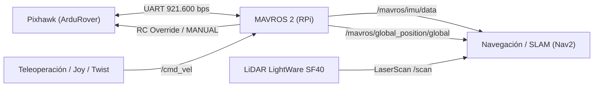

# PLAN DE MIGRACIÓN Y CONTROL DEL ROVER VOYAGER_3 (ROS 2 & SIMULACIÓN)

**Fecha:** Octubre 2026  
**Vehículo:** Fible ALTU / Voyager_3  
**Chasis:** Rover Ackermann (1/10 RC modificado)  
**Estado:** Backup completado (`sd.img` 31.9 GB), enlace Pixhawk validado a 921.600 bps.

---

## 1. INVENTARIO COMPLETO DEL HARDWARE IDENTIFICADO

| Subsistema | Componente Físico | Conexión / Puerto | Especificaciones Clave |
| :--- | :--- | :--- | :--- |
| **Companion Computer** | Raspberry Pi 3 Model B | Alimentación 5V BEC | CPU Cortex-A53 quad-core 1.2 GHz, 1 GB LPDDR2, WiFi 2.4 GHz, Ethernet 100M. |
| **Autopiloto** | Pixhawk 1 (PX4v3) | `TELEM 2` $\to$ RPi `/dev/serial0` | STM32F427 @ 168 MHz, 2MB Flash, NuttX OS, ArduRover V3.4.2. Enlace serie a **921.600 baudios**. |
| **Sensor LiDAR** | LightWare SF40/C 360° | Pixhawk `SERIAL 4/5` | Telémetro láser rotatorio 360°, alcance hasta 100 m, UART @ 115.200 bps. Parámetros: `AVOID_ENABLE=3`. |
| **Navegación / GNSS** | U-blox Neo-M8N + Brújula | Pixhawk `SERIAL 3` + I2C | GPS/GLONASS concurrente, brújula digital HMC5883L/LSM303D externa sobre mástil elevado. |
| **Actuador Dirección** | Servo digital RC | Pixhawk `MAIN OUT 1` | Cinemática Ackermann. `SERVO1_FUNCTION=26` (GroundSteering), Trim: 1470 $\mu$s, Min: 1100, Max: 1900. |
| **Actuador Tracción** | Variador electrónico (ESC) + Motor DC/Brushless | Pixhawk `MAIN OUT 3` | `SERVO3_FUNCTION=70` (Throttle), Min: 900, Max: 2000, Trim: 1300 $\mu$s. |
| **Cámara** | Raspberry Pi Camera v2 | Conector CSI de cinta | Sensor Sony IMX219 (8 MP), GStreamer H.264 RTP stream por UDP 5600. |
| **Comunicaciones Legacy** | Router MikroTik mAP + Módem 4G Huawei | `eth0` (192.168.1.1) + USB (192.168.8.1) | Módulos del proyecto RAWFIE (opcionales para operación en laboratorio/taller). |

---

## 2. DIAGNÓSTICO DEL SISTEMA OPERATIVO ACTUAL

* **OS:** Raspbian GNU/Linux 9.4 (Stretch).
* **Kernel:** Linux 4.14.34-v7+ (32-bit `armv7l`).
* **Python:** 2.7.13 (Python 3.5.3 legado).
* **Stack de Control Legacy:** MAVProxy multiplexando a puerto UDP 1234 (`DroneKit`) y demonio `adapter-rover` publicando telemetría Apache Avro hacia Kafka remoto en Grecia (`172.19.0.18:9092`).
* **Limitación Crítica:** Raspbian Stretch es un sistema operativo descatalogado (End-of-Life). **No admite ROS 2 nativo** (ROS 2 Humble / Iron requiere arquitectura de 64 bits `aarch64` y Ubuntu 22.04 LTS).

---

## 3. HOJA DE RUTA PARA INTEGRACIÓN DE ROS 2 (MÉTODO RECOMENDADO)

### Fase A: Independencia de Tarjeta SD
1. Mantener la tarjeta SD actual como reliquia / backup histórico (está clonada de forma idéntica en `D:\Voyager\backup_sdbackup\sd.img`).
2. Utilizar una **nueva tarjeta microSD de 32 o 64 GB** (Clase 10 / U3).

### Fase B: Instalación del Stack Moderno
1. Flashear **Ubuntu Server 22.04.4 LTS (64-bit `arm64`)** para Raspberry Pi.
2. Instalar **ROS 2 Humble Hawksbill**.
3. Instalar **MAVROS 2**:
   ```bash
   sudo apt install ros-humble-mavros ros-humble-mavros-msgs
   ```
4. Configurar el puerto UART `/dev/ttyAMA0` (GPIO 14/15) a 921.600 baudios en `/boot/firmware/config.txt`.
5. Lanzar el nodo de enlace:
   ```bash
   ros2 launch mavros apm.launch fcu_url:=serial:///dev/ttyAMA0:921600
   ```

### Fase C: Arquitectura de Tópicos y Control en ROS 2



1. **Lectura de Sensores:** MAVROS publica automáticamente:
   * `/mavros/imu/data` (Giroscopios y acelerómetros @ 50 Hz).
   * `/mavros/battery` (Voltaje y consumo en tiempo real).
   * `/mavros/global_position/raw/fix` (Coordenadas satelitales GPS).
   * `/mavros/state` (Modo actual, armado/desarmado, conexión).
2. **Control de Conducción:** El robot se conduce publicando mensajes estándar `geometry_msgs/msg/Twist` en `/mavros/setpoint_velocity/cmd_vel_unstamped` (velocidad lineal $v$ y velocidad angular $\omega$).

---

## 4. TRABAJO FUTURO: EVOLUCIÓN DE LA PERCEPCIÓN LIDAR Y MIGRACIÓN A ROS 2 ON-BOARD

Actualmente, el UGV Voyager 3 se encuentra en una **fase híbrida de transición**:
* **A bordo del robot (Actual):** La Raspberry Pi 3 ejecuta el sistema legado Raspbian Stretch (32-bit `armv7l`) cumpliendo exclusivamente funciones de pasarela ligera MAVLink por UDP y streaming de vídeo H.264 por Wi-Fi. **El robot físico todavía no ejecuta ROS 2 a bordo**.
* **Estación de Ingeniería (Actual):** El entorno ROS 2 Humble corre externamente en WSL2 / PC, decodificando la telemetría MAVLink que llega por la red inalámbrica.
* **Percepción Actual (Cuello de Botella):** El LiDAR SF40/C está conectado al puerto `SERIAL 4/5` de la Pixhawk 1. Como el driver `AP_Proximity` de ArduRover v3.4.2 filtra las lecturas en octantes, solo se transmiten **8 puntos discretos** ($45^\circ$ por sector) vía mensajes MAVLink `DISTANCE_SENSOR` (ID 132), los cuales el nodo `sf40_scan_node.py` en la PC sintetiza volumétricamente mediante el algoritmo Arc-Cloud 3D.

Para el despliegue futuro en el que el robot ejecute ROS 2 directamente a bordo, se establecen dos hitos de modernización de la nube de puntos:

### Hito Futuro 1: Upgrade Firmware Pixhawk a ArduRover 4.x (Resolución Intermedia: 72 Sectores)
* **Objetivo:** Incrementar la densidad angular sin modificar el conexionado físico actual.
* **Mecanismo:** Actualizar ArduRover a versión 4.0/4.1 (techo de la Pixhawk 1 / STM32F427 por memoria flash de 2MB).
* **Mejora:** Sustituir `DISTANCE_SENSOR` por el mensaje MAVLink estándar `OBSTACLE_DISTANCE` (ID 330).
* **Resultado:** Pasa de 8 a **72 sectores discretos** ($\Delta\theta = 5.0^\circ$), multiplicando por $9\times$ la resolución perimetral para evasión reactiva.

### Hito Futuro 2: Despliegue de ROS 2 On-Board y Bypass del LiDAR (Resolución Máxima: 1.024 - 2.048 Puntos)
* **Objetivo:** Disponer de una nube de puntos densa real para mapeo SLAM (`slam_toolbox` / `cartographer_ros`) y navegación autónoma Nav2 independiente de la estación terrena.
* **Arquitectura On-Board:**
  1. Instalar un sistema operativo de 64 bits (`arm64`) como Ubuntu Server 22.04 LTS en una nueva microSD (o actualizar la SBC a Raspberry Pi 5 / Jetson Orin Nano).
  2. Ejecutar ROS 2 Humble de forma nativa a bordo del robot.
* **Bypass Físico del LiDAR (Desacople de la Pixhawk):**
  1. **Señal de Datos:** Desconectar los cables serie (TX/RX) del SF40/C del puerto `SERIAL 4/5` de la Pixhawk y conectarlos directamente a la computadora de a bordo mediante un adaptador USB-UART industrial (FTDI) a 115.200 bps o velocidad superior.
  2. **Alimentación Eléctrica Aislada (CRÍTICO):** Mantener incondicionalmente la alimentación del LiDAR en la línea dedicada de **12V DC de la PDB** (batería principal). Jamás alimentar desde los 5V de la Raspberry Pi.
  3. **Driver ROS 2 Nativo:** Ejecutar un nodo de lectura directa del protocolo binario de LightWare a bordo, publicando directamente en `/scan` (`sensor_msgs/msg/LaserScan`) y `/cloud` (`sensor_msgs/msg/PointCloud2`).
* **Resultado:** Escaneo continuo a 360° con **1.024 a 2.048 puntos por vuelta** a 10 Hz ($\Delta\theta \approx 0.18^\circ - 0.35^\circ$), eliminando la latencia de la Pixhawk y liberando su CPU exclusivamente para el control de actuadores Ackermann y EKF.

| Métrica | Fase Actual (Híbrida MAVLink) | Hito Futuro 1 (ArduRover 4.x) | Hito Futuro 2 (ROS 2 On-Board Directo) |
| :--- | :---: | :---: | :---: |
| **Ubicación de ROS 2** | Estación PC (WSL2) | Estación PC o RPi | **A Bordo del Robot (SBC)** |
| **Origen del Flujo** | Pixhawk `SERIAL 4/5` | Pixhawk `SERIAL 4/5` | **USB-UART directo a SBC** |
| **Protocolo de Enlace** | MAVLink `DISTANCE_SENSOR` | MAVLink `OBSTACLE_DISTANCE` | **Protocolo Nativo LightWare UART** |
| **Puntos por Revolución** | **8** | **72** | **1.024 – 2.048** |
| **Resolución Angular** | $45.0^\circ$ | $5.0^\circ$ | **$\approx 0.25^\circ$** |
| **Capacidad Operativa** | Evasión de colisión simple | Detección perimetral gruesa | **SLAM 2D / 3D y Nav2 Completo** |

---

## 5. INTEGRACIÓN CON GEMELO DIGITAL Y SIMULACIÓN
* El chasis Ackermann con sus límites ($1100-1900\,\mu\text{s}$) y el LiDAR 360° pueden ser modelados en simulación física para validar trayectorias, control de trayectoria y algoritmos de evitación antes de transferir las políticas de control al vehículo real (*Sim-to-Real*).
