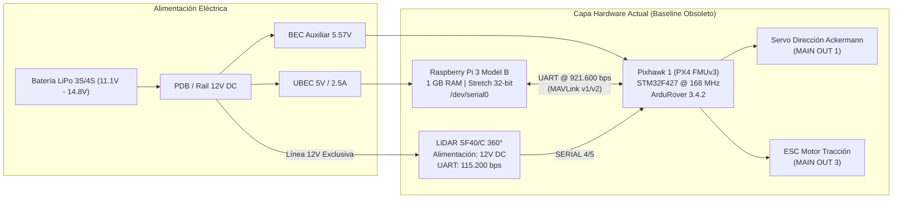
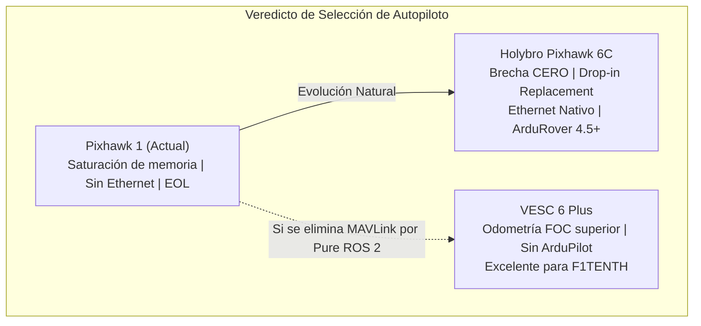
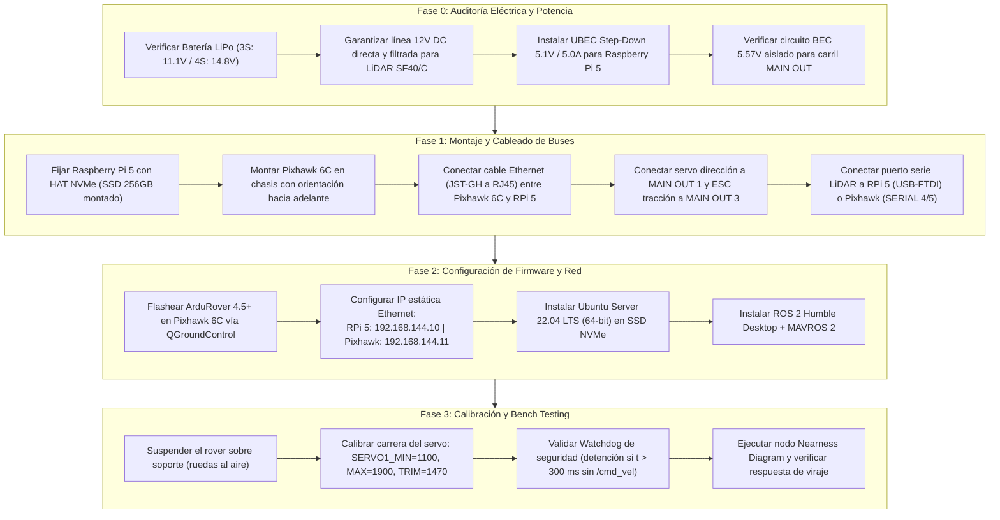
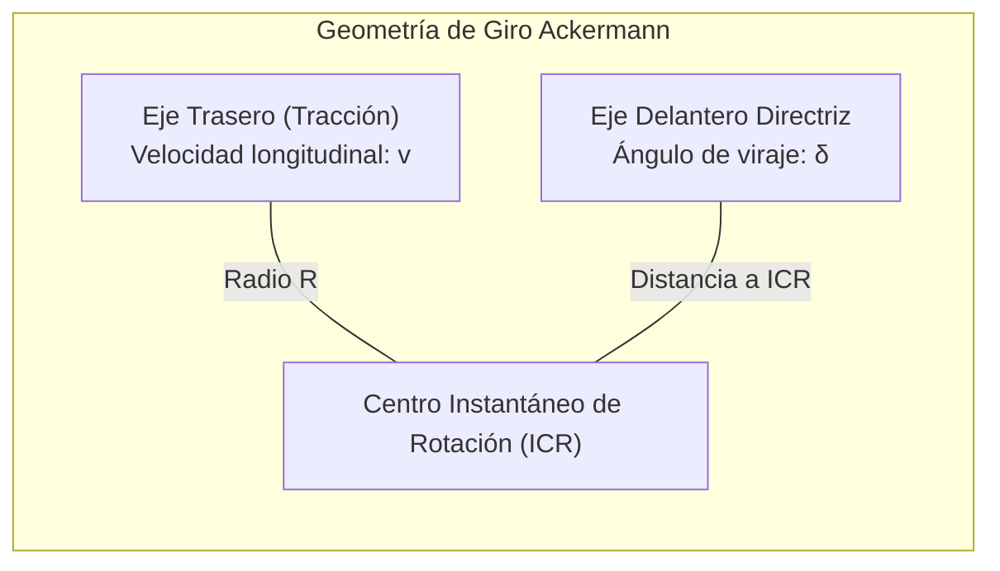

# Propuestas de Hardware, Datasheets y GAP Analysis para el UGV Voyager 3

**Documento Técnico y Ficha de Ingeniería**  
**Proyecto:** UGV Voyager 3 (Fible ALTU - RAWFIE)  
**Cinemática:** No holónoma tipo Ackermann (Dirección delantera por servo PWM, tracción trasera por ESC)  
**Autor:** Antigravity / Gemini Engineering Agent  
**Fecha:** Octubre 2026  
**Clasificación:** Ingeniería de Sistemas, Robótica Móvil y Docencia Universitaria  

---

## 📑 Índice de Contenidos

1. [Resumen Ejecutivo y Estado Base (Baseline Actual)](#1-resumen-ejecutivo-y-estado-base-baseline-actual)
2. [Fichas Técnicas Resumidas (Datasheet Specifications)](#2-fichas-t%C3%A9cnicas-resumidas-datasheet-specifications)
   * 2.1. [Capa de Control de Bajo Nivel / Autopiloto](#21-capa-de-control-de-bajo-nivel--autopiloto)
   * 2.2. [Capa de Cómputo de Misión / Companion Computer](#22-capa-de-c%C3%B3mputo-de-misi%C3%B3n--companion-computer)
3. [GAP Analysis 1: Alternativas a la Pixhawk 1](#3-gap-analysis-1-alternativas-a-la-pixhawk-1)
4. [GAP Analysis 2: Alternativas a la Raspberry Pi 3B](#4-gap-analysis-2-alternativas-a-la-raspberry-pi-3b)
5. [Plan de Migración Tecnológica Paso a Paso](#5-plan-de-migraci%C3%B3n-tecnol%C3%B3gica-paso-a-paso)
6. [Contenido Educacional: Guía Teórico-Práctica (Protocolo Feynman)](#6-contenido-educacional-gu%C3%ADa-te%C3%B3rico-pr%C3%A1ctica-protocolo-feynman)
7. [Casos de Estudio Reales y Validación en el Estado del Arte](#7-casos-de-estudio-reales-y-validaci%C3%B3n-en-el-estado-del-arte)

---

## 1. Resumen Ejecutivo y Estado Base (Baseline Actual)

El UGV **Voyager 3** fue concebido dentro del consorcio europeo H2020 RAWFIE. Su arquitectura física actual consta de dos niveles de cómputo rígidamente acoplados mediante un enlace serie UART asíncrono:



### Límites Insuperables del Baseline
1. **Computadora de Misión:** La Raspberry Pi 3 Model B con 1 GB de RAM LPDDR2 y arquitectura `armv7l` (32 bits) no soporta de forma estable distribuciones modernas de Linux de 64 bits (Ubuntu 22.04/24.04 LTS), requeridas incondicionalmente por **ROS 2 Humble / Iron / Jazzy**. El bus de datos comparte el controlador USB 2.0 y Ethernet 100M, generando latencias críticas en la recepción de paquetes.
2. **Autopiloto:** La Pixhawk 1 (`STM32F427VI`) dispone de únicamente 2 MB de memoria Flash y 256 KB de RAM. Está descontinuada por el consorcio PX4 y congelada en ArduPilot (imposibilidad de compilar versiones modernas > 4.1 con micro-XRCE-DDS o transporte nativo Ethernet DDS).

---

## 2. Fichas Técnicas Resumidas (Datasheet Specifications)

A continuación se condensan las especificaciones extraídas de las hojas de datos oficiales de los fabricantes para la evaluación objetiva de cada candidato.

### 2.1. Capa de Control de Bajo Nivel / Autopiloto

#### A. Pixhawk 1 (Baseline - 3DR / ProfiCNC / PX4 FMUv3)
* **Procesador Primario:** STMicroelectronics STM32F427VI (32-bit ARM Cortex-M4F @ 168 MHz, 2 MB Flash, 256 KB SRAM, FPU por hardware).
* **Coprocesador Failsafe (I/O):** STMicroelectronics STM32F100 (32-bit ARM Cortex-M3 @ 24 MHz, 8 KB SRAM).
* **Suite de Sensores:**
  * IMU 1: InvenSense MPU-6000 (Acelerómetro/Giroscopio 3 ejes SPI).
  * IMU 2: ST Microelectronics LSM303D (Acelerómetro/Magnetómetro 14-bit) + L3GD20 (Giroscopio 16-bit).
  * Barómetro: MEAS MS5611.
* **Interfaces Físicas:** 5x UART (puertos seriales con control de flujo), 1x CAN bus, 1x I2C, 1x SPI, 8x salidas PWM principales (servo rail) + 6x salidas auxiliares.
* **Tensión de Operación:** Entrada de alimentación lógica: 4.8V a 5.4V DC. Carril de servos (`MAIN OUT`): 0V a 10V DC aislado de la lógica.

#### B. Holybro Pixhawk 6C (Estándar FMUv6C)
* **Procesador Primario:** STMicroelectronics STM32H743IIK6 (32-bit ARM Cortex-M7 @ 480 MHz, 2 MB Flash, 1 MB SRAM, doble precisión FPU).
* **Coprocesador I/O:** STMicroelectronics STM32F103 (32-bit ARM Cortex-M3 @ 72 MHz, 64 KB SRAM).
* **Suite de Sensores:**
  * IMU 1: TDK InvenSense ICM-42688-P (Acelerómetro/Giroscopio de 6 ejes de bajo ruido, montado sobre aislamiento mecánico).
  * IMU 2: Bosch BMI055 (Acelerómetro/Giroscopio redundante).
  * Magnetómetro: Isentek IST8310.
  * Barómetro: TE Connectivity MS5611.
  * Control Térmico: Resistencia calefactora integrada en el módulo IMU para estabilidad térmica de los giróscopos.
* **Interfaces Físicas:**
  * 5x UART (con soporte DMA y control de flujo por hardware).
  * 1x Puerto Ethernet 100 Mbps (conector JST-GH de 8 pines, compatible con MAVLink UDP y Micro-XRCE-DDS).
  * 2x CAN bus (transceptores integrados).
  * 2x I2C, 1x SPI bus externo.
  * 8x Salidas PWM estándar + 8x Salidas Auxiliares/DShot.
* **Tensión de Operación:** Entrada primaria Power Module: 4.9V a 5.5V. Carril de servos: 0V a 36V.

#### C. Holybro Pixhawk 6X (Estándar Pixhawk Autopilot Bus - FMUv6X)
* **Procesador Primario:** STMicroelectronics STM32H753IIK6 (32-bit ARM Cortex-M7 @ 480 MHz, soporte criptográfico por hardware).
* **Suite de Sensores:** 3x IMUs redundantes montadas en bahía amortiguada independientemente (ICM-42688-P, ICM-20649 de alto rango, Bosch BMI088).
* **Interfaces Físicas:** 6x UART, 2x CAN FD (FlexCAN de hasta 5 Mbps), 1x Ethernet 100M nativo, doble entrada de Power Module con conmutación ideal de diodos.

#### D. Cube Orange+ (Cubepilot Ecosystem)
* **Procesador:** STMicroelectronics STM32H757 Dual Core (Cortex-M7 @ 480 MHz + Cortex-M4 @ 240 MHz).
* **Sensores:** Triple IMU redundante calefactada con sensores TDK ICM-42688P, ICM-20948 y ICM-20649.
* **Conector:** Conector DF17 de 80 pines diseñado para montaje en Carrier Boards modulares estándar (Kore, Mini Carrier, ADS-B Carrier).

#### E. Vedder VESC 6 Plus (Controlador Integrado FOC)
* **Microcontrolador:** STMicroelectronics STM32F405 @ 168 MHz.
* **Etapa de Potencia:** Driver MOSFET TI DRV8301, soporte para tensiones de 8V a 60V (baterías 3S a 12S), corriente continua de $80\text{ A}$ (picos de $120\text{ A}$).
* **Control de Motor:** Algoritmo de control orientado a campo (FOC) con estimación de flujo por observador o sensores Hall/encoders digitales. Odometría de muy alta resolución basada en conteo de pulsos/polos.
* **Interfaces:** 1x USB, 1x CAN bus, 1x UART, 1x entrada/salida PWM/PPM (para el servo de dirección), entradas analógicas para potenciómetros/aceleradores.

#### F. PJRC Teensy 4.1 (Plataforma micro-ROS Dedicada)
* **Procesador:** NXP i.MXRT1062 (Cortex-M7 @ 600 MHz, 1024 KB RAM, 8 MB Flash externa).
* **Interfaces:** PHY Ethernet 10/100M nativo integrado en silicio, 8x UART serie, 3x CAN bus (1x CAN FD), 35x salidas PWM con temporizadores de 32 bits a submilisegundo.
* **Software:** Soporte nativo para cliente `micro_ros_arduino` / `micro-ROS` ejecutándose sobre FreeRTOS o Baremetal con transporte Ethernet UDP o USB Serial CDC.

---

### 2.2. Capa de Cómputo de Misión / Companion Computer

#### A. Raspberry Pi 3 Model B (Baseline)
* **SoC:** Broadcom BCM2837 (Quad-Core ARM Cortex-A53 @ 1.2 GHz, 64-bit instruction set).
* **Memoria:** 1 GB LPDDR2 compartida con GPU.
* **GPU:** Broadcom VideoCore IV @ 400 MHz.
* **Almacenamiento:** Ranura microSD UHS-I (~20-25 MB/s).
* **Red y E/S:** Wi-Fi 802.11 b/g/n (2.4 GHz), Bluetooth 4.1, Fast Ethernet 100 Mbps (compartido a través del chip LAN9514 por un único puerto USB 2.0). 4x USB 2.0.
* **Consumo Energético:** $3.5\text{ W}$ a $5.0\text{ W}$ ($5.0\text{ V} / 2.5\text{ A}$).

#### B. Raspberry Pi 5 (8 GB RAM)
* **SoC:** Broadcom BCM2712 (Quad-Core ARM Cortex-A76 @ 2.4 GHz, 16nm, criptografía ARMv8-A, 512 KB L2 cache por núcleo, 2 MB L3 cache compartida).
* **Memoria:** 8 GB LPDDR4X-4267 SDRAM (ancho de banda de más de $17\text{ GB/s}$ frente a los $3.2\text{ GB/s}$ de RPi 3).
* **GPU:** VideoCore VII @ 800 MHz (soporte OpenGL ES 3.1, Vulkan 1.2).
* **Almacenamiento y Expansión:** Puerto PCIe 2.0 x1 (hasta 500 MB/s con HAT oficial o tarjetas M.2 NVMe SSD). Ranura microSD de alta velocidad (SDR104 con soporte para > 80 MB/s).
* **Red y E/S:** Gigabit Ethernet dedicado (Broadcom BCM54213PE, interfaz RGMII sin cuello de botella USB), Wi-Fi dual band 802.11ac, 2x USB 3.0 (5 Gbps con controlador host RP1 dedicado), 2x USB 2.0.
* **Consumo Energético:** $5.0\text{ W}$ (reposo) a $12.0\text{ W}$ (carga máxima). Requiere fuente USB-PD $5.1\text{ V} / 5.0\text{ A}$ ($27\text{ W}$).

#### C. NVIDIA Jetson Orin Nano Developer Kit (8 GB)
* **CPU:** 6-core ARM Cortex-A78AE v8.2 (64-bit) @ 1.5 GHz, 1.5 MB L2 + 4 MB L3 cache.
* **GPU:** Arquitectura NVIDIA Ampere con 1024 núcleos CUDA y 32 Tensor Cores.
* **Rendimiento de Inferencia IA:** Hasta **40 TOPS** (operaciones INT8 densas).
* **Memoria:** 8 GB LPDDR5 de 128 bits a 2133 MHz (ancho de banda de $68\text{ GB/s}$).
* **Almacenamiento:** 1x ranura M.2 Key M (PCIe 3.0 x4 para SSD NVMe de alta velocidad, > 2000 MB/s). Ranura microSD integrada.
* **E/S:** 1x Gigabit Ethernet (10/100/1000 Mbps), 4x USB 3.2 Gen 2 (10 Gbps), 2x conectores de cámara MIPI CSI-2 (4 vías cada uno), DisplayPort 1.2.
* **Consumo Energético:** Modos de potencia configurables: $7\text{ W}$ a $15\text{ W}$. Alimentación DC vía Jack $9\text{ V} - 20\text{ V}$.

#### D. Radxa Rock 5B+ (Rockchip RK3588)
* **CPU:** Octa-Core (4x Cortex-A76 @ 2.4 GHz + 4x Cortex-A55 @ 1.8 GHz).
* **Acelerador IA (NPU):** 6 TOPS compatible con marcos de trabajo TensorFlow, ONNX y PyTorch.
* **Memoria:** Opciones de 8 GB o 16 GB LPDDR5.
* **Almacenamiento:** M.2 Key M PCIe 3.0 x4 para discos NVMe + zócalo eMMC 5.1.
* **E/S:** 1x puerto Ethernet 2.5 Gbps (RJ45), 2x HDMI out (8K), 2x USB 3.0, 2x USB 2.0. Consumo: 8W a 18W.

#### E. LattePanda Sigma / Intel NUC (Arquitectura Industrial x86_64)
* **Procesador:** Intel Core i5-1340P (13ª Gen, 12 núcleos / 16 hilos: 4 Performance cores @ 4.6 GHz + 8 Efficient cores @ 3.4 GHz).
* **Gráficos:** Intel Iris Xe Graphics (96 Unidades de Ejecución).
* **Memoria:** 16 GB Dual-Channel LPDDR5-6400 MHz.
* **Almacenamiento:** 2x M.2 M-Key PCIe 4.0 x4 (tasas de transferencia > 5000 MB/s).
* **E/S:** 2x puertos Ethernet 2.5 GbE Intel i225-V, 2x Thunderbolt 4 (40 Gbps), 2x USB 3.2 Gen 2.
* **Consumo Energético:** $20\text{ W}$ (reposo/carga media) a $45\text{ W}$ (pico PL2). Alimentación $12\text{ V} - 24\text{ V}$ DC.

---

## 3. GAP Analysis 1: Alternativas a la Pixhawk 1

El **GAP Analysis** (Análisis de Brecha) evalúa la discrepancia entre las capacidades actuales del UGV Voyager 3 (**Estado Actual / Baseline**), los requisitos técnicos exigidos para autonomía moderna con ROS 2 (**Estado Deseado / Target**) y el grado de cobertura proporcionado por cada opción de sustitución.

### 3.1. Matriz de Análisis de Brecha (Autopilotos y Controladores de Bajo Nivel)

| Criterio de Evaluación | Requisito Objetivo (Target State) | Baseline: Pixhawk 1 | Opción 1: Holybro Pixhawk 6C | Opción 2: Holybro Pixhawk 6X | Opción 3: Cube Orange+ | Opción 4: Vedder VESC 6 Plus | Opción 5: Teensy 4.1 + micro-ROS |
| :--- | :--- | :--- | :--- | :--- | :--- | :--- | :--- |
| **Capacidad de Cómputo MCU** | $\ge 400\text{ MHz}$, ARM Cortex-M7 con FPU doble precisión | **BRECHA ALTA:** Cortex-M4 @ 168 MHz (saturación en loops de control a alta frecuencia) | **CERO BRECHA:** Cortex-M7 @ 480 MHz (STM32H743) | **CERO BRECHA:** Cortex-M7 @ 480 MHz (STM32H753) | **CERO BRECHA:** Dual Core M7 @ 480 MHz + M4 @ 240 MHz | **BRECHA MODERADA:** Cortex-M4 @ 168 MHz (dedicado exclusivamente a motor) | **SOBREPASA:** Cortex-M7 @ 600 MHz (NXP i.MXRT1062) |
| **Memoria Flash & Firmware** | $\ge 2\text{ MB}$ Flash con soporte ArduRover 4.5+ / Micro-XRCE | **BRECHA CRÍTICA:** Flash 2 MB pero con bug de hardware 1MB; firmware congelado en v3.4.2 | **CERO BRECHA:** 2 MB Flash sin bugs. Soporte completo de ArduPilot 4.5+ y PX4 | **CERO BRECHA:** 2 MB Flash. Compatibilidad total con branches actuales | **CERO BRECHA:** 2 MB Flash. Soporte upstream permanente en ArduPilot | **BRECHA METODOLÓGICA:** No corre ArduPilot (corre firmware VESC open-source) | **BRECHA METODOLÓGICA:** No corre ArduPilot (corre firmware C++ ROS 2 puro) |
| **Redundancia y Aislamiento IMU** | Mínimo 2x IMUs redundantes con desacoplo mecánico/térmico | **BRECHA ALTA:** Sensores antiguos (MPU-6000) soldados en placa rígida sin aislamiento | **CERO BRECHA:** 2x IMUs aisladas mecánicamente con calefacción interna | **SOBREPASA:** 3x IMUs con triple aislamiento y calentador resistivo | **SOBREPASA:** 3x IMUs en cubículo sellado calefactado | **BRECHA ALTA:** Solo 1x IMU básica interna no aislada | **BRECHA ALTA:** Requiere breakout board externo (ej. BNO085) |
| **Enlace a Companion Computer** | Ethernet 100M nativo (UDP MAVLink o DDS) | **BRECHA CRÍTICA:** Solo UART asíncrono (cuello de botella a 921.600 bps) | **CERO BRECHA:** Puerto Ethernet 100 Mbps nativo vía conector JST-GH | **CERO BRECHA:** Puerto Ethernet 100 Mbps nativo integrado | **BRECHA MODERADA:** Requiere Carrier Board con PHY Ethernet externo | **BRECHA ALTERNATIVA:** Conexión USB nativa / CAN bus a 1 Mbps | **CERO BRECHA:** PHY Ethernet nativo 100 Mbps en pines dedicados |
| **Control Cinemático Ackermann** | Generación PWM precisa para servo (1) y ESC (3) con Failsafe | **CERO BRECHA:** Funciones `SERVO1=26` y `SERVO3=70` nativas en ArduRover | **CERO BRECHA:** Mapeo 1:1 idéntico usando parámetros del Voyager 3 | **CERO BRECHA:** Mapeo 1:1 idéntico usando parámetros del Voyager 3 | **CERO BRECHA:** Mapeo 1:1 idéntico usando parámetros del Voyager 3 | **CERO BRECHA:** FOC ultrapreciso en motor + salida PWM directa para servo | **BRECHA DE DESARROLLO:** Requiere programar los temporizadores y la lógica de failsafe |
| **Facilidad de Integración** | Conservar cableado actual y PDB sin rediseño | **Línea base actual** | **CERO BRECHA:** Mismo factor de forma y compatibilidad con conectores JST-GH | **BRECHA LEVE:** Requiere baseboard PAB (ligeramente más voluminoso) | **BRECHA MODERADA:** Requiere baseboard DF17 (peso y volumen mayores) | **BRECHA MODERADA:** Requiere reemplazar el ESC actual y cablear USB/CAN | **BRECHA ALTA:** Requiere diseñar PCB de soporte o cableado prototipo |
| **Costo Aproximado** | Presupuesto académico razonable (< \$250) | \$0 (Existente, pero obsoleto) | ~\$160 - \$180 (Excelente relación) | ~\$260 - \$310 (Elevado) | ~\$350 - \$420 (Muy elevado) | ~\$120 - \$150 (Económico) | ~\$40 (Muy económico) |

### 3.2. Conclusión y Veredicto Técnico del GAP Analysis 1



* **Ganador Indiscutible (Ruta Conservadora / Compatibilidad 100%):** **Holybro Pixhawk 6C**. Elimina todas las brechas del sistema actual (procesador, memoria, redundancia sensorial y conexión Ethernet nativa), permitiendo cargar directamente la configuración de servomotores y parámetros del Voyager 3 ([`CONFIGURACION_PARAMETROS_PIXHAWK.parm`](file:///d:/Voyager/analisis_sistema/CONFIGURACION_PARAMETROS_PIXHAWK.parm)) sin reprogramar el stack de bajo nivel.
* **Alternativa Disruptiva (Ruta Pure ROS 2 / F1TENTH):** **VESC 6 Plus**. Recomendado únicamente si la institución decide desacoplar completamente el vehículo de ArduPilot y gobernarlo exclusivamente mediante nodos de ROS 2.

---

## 4. GAP Analysis 2: Alternativas a la Raspberry Pi 3B

### 4.1. Matriz de Análisis de Brecha (Companion Computers)

| Criterio de Evaluación | Requisito Objetivo (Target State) | Baseline: Raspberry Pi 3B | Opción 1: Raspberry Pi 5 (8 GB) | Opción 2: NVIDIA Jetson Orin Nano (8 GB) | Opción 3: Radxa Rock 5B+ (16 GB) | Opción 4: LattePanda Sigma (x86_64) |
| :--- | :--- | :--- | :--- | :--- | :--- | :--- |
| **Capacidad de Memoria RAM** | $\ge 8\text{ GB}$ (para ejecutar Nav2, SLAM Toolbox y visualización) | **BRECHA CRÍTICA:** 1 GB LPDDR2 (OOM Killer constante bajo ROS 2) | **CERO BRECHA:** 8 GB LPDDR4X (holgura para grafos densos de ROS 2) | **CERO BRECHA:** 8 GB LPDDR5 (ancho de banda masivo: $68\text{ GB/s}$) | **SOBREPASA:** 16 GB LPDDR5 | **SOBREPASA:** 16 GB / 32 GB LPDDR5 |
| **Arquitectura de SO & ROS 2** | 64-bit `aarch64` o `x86_64` con Ubuntu 22.04/24.04 LTS (ROS 2 Humble/Jazzy) | **BRECHA CRÍTICA:** Raspbian Stretch 32-bit (`armv7l`); no compatible con ROS 2 nativo | **CERO BRECHA:** Soporte oficial de Ubuntu 22.04 y 24.04 Server/Desktop 64-bit | **CERO BRECHA:** JetPack 6.x basado en Ubuntu 22.04 LTS oficial | **BRECHA LEVE:** Kernel Rockchip con parches sobre Ubuntu 22.04 | **CERO BRECHA:** Distribución canónica x86_64 sin particularidades ARM |
| **Almacenamiento y Tasas de E/S** | Almacenamiento NVMe PCIe $> 400\text{ MB/s}$ (para grabación de *rosbags*) | **BRECHA CRÍTICA:** MicroSD (~20 MB/s); corrupción habitual de bloques de datos | **CERO BRECHA:** Soporte NVMe M.2 vía HAT PCIe 2.0 ($> 450\text{ MB/s}$) | **CERO BRECHA:** Ranura M.2 PCIe 3.0 x4 nativa ($> 2000\text{ MB/s}$) | **CERO BRECHA:** M.2 PCIe 3.0 x4 nativo ($> 2000\text{ MB/s}$) | **SOBREPASA:** M.2 PCIe 4.0 x4 nativo ($> 5000\text{ MB/s}$) |
| **Aceleración por Hardware (IA / GPU)** | Capacidad de inferencia en tiempo real para Visión/LiDAR 3D | **BRECHA TOTAL:** GPU VideoCore obsoleta sin soporte para frameworks modernos | **BRECHA MODERADA:** Sin NPU/GPU para deep learning (sólo inferencia CPU ligera) | **SOBREPASA:** 1024 núcleos CUDA Ampere + Tensor Cores (**40 TOPS**) | **CERO BRECHA:** NPU integrada de 6 TOPS (RKNN toolkit) | **BRECHA MODERADA:** Intel Iris Xe (OpenVINO, sin núcleos Tensor dedicados) |
| **Ancho de Banda de Red y Buses** | Gigabit Ethernet independiente y puertos USB 3.0 dedicados | **BRECHA CRÍTICA:** Bus compartido USB 2.0 / LAN9514 (colisiones de paquetes) | **CERO BRECHA:** Gigabit Ethernet dedicado + controlador USB 3.0 independiente | **CERO BRECHA:** Gigabit Ethernet dedicado + 4x USB 3.2 Gen 2 (10 Gbps) | **SOBREPASA:** Ethernet 2.5 Gbps + USB 3.0 dedicados | **SOBREPASA:** Dual Ethernet 2.5 Gbps + Thunderbolt 4 (40 Gbps) |
| **Eficiencia y Consumo Térmico** | Consumo $< 15\text{ W}$ operable desde batería LiPo vehicular | **CERO BRECHA:** 3.5W - 5.0W (pero con bajo rendimiento) | **CERO BRECHA:** 5.0W - 12.0W (gestionable con UBEC 5V/5A y ventilador activo) | **CERO BRECHA:** 7.0W - 15.0W (excelente para la potencia entregada) | **BRECHA LEVE:** 8.0W - 18.0W (requiere disipación voluminosa) | **BRECHA ALTA:** 20W - 45W (compromete la autonomía de la batería LiPo) |
| **Facilidad de Curva de Aprendizaje** | Mínima fricción para docentes y estudiantes | **Línea base conocida** | **CERO BRECHA:** Ecosistema Raspberry Pi idéntico al actual, máxima documentación | **BRECHA MODERADA:** Curva de aprendizaje en JetPack, contenedores CUDA y flasheo | **BRECHA ALTA:** Ecosistema de soporte y comunidad fragmentada | **CERO BRECHA:** Experiencia PC de escritorio idéntica |
| **Costo Aproximado** | Presupuesto razonable para laboratorios universitarios | \$0 (Existente, pero inútil para ROS 2) | ~\$80 (Placa) + ~\$35 (HAT NVMe + SSD) = **~\$115** | ~\$249 - \$299 (Dev Kit completo) | ~\$140 - \$170 | ~\$450 - \$600 |

### 4.2. Conclusión y Veredicto Técnico del GAP Analysis 2

1. **Recomendación Principal para Docencia y Navegación Básica:** **Raspberry Pi 5 (8 GB RAM) con HAT NVMe**.
   * *Justificación de Brecha:* Resuelve el 100% de los problemas que bloqueaban el desarrollo en el Voyager 3 (falta de RAM, bus compartido lento, ausencia de arquitectura de 64 bits para ROS 2 Humble). Mantiene los costos bajos, el consumo contenido ($< 12\text{ W}$) y una curva de aprendizaje mínima para los alumnos.
2. **Recomendación para Investigación Avanzada y Visión Artificial:** **NVIDIA Jetson Orin Nano (8 GB)**.
   * *Justificación de Brecha:* Si el roadmap del laboratorio prevé la instalación futura de cámaras de profundidad (Intel RealSense D435i / ZED 2i) o modelos de detección de obstáculos por redes neuronales (YOLOv8/v11), la Jetson Orin Nano es la única que cierra la brecha de inferencia de IA gracias a sus 40 TOPS de potencia gráfica y compatibilidad con **Isaac ROS**.

---

## 5. Plan de Migración Tecnológica Paso a Paso

El siguiente procedimiento describe la migración segura hacia la arquitectura objetivo recomendada (**Pixhawk 6C + Raspberry Pi 5**), mitigando el riesgo de daños por sobretensión o mala praxis.



### Reglas Críticas de Seguridad de Hardware

> [!CAUTION]
> **Alimentación del LiDAR LightWare SF40/C:** El emisor y el motor rotatorio de este sensor exigen **incondicionalmente 12V DC** ($\pm 10\%$). Conectarlo a los pines de 5V de la Raspberry Pi 5 o al carril de la Pixhawk provocará un colapso en la línea de señal o daños en los reguladores de la computadora de abordo.

> [!IMPORTANT]
> **Aislamiento de la Electrónica de Potencia:** El servomotor de dirección genera picos de fuerza contraelectromotriz (back-EMF) durante virajes bruscos. El carril `MAIN OUT` de la Pixhawk **NUNCA** debe puentearse con la línea de alimentación lógica de la Raspberry Pi.

---

## 6. Contenido Educacional: Guía Teórico-Práctica (Protocolo Feynman)

### 6.1. Deconstrucción Matemática del Modelo Bicicleta Ackermann

A diferencia de los robots diferenciales que pueden pivotar con velocidad lineal nula ($v = 0, \omega \neq 0$), un vehículo con dirección Ackermann está sometido a restricciones no holónomas estrictas:



Las ecuaciones diferenciales cinemáticas respecto al centro del eje trasero (`base_link`) son:

$$\begin{bmatrix} \dot{x} \\ \dot{y} \\ \dot{\theta} \end{bmatrix} = \begin{bmatrix} \cos(\theta) & 0 \\ \sin(\theta) & 0 \\ 0 & 1 \end{bmatrix} \begin{bmatrix} v \\ \omega \end{bmatrix}$$

donde la velocidad angular $\omega = \dot{\theta}$ está restringida físicamente por el ángulo de viraje de las ruedas directrices $\delta$ y la batalla del vehículo $L$:

$$\omega = \frac{v}{L} \tan(\delta)$$

#### Transformación Inversa (de Comando ROS `/cmd_vel` a Dirección Física)
Dado un comando de velocidad deseado $(v, \omega)$ procedente de un planificador local como el nodo [`nearness_diagram_ackermann_node.py`](file:///d:/Voyager/ros2_ws/src/voyager_navigation/voyager_navigation/nearness_diagram_ackermann_node.py):

$$\delta = \arctan\left(\frac{L \cdot \omega}{v + \text{sign}(v) \cdot \epsilon}\right)$$

donde $\epsilon = 10^{-7}\text{ m/s}$ es la guarda numérica implementada obligatoriamente para evitar la división por cero cuando el rover se encuentra detenido ($v = 0$).

#### Restricciones de Saturación Física del Chasis Voyager 3
* **Ángulo de dirección máximo:** $|\delta| \le \delta_{\max} \approx 25^\circ = 0.4363\text{ rad}$.
* **Radio mínimo de giro:**
  $$R_{\min} = \frac{L}{\tan(\delta_{\max})} = \frac{0.32\text{ m}}{\tan(0.4363)} \approx \frac{0.32}{0.4663} \approx 0.686\text{ m}$$
* **Implicación en Algoritmos de Evasión:** El planificador local jamás debe solicitar pasillos o valles cuya curvatura exija un radio $R < 0.69\text{ m}$, o de lo contrario el chasis no podrá ejecutar la trayectoria sin chocar lateralmente.

---

### 6.2. Diseño de Prácticas de Laboratorio para Estudiantes

#### Práctica 1: Calibración y Caracterización de Actuadores PWM
* **Objetivo:** Relacionar el ancho de pulso en microsegundos ($\mu\text{s}$) enviado por el canal PWM con las magnitudes físicas de velocidad $v$ (m/s) y ángulo $\delta$ (grados/radianes).
* **Procedimiento:**
  1. Conectar la Pixhawk al software de estación de tierra (QGroundControl).
  2. Ajustar `SERVO1_TRIM` hasta que las ruedas apunten rigurosamente al frente ($0^\circ$). Registrar el valor nominal ($1470\,\mu\text{s}$).
  3. Incrementar el pulso hacia `SERVO1_MAX` ($1900\,\mu\text{s}$) y medir con goniómetro digital el ángulo mecánico de la rueda directriz interior y exterior (condición geométrica de Ackermann).
  4. Generar la curva de transferencia lineal:
     $$\delta(\text{PWM}) = \frac{\delta_{\max} - (-\delta_{\max})}{\text{PWM}_{\max} - \text{PWM}_{\min}} \cdot (\text{PWM} - \text{PWM}_{\text{trim}})$$

#### Práctica 2: Análisis de Latencia y Frecuencia de Telemetría (UART vs Ethernet)
* **Objetivo:** Cuantificar la latencia de muestreo de la IMU y del escaneo del LiDAR.
* **Procedimiento:**
  1. Medir mediante el comando `ros2 topic hz /mavros/imu/data` la estabilidad de la tasa de refresco a $50\text{ Hz}$.
  2. Medir la latencia extremo a extremo (*jitter*) de los comandos de velocidad publicando en `/cmd_vel` y midiendo el tiempo de llegada de la respuesta de corriente en el bus de la Pixhawk.
  3. Comparar la saturación de CPU de la Raspberry Pi 3 frente a la Raspberry Pi 5 al procesar el mensaje `sensor_msgs/msg/LaserScan` a $10\text{ Hz}$.

#### Práctica 3: Evasión Reactiva en Espacio Confinado (Nearness Diagram)
* **Objetivo:** Sintonizar los diagramas de cercanía para el vehículo Ackermann.
* **Procedimiento:**
  1. Ubicar el vehículo frente a un obstáculo a $1.5\text{ m}$.
  2. Verificar que el algoritmo detecte la discontinuidad de profundidad y seleccione el valle navegable más cercano a la meta.
  3. Comprobar que, al aproximarse a una distancia menor a la zona de seguridad $d_{\text{safety}} = 0.5\text{ m}$, el vehículo reduzca suavemente la velocidad lineal antes de iniciar el viraje:
     $$v = v_{\max} \cdot \left(\frac{d - d_{\text{safety}}}{d_{\text{detect}} - d_{\text{safety}}}\right)$$

---

## 7. Casos de Estudio Reales y Validación en el Estado del Arte

### Caso 1: F1TENTH Autonomous Racing Consortium
* **Instituciones Promotoras:** University of Pennsylvania, TU Wien, ETH Zürich.
* **Hardware Estándar:** Chasis Traxxas Slash 4x4 (escala 1/10), controlador motor **VESC 6**, computadora **NVIDIA Jetson Orin Nano** o **Raspberry Pi 5**, LiDAR Hokuyo / Slamtec.
* **Lección Transferible al Voyager 3:** El ecosistema F1TENTH demuestra que un UGV 1/10 con cinemática Ackermann logra trayectorias óptimas a más de $5\text{ m/s}$ empleando ROS 2 y Nav2 con controladores `RegulatedPurePursuit` ejecutados en hardware de bajo costo.

### Caso 2: Holybro PX4/ArduPilot Development Rover
* **Hardware Estándar:** Chasis todoterreno comercial, controladora **Holybro Pixhawk 6C** con módulo de navegación GNSS RTK multibanda y enlace Ethernet hacia una Raspberry Pi 5.
* **Lección Transferible al Voyager 3:** Confirma que la combinación Pixhawk 6C + Raspberry Pi 5 es la arquitectura industrial de referencia para misiones BVLOS y navegación por satélite donde se requiere redundancia completa de autopiloto y lazo de seguridad desarmado.

---

## 8. Tabla Resumen y Decisión Final para Adquisición

```
┌──────────────────────────────────────────────────────────────────────────────┐
│                    PROPUESTA FINAL DE ADQUISICIÓN Y MIGRACIÓN                │
├──────────────────────────────────────────────────────────────────────────────┤
│ 1. Companion Computer:                                                       │
│    • Raspberry Pi 5 (8 GB RAM) con carcasa disipadora activa.                │
│    • Módulo oficial Raspberry Pi M.2 HAT+ con disco SSD NVMe de 256 GB.     │
│    • Módulo UBEC Step-Down 5.1V / 5.0A (Conector USB-C).                     │
│                                                                              │
│ 2. Autopiloto de Bajo Nivel:                                                 │
│    • Holybro Pixhawk 6C (Caja de plástico ligera con amortiguación interna). │
│    • Cable Ethernet JST-GH a RJ45 para comunicación directa con RPi 5.       │
│                                                                              │
│ 3. Sensores y Actuadores Preservados:                                        │
│    • LiDAR rotativo 360° LightWare SF40/C (Línea exclusiva 12V DC PDB).     │
│    • GPS U-blox Neo-M8N con brújula externa en mástil elevado.               │
│    • Servomotor digital de dirección delantera (MAIN OUT 1 @ 5.57V BEC).     │
│    • ESC y motor brushless de tracción trasera (MAIN OUT 3).                 │
└──────────────────────────────────────────────────────────────────────────────┘
```

Esta solución erradica los cuellos de botella del Voyager 3, permitiendo una transición transparente hacia el stack completo de **ROS 2 Humble / Nav2**, garantizando la preservación histórica de la plataforma y dotando al laboratorio de una base reproducible de docencia e investigación.