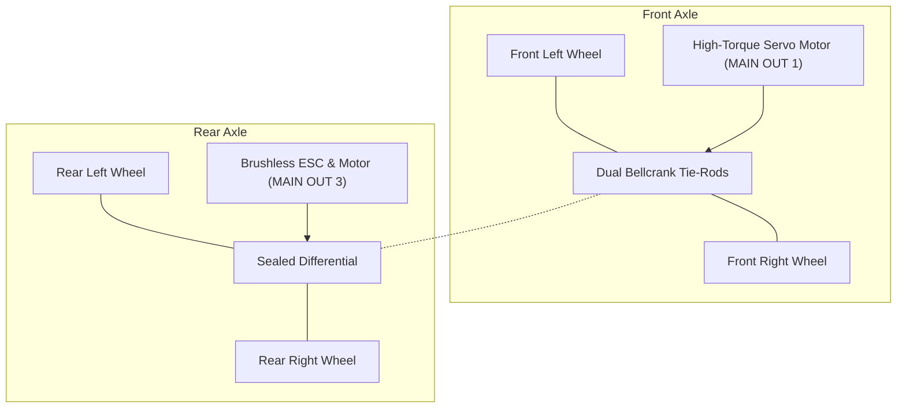

# Chassis & Actuators: Ackermann Steering & Propulsion

This document covers the mechanical chassis, Ackermann steering geometry, actuator mapping, PWM pulse widths, and ArduRover servo parameters for the **UGV Voyager 3**.

---

## 1. Chassis Platform: Fible ALTU

* **Platform Origin:** Fible ALTU (European Union H2020 RAWFIE Project).
* **Scale & Form Factor:** 1:10 scale rugged all-terrain chassis.
* **Drive Kinematics:** Pure **Ackermann Steering** (front steerable wheels, rear traction drive).
* **Drivetrain:** Rear sealed differential with steel universal driveshafts and independent coil-over oil dampers.



---

## 2. Mathematical Kinematic Model (Bicycle Model)

The UGV Voyager 3 follows standard non-holonomic Ackermann steering kinematics, modeled using the equivalent single-track bicycle model:

```text
               FL ────── FR
                    ▲
                    │ δ (Steering Angle)
                    │
                    │ Wheelbase (L)
                    │
                    ▼
               RL ────── RR
                    ▲
                    │ v (Linear Velocity)
```

### Governing Equations
Given the vehicle wheelbase $L$, the steering angle of the virtual front wheel $\delta$, and the rear-axle linear velocity $v$:

$$\dot{x} = v \cos(\theta)$$

$$\dot{y} = v \sin(\theta)$$

$$\dot{\theta} = \frac{v}{L} \tan(\delta)$$

The path curvature $\kappa$ and instantaneous turning radius $R$ are:

$$\kappa = \frac{\tan(\delta)}{L}$$

$$R = \frac{1}{\kappa + \text{sign}(\kappa) \cdot \epsilon} = \frac{L}{\tan(\delta) + \text{sign}(\delta) \cdot \epsilon}$$

where $\epsilon = 10^{-7}$ prevents numerical division by zero when traveling straight ($\delta = 0$).

### Physical Steering Bounds
* **Maximum Mechanical Steering Angle ($\delta_{\max}$):** $\pm 25.0^\circ \approx \pm 0.4363\text{ rad}$.
* Any trajectory planner or ROS 2 controller must saturate commanded steering angles strictly within $[-\delta_{\max}, \delta_{\max}]$.

---

## 3. Actuator Configuration & PWM Calibration

The autopilot controls vehicle motion using two independent PWM channels on the carrier board's **`MAIN OUT`** rail:

### 3.1. Front Steering Servo (`MAIN OUT 1`)
* **Actuator Type:** High-torque metal-gear standard RC servo motor.
* **Electrical Supply:** **5.57 V DC** delivered exclusively from the auxiliary Servo BEC.
* **Control Signal:** Standard 50 Hz PWM pulse width modulation.

| Parameter | Value | Description |
| :--- | :---: | :--- |
| `SERVO1_FUNCTION` | `26` | Assigned to `k_ground_steering` (Ackermann front wheel control) |
| `SERVO1_MIN` | `1100` µs | Maximum mechanical steer right (PWM lower limit) |
| `SERVO1_MAX` | `1900` µs | Maximum mechanical steer left (PWM upper limit) |
| `SERVO1_TRIM` | `1470` µs | Calibrated mechanical center / neutral alignment |
| `SERVO1_REVERSED`| `1` | Polarity inversion matching steering bellcrank linkage |

---

### 3.2. Rear Traction Motor & ESC (`MAIN OUT 3`)
* **Actuator Type:** High-torque brushless/brushed electric motor coupled to sealed differential.
* **Electronic Speed Controller (ESC):** Bidirectional car ESC with forward, reverse, and proportional braking.
* **Electrical Supply:** Direct unregulated battery power from the **4S LiPo bus** ($14.8\text{ V} - 16.8\text{ V}$).
* **Control Signal:** 50 Hz PWM throttle commands.

| Parameter | Value | Description |
| :--- | :---: | :--- |
| `SERVO3_FUNCTION` | `70` | Assigned to `k_throttle` (propulsion motor output) |
| `SERVO3_MIN` | `900` µs | Full reverse / maximum braking limit |
| `SERVO3_MAX` | `2000` µs | Full forward maximum throttle limit |
| `SERVO3_TRIM` | `1300` µs | Motor neutral / stationary stop position |
| `SERVO3_REVERSED`| `1` | Inversion to ensure positive throttle moves rover forward |

---

## 4. Safety Architecture & Arming Logic

* **Mandatory Arming Enforcement (`ARMING_REQUIRE = 1`):**  
  The autopilot inhibits all PWM signals to the throttle and steering channels while in `DISARMED` state. The motor cannot spin accidentally until an explicit arming command is received.
* **Hardware Safety Switch Bypass (`BRD_SAFETYENABLE = 0`):**  
  Disables the requirement to physically press an external push-button switch on the mast, allowing software arming over MAVLink/ROS.
* **Throttle Failsafe (`FS_THR_ENABLE`):**  
  * For outdoor operation: Set to `1` (Rover stops if radio receiver signal is lost).
  * For bench testing without RC transmitter: Set to `0` to permit MAVLink commands without RC link error.
