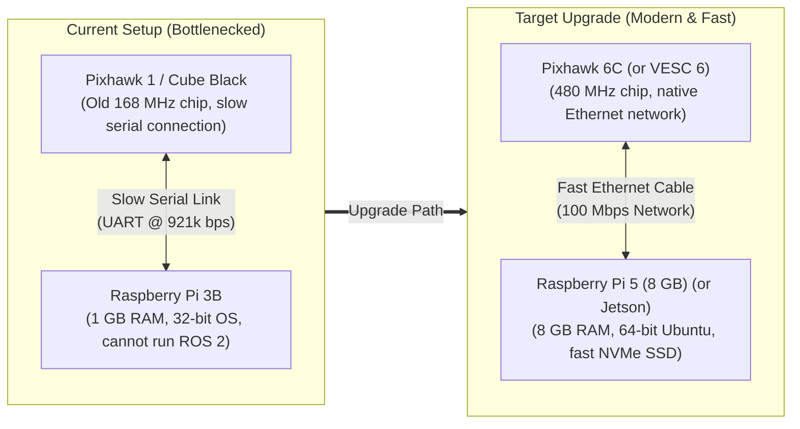
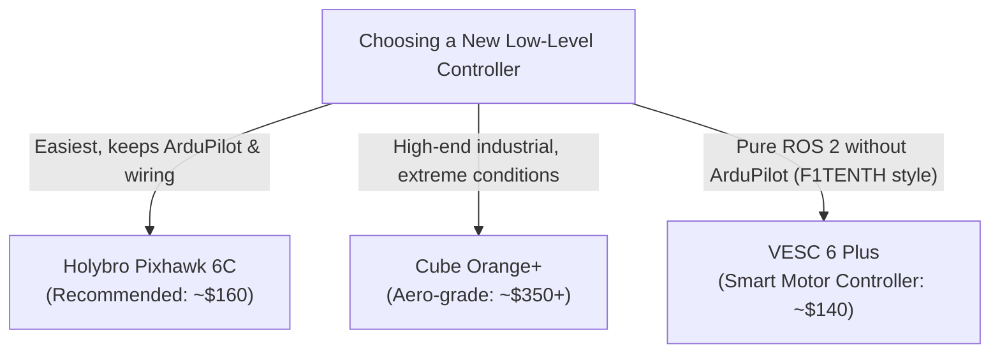
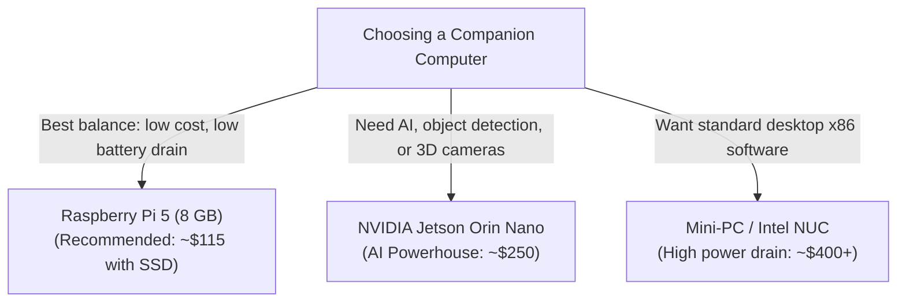
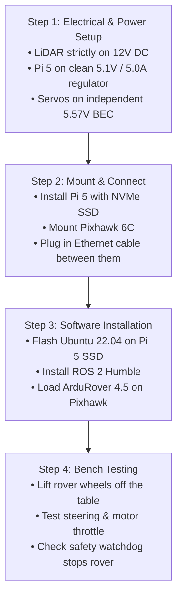

# Hardware Upgrade Guide & GAP Analysis (UGV Voyager 3)

A practical, accessible guide to upgrading the flight controller and companion computer of the **Voyager 3 autonomous rover** for modern robotics with **ROS 2**.

---

## 1. Why Upgrade? (The Problem in Plain English)

The Voyager 3 currently runs on hardware from 2016–2018:
* **Autopilot:** The Cube Black / Pixhawk 1 (STM32F427 microcontroller @ 168 MHz).
* **Companion Computer:** Raspberry Pi 3 Model B (1 GB RAM, 32-bit Raspbian Stretch).
* **Steering & Drive:** Car-like Ackermann steering (front servo on `MAIN OUT 1`, rear drive motor on `MAIN OUT 3`).
* **Sensor:** LightWare SF40/C 360° LiDAR (**12V DC**).



### The Bottlenecks
1. **Not enough memory (RAM):** The Raspberry Pi 3 only has 1 GB of RAM. Modern navigation software (ROS 2 Humble, Nav2, and SLAM mapping) requires at least 4 GB to 8 GB. On the Pi 3, the system runs out of memory and crashes.
2. **Outdated 32-bit software:** Modern ROS 2 requires a 64-bit operating system (Ubuntu 22.04 LTS or newer). The Pi 3's operating system (Raspbian Stretch) is expired and cannot install ROS 2.
3. **Slow communication:** The autopilot and the Raspberry Pi talk over a slow serial wire (UART). Newer setups use a standard Ethernet network cable, which is faster, cleaner, and more reliable.
4. **Aging autopilot processor:** The processor in the Pixhawk 1 / Cube Black no longer receives feature updates in modern ArduPilot versions.

---

## 2. Autopilot Options (Replacing the Pixhawk / Cube Black)

The autopilot's job is simple: accurately control the front steering servo and rear throttle motor, read IMU motion sensors, and act as a safety watchdog.



### Option Comparison
* **Holybro Pixhawk 6C (Recommended — Best Overall):**
  * *What it is:* The direct modern replacement for the Pixhawk 1.
  * *Why pick it:* Uses the same plugs and wiring. You can import all current vehicle settings directly. Adds a **native Ethernet port** so it connects to the computer like any standard networked device.
  * *Price:* ~\$160.
* **Holybro Pixhawk 6X / Cube Orange+ (Industrial Grade):**
  * *What it is:* Heavy-duty autopilots with heated, triple-redundant sensors.
  * *Why pick it:* Great if the rover operates in freezing snow or extreme vibration, but it is larger, heavier, and more expensive than necessary for a 1/10 ground car.
  * *Price:* ~\$260 – \$380.
* **Vedder VESC 6 Plus (The F1TENTH / Pure ROS 2 Approach):**
  * *What it is:* A smart brushless motor controller with a built-in steering servo output.
  * *Why pick it:* It completely replaces the car's ESC. It gives high-precision wheel speed (odometry) and plugs straight into the computer over USB or CAN bus. Ideal if you want to bypass ArduPilot and control the car 100% from ROS 2.
  * *Price:* ~\$120 – \$150.

---

## 3. Companion Computer Options (Replacing Raspberry Pi 3B)

The companion computer runs ROS 2, reads the LiDAR laser scanner, builds 2D/3D maps, and plans obstacle avoidance paths.



### Option Comparison
* **Raspberry Pi 5 with 8 GB RAM (Recommended — Best for Education & General ROS 2):**
  * *Performance:* 6 to 8 times faster than Raspberry Pi 3B.
  * *Memory:* 8 GB RAM (plenty of room for ROS 2 Humble, Nav2, and SLAM mapping simultaneously).
  * *Storage:* Supports fast **M.2 NVMe SSD** storage via a top HAT board. This eliminates micro-SD card corruption and allows recording large sensor datasets (*rosbags*) without lag.
  * *Power:* Draws only 5W to 12W from the battery.
  * *Price:* ~\$80 (board) + ~\$35 (NVMe HAT + 256 GB SSD) = **~\$115 total**.
* **NVIDIA Jetson Orin Nano with 8 GB RAM (Best for AI and Computer Vision):**
  * *Performance:* Includes a built-in NVIDIA Ampere GPU with 40 TOPS of AI processing power.
  * *When to choose it:* Pick this if you plan to add depth cameras (Intel RealSense or ZED 2i) or run deep learning models (YOLO object detection) in real time.
  * *Price:* ~\$250 – \$299.
* **Mini-PC (Intel Core i5 / LattePanda / NUC):**
  * *Performance:* Desktop-class processing.
  * *Drawback:* Consumes 20W to 45W of battery power, cutting rover run-time significantly.

---

## 4. GAP Analysis (Current vs. Target)

The tables below highlight the exact differences (**gaps**) between what the rover has today and what each replacement offers.

### 4.1. Autopilot GAP Analysis

| Feature | Target Requirement | Baseline: Pixhawk 1 | Option 1: Pixhawk 6C | Option 2: VESC 6 Plus |
| :--- | :--- | :--- | :--- | :--- |
| **Processor Speed** | $\ge 400\text{ MHz}$ | 168 MHz (Slow) | **480 MHz (Zero Gap)** | 168 MHz (Motor-focused) |
| **Software Support** | ArduRover 4.5+ or native ROS 2 | Frozen at old v3.4.2 | **Full modern support** | Native open-source VESC |
| **Computer Link** | Fast Network (Ethernet / USB) | Old serial cable (921k) | **Native 100M Ethernet** | Native USB / CAN bus |
| **Ackermann Steering** | Front servo + Rear ESC throttle | Built-in | **100% compatible** | Direct servo PWM out |
| **Wiring Changes** | Minimal to none | Baseline | **Zero changes (Drop-in)** | Must swap car ESC |
| **Estimated Cost** | Under \$200 | \$0 (Outdated) | **~\$160 - \$180** | **~\$120 - \$150** |
| **Verdict** | — | **Replace** | **Winner (Easiest upgrade)** | **Best for Pure ROS 2** |

### 4.2. Companion Computer GAP Analysis

| Feature | Target Requirement | Baseline: Raspberry Pi 3B | Option 1: Raspberry Pi 5 (8 GB) | Option 2: Jetson Orin Nano (8 GB) |
| :--- | :--- | :--- | :--- | :--- |
| **RAM (Memory)** | $\ge 8\text{ GB}$ | 1 GB (Causes crashes) | **8 GB LPDDR4X (Zero Gap)** | **8 GB LPDDR5 (Zero Gap)** |
| **Operating System** | 64-bit Ubuntu 22.04 LTS | Old 32-bit Stretch (Dead) | **Official 64-bit Ubuntu** | **Official 64-bit JetPack** |
| **Drive Speed** | Fast SSD ($> 400\text{ MB/s}$) | Slow SD card (~20 MB/s) | **M.2 NVMe SSD support** | **M.2 NVMe SSD support** |
| **AI / GPU Power** | Optional for 2D LiDAR | None | Basic (CPU only) | **40 TOPS GPU (High-end)** |
| **Battery Draw** | Under 15 Watts | ~4 Watts | **5W - 12W (Safe)** | **7W - 15W (Safe)** |
| **Learning Curve** | Gentle for students | Familiar | **Identical to Pi 3 (Easiest)** | Moderate (Requires CUDA setup) |
| **Estimated Cost** | Under \$150 | \$0 (Unusable for ROS 2)| **~\$115 (with SSD HAT)** | **~\$250 - \$299** |
| **Verdict** | — | **Replace** | **Winner for General Use** | **Winner if adding Cameras** |

---

## 5. Step-by-Step Migration Plan

A safe, simple 4-step sequence to upgrade the hardware without electrical mistakes:



### Safety Rules (Avoid Common Mistakes!)

> [!CAUTION]
> **LiDAR Power Rule:** The LightWare SF40/C 360° LiDAR **must always be powered from the 12V DC line** on the rover's power distribution board. **Never** connect its power leads to the Raspberry Pi 5V pins!

> [!IMPORTANT]
> **Servo Power Isolation:** The steering servo draws high electrical bursts during sharp turns. It must stay powered by its own dedicated **5.57V regulator (BEC)** on the autopilot servo rail, never from the Raspberry Pi logic power line.

---

## 6. How Ackermann Steering Works (Educational Primer)

Understanding car steering is essential for writing or tuning robotics software:

### 1. You Cannot Turn in Place
Unlike vacuum robots or tank-style robots that spin on the spot ($v = 0, \omega \neq 0$), a car-like vehicle with Ackermann steering **must move forward or backward** in order to turn:
$$\text{Turning Angle } \delta = \arctan\left(\frac{L \cdot \omega}{v}\right)$$
* $L$ is the distance between the front and rear axles ($L \approx 0.32\text{ m}$ on Voyager 3).
* $v$ is the driving speed.
* $\omega$ is the turning rate.

### 2. The Division-by-Zero Trap ($\epsilon$)
When the rover is standing completely still ($v = 0$), calculating the turning angle directly causes a division by zero in software.
In [`nearness_diagram_ackermann_node.py`](file:///d:/Voyager/ros2_ws/src/voyager_navigation/voyager_navigation/nearness_diagram_ackermann_node.py), we guard against this by adding a tiny number ($\epsilon = 10^{-7}$):
$$\delta = \arctan\left(\frac{L \cdot \omega}{v + \text{sign}(v) \cdot 10^{-7}}\right)$$

### 3. Minimum Turning Circle ($R_{\min}$)
The front wheels can only turn up to approximately $25^\circ$ ($\approx 0.436\text{ radians}$). This creates a physical **minimum turning radius**:
$$R_{\min} = \frac{L}{\tan(25^\circ)} = \frac{0.32\text{ m}}{0.466} \approx 0.69\text{ meters}$$
Any path planner (like Nav2 or Nearness Diagram) must know this limit: it should never request a turn tighter than $0.69\text{ meters}$, or the car will scrape obstacles on the inside of the curve.

---

## 7. Real-World Examples & Reference Projects

### Example 1: The F1TENTH Autonomous Racing Project
* **Used by:** University of Pennsylvania, TU Wien, and universities worldwide.
* **Setup:** Scale 1/10 RC car (identical chassis scale to Voyager 3), equipped with a **VESC motor controller**, an **NVIDIA Jetson or Raspberry Pi 5**, and a 2D LiDAR.
* **Takeaway:** Proves that small 1/10 Ackermann cars can navigate complex tracks at high speeds using standard ROS 2 packages and budget-friendly compute boards.

### Example 2: Holybro Autonomous Inspection Rover
* **Setup:** Commercial off-road rover chassis running a **Pixhawk 6C** connected via **Ethernet** to a companion computer running ROS 2.
* **Takeaway:** Confirms that Pixhawk 6C + Ethernet is the standard, reliable architecture for outdoor waypoint missions and fail-safe robotics.

---

## 8. Summary of Recommended Purchases

For the best balance of cost, ease of installation, and modern ROS 2 performance:

```
┌─────────────────────────────────────────────────────────────────────────────┐
│                       RECOMMENDED UPGRADE BILL OF MATERIALS                 │
├─────────────────────────────────────────────────────────────────────────────┤
│ 1. Companion Computer:                                                      │
│    • Raspberry Pi 5 (8 GB RAM)                                      ~$80    │
│    • Official Raspberry Pi M.2 HAT+ & 256 GB NVMe SSD               ~$35    │
│    • 5.1V / 5.0A Step-Down Voltage Regulator (UBEC USB-C)           ~$15    │
│                                                                             │
│ 2. Low-Level Autopilot:                                                     │
│    • Holybro Pixhawk 6C (Plastic case with internal vibration foam) ~$170   │
│    • JST-GH to RJ45 Ethernet Cable (for direct network link)        ~$10    │
│                                                                             │
│ 3. Existing Parts Kept:                                                     │
│    • LightWare SF40/C 360° LiDAR (Kept on dedicated 12V DC line)     $0     │
│    • U-blox Neo-M8N GPS & Compass Mast                               $0     │
│    • Front Steering Servo & Rear Traction ESC / Motor                $0     │
├─────────────────────────────────────────────────────────────────────────────┤
│ Total Estimated Investment:                                         ~$310   │
└─────────────────────────────────────────────────────────────────────────────┘
```

This setup completely removes the memory and software limits of the original 2016 build, enabling full **ROS 2 Humble / Nav2** autonomy while reusing all existing sensors and motors.
