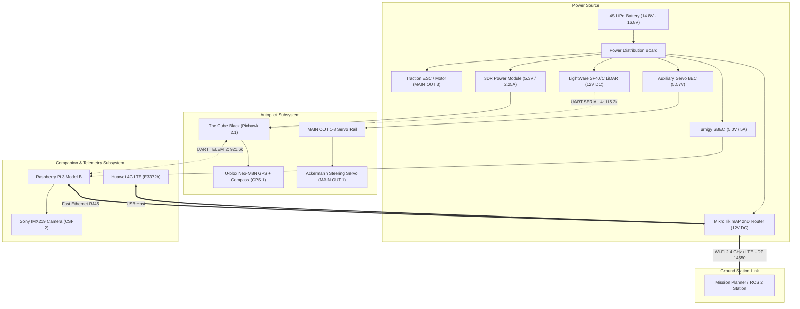

# Hardware Documentation Index

This directory provides the comprehensive technical documentation, pinout mappings, carrier board wiring, electrical specifications, and official references for all hardware subsystems of the **UGV Voyager 3 (Fible ALTU / EU H2020 RAWFIE)**.

---

## 1. Hardware Subsystems Directory

Navigate to any document below for component specifications, pinout tables, datasheets, and configuration guides:

### Architecture & System Overviews
| Document | Focus & Content |
| :--- | :--- |
| [Hardware Overview](hardware_overview.md) | High-level Bill of Materials (BOM), 4-domain power tree, and safety rules |
| [Communication Architecture](communication_architecture.md) | Physical buses, protocols, baudrates, and telemetry routing flow |

### Processing & Flight Control
| Document | Focus & Content |
| :--- | :--- |
| [01 — The Cube Black Autopilot](01_the_cube_black_autopilot.md) | STM32F427 FMU, STM32F100 co-processor, heated triple IMUs (45°C), carrier board pinouts |
| [03 — Raspberry Pi 3B Gateway](03_raspberry_pi_3b.md) | BCM2837 companion computer, high-speed UART (`/dev/serial0` @ 921.6k), MAVProxy bridge |

### Perception & Navigation
| Document | Focus & Content |
| :--- | :--- |
| [02 — LightWare SF40/C LiDAR](02_lightware_sf40c_lidar.md) | 360° laser rangefinder (0.2 m – 100 m, 20 kHz), strict 12V DC power rule, proximity radar |
| [04 — RPi Camera Module v2](04_rpi_camera_v2.md) | Sony IMX219 (8.08 MP, f/2.0), MIPI CSI-2 bus, H.264 RTP stream over UDP port 5600 |
| [05 — U-blox Neo-M8N GNSS & Compass](05_ublox_m8n_gps_compass.md) | 72-channel concurrent GNSS, external I2C compass on elevated carbon fiber mast |

### Networking & Telemetry
| Document | Focus & Content |
| :--- | :--- |
| [06 — MikroTik mAP 2nD Router](06_mikrotik_map_2nd_router.md) | Dual Fast Ethernet + USB Host router, 2.4 GHz Wi-Fi (Hotspot `DroneLab` vs direct AP) |
| [07 — Huawei 4G LTE Modem](07_huawei_e3372h_lte_modem.md) | E3372h Cat4 USB modem, hostless HiLink architecture (CDC-Ether, subnet `192.168.8.1`) |

### Actuation & Chassis
| Document | Focus & Content |
| :--- | :--- |
| [08 — Ackermann Steering & Actuators](08_ackermann_actuators_chassis.md) | Fible ALTU chassis, bicycle model, steering servo on `MAIN OUT 1`, ESC on `MAIN OUT 3` |

### Power Distribution & Calibration
| Document | Focus & Content |
| :--- | :--- |
| [09 — Power Distribution Tree](09_power_distribution_tree.md) | 4-domain decoupled power tree, 4S LiPo battery, BEC regulators, ATX supply trip warning |
| [10 — ArduRover Parameters Master Table](10_ardurover_parameters_master.md) | Complete calibrated ArduRover parameter dump verified against vehicle hardware |
| [11 — Hardware Upgrade & GAP Analysis](11_hardware_upgrade_and_gap_analysis.md) | Concise modernization guide: Pixhawk 6C vs VESC, Raspberry Pi 5 vs Jetson Orin, and safe migration |

---

## 2. Hardware Architecture & Signal Interconnect

---

## 3. Four Golden Hardware Rules

1. **LiDAR Power Input:**  
   The LightWare SF40/C must be powered at **12.0 V DC directly from the PDB**. Never connect its power leads to the 5V rail of the Pixhawk or Raspberry Pi.
2. **TELEM 2 Isolation:**  
   The Raspberry Pi 3B is powered by its own Turnigy SBEC. The serial link on `TELEM 2` connects **only TX, RX, and GND** (Pin 1 +5V is left empty).
3. **Servo Rail Isolation:**  
   The Cube does not supply power to the `MAIN OUT 1-8` servo rail. The steering servo receives power from an independent **5.57V DC auxiliary BEC**.
4. **4S LiPo Battery vs. Bench Supplies:**  
   Standard PC (ATX) power supplies shut down due to Over-Current Protection (OCP) when the motor accelerates or the steering servo snaps. All drive tests require the **4S LiPo battery** ($14.8\text{ V} - 16.8\text{ V}$).
