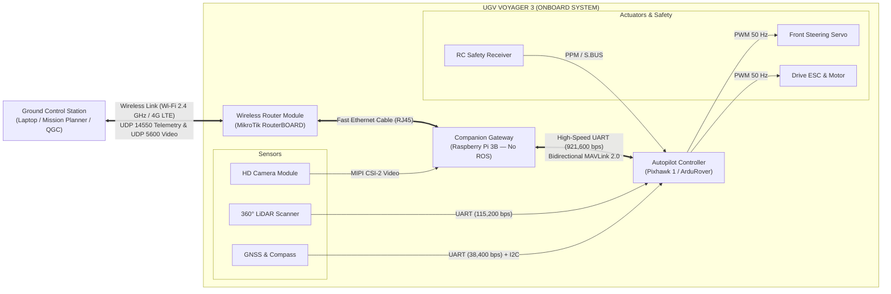

# Communication Architecture & Data Flow

This document describes the internal and external communication architecture of the **UGV Voyager 3**, detailing each hardware bus, protocol, and data rate.

---

## 🗺️ 1. High-Level Data Flow

The architecture operates with a clean separation between **real-time low-level control** (Pixhawk 1) and **networked telemetry forwarding** (Raspberry Pi 3B + MikroTik Router).

---

## 🔌 2. Hardware Interfaces & Bus Table

| Link / Bus | Endpoints | Physical Medium | Protocol / Encoding | Data Rate / Frequency |
| :--- | :--- | :--- | :--- | :---: |
| **GCS Link** | GCS Laptop ↔ Onboard Router | Wi-Fi 2.4 GHz / 4G LTE | UDP Packets (Ports 14550 & 5600) | Wireless (3 - 8 ms latency) |
| **Onboard Network** | MikroTik Router ↔ Raspberry Pi | CAT5e Cable (RJ45) | Fast Ethernet TCP/IP & UDP | 100 Mbps Full-Duplex |
| **Autopilot Bridge** | Raspberry Pi (`/dev/serial0`) ↔ Pixhawk (`TELEM 2`) | 3-Wire Serial (TX, RX, GND) | MAVLink 1.0 / 2.0 | **921,600 bps** (3.3V TTL) |
| **LiDAR Proximity** | SF40/C ↔ Pixhawk (`SERIAL 4/5`) | 3-Wire Serial (TX, RX, GND) | LightWare Serial Protocol | **115,200 bps** (3.3V TTL) |
| **GNSS & Heading** | Neo-M8N ↔ Pixhawk (`SERIAL 3` + I2C) | 6-Pin DF13 Cable | NMEA/UBX + I2C Compass | **38,400 bps** + 400 kHz I2C |
| **Steering Output** | Pixhawk (`MAIN OUT 1`) ↔ Servo | 3-Pin Servo Wire (Signal + 5.57V) | Standard PWM (`SERVO1_FUNCTION=26`) | 50 Hz (1100 μs – 1900 μs) |
| **Throttle Output** | Pixhawk (`MAIN OUT 3`) ↔ ESC | 3-Pin Servo Wire (Signal + GND) | Throttle PWM (`SERVO3_FUNCTION=70`) | 50 Hz (900 μs – 2000 μs) |
| **Manual Safety** | RC Receiver ↔ Pixhawk (`RC IN`) | 3-Pin Wire (Signal + 5V + GND) | PPM or S.BUS Serial Stream | 2.4 GHz Radio Failsafe |
| **Vision Feed** | Sony IMX219 ↔ Raspberry Pi | 15-Pin Flat Flexible Ribbon (FFC) | MIPI CSI-2 | H.264 @ 1024x768 30 fps |

---

## 💡 3. Key Design Choices

1. **No Heavy Computation on the Raspberry Pi:**  
   The Raspberry Pi 3B is intentionally dedicated to lightweight gateway services (`MAVProxy` and `GStreamer`). It does not run heavy navigation software, ROS, or SLAM nodes onboard. This ensures zero CPU throttling, low latency, and continuous packet routing.
2. **Physical Ethernet Trunk:**  
   The RPi connects to the onboard MikroTik router using a shielded RJ45 Ethernet patch cable. This avoids internal Wi-Fi collisions and ensures that cellular (4G LTE) and local Wi-Fi traffic flow reliably into the same network segment.
3. **Dedicated Low-Level Hardware Loop:**  
   Sensors required for vehicle survival (LiDAR obstacle proximity and GPS) report directly to the Pixhawk. Even if the Raspberry Pi restarts or loses network connectivity, the Pixhawk retains autonomous obstacle stop and safety failsafe capabilities.

---

> 📐 **Visual System Diagram:**  
> A dedicated, clean vector architecture diagram is available in Draw.io format:  
> [📄 `analisis_sistema/arquitectura_comunicacion_voyager.drawio`](../../analisis_sistema/arquitectura_comunicacion_voyager.drawio)
