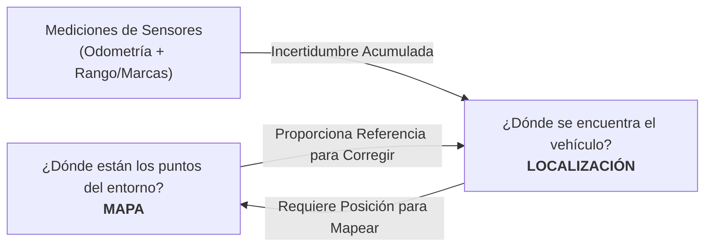
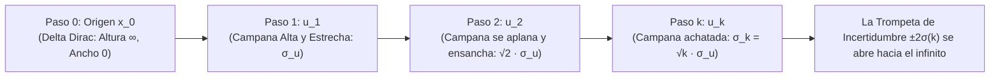
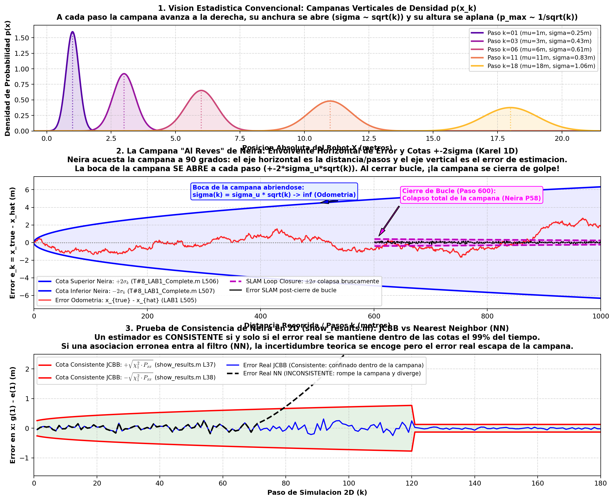
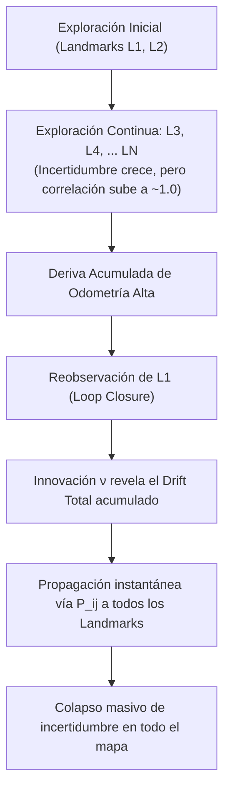

# 01. Fundamentos de SLAM y Filtrado Estocástico (EKF-SLAM)

---

## 🎯 Deconstrucción Conceptual (Protocolo Feynman)

El problema de **SLAM (Simultaneous Localization and Mapping)** surge de una paradoja circular de incertidumbre:
* Para construir un **mapa** preciso del entorno a partir de observaciones sensoriales ruidosas, el robot necesita conocer con exactitud su **posición** en cada instante.
* Para determinar su **posición** con exactitud a lo largo del tiempo, el robot necesita un **mapa** confiable contra el cual corregir la inevitable deriva (*drift*) de su odometría.



La resolución estocástica clásica consiste en estimar **conjuntamente** la postura del vehículo y las posiciones de todas las marcas (*landmarks*) del entorno dentro de una única distribución de probabilidad multivariada gaússiana, conocida como el **Mapa Estocástico** (*Stochastic Map*, Smith, Self & Cheeseman 1986).

---

## 📐 Formalismo Matemático

### 1. Variables de Estado y Mapa Estocástico

Definimos el vector de estado conjunto $\mathbf{x}_k \in \mathbb{R}^{d_R + N d_L}$ en el instante temporal $k$, donde el robot tiene dimensión $d_R$ (en 1D $d_R=1$, en 2D $d_R=3$ para $(x, y, \theta)$) y existen $N$ marcas en el mapa, cada una de dimensión $d_L$:

$$\mathbf{x}_k = \begin{bmatrix} \mathbf{x}_{R,k} \\ \mathbf{p}_{1,k} \\ \mathbf{p}_{2,k} \\ \vdots \\ \mathbf{p}_{N,k} \end{bmatrix}$$

La incertidumbre del sistema se modela como una distribución normal $\mathbf{x}_k \sim \mathcal{N}(\hat{\mathbf{x}}_k, \mathbf{P}_k)$, donde la matriz de covarianza conjunta $\mathbf{P}_k \in \mathbb{R}^{(d_R + N d_L) \times (d_R + N d_L)}$ adopta la estructura por bloques:

$$\mathbf{P}_k = \begin{bmatrix} 
\mathbf{P}_{RR} & \mathbf{P}_{R1} & \mathbf{P}_{R2} & \cdots & \mathbf{P}_{RN} \\
\mathbf{P}_{1R} & \mathbf{P}_{11} & \mathbf{P}_{12} & \cdots & \mathbf{P}_{1N} \\
\mathbf{P}_{2R} & \mathbf{P}_{21} & \mathbf{P}_{22} & \cdots & \mathbf{P}_{2N} \\
\vdots & \vdots & \vdots & \ddots & \vdots \\
\mathbf{P}_{NR} & \mathbf{P}_{N1} & \mathbf{P}_{N2} & \cdots & \mathbf{P}_{NN}
\end{bmatrix}_k$$

* $\mathbf{P}_{RR} \in \mathbb{R}^{d_R \times d_R}$: Varianza/covarianza de la pose del vehículo.
* $\mathbf{P}_{ii} \in \mathbb{R}^{d_L \times d_L}$: Incertidumbre marginal de la posición de la marca $i$.
* $\mathbf{P}_{Ri} = \mathbf{P}_{iR}^T \in \mathbb{R}^{d_R \times d_L}$: **Correlación cruzada entre el vehículo y la marca $i$**.
* $\mathbf{P}_{ij} = \mathbf{P}_{ji}^T \in \mathbb{R}^{d_L \times d_L}$: **Correlación cruzada entre la marca $i$ y la marca $j$**.

> [!IMPORTANT]
> **El secreto del SLAM reside en los términos fuera de la diagonal ($\mathbf{P}_{ij}, \mathbf{P}_{Ri}$).** Aunque las marcas sean estáticas e independientes en el mundo real, las mediciones continuas del sensor desde una postura incierta del robot generan correlaciones que crecen monótonamente hacia $+1$. Esto convierte al mapa en una red elástica y rígida de información compartida.

---

### 2. Modelo de Movimiento y Paso de Predicción

El vehículo se desplaza gobernado por un comando o lectura de odometría $\mathbf{u}_k$ con ruido aditivo $\mathbf{w}_k \sim \mathcal{N}(\mathbf{0}, \mathbf{Q}_k)$:

$$\mathbf{x}_{R,k} = f(\mathbf{x}_{R,k-1}, \mathbf{u}_k) + \mathbf{w}_k$$

Las marcas permanecen estacionarias en el entorno:

$$\mathbf{p}_{i,k} = \mathbf{p}_{i,k-1}, \quad \forall i \in \{1, \dots, N\}$$

El modelo de transición conjunto para todo el mapa es:

$$\mathbf{x}_k = \mathbf{f}(\mathbf{x}_{k-1}, \mathbf{u}_k) + \mathbf{G}_k \mathbf{w}_k = \begin{bmatrix} f(\mathbf{x}_{R,k-1}, \mathbf{u}_k) \\ \mathbf{p}_{1,k-1} \\ \vdots \\ \mathbf{p}_{N,k-1} \end{bmatrix} + \begin{bmatrix} \mathbf{I}_{d_R} \\ \mathbf{0} \\ \vdots \\ \mathbf{0} \end{bmatrix} \mathbf{w}_k$$

Linealizando alrededor de $\hat{\mathbf{x}}_{k-1|k-1}$ mediante la matriz Jacobiana $\mathbf{F}_k$:

$$\mathbf{F}_k = \left. \frac{\partial \mathbf{f}}{\partial \mathbf{x}} \right|_{\hat{\mathbf{x}}_{k-1|k-1}} = \begin{bmatrix} 
\mathbf{F}_{R,k} & \mathbf{0} & \cdots & \mathbf{0} \\
\mathbf{0} & \mathbf{I}_{d_L} & \cdots & \mathbf{0} \\
\vdots & \vdots & \ddots & \vdots \\
\mathbf{0} & \mathbf{0} & \cdots & \mathbf{I}_{d_L}
\end{bmatrix}$$

donde $\mathbf{F}_{R,k} = \left. \frac{\partial f}{\partial \mathbf{x}_R} \right|_{\hat{\mathbf{x}}_{R,k-1|k-1}}$.

#### Ecuaciones de Predicción:
1. **Estado predicho:**
   $$\hat{\mathbf{x}}_{k|k-1} = \mathbf{f}(\hat{\mathbf{x}}_{k-1|k-1}, \mathbf{u}_k)$$
2. **Covarianza predicha:**
   $$\mathbf{P}_{k|k-1} = \mathbf{F}_k \mathbf{P}_{k-1|k-1} \mathbf{F}_k^T + \mathbf{G}_k \mathbf{Q}_k \mathbf{G}_k^T$$

Desarrollando por bloques:
$$\begin{aligned}
\mathbf{P}_{RR, k|k-1} &= \mathbf{F}_{R,k} \mathbf{P}_{RR, k-1|k-1} \mathbf{F}_{R,k}^T + \mathbf{Q}_k \\
\mathbf{P}_{Ri, k|k-1} &= \mathbf{F}_{R,k} \mathbf{P}_{Ri, k-1|k-1} \\
\mathbf{P}_{ij, k|k-1} &= \mathbf{P}_{ij, k-1|k-1}
\end{aligned}$$

> [!NOTE]
> Observa que durante la predicción, la incertidumbre intrínseca de los landmarks ($\mathbf{P}_{ii}$) no se altera en absoluto. Sin embargo, las correlaciones cruzadas $\mathbf{P}_{Ri}$ cambian porque el robot se ha movido a una nueva posición con mayor incertidumbre odrométrica.

---

### 3. Modelo de Medición y Paso de Actualización

Supongamos que el sensor observa la marca $i$-ésima existente en el mapa, obteniendo la observación $\mathbf{z}_k$ con ruido $\mathbf{v}_k \sim \mathcal{N}(\mathbf{0}, \mathbf{R}_k)$:

$$\mathbf{z}_k = h(\mathbf{x}_{R,k}, \mathbf{p}_{i,k}) + \mathbf{v}_k$$

#### A. Innovación (Error de Predicción Sensorial)
$$\boldsymbol{\nu}_k = \mathbf{z}_k - h(\hat{\mathbf{x}}_{R,k|k-1}, \hat{\mathbf{p}}_{i,k|k-1})$$

#### B. Matriz Jacobiana de Medición
$$\mathbf{H}_k = \left. \frac{\partial h}{\partial \mathbf{x}} \right|_{\hat{\mathbf{x}}_{k|k-1}} = \begin{bmatrix} \mathbf{H}_{R,k} & \mathbf{0} & \cdots & \mathbf{H}_{p_i,k} & \cdots & \mathbf{0} \end{bmatrix}$$
donde $\mathbf{H}_{R,k} = \frac{\partial h}{\partial \mathbf{x}_R} \in \mathbb{R}^{d_z \times d_R}$ y $\mathbf{H}_{p_i,k} = \frac{\partial h}{\partial \mathbf{p}_i} \in \mathbb{R}^{d_z \times d_L}$.

#### C. Covarianza de la Innovación ($\mathbf{S}_k$)
$$\mathbf{S}_k = \mathbf{H}_k \mathbf{P}_{k|k-1} \mathbf{H}_k^T + \mathbf{R}_k = \mathbf{H}_R \mathbf{P}_{RR} \mathbf{H}_R^T + \mathbf{H}_R \mathbf{P}_{Ri} \mathbf{H}_{p_i}^T + \mathbf{H}_{p_i} \mathbf{P}_{iR} \mathbf{H}_R^T + \mathbf{H}_{p_i} \mathbf{P}_{ii} \mathbf{H}_{p_i}^T + \mathbf{R}_k$$

#### D. Ganancia de Kalman ($\mathbf{K}_k$)
$$\mathbf{K}_k = \mathbf{P}_{k|k-1} \mathbf{H}_k^T \mathbf{S}_k^{-1}$$
Nótese que $\mathbf{K}_k \in \mathbb{R}^{(d_R + N d_L) \times d_z}$. La ganancia tiene componentes para el robot ($\mathbf{K}_R$) y para **todas y cada una de las marcas del mapa** ($\mathbf{K}_j$):
$$\mathbf{K}_j = \left( \mathbf{P}_{jR} \mathbf{H}_R^T + \mathbf{P}_{ji} \mathbf{H}_{p_i}^T \right) \mathbf{S}_k^{-1}$$

#### E. Actualización del Estado y la Covarianza
$$\hat{\mathbf{x}}_{k|k} = \hat{\mathbf{x}}_{k|k-1} + \mathbf{K}_k \boldsymbol{\nu}_k$$
$$\mathbf{P}_{k|k} = (\mathbf{I} - \mathbf{K}_k \mathbf{H}_k) \mathbf{P}_{k|k-1} = \mathbf{P}_{k|k-1} - \mathbf{K}_k \mathbf{S}_k \mathbf{K}_k^T$$

---

### 4. Incorporación de Nuevas Marcas (*Map Augmentation*)

Cuando el sensor detecta una entidad que no corresponde a ninguna marca previa, debe añadirse al mapa. La posición de la nueva marca $\mathbf{p}_{\text{new}}$ se deriva invirtiendo el modelo de medición:

$$\mathbf{p}_{\text{new}} = g(\mathbf{x}_{R,k}, \mathbf{z}_k)$$

El estado y la covarianza se expanden:

$$\mathbf{x}_{\text{aug}} = \begin{bmatrix} \mathbf{x}_k \\ \mathbf{p}_{\text{new}} \end{bmatrix}, \quad \mathbf{P}_{\text{aug}} = \begin{bmatrix} \mathbf{P}_k & \mathbf{P}_{k} \mathbf{J}_{g, x}^T \\ \mathbf{J}_{g, x} \mathbf{P}_k & \mathbf{J}_{g, x} \mathbf{P}_k \mathbf{J}_{g, x}^T + \mathbf{J}_{g, z} \mathbf{R}_k \mathbf{J}_{g, z}^T \end{bmatrix}$$
donde $\mathbf{J}_{g, x} = \begin{bmatrix} \frac{\partial g}{\partial \mathbf{x}_R} & \mathbf{0} & \cdots & \mathbf{0} \end{bmatrix}$ y $\mathbf{J}_{g, z} = \frac{\partial g}{\partial \mathbf{z}}$.

---

## 🔔 La Campana de Incertidumbre y la Trompeta de Odometría (Uncertainty Envelope)

Uno de los conceptos visuales y matemáticos más cruciales de la Lección 1 es la **dispersión espacial de la función de densidad de probabilidad (PDF)** y la formación de la **"Trompeta de Incertidumbre"** ($\pm 2\sigma$ confidence envelope) que se abre incondicionalmente a medida que el robot avanza.



### 1. Evolución Matemática de la Campana Gaussiana Paso a Paso
Supongamos que Karel parte del origen con certeza inicial (modelada formalmente como el límite de una Gaussiana cuando $\sigma \to 0$, i.e., la función Delta de Dirac $\delta(x)$).

A cada paso discreto $k$, se comanda un desplazamiento $u_k$ afectado por un error de odometría aleatorio independiente $\tilde{u}_k \sim \mathcal{N}(0, \sigma_u^2)$:

1. **Paso 1 ($k=1$):** El robot se encuentra en $\hat{x}_1 = u_1$ con varianza $\sigma_1^2 = \sigma_u^2$.
   $$p(x_1) = \frac{1}{\sigma_u \sqrt{2\pi}} \exp\left( -\frac{(x_1 - u_1)^2}{2\sigma_u^2} \right)$$
2. **Paso 2 ($k=2$):** Se comanda otro paso $u_2$. Dado que los ruidos son independientes:
   $$\hat{x}_2 = u_1 + u_2, \quad \sigma_2^2 = \sigma_1^2 + \sigma_u^2 = 2 \sigma_u^2 \implies \sigma_2 = \sqrt{2}\sigma_u$$
   *La campana se desplaza hacia la derecha, su anchura se expande por un factor $\sqrt{2} \approx 1.414$, y su altura máxima disminuye en $\frac{1}{\sqrt{2}} \approx 0.707$ para preservar el área total unitaria $\int p(x)dx = 1$.*
3. **Paso $k$ General:** Tras $k$ pasos idénticos:
   $$\hat{x}_k = k \cdot u, \quad \sigma_k^2 = k \cdot \sigma_u^2 \implies \sigma_k = \sqrt{k} \cdot \sigma_u$$
   $$p(x_k) = \frac{1}{\sqrt{2\pi k \sigma_u^2}} \exp\left( -\frac{(x_k - k u)^2}{2 k \sigma_u^2} \right)$$
   * **Amplitud del pico:** Decae asintóticamente como $\mathcal{O}(1/\sqrt{k})$.
   * **Anchura de la base (soporte $2\sigma$):** Se abre y ensancha como $\mathcal{O}(\sqrt{k})$.

---

### 2. La Trompeta de Incertidumbre y la Paradoja de la "Ida y Vuelta" (*Back and Forth*)
Al graficar la trayectoria estimada del robot a lo largo del tiempo o distancia junto con sus bandas de confianza del $95.4\%$ ($\pm 2\sigma$):

$$\text{Banda Superior:} \quad x_{\text{upper}}(k) = \hat{x}_k + 2 \sigma_u \sqrt{k}$$
$$\text{Banda Inferior:} \quad x_{\text{lower}}(k) = \hat{x}_k - 2 \sigma_u \sqrt{k}$$

Estas bandas forman una **envolvente parabólica en forma de trompeta que se abre continuamente**.

> [!CAUTION]
> **El Teorema Ineludible de la Odometría Pura:**
> **La incertidumbre en odometría abierta SIEMPRE crece monótonamente en el tiempo.**
> Supongamos que el robot avanza 100 metros hacia adelante y luego da la vuelta ($180^\circ$) y retrocede 100 metros regresando exactamente al punto físico de partida ($x = 0$).
> * La posición esperada retorna al origen: $\hat{x}_{\text{final}} = 100 - 100 = 0\text{ m}$.
> * **Sin embargo, la incertidumbre NO se reduce a cero ni se cancela:**
>   $$\sigma_{\text{final}}^2 = \sum_{i=1}^{100} \sigma_u^2 + \sum_{i=101}^{200} \sigma_u^2 = 200 \sigma_u^2 \implies \sigma_{\text{final}} = \sqrt{200} \sigma_u \approx 14.14 \sigma_u$$
> * Las bandas de confianza están más abiertas que nunca al regresar al inicio. Los errores odrométricos son estocásticos e irreversibles: el movimiento hacia atrás inyecta tanto ruido adicional como el movimiento hacia adelante.

---

### 3. La Construcción de Neira: ¿Por Qué la Pone "Al Revés"? (Espacio del Error y Envolvente ±2σ)

En las clases magistrales de la Universidad de Zaragoza, el Prof. José Neira no grafica una secuencia de campanas de Gauss verticales sobre el camino; **la pone "al revés" (acostada horizontalmente a $90^\circ$ sobre el eje del tiempo/distancia)**. 

#### A. Las Tres Razones del "Al Revés" de Neira
1. **Rotación Dimensional ($90^\circ$):** 
   - La campana de Gauss clásica tiene la densidad $p(x)$ en el eje vertical y la posición $x$ en el horizontal.
   - Neira traslada el análisis al **espacio del error centrado en cero ($y = 0$)**: el eje horizontal es la progresión de la trayectoria ($k$ pasos o metros recorridos), y el eje vertical es el error de estimación ($e_k = x_{\text{true}} - \hat{x}$).
   - Las cotas de confianza del $95.4\%$ ($\pm 2\sigma_k$) forman las paredes superior e inferior de la campana. Como $\sigma_k = \sigma_u \sqrt{k}$, las paredes siguen una curva parabólica que **se abre horizontalmente hacia la derecha**: es una campana acostada cuya boca se ensancha a cada paso.
2. **Inversión del Signo del Error:**
   - En teoría clásica de control, el error suele formularse como $e = \hat{x} - x_{\text{true}}$ (estimación menos verdad).
   - Neira lo invierte ("al revés"): $e_k = x_{\text{true}, k} - \hat{x}_k$ (`map.stats.true_robot_x - map.hat_x(1)` en Karel 1D, y `g(1,:) - e(1,:)` en Karel 2D).
3. **Criterio Estricto de Consistencia Estadística:**
   - La trayectoria del error real (línea roja o azul) es una realización estocástica de una caminata aleatoria (proceso de Wiener / movimiento Browniano).
   - **Regla de Oro de Consistencia:** El estimador es consistente si y solo si el error real permanece confinado dentro de la boca de la campana el $95.45\%$ del tiempo para $\pm 2\sigma$ (o el $99\%$ para cotas $\pm \sqrt{\chi^2_1 P}$). Si el error se escapa de la campana (como ocurre con *Nearest Neighbor* ante emparejamientos erróneos), el filtro se vuelve **inconsistente**.

#### B. Construcción Exacta en los Códigos de MATLAB

##### 1. En Karel 1D (`T#8_LAB1_Complete.m`, Líneas 496–511):
```matlab
% Error y varianza calculados a cada paso k:
map.stats.error_robot_x = [map.stats.error_robot_x; (map.stats.true_robot_x(end) - map.hat_x(1))];
map.stats.sigma_robot_x = [map.stats.sigma_robot_x; sqrt(map.hat_P(1,1))];

% Construcción de la campana de incertidumbre abierta al revés:
figure; grid on; hold on;
plot(map.stats.true_robot_x,  map.stats.error_robot_x, 'r-', 'Linewidth', 2); % Error real
plot(map.stats.true_robot_x,  2*map.stats.sigma_robot_x, 'b-', 'Linewidth', 2); % Cota superior +2σ
plot(map.stats.true_robot_x, -2*map.stats.sigma_robot_x, 'b-', 'Linewidth', 2); % Cota inferior -2σ
xlabel('meters (m)'); ylabel('meters (m)');
title('Robot estimation error + 2sigma bounds');
```

##### 2. En Karel 2D (`show_results.m`, Líneas 33–51):
```matlab
% g = trayectoria real (ground truth), e = trayectoria estimada por EKF
% es = historial de matrices de covarianza P
figure; hold on;
subplot(2, 2, 1); hold on; title('Vehicle error in x (m)');
plot(g(1,:) - e(1,:), 'b-');                         % Error real en x
plot( sqrt(chi2(1)*es(1,1:3:end)), 'r-');           % Cota superior +√(χ²·P_xx)
plot(-sqrt(chi2(1)*es(1,1:3:end)), 'r-');           % Cota inferior -√(χ²·P_xx)

subplot(2, 2, 2); hold on; title('Vehicle error in y (m)');
plot(g(2,:) - e(2,:), 'b-');
plot( sqrt(chi2(1)*es(2,2:3:end)), 'r-');
plot(-sqrt(chi2(1)*es(2,2:3:end)), 'r-');

subplot(2, 2, 3); hold on; title('Vehicle error in theta (deg)');
plot((normalize(g(3,:) - e(3,:)))*180/pi, 'b-');
plot( sqrt(chi2(1)*es(3,3:3:end))*180/pi, 'r-');
plot(-sqrt(chi2(1)*es(3,3:3:end))*180/pi, 'r-');
```

---

### 4. Evidencia Experimental Generada

A continuación se presenta la gráfica experimental tripartita que sintetiza la visión estadística clásica frente a la construcción de Neira en 1D y 2D:



*(Gráfica generada mediante el script ejecutable [`reference_code/matlab_slam_labs/lab1_1d_karel/plot_neira_uncertainty_bell.py`](file:///d:/Voyager/reference_code/matlab_slam_labs/lab1_1d_karel/plot_neira_uncertainty_bell.py))*.

* **Panel 1 (Arriba - Visión Convencional):** Campanas de densidad $p(x_k)$ que se desplazan hacia la derecha, aplanándose y ensanchándose en $\sigma \propto \sqrt{k}$.
* **Panel 2 (Centro - La Campana al Revés de Neira en 1D):** La envolvente $\pm 2\sigma$ centrada en $0$. La campana se abre continuamente bajo odometría pura ($\sigma \to \infty$), mientras que en SLAM, en el momento del cierre de bucle (paso 600), la campana **se cierra de golpe**, estrangulando la incertidumbre de vuelta a cero.
* **Panel 3 (Abajo - Consistencia 2D de Neira):** Comparación entre JCBB (consistente, el error vive atrapado dentro de las cotas $\pm \sqrt{\chi^2_1 P_{xx}}$) y Nearest Neighbor (inconsistente, una falsa asociación colapsa falsamente la covarianza pero hace explotar el error real fuera de la campana).

---

## 🔬 Evolución de la Correlación y Cierre de Bucle (*Loop Closing*)

Definimos el coeficiente de correlación de Pearson entre la variable $i$ y la variable $j$:

$$\rho_{ij} = \frac{P_{ij}}{\sqrt{P_{ii} P_{jj}}}, \quad -1 \le \rho_{ij} \le 1$$

Durante la fase de exploración en un entorno desconocido:
1. Conforme el robot avanza detectando nuevas marcas sucesivas, la correlación mutua entre todos los pares de marcas $\rho_{ij}$ **se incrementa monótonamente hacia $+1$**.
2. **Mapeo Exploratorio:** La incertidumbre absoluta de las marcas crece linealmente con la distancia recorrida (al igual que la odometría), pero su distancia relativa se conoce con enorme precisión.
3. **Cierre de Bucle:** En el instante en que el robot regresa al inicio y observa nuevamente la marca $\mathbf{p}_1$ (cuya varianza inicial era casi nula):
   * La innovación $\boldsymbol{\nu}_k$ contiene el error acumulado durante todo el viaje.
   * A través de las correlaciones cruzadas $\mathbf{P}_{j1} \approx \sqrt{P_{jj} P_{11}}$, el vector de ganancia de Kalman $\mathbf{K}$ actualiza **todo el estado del mapa de forma simultánea**.
   * La covarianza de todas las marcas intermedias $\mathbf{P}_{jj}$ sufre un colapso masivo, reduciendo su incertidumbre al límite impuesto por el sensor.



---

## ⚠️ El Coste Computacional $\mathcal{O}(N^2)$

La actualización de la covarianza:
$$\mathbf{P}_{k|k} = \mathbf{P}_{k|k-1} - \mathbf{K}_k \mathbf{S}_k \mathbf{K}_k^T$$

Involucra el producto exterior de $\mathbf{K}_k \in \mathbb{R}^{(d_R + N d_L) \times d_z}$ con $\mathbf{S}_k \in \mathbb{R}^{d_z \times d_z}$.
* Para actualizar todos los elementos de la matriz $\mathbf{P}_k$, se requieren $\mathcal{O}(N^2)$ operaciones algebraicas por cada observación.
* Cuando $N > 1.000$ marcas (habitual en mapas urbanos o de interior), el tiempo de cálculo por ciclo supera ampliamente los $100\text{ ms}$, haciendo que el EKF-SLAM clásico sea computacionalmente inviable en tiempo real sin estrategias de submapeo.

---

## 🧪 Mini-Test de Verificación Numérica (Feynman Protocol)

El siguiente script en Python reproduce el experimento 1D canónico de Karel the Robot (Smith-Cheeseman EKF), demostrando el crecimiento de correlación cruzada hacia $+1$ y la corrección de bucle:

```python
import numpy as np

def test_1d_ekf_slam():
    # Estado inicial: [x_robot, p1, p2]
    x_true = np.array([0.0, 5.0, 10.0])
    x_est = np.array([0.0, 5.0, 10.0])
    
    # Matriz de covarianza P (robot conocido en origen, landmarks con ruido inicial)
    P = np.diag([1e-6, 0.5, 0.5])
    
    sigma_u = 0.2  # Odometria (ruido por paso)
    sigma_z = 0.05 # Sensor de rango
    
    # 1. Movimiento del robot (u = +2.0m)
    u = 2.0
    F = np.eye(3)
    G = np.array([[1.0], [0.0], [0.0]])
    Q = np.array([[sigma_u**2]])
    
    # Predicción
    x_est[0] += u
    P = F @ P @ F.T + G @ Q @ G.T
    
    # 2. Medición a p1 (distancia z = p1 - x_robot)
    z_pred = x_est[1] - x_est[0]
    z_meas = (x_true[1] - (x_true[0] + u)) + 0.01  # Medicion simulada
    H = np.array([[-1.0, 1.0, 0.0]])
    
    # Innovación y ganancia
    nu = z_meas - z_pred
    S = H @ P @ H.T + sigma_z**2
    K = P @ H.T / S[0, 0]
    
    # Actualización EKF
    x_est = x_est + (K * nu).flatten()
    P = P - K @ S @ K.T
    
    # Verificación de invariantes:
    # Coeficiente de correlacion rho(p1, p2)
    rho_12 = P[1, 2] / np.sqrt(P[1, 1] * P[2, 2])
    
    assert P[0, 0] < (sigma_u**2), "La actualización debió reducir la varianza del robot"
    assert np.all(np.linalg.eigvals(P) >= 0), "La matriz P debe ser semidefinida positiva"
    print("1D EKF SLAM Invariants Verified! Covariance trace:", np.trace(P))

if __name__ == "__main__":
    test_1d_ekf_slam()
```
