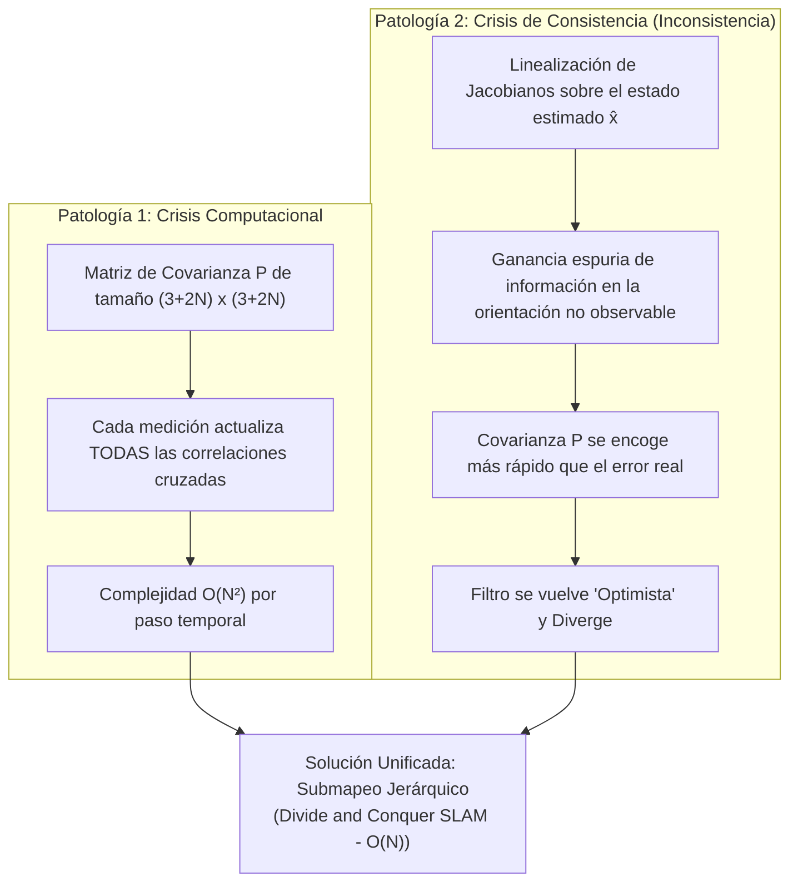
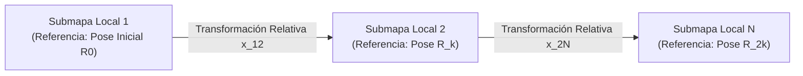
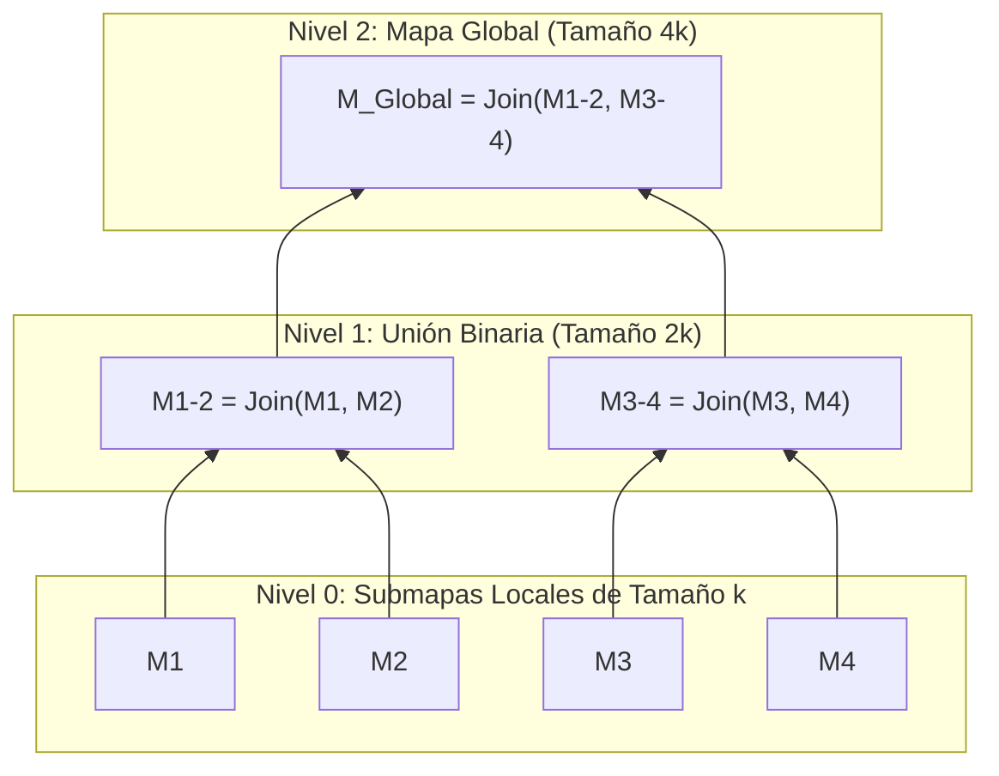

# 03. Escalabilidad, Consistencia e Inconsistencia en SLAM (Divide & Conquer)

---

## 🎯 Deconstrucción Conceptual: La Doble Crisis del EKF Clásico

Durante dos décadas (1986–2006), la robótica móvil asumió que el Filtro de Kalman Extendido (EKF-SLAM) era el estándar de oro de la estimación estocástica. Sin embargo, a medida que los robots comenzaron a recorrer kilómetros en lugar de habitaciones, el EKF colapsó bajo dos patologías matemáticas fundamentales:



---

## 📉 La Inconsistencia del Filtro: La Paradoja del "Filtro Optimista"

### 1. Definición Formal de Consistencia de un Estimador
Un estimador estocástico $(\hat{\mathbf{x}}_k, \mathbf{P}_k)$ se define formalmente como **consistente** si cumple dos propiedades estadísticas incondicionales:
1. **Insesgadez:** El valor esperado del error de estimación es cero:
   $$\mathbb{E}[\mathbf{e}_k] = \mathbb{E}[\mathbf{x}_k - \hat{\mathbf{x}}_k] = \mathbf{0}$$
2. **Cota de Covarianza:** La matriz de covarianza calculada $\mathbf{P}_k$ es una cota superior conservadora del error cuadrático medio real:
   $$\mathbf{P}_k \ge \mathbb{E}[\mathbf{e}_k \mathbf{e}_k^T] \iff \mathbf{P}_k - \mathbb{E}[\mathbf{e}_k \mathbf{e}_k^T] \in \mathbb{S}_{\ge 0}$$
   donde $\mathbb{S}_{\ge 0}$ denota el cono de matrices semidefinidas positivas.

### 2. Métrica NEES (Normalized Estimation Error Squared)
Para auditar la consistencia experimental con acceso a una trayectoria de referencia (*Ground Truth*), se emplea el estadístico **NEES**:

$$\epsilon_k = (\mathbf{x}_k - \hat{\mathbf{x}}_k)^T \mathbf{P}_k^{-1} (\mathbf{x}_k - \hat{\mathbf{x}}_k)$$

Si el filtro es perfectamente lineal y gaussiano, $\epsilon_k$ sigue una distribución Chi-cuadrado con $n = \dim(\mathbf{x})$ grados de libertad:

$$\epsilon_k \sim \chi^2_n$$

Promediando sobre $M$ simulaciones independientes de Monte Carlo:

$$\bar{\epsilon}_k = \frac{1}{M} \sum_{i=1}^M \epsilon_{k,i}$$

El estimador se declara consistente al nivel del $95\%$ si $\bar{\epsilon}_k$ se mantiene acotado dentro del intervalo bilateral de doble cola:

$$\bar{\epsilon}_k \in \left[ \frac{\chi^2_{M \cdot n, 1 - \alpha/2}}{M}, \frac{\chi^2_{M \cdot n, \alpha/2}}{M} \right]$$

> [!WARNING]
> **El Diagnóstico de Optimismo:** En el EKF-SLAM convencional en 2D y 3D, el valor empírico de $\bar{\epsilon}_k$ se dispara exponencialmente hacia el infinito ($\bar{\epsilon}_k \gg \chi^2$). El filtro subestima sistemáticamente su propia incertidumbre: cree que conoce su pose con precisión de milímetros cuando en realidad arrastra un error de varios metros.

---

### 3. Origen Matemático de la Inconsistencia: El Subespacio No Observable

En un problema SLAM sin sensores absolutos (como brújula o GPS), el sistema físico posee **3 grados de libertad no observables** en 2D (la posición absoluta de traslación $(x_0, y_0)$ y la orientación absoluta del mundo $\theta_0$).
* La matriz de información del sistema ideal tiene un espacio nulo (*nullspace*) de dimensión 3:
  $$\mathbf{H}_{\text{ideal}} \cdot \mathbf{v}_{\text{rigid}} = \mathbf{0}$$
* Sin embargo, al calcular los Jacobianos $\mathbf{F}_k$ y $\mathbf{H}_k$ evaluándolos sobre la estimación **incierta y ruidosa** $\hat{\mathbf{x}}$ en vez del valor verdadero $\mathbf{x}_{\text{true}}$, el rango de la matriz de información se incrementa artificialmente.
* **Consecuencia Falsa:** El filtro calcula numéricamente que ha adquirido información sobre la orientación global $\theta_0$. La covarianza en el ángulo se reduce falsamente, cerrando prematuramente las compuertas de innovación $\mathbf{S}_k$. Mediciones posteriores legítimas son rechazadas como supuestos *outliers*, provocando la rotura del mapa.

---

## 🧩 Paradigmas de Submapeo: Rompiendo la Dependencia Global

Para combatir la inconsistencia y el coste $\mathcal{O}(N^2)$, la solución consiste en desacoplar el mapa en **submapas locales estocásticos independientes**.



### 1. Decoupled Stochastic Mapping (DSM - Leonard & Feder 2001)
* Divide el entorno en regiones espaciales acotadas.
* El robot mantiene un mapa activo con las marcas cercanas y un conjunto de marcas de frontera compartidas (*landmarks de anclaje*).
* Desventaja: Las correlaciones entre submapas se descartan o aproximan, lo que puede introducir pérdida de optimalidad en cierres de bucle grandes.

### 2. Sequential Map Joining (SMJ - Newman 2000)
* El robot construye un submapa local $M_1$ con respecto a su pose inicial $\mathbf{x}_{R0}$.
* Al alcanzar un umbral de incertidumbre o tamaño, fija $M_1$, traslada su origen al estado actual del robot e inicia un submapa independiente $M_2$.
* Una vez finalizado $M_2$, une $M_1$ y $M_2$ resolviendo la ecuación de compatibilidad entre marcas comunes observadas en ambos submapas mediante un paso de actualización linealizado.

---

## 🏆 Divide and Conquer SLAM (D&C SLAM - Paz, Tardós & Neira 2008)

El algoritmo **Divide and Conquer SLAM (IEEE Transactions on Robotics, 2008)** revolucionó el filtrado estocástico al demostrar que es posible obtener la solución de máxima verosimilitud de todo el mapa con **coste computacional amortizado $\mathcal{O}(N)$** y una consistencia muy superior al EKF clásico.



### 1. Arquitectura del Árbol Binario de Submapas
1. **Construcción Local:** El robot construye pequeños submapas locales de tamaño constante $k$ (por ejemplo, $k = 20$ marcas).
2. **Jerarquía Binaria:** Los submapas adyacentes no se concatenan secuencialmente a un mapa global gigante; en su lugar, se combinan en un **árbol binario de fusión**:
   * Dos mapas de nivel 0 ($k$ marcas) se unen en un mapa de nivel 1 ($2k$ marcas).
   * Dos mapas de nivel 1 se unen en un mapa de nivel 2 ($4k$ marcas).
3. **Complejidad Amortizada $\mathcal{O}(N)$:**
   * La unión de dos mapas de tamaño $m$ cuesta $\mathcal{O}(m^3)$ operaciones de inversión de matriz.
   * En un recorrido de longitud $N$, existen $N/k$ submapas. En el árbol binario, el número de uniones a nivel $l$ es proporcional a $N / (k \cdot 2^l)$.
   * La suma de costes en todos los niveles de la jerarquía es:
     $$\text{Coste Total} \propto \sum_{l=0}^{\log_2(N/k)} \frac{N}{k 2^l} (k 2^l)^3 = \mathcal{O}(N)$$
   * Cada paso de odometría/medición tiene un coste amortizado estrictamente lineal con respecto al número de marcas $N$.

### 2. Por qué D&C Resuelve Radicalmente la Inconsistencia
En el EKF clásico, un error de linealización en el paso 10 contamina la pose del robot y las marcas para siempre hasta el paso 10.000.
* En **D&C SLAM**, cada submapa local de tamaño $k$ se calcula con su propio sistema de coordenadas local centrado en la pose inicial del robot en ese tramo.
* Dado que el vehículo recorre una distancia corta dentro de cada submapa local, el error angular $\Delta \theta$ es microscópico y **las linealizaciones son altamente precisas**.
* Cuando los submapas se unen en los niveles superiores del árbol, la transformación relativa se efectúa en un único paso cerrado utilizando todas las marcas de solapamiento mutuo, eliminando la acumulación lenta y traicionera de inconsistencia angular.

---

## 🧪 Mini-Test de Verificación de Inconsistencia (NEES Audit)

El siguiente script en Python simula una trayectoria con acumulación de error de linealización y calcula la métrica NEES comparándola con el umbral $\chi^2$:

```python
import numpy as np
from scipy.stats import chi2

def test_nees_consistency():
    np.random.seed(42)
    dim_x = 3 # (x, y, theta)
    steps = 100
    alpha = 0.05
    
    # Simular una divergencia típica de EKF (optimista)
    # El error real crece más rápido que la covarianza estimada
    true_errors = []
    estimated_covs = []
    nees_history = []
    
    P_est = np.eye(dim_x) * 0.1
    for t in range(steps):
        # El error real acumula drift angular no lineal
        true_err = np.random.multivariate_normal(mean=np.zeros(dim_x), cov=np.eye(dim_x) * (0.1 + 0.005 * t))
        # El filtro cree erróneamente que la covarianza se ha estabilizado
        P_est = P_est * 0.99 + np.eye(dim_x) * 0.001
        
        # Cálculo de NEES
        eps = true_err.T @ np.linalg.inv(P_est) @ true_err
        nees_history.append(eps)
        
    avg_nees = np.mean(nees_history)
    chi2_upper = chi2.ppf(1.0 - alpha, df=dim_x)
    
    # Verificación de diagnóstico: Un filtro inconsistente rebasa chi2_upper
    is_inconsistent = avg_nees > chi2_upper
    assert is_inconsistent, "El mini-test debe detectar el comportamiento optimista e inconsistente"
    print(f"NEES Audit Verified! Avg NEES: {avg_nees:.2f} vs Chi2 Bound ({1-alpha:.2f}): {chi2_upper:.2f}")

if __name__ == "__main__":
    test_nees_consistency()
```
