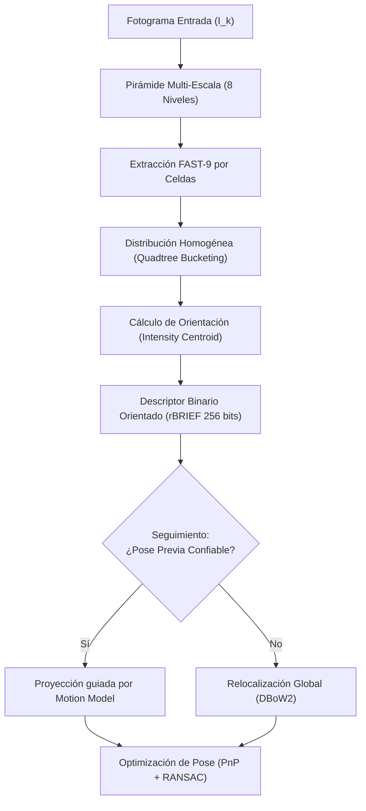

# 04. Front-End Visual, Geometría Proyectiva y Extracción de Features (ORB)

---

## 🎯 Deconstrucción Conceptual (Protocolo Feynman)

A diferencia de los telémetros láser que proporcionan mediciones directas de distancia métrica, una cámara estándar es un sensor **proyectivo angular** (*bearing-only sensor*). 
* Cada píxel $(u, v)$ en la imagen define un rayo óptico en el espacio tridimensional.
* **El Teorema de la Escala Perdida (Monocular):** Una sola cámara pierde la noción de escala métrica absoluta. La distancia a un objeto sólo puede inferirse mediante el movimiento relativo del observador (*paralaje geométrico*), triangulando rayos ópticos desde múltiples puntos de vista distintos.



---

## 📷 Modelo de Cámara Pinhole y Geometría Epipolar

### 1. Modelo de Cámara Estenopeica (*Pinhole Camera Model*)
Un punto 3D en coordenadas del mundo $\mathbf{p}_W = [X_W, Y_W, Z_W]^T \in \mathbb{R}^3$ se transforma al sistema de coordenadas de la cámara $\mathbf{p}_C = [X_C, Y_C, Z_C]^T$ mediante la pose de la cámara $\mathbf{T}_{CW} = [\mathbf{R}_{CW} \mid \mathbf{t}_{CW}] \in SE(3)$:

$$\mathbf{p}_C = \mathbf{R}_{CW} \mathbf{p}_W + \mathbf{t}_{CW}$$

La proyección en el plano de imagen normalizado $(x_n, y_n)$ y en coordenadas de píxel $(u, v)$ está gobernada por la matriz intrínseca $\mathbf{K}$:

$$\begin{bmatrix} u \\ v \\ 1 \end{bmatrix} = \frac{1}{Z_C} \mathbf{K} \mathbf{p}_C = \frac{1}{Z_C} \begin{bmatrix} f_x & 0 & c_x \\ 0 & f_y & c_y \\ 0 & 0 & 1 \end{bmatrix} \begin{bmatrix} X_C \\ Y_C \\ Z_C \end{bmatrix}$$
* $f_x, f_y$: Distancias focales expresadas en unidades de píxeles.
* $c_x, c_y$: Coordenadas del punto principal (intersección del eje óptico con el sensor).

#### Distorsión de Lente (Modelo Radial-Tangencial de Brown-Conrady):
Las coordenadas normalizadas no distorsionadas $(x_n, y_n) = (X_C/Z_C, Y_C/Z_C)$ con radio $r^2 = x_n^2 + y_n^2$ se corrigen antes de la proyección:

$$\begin{aligned}
x_{\text{dist}} &= x_n (1 + k_1 r^2 + k_2 r^4 + k_3 r^6) + 2 p_1 x_n y_n + p_2 (r^2 + 2 x_n^2) \\
y_{\text{dist}} &= y_n (1 + k_1 r^2 + k_2 r^4 + k_3 r^6) + p_1 (r^2 + 2 y_n^2) + 2 p_2 x_n y_n
\end{aligned}$$

---

### 2. Geometría Epipolar entre Dos Vistas
Dadas dos imágenes capturadas desde poses relativas $(\mathbf{R}, \mathbf{t})$, un punto 3D proyectado en coordenadas normalizadas como $\mathbf{x}_1$ en la vista 1 y $\mathbf{x}_2$ en la vista 2 obedece la **restricción epipolar coplanar**:

$$\mathbf{x}_2^T \mathbf{E} \mathbf{x}_1 = 0$$

donde $\mathbf{E} \in \mathbb{R}^{3 \times 3}$ es la **Matriz Esencial**:

$$\mathbf{E} = [\mathbf{t}]_\times \mathbf{R} = \begin{bmatrix} 0 & -t_z & t_y \\ t_z & 0 & -t_x \\ -t_y & t_x & 0 \end{bmatrix} \mathbf{R}$$

En coordenadas directas de píxeles, la relación utiliza la **Matriz Fundamental** $\mathbf{F}$:

$$\mathbf{u}_2^T \mathbf{F} \mathbf{u}_1 = 0, \quad \mathbf{F} = \mathbf{K}^{-T} \mathbf{E} \mathbf{K}^{-1}$$

* La línea epipolar asociada al punto $\mathbf{u}_1$ en la segunda imagen es $\mathbf{l}_2 = \mathbf{F} \mathbf{u}_1$.
* Toda correspondencia legítima $\mathbf{u}_2$ debe yacer sobre $\mathbf{l}_2$, reduciendo la búsqueda 2D de correspondencias a un escaneo 1D a lo largo de una línea.

---

### 3. Triangulación de Puntos 3D (Direct Linear Transform - DLT)
Dadas dos observaciones emparejadas $\mathbf{x}_1$ y $\mathbf{x}_2$, y las matrices de proyección $\mathbf{P}_1 = \mathbf{K}[\mathbf{I} \mid \mathbf{0}]$ y $\mathbf{P}_2 = \mathbf{K}[\mathbf{R} \mid \mathbf{t}]$:

$$\mathbf{u}_1 \times (\mathbf{P}_1 \tilde{\mathbf{p}}_W) = \mathbf{0}, \quad \mathbf{u}_2 \times (\mathbf{P}_2 \tilde{\mathbf{p}}_W) = \mathbf{0}$$

Esto se formula como un sistema lineal homogéneo $\mathbf{A} \tilde{\mathbf{p}}_W = \mathbf{0}$ de dimensión $4 \times 4$, cuya solución óptima se extrae mediante la descomposición en valores singulares (SVD) de $\mathbf{A}$, tomando el autovector correspondiente al menor valor singular.

> [!IMPORTANT]
> **El Criterio del Paralaje:** La triangulación es numéricamente inestable si el ángulo de paralaje $\theta_{\text{parallax}}$ entre los dos rayos ópticos es inferior a $1.0^\circ$. El sistema debe rechazar puntos con paralaje casi nulo para evitar proyectar coordenadas hacia el infinito con varianza descontrolada.

---

## ⚡ Extracción y Descripción de Características ORB

ORB (*Oriented FAST and Rotated BRIEF*, Rublee et al. 2011) proporciona invariancia a escala y rotación con un coste computacional dos órdenes de magnitud menor que SIFT o SURF, permitiendo ejecución a 30 FPS en CPUs embebidas como la Raspberry Pi 3B.

### 1. Detección de Esquinas FAST-9
Un píxel candidato $p$ con intensidad $I_p$ es una esquina si existe un arco contiguo de al menos 9 píxeles en una circunferencia de Bresenham de 16 píxeles de radio que sean todos más brillantes que $I_p + \epsilon_{\text{fast}}$ o todos más oscuros que $I_p - \epsilon_{\text{fast}}$.
* Se acelera con un árbol de decisión ID3 entrenado evaluando primero los píxeles opuestos 1, 9, 5 y 13.

### 2. Cuadrícula Homogénea (Quadtree Bucketing)
Para evitar que todas las esquinas se concentren en regiones de alta textura (dejando zonas desérticas en el resto del fotograma), ORB-SLAM divide la imagen recursivamente con una estructura de cuadrante (*Quadtree*):
* Si una celda contiene más de una esquina, se subdivide en 4 cuadrantes.
* Se conserva únicamente la esquina de mayor respuesta de Harris por nodo de hoja, garantizando una dispersión espacial geométricamente uniforme en todo el plano visual.

### 3. Centroide de Intensidad y Orientación (*Intensity Centroid*)
Para asignar una orientación consistente $\theta \in [-\pi, \pi)$ que proporcione invariancia a rotación, se calcula el centroide de intensidad sobre un parche circular de radio $r$:

$$m_{pq} = \sum_{x=-r}^r \sum_{y=-r}^r x^p y^q I(x, y)$$

El centro de masa $\mathbf{C}$ y el vector de orientación $\theta$ son:

$$\mathbf{C} = \left( \frac{m_{10}}{m_{00}}, \frac{m_{01}}{m_{00}} \right), \quad \theta = \text{atan2}(m_{01}, m_{10})$$

### 4. Descriptor Rotado rBRIEF
BRIEF define un vector de 256 bits mediante comparaciones binarias entre pares de píxeles $(x_i, y_i)$:

$$\tau(p; x, y) = \begin{cases} 1 & \text{si } I(p + x) < I(p + y) \\ 0 & \text{en caso contrario} \end{cases}$$

Para hacerlo invariante a rotación, la matriz de patrones de prueba $\mathbf{S} \in \mathbb{R}^{2 \times 256}$ se rota según el ángulo $\theta$:

$$\mathbf{S}_\theta = \mathbf{R}_\theta \mathbf{S} = \begin{bmatrix} \cos \theta & -\sin \theta \\ \sin \theta & \cos \theta \end{bmatrix} \mathbf{S}$$

* La distancia de matching entre dos descriptores binarios $\mathbf{d}_A, \mathbf{d}_B$ es la **Distancia de Hamming**:
  $$D_{\text{Hamming}}(\mathbf{d}_A, \mathbf{d}_B) = \sum_{k=1}^{256} d_A^{(k)} \oplus d_B^{(k)}$$
* En arquitecturas ARM (RPi 3B) y x86, esta operación se ejecuta en un solo ciclo de instrucción mediante `__builtin_popcount` del operador XOR a nivel de bit.

---

## 🎯 Estimación de Pose: PnP y Minimización del Error de Reproyección

Dado un conjunto de puntos 3D observados $\mathbf{p}_{W, j}$ y sus correspondientes píxeles medidos $\mathbf{u}_j = [u_j, v_j]^T$, la pose de la cámara $\mathbf{T}_{CW} = [\mathbf{R} \mid \mathbf{t}]$ se calcula resolviendo el problema **PnP (Perspective-n-Point)** mediante minimización del error de reproyección:

$$\mathbf{e}_j = \mathbf{u}_j - \pi(\mathbf{K} (\mathbf{R}_{CW} \mathbf{p}_{W, j} + \mathbf{t}_{CW}))$$

$$\mathbf{T}_{CW}^* = \arg\min_{\mathbf{T}_{CW}} \sum_{j} \rho_H \left( \mathbf{e}_j^T \boldsymbol{\Sigma}_j^{-1} \mathbf{e}_j \right)$$

donde $\rho_H(\cdot)$ es la función de coste robusta de Huber para desensibilizar el ajuste frente a emparejamientos espurios (*outliers*):

$$\rho_H(s) = \begin{cases} s & \text{si } s \le \delta_H^2 \\ 2 \delta_H \sqrt{s} - \delta_H^2 & \text{si } s > \delta_H^2 \end{cases}$$

---

## 🧪 Mini-Test de Verificación de Geometría Proyectiva

El siguiente script en Python valida la proyección pinhole, el cálculo de la restricción epipolar y la invariancia de la matriz esencial:

```python
import numpy as np

def test_pinhole_and_epipolar_geometry():
    # Parámetros intrínsecos de cámara
    fx, fy, cx, cy = 500.0, 500.0, 320.0, 240.0
    K = np.array([[fx, 0, cx], [0, fy, cy], [0, 0, 1]])
    
    # Punto en el espacio 3D (coordenadas del mundo)
    P_W = np.array([0.5, -0.2, 3.0])
    
    # Cámara 1 en el origen
    R1 = np.eye(3)
    t1 = np.zeros(3)
    p_c1 = R1 @ P_W + t1
    u1_homog = K @ (p_c1 / p_c1[2])
    
    # Cámara 2 desplazada en X (baseline = 0.2m) y ligera rotación en Y
    theta = np.radians(5.0)
    R2 = np.array([[np.cos(theta), 0, np.sin(theta)], [0, 1, 0], [-np.sin(theta), 0, np.cos(theta)]])
    t2 = np.array([-0.2, 0.0, 0.0])
    p_c2 = R2 @ P_W + t2
    u2_homog = K @ (p_c2 / p_c2[2])
    
    # Coordenadas normalizadas
    x1_norm = np.linalg.inv(K) @ u1_homog
    x2_norm = np.linalg.inv(K) @ u2_homog
    
    # Matriz Esencial: E = [t]x * R
    t_x = np.array([[0, -t2[2], t2[1]], [t2[2], 0, -t2[0]], [-t2[1], t2[0], 0]])
    E = t_x @ R2
    
    # Verificación de la restricción epipolar: x2^T * E * x1 == 0
    epipolar_error = np.abs(x2_norm.T @ E @ x1_norm)
    assert epipolar_error < 1e-7, f"Error epipolar rebasado: {epipolar_error}"
    print(f"Pinhole & Epipolar Geometry Verified! Residual: {epipolar_error:.2e}")

if __name__ == "__main__":
    test_pinhole_and_epipolar_geometry()
```
