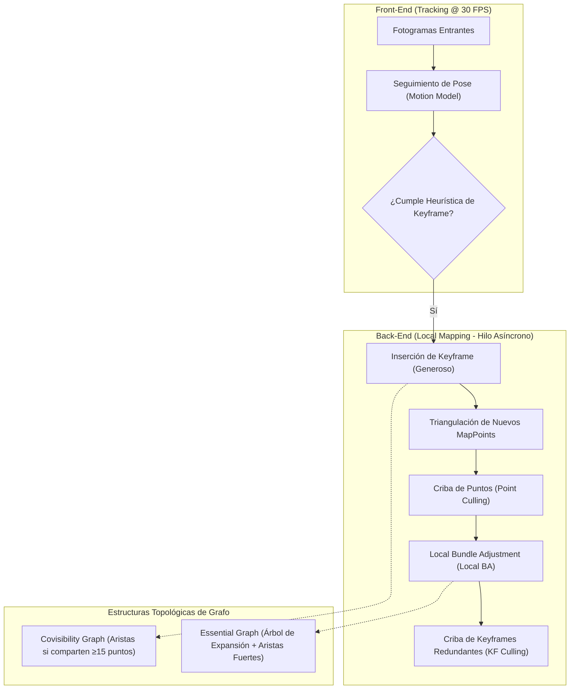
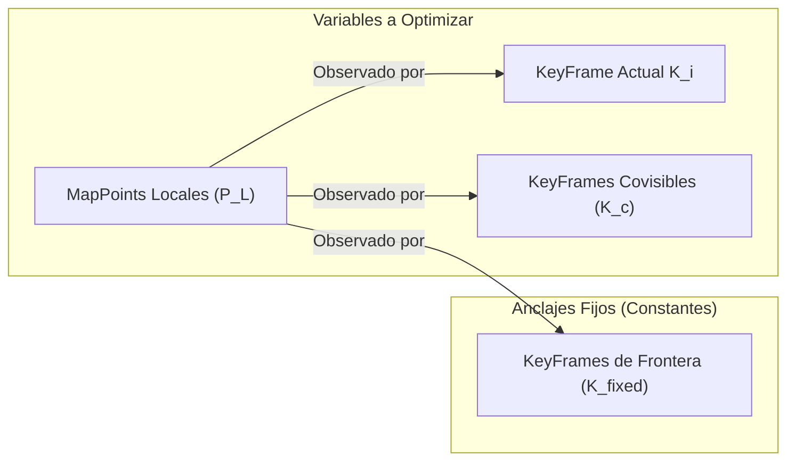

# 05. Back-End de Mapeo, Local Bundle Adjustment y Evaluación de Precisión (ATE/RPE)

---

## 🎯 Deconstrucción Conceptual: ¿Por qué Optimizar sobre Keyframes en vez de Filtrar?

En 2010, **Hauke Strasdat, José M. M. Montiel y Andrew Davison** publicaron el trabajo paradigmático: *"Real-Time Monocular SLAM: Why Filter?"*. El análisis matemático demostró de forma concluyente que para un presupuesto computacional fijo en CPUs estándar:
1. **El Filtro (EKF) gasta la mayor parte de su cómputo en marginalizar fotogramas pasados**, actualizando densamente matrices de covarianza $\mathbf{P}$ cuyos errores de linealización tempranos quedan fijados para siempre.
2. **El Ajuste por Haces sobre Keyframes (Keyframe-Based Bundle Adjustment)** descarta fotogramas redundantes donde el robot apenas se ha movido, reteniendo únicamente fotogramas clave con suficiente línea base (*baseline*). Al resolver iterativamente un sistema no lineal de mínimos cuadrados, **alcanza una precisión por orden de magnitud superior con coste local estrictamente acotado $\mathcal{O}(1)$**.



---

## 🏗️ La Arquitectura de Mapeo Local (Local Mapping)

El hilo de mapeo local de ORB-SLAM opera bajo la doctrina de **"Supervivencia del más apto" (*Survival of the Fittest*)**:
* Es deliberadamente **generoso al insertar nuevos KeyFrames**, garantizando que el seguimiento no se pierda durante rotaciones bruscas o aceleraciones del vehículo.
* Posteriormente, aplica **reglas estrictas de criba (*culling*)** para purgar puntos espurios y KeyFrames redundantes, manteniendo el mapa en un estado óptimo de compacidad y densidad.

---

### 1. Política de Inserción de KeyFrames
Un fotograma ordinario se promociona a KeyFrame si se satisfacen tres condiciones:
1. Han transcurrido más de 20 fotogramas desde la última inserción, o el hilo de mapeo local se encuentra inactivo (*idle*).
2. El fotograma actual sigue con éxito al menos 50 puntos del mapa.
3. El fotograma actual sigue menos del $90\%$ de los puntos observados por su KeyFrame de referencia (indicativo de que ha ocurrido un cambio visual o desplazamiento angular significativo).

### 2. Triangulación de Nuevos MapPoints
El mapeo local busca características ORB sin correspondencia 3D entre el KeyFrame actual $K_i$ y sus vecinos más cercanos en el **Grafo de Covisibilidad** (*Covisibility Graph*):
* Se comprueba la restricción epipolar: el píxel emparejado debe encontrarse a una distancia ortogonal menor que un umbral de la línea epipolar $\mathbf{l} = \mathbf{F} \mathbf{u}$.
* Se comprueba el **paralaje mínimo**: los rayos visuales deben formar un ángulo $\theta_{\text{parallax}} > 1.0^\circ$.
* Se verifica la **coherencia de profundidad y escala**: el punto 3D debe poseer coordenada $Z > 0$ en ambas cámaras y satisfacer el factor de escala de la pirámide de resolución.

---

### 3. Criba de MapPoints (*Recent MapPoint Culling*)
Para evitar que mediciones espurias o reflexiones contaminen el mapa a largo plazo, cada nuevo punto 3D debe superar un periodo de prueba durante los primeros 3 KeyFrames posteriores a su nacimiento:
1. **Ratio de Visibilidad:** El punto debe ser encontrado en más del $25\%$ de los fotogramas en los que se predice geométricamente visible.
2. **Consistencia Multi-Vista:** Al finalizar los 3 KeyFrames, debe haber sido observado por al menos 3 KeyFrames distintos.
Si no cumple ambas condiciones, el MapPoint se borra incondicionalmente de la memoria.

### 4. Criba de KeyFrames Redundantes (*Local KeyFrame Culling*)
A medida que el robot navega por zonas ya mapeadas o permanece detenido, el número de KeyFrames podría crecer sin límite, saturando la CPU.
* El mapeo local audita todos los KeyFrames covisibles.
* **Criterio de Redundancia:** Si más del $90\%$ de los MapPoints que observa un KeyFrame ya son observados por al menos otros 3 KeyFrames vecinos al mismo nivel o a un nivel más fino de la pirámide de escala, **dicho KeyFrame es eliminado del mapa**.
* Sus conexiones en el grafo se reasignan a sus vecinos, preservando la topología intacta.

---

## 📐 Local Bundle Adjustment (Local BA)

El Local BA optimiza un subconjunto acotado del mapa alrededor del KeyFrame actual $K_i$, formulado como un grafo de factores:



### Formulación Matemática:
Sea $\mathcal{K}_L$ el conjunto compuesto por el KeyFrame actual y todos los KeyFrames que comparten al menos 15 puntos con él en el Grafo de Covisibilidad. Sea $\mathcal{P}_L$ el conjunto de todos los MapPoints observados por los KeyFrames de $\mathcal{K}_L$.
Sea $\mathcal{K}_F$ el conjunto de KeyFrames que no pertenecen a $\mathcal{K}_L$ pero que observan algún punto de $\mathcal{P}_L$ (*KeyFrames de anclaje*).

El problema de optimización busca minimizar el error cuadrático robusto de reproyección:

$$\min_{\{\mathbf{T}_k \mid k \in \mathcal{K}_L\}, \{\mathbf{p}_j \mid j \in \mathcal{P}_L\}} \sum_{k \in \mathcal{K}_L \cup \mathcal{K}_F} \sum_{j \in \mathcal{P}_L} \rho_H \left( \left( \mathbf{u}_{kj} - \pi(\mathbf{T}_k \mathbf{p}_j) \right)^T \boldsymbol{\Sigma}_{kj}^{-1} \left( \mathbf{u}_{kj} - \pi(\mathbf{T}_k \mathbf{p}_j) \right) \right)$$

* Las poses de los KeyFrames $k \in \mathcal{K}_F$ **se mantienen estrictamente congeladas**. Actúan como anclas geométricas que previenen que el mapa local se deforme o sufra una deriva de escala durante la optimización.
* Como el tamaño de $\mathcal{K}_L$ está acotado por la densidad visual local, el tiempo de cálculo de cada iteración de Gauss-Newton es constante $\mathcal{O}(1)$.

---

## 📊 Evaluación Rigurosa de la Precisión de Trayectoria (SLAM Accuracy)

Para validar cuantitativamente un sistema SLAM contra un sistema de captura de movimiento (*Ground Truth* o MoCap), se emplean las métricas normalizadas de Sturm et al. (2012).

### 1. Error de Trayectoria Absoluta (Absolute Trajectory Error - ATE)
El ATE mide la fidelidad global de la trayectoria reconstruida. Dadas las poses estimadas $\mathbf{P}_1, \dots, \mathbf{P}_n \in SE(3)$ y las poses de referencia $\mathbf{Q}_1, \dots, \mathbf{Q}_n \in SE(3)$, primero se calcula la transformación rígida óptima $\mathbf{S} \in SE(3)$ (o $\mathbf{S} \in Sim(3)$ en monocular con factor de escala $s$) mediante el algoritmo de Umeyama:

$$\mathbf{S}^* = \arg\min_{\mathbf{S}} \sum_{i=1}^n \|\mathbf{Q}_i^{-1} \mathbf{S} \mathbf{P}_i\|^2$$

El error de traslación absoluto en el paso $i$ es:

$$\mathbf{F}_i = \mathbf{Q}_i^{-1} \mathbf{S}^* \mathbf{P}_i$$

El valor representativo global es la raíz del error cuadrático medio (**ATE RMSE**):

$$\text{ATE}_{\text{RMSE}} = \sqrt{\frac{1}{n} \sum_{i=1}^n \|\text{trans}(\mathbf{F}_i)\|^2}$$

---

### 2. Error de Pose Relativa (Relative Pose Error - RPE)
El RPE mide la deriva (*drift*) local del sistema por unidad de tiempo $\Delta$ o por metro recorrido (equivalente a la velocidad de deriva de la odometría):

$$\mathbf{E}_i^\Delta = (\mathbf{Q}_i^{-1} \mathbf{Q}_{i+\Delta})^{-1} (\mathbf{P}_i^{-1} \mathbf{P}_{i+\Delta})$$

$$\text{RPE}_{\text{RMSE}} = \sqrt{\frac{1}{m} \sum_{i=1}^m \|\text{trans}(\mathbf{E}_i^\Delta)\|^2}$$

---

### 3. Comparativa de Sensores en Benchmarks Internacionales

| Modalidad Sensorial | Grados de Libertad Estimados | Deriva de Escala | Resistencia a Movimientos Bruscos | Coste Computacional | Comportamiento Exterior (Sol) |
|---|---|---|---|---|---|
| **Monocular** | $SE(3) + \text{Escala } s$ (7 DoF) | Sí (acoplada a la trayectoria) | Baja (requiere paralaje) | Bajo | Excelente |
| **Estéreo** | $SE(3)$ Métrico (6 DoF) | Nula (Línea base fija $b$) | Media | Medio | Excelente |
| **RGB-D (ToF / Estructurada)** | $SE(3)$ Métrico (6 DoF) | Nula (Medición directa $Z$) | Media | Medio-Bajo | Muy Pobre (Ceguera por IR solar) |
| **Visual-Inercial (VIO)** | $SE(3)$ Métrico + Gravedad (6 DoF) | Nula (Escala acoplada a $\mathbf{g}$) | **Máxima** (Inmune a oclusiones) | Medio-Alto | Excelente |

---

## 🧪 Mini-Test de Verificación de Métrica ATE (Umeyama Alignment)

El siguiente script en Python implementa la métrica ATE con alineación por mínimos cuadrados según el método cerrado de Umeyama:

```python
import numpy as np

def align_umeyama(P_est, Q_gt):
    # P_est, Q_gt son matrices de forma (N, 3)
    mu_P = np.mean(P_est, axis=0)
    mu_Q = np.mean(Q_gt, axis=0)
    
    P_c = P_est - mu_P
    Q_c = Q_gt - mu_Q
    
    # Matriz de covarianza cruzada
    H = P_c.T @ Q_c
    U, S, Vt = np.linalg.svd(H)
    R = Vt.T @ U.T
    
    # Asegurar determinante positivo (+1)
    if np.linalg.det(R) < 0:
        Vt[-1, :] *= -1
        R = Vt.T @ U.T
        
    t = mu_Q - R @ mu_P
    return R, t

def test_ate_metric():
    # Trayectoria simulada: espiral circular
    theta = np.linspace(0, 2*np.pi, 50)
    Q_gt = np.column_stack([np.cos(theta)*5.0, np.sin(theta)*5.0, theta*0.5])
    
    # Estimación con rotación arbitraria, traslación y ruido
    R_sim = np.array([[0, -1, 0], [1, 0, 0], [0, 0, 1]])
    t_sim = np.array([10.0, -5.0, 2.0])
    noise = np.random.normal(0, 0.02, size=Q_gt.shape)
    P_est = (Q_gt @ R_sim.T) + t_sim + noise
    
    # Alinear
    R_align, t_align = align_umeyama(P_est, Q_gt)
    P_aligned = (P_est @ R_align.T) + t_align
    
    ate_rmse = np.sqrt(np.mean(np.sum((Q_gt - P_aligned)**2, axis=1)))
    assert ate_rmse < 0.05, f"ATE RMSE fuera de tolerancia: {ate_rmse}"
    print(f"ATE Umeyama Alignment Verified! Trajectory RMSE: {ate_rmse*100:.2f} cm")

if __name__ == "__main__":
    test_ate_metric()
```
