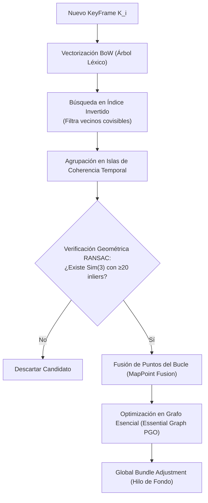
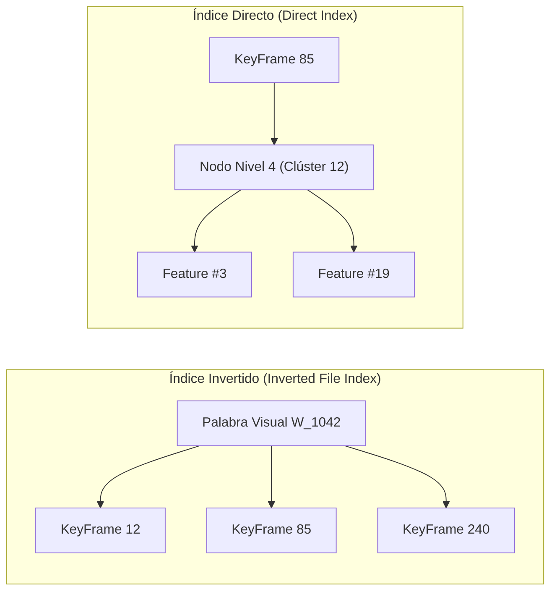

# 06. Reconocimiento de Lugares, DBoW2 y Cierre de Bucle en Sim(3)

---

## 🎯 Deconstrucción Conceptual (Protocolo Feynman)

Durante la navegación prolongada, cualquier odometría (incluso el mejor SLAM visual) acumula una lenta pero inexorable deriva (*drift*). En sistemas monoculares, esta deriva afecta no sólo a la traslación y rotación, sino también a la **escala métrica del mundo** (el mapa se expande o se encoge gradualmente).

El **Cierre de Bucle (*Loop Closing*)** es el mecanismo que rompe esta acumulación:
1. Responde a la pregunta: *"¿He estado antes en este lugar físico?"*.
2. Si la respuesta es afirmativa, alinea geométricamente ambos extremos de la trayectoria.
3. Propaga la corrección elásticamente a lo largo de todo el grafo de poses, devolviendo al mapa su consistencia global absoluta.



---

## 📖 Bolsas de Palabras Binarias (Bags of Binary Words - DBoW2)

Desarrollado por **Dorian Gálvez-López y Juan D. Tardós (IEEE Transactions on Robotics, 2012)**, DBoW2 permite indexar y consultar decenas de miles de imágenes en milisegundos utilizando descriptores binarios rápidos (ORB/BRIEF).

---

### 1. Construcción del Árbol de Vocabulario Visual (*Vocabulary Tree*)
* Se recopila un conjunto de entrenamiento masivo de millones de descriptores ORB.
* Se aplica el algoritmo $k$-means jerárquico recursivo:
  * El espacio se divide en $k$ clústeres principales en el primer nivel.
  * Cada clúster se subdivide a su vez en $k$ subclústeres, repitiendo el proceso hasta una profundidad $L$.
* El árbol contiene $W = k^L$ nodos de hoja (*palabras visuales*).
  * Ejemplo estándar: $k = 10$, $L = 6 \implies W = 1.000.000$ de palabras visuales.

### 2. Esquema de Ponderación TF-IDF
Para representar una imagen como un vector disperso $\mathbf{v} \in \mathbb{R}^W$:
1. **Frecuencia del Término (Term Frequency - TF):**
   $$\text{TF}_i = \frac{n_{id}}{n_d}$$
   donde $n_{id}$ es el número de veces que la palabra $i$ aparece en la imagen $d$, y $n_d$ es el total de descriptores en dicha imagen.
2. **Frecuencia Inversa de Documento (Inverse Document Frequency - IDF):**
   $$\text{IDF}_i = \log \left( \frac{N}{n_i} \right)$$
   donde $N$ es el total de imágenes en la base de datos de entrenamiento y $n_i$ es el número de imágenes donde aparece la palabra $i$.
   * Palabras universales y poco informativas (e.g. texturas uniformes presentes en todas las fotos) reciben $\text{IDF} \approx 0$.
   * Palabras muy específicas y distintivas reciben un peso elevado.
3. **Peso de la Palabra:**
   $$w_i = \text{TF}_i \times \text{IDF}_i$$

El vector de la imagen se normaliza mediante la norma $L_1$: $\mathbf{v} = \frac{\mathbf{w}}{\|\mathbf{w}\|_1}$.

---

### 3. Función de Puntuación (*Scoring Metric*)
Dadas dos imágenes con vectores normalizados $\mathbf{v}_1, \mathbf{v}_2$, su similitud se mide mediante el score $L_1$:

$$s(\mathbf{v}_1, \mathbf{v}_2) = 1 - \frac{1}{2} \|\mathbf{v}_1 - \mathbf{v}_2\|_1 = \sum_{i=1}^W \min(v_{1,i}, v_{2,i})$$
* Si no comparten ninguna palabra, $s = 0$. Si son idénticas, $s = 1$.
* Para neutralizar la variación del contenido visual (lugares con alta o baja textura natural), la puntuación se normaliza respecto al KeyFrame anterior:
  $$\eta(\mathbf{v}_1, \mathbf{v}_2) = \frac{s(\mathbf{v}_1, \mathbf{v}_2)}{s(\mathbf{v}_1, \mathbf{v}_{1,\text{prev}})}$$

---

### 4. La Estructura Dual: Índice Invertido e Índice Directo



* **Índice Invertido (*Inverted Index*):** Asocia cada `Palabra_ID` con la lista de KeyFrames que la contienen.
  * Durante una consulta de cierre de bucle, el algoritmo sólo evalúa KeyFrames que comparten al menos una palabra con el fotograma actual, evitando barridos lineales $\mathcal{O}(M)$ y reduciendo la búsqueda a unos pocos milisegundos.
* **Índice Directo (*Direct Index*):** Asocia cada KeyFrame con el conjunto de sus características ORB agrupadas en un nivel intermedio del árbol (típicamente nivel $m=4$).
  * Acelera el emparejamiento fino de descriptores: sólo se calculan distancias de Hamming entre características que comparten el mismo nodo ancestro en el árbol, logrando correspondencias 2D-2D en menos de $1\text{ ms}$.

---

## 🔄 El Pipeline de Cierre de Bucle

### 1. Detección y Coherencia Temporal (Islas de Candidatos)
Cuando el KeyFrame actual $K_i$ consulta el índice invertido:
1. Se descartan todos los KeyFrames conectados a $K_i$ en el Grafo de Covisibilidad (vecinos inmediatos con alta covisibilidad).
2. Los candidatos restantes con score normalizado alto se agrupan en **"Islas" de KeyFrames conectados entre sí**.
3. **Verificación de Coherencia Temporal:** Una isla sólo se acepta si se detecta de forma consistente durante al menos 3 KeyFrames consecutivos.

---

### 2. Alineación Geométrica en $Sim(3)$ (Deriva de Escala Monocular)
En SLAM monocular, el bucle acumula un error en 7 grados de libertad: 3 de rotación, 3 de traslación y **1 de escala métrica** ($s$). Por tanto, la transformación relativa no puede modelarse como un elemento de $SE(3)$, sino del grupo de similitud **$Sim(3)$**:

$$\mathbf{S}_{ij} = \begin{bmatrix} s \mathbf{R} & \mathbf{t} \\ \mathbf{0} & 1 \end{bmatrix} \in Sim(3)$$

Se resuelven las correspondencias 3D-3D entre los MapPoints de ambos lados del bucle empleando el método cerrado de **Horn (1987)** integrado dentro de un bucle de **RANSAC en $Sim(3)$**:
* Si se confirman al menos 20 inliers con error de reproyección bidireccional bajo, la hipótesis de bucle queda validada incondicionalmente.

---

### 3. Fusión de Mapas y Corrección del Grafo Esencial (*Essential Graph PGO*)
Una vez calculada la transformación $\mathbf{S}_{ij}$:
1. **Fusión de MapPoints:** Todos los puntos del extremo del bucle se proyectan en el KeyFrame actual y sus vecinos; los puntos coincidentes se fusionan en una única entidad geométrica.
2. **Propagación del Grafo Esencial (Pose Graph Optimization):**
   * El Grafo Esencial contiene el Árbol de Expansión (*Spanning Tree*), las aristas del cierre de bucle y aristas de covisibilidad con alto peso ($\ge 100$).
   * Se formula un problema de optimización de grafo de poses en $Sim(3)$, donde el error residual en cada arista $(i, j)$ es:
     $$\mathbf{e}_{ij} = \log_{Sim(3)} \left( \mathbf{S}_{ij, \text{meas}}^{-1} \mathbf{S}_i \mathbf{S}_j^{-1} \right)$$
   * La corrección de escala y pose se propaga por toda la trayectoria en menos de $200\text{ ms}$.
3. **Global Bundle Adjustment:** Un hilo de fondo asíncrono ejecuta un BA completo sobre todos los KeyFrames y MapPoints del mapa para pulir la solución óptima de máxima verosimilitud sin congelar el hilo principal de navegación.

---

## 🧪 Mini-Test de Verificación de Invarianza Sim(3) de Horn

El siguiente script en Python valida la estimación de transformación $Sim(3)$ con recuperación exacta del factor de escala $s$:

```python
import numpy as np

def estimate_sim3_horn(P_from, P_to):
    # P_from, P_to son matrices (N, 3) con N >= 3 puntos
    mu_from = np.mean(P_from, axis=0)
    mu_to = np.mean(P_to, axis=0)
    
    A = P_from - mu_from
    B = P_to - mu_to
    
    # Factor de escala s = sqrt(var(B) / var(A))
    var_A = np.mean(np.sum(A**2, axis=1))
    var_B = np.mean(np.sum(B**2, axis=1))
    s = np.sqrt(var_B / var_A)
    
    # Rotacion optima por SVD
    H = (B / s).T @ A
    U, _, Vt = np.linalg.svd(H)
    R = U @ Vt
    if np.linalg.det(R) < 0:
        U[:, -1] *= -1
        R = U @ Vt
        
    t = mu_to - s * (R @ mu_from)
    return s, R, t

def test_sim3_loop_closure():
    # 10 puntos en el mapa
    P_gt = np.random.uniform(-5, 5, size=(10, 3))
    
    # Simular deriva de bucle: escala s=1.35, rotacion yaw=30 deg, traslacion t=[2, -1, 4]
    s_true = 1.35
    yaw = np.radians(30.0)
    R_true = np.array([[np.cos(yaw), -np.sin(yaw), 0],
                       [np.sin(yaw), np.cos(yaw), 0],
                       [0, 0, 1]])
    t_true = np.array([2.0, -1.0, 4.0])
    
    P_drifted = s_true * (P_gt @ R_true.T) + t_true
    
    # Recuperar transformacion Sim(3)
    s_est, R_est, t_est = estimate_sim3_horn(P_gt, P_drifted)
    
    assert np.isclose(s_est, s_true, atol=1e-5), f"Error en escala estimada: {s_est}"
    assert np.allclose(R_est, R_true, atol=1e-5), "Error en rotación estimada"
    assert np.allclose(t_est, t_true, atol=1e-5), "Error en traslación estimada"
    print(f"Horn Sim(3) Alignment Verified! Recovered Scale: {s_est:.4f} (True: {s_true})")

if __name__ == "__main__":
    test_sim3_loop_closure()
```
