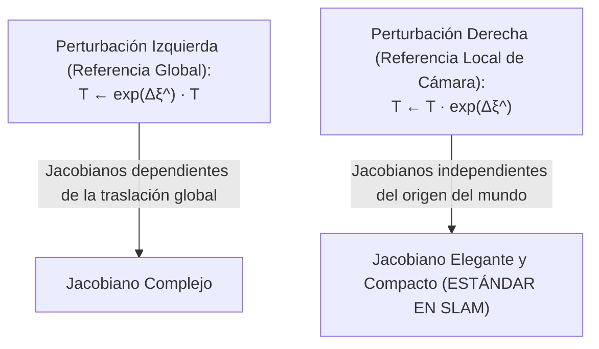

# 07. Grupos de Lie, Álgebras y Geometría Diferencial en SLAM (SO3, SE3, Sim3)

---

## 🎯 Deconstrucción Conceptual (Protocolo Feynman)

En la optimización numérica clásica, las variables de decisión residen en espacios vectoriales euclidianos $\mathbb{R}^n$, donde la suma $\mathbf{x} \leftarrow \mathbf{x} + \Delta \mathbf{x}$ preserva siempre la validez de la solución.

En robótica espacial y SLAM 3D, **las rotaciones NO pertenecen a un espacio vectorial**:
* Si sumamos dos matrices ortogonales de rotación $\mathbf{R}_1, \mathbf{R}_2 \in SO(3)$, el resultado **NO** es una matriz de rotación:
  $$(\mathbf{R}_1 + \mathbf{R}_2)^T (\mathbf{R}_1 + \mathbf{R}_2) \ne \mathbf{I}, \quad \det(\mathbf{R}_1 + \mathbf{R}_2) \ne 1$$
* Los ángulos de Euler sufren de singularidades matemáticas (*bloqueo de cardán / Gimbal Lock*).
* Los cuaterniones unitarios $\mathbf{q} = [w, x, y, z]^T$ requieren restricciones de norma unitaria $\|\mathbf{q}\| = 1$, introduciendo multiplicadores de Lagrange innecesarios.

```mermaid
flowchart LR
    subgraph Manifold["Variedad Curva No Lineal M (Grupo de Lie G)"]
        T["Pose Actual T ∈ SE(3)"]
    end

    subgraph TangentSpace["Espacio Tangente Plano T_I M (Álgebra de Lie g = R⁶)"]
        Delta["Incremento Vectorial Δξ ∈ R⁶"]
    end

    TangentSpace -->|Mapa Exponencial exp(Δξ^)| Manifold
    Manifold -->|Mapa Logarítmico log(T)| TangentSpace
```

La **Teoría de Grupos de Lie** resuelve este dilema conectando una variedad suave curva (*manifold*) con su espacio tangente lineal en la identidad (*álgebra de Lie*), permitiendo realizar derivadas, gradientes y optimizaciones sin restricciones numéricas artificiales.

---

## 📐 Fundamentos de Grupos y Álgebras de Lie

Un **Grupo de Lie** $(\mathcal{G}, \circ)$ es una variedad diferenciable suave que satisface simultáneamente los axiomas de grupo algebraico (clausura, asociatividad, elemento neutro e inverso) junto con operaciones de multiplicación e inversión infinitamente diferenciables ($C^\infty$).

### 1. El Álgebra de Lie ($\mathfrak{g}$)
El álgebra de Lie $\mathfrak{g}$ es el espacio tangente al grupo de Lie evaluado en el elemento neutro identidad $\mathbf{I}$:

$$\mathfrak{g} = T_{\mathbf{I}} \mathcal{G}$$
* Posee la misma dimensión que los grados de libertad de la variedad.
* Está equipada con una operación bilineal antisimétrica denominada **Corchete de Lie (*Lie Bracket*)**:
  $$[\mathbf{A}, \mathbf{B}] = \mathbf{A} \mathbf{B} - \mathbf{B} \mathbf{A}$$

### 2. Isomorfismo: Operadores Sombrero ($^\wedge$) y Cuña ($^\vee$)
Para un grupo de Lie de dimensión $n$, existe un isomorfismo lineal entre el espacio vectorial euclidiano $\mathbb{R}^n$ y su álgebra de Lie matricial $\mathfrak{g}$:
* **Operador Sombrero (*Hat*):** $(\cdot)^\wedge : \mathbb{R}^n \to \mathfrak{g}$
* **Operador Cuña (*Vee*):** $(\cdot)^\vee : \mathfrak{g} \to \mathbb{R}^n$ tal que $(\mathbf{x}^\wedge)^\vee = \mathbf{x}$.

---

## 🔄 El Grupo Especial de Rotaciones: $SO(3)$

El grupo de rotaciones en tres dimensiones se define como:

$$SO(3) = \{ \mathbf{R} \in \mathbb{R}^{3 \times 3} \mid \mathbf{R}^T \mathbf{R} = \mathbf{I}, \det(\mathbf{R}) = +1 \}$$

### 1. Álgebra de Lie $\mathfrak{so}(3)$
El álgebra de Lie $\mathfrak{so}(3)$ es el espacio de todas las matrices antisimétricas de $3 \times 3$:

$$\mathfrak{so}(3) = \{ [\boldsymbol{\omega}]_\times \in \mathbb{R}^{3 \times 3} \mid [\boldsymbol{\omega}]_\times^T = -[\boldsymbol{\omega}]_\times, \boldsymbol{\omega} \in \mathbb{R}^3 \}$$

Para un vector de velocidad angular / eje-ángulo $\boldsymbol{\omega} = [\omega_1, \omega_2, \omega_3]^T \in \mathbb{R}^3$:

$$[\boldsymbol{\omega}]_\times = \boldsymbol{\omega}^\wedge = \begin{bmatrix} 0 & -\omega_3 & \omega_2 \\ \omega_3 & 0 & -\omega_1 \\ -\omega_2 & \omega_1 & 0 \end{bmatrix}$$

---

### 2. El Mapa Exponencial de $SO(3)$: Fórmula de Rodrigues
La exponencial de una matriz $[\boldsymbol{\omega}]_\times$ con ángulo $\theta = \|\boldsymbol{\omega}\|$ y eje unitario $\mathbf{n} = \boldsymbol{\omega} / \theta$ se resuelve de forma cerrada mediante la **Fórmula de Rotación de Rodrigues**:

$$\exp([\boldsymbol{\omega}]_\times) = \sum_{k=0}^\infty \frac{([\boldsymbol{\omega}]_\times)^k}{k!} = \mathbf{I} + \frac{\sin \theta}{\theta} [\boldsymbol{\omega}]_\times + \frac{1 - \cos \theta}{\theta^2} [\boldsymbol{\omega}]_\times^2$$

> [!NOTE]
> Para evitar singularidades numéricas cuando $\theta \to 0$, se emplea la expansión en serie de Taylor con guarda $\epsilon = 10^{-7}$:
> $$\frac{\sin \theta}{\theta} \approx 1 - \frac{\theta^2}{6}, \quad \frac{1 - \cos \theta}{\theta^2} \approx \frac{1}{2} - \frac{\theta^2}{24}$$

### 3. El Mapa Logarítmico de $SO(3)$
Dada una matriz de rotación $\mathbf{R} \in SO(3)$, recupera el vector eje-ángulo $\boldsymbol{\omega} = \log(\mathbf{R})^\vee$:

$$\theta = \arccos \left( \frac{\text{trace}(\mathbf{R}) - 1}{2} \right)$$

$$[\boldsymbol{\omega}]_\times = \frac{\theta}{2 \sin \theta} (\mathbf{R} - \mathbf{R}^T)$$

---

## 🚗 El Grupo Especial Euclídeo: $SE(3)$

El grupo $SE(3)$ representa los movimientos rígidos de traslación y rotación en el espacio 3D:

$$SE(3) = \left\{ \mathbf{T} = \begin{bmatrix} \mathbf{R} & \mathbf{t} \\ \mathbf{0}_{1 \times 3} & 1 \end{bmatrix} \in \mathbb{R}^{4 \times 4} \;\middle|\; \mathbf{R} \in SO(3), \mathbf{t} \in \mathbb{R}^3 \right\}$$

### 1. Álgebra de Lie $\mathfrak{se}(3)$ y Coordenadas Twist
Un elemento del álgebra $\mathfrak{se}(3)$ se parametriza mediante un vector *twist* $\boldsymbol{\xi} \in \mathbb{R}^6$:

$$\boldsymbol{\xi} = \begin{bmatrix} \boldsymbol{\rho} \\ \boldsymbol{\phi} \end{bmatrix} \in \mathbb{R}^6, \quad \boldsymbol{\rho} \in \mathbb{R}^3 \text{ (traslacional)}, \boldsymbol{\phi} \in \mathbb{R}^3 \text{ (rotacional)}$$

$$\boldsymbol{\xi}^\wedge = \begin{bmatrix} [\boldsymbol{\phi}]_\times & \boldsymbol{\rho} \\ \mathbf{0}_{1 \times 3} & 0 \end{bmatrix} \in \mathbb{R}^{4 \times 4}$$

### 2. Mapa Exponencial de $SE(3)$
$$\exp(\boldsymbol{\xi}^\wedge) = \begin{bmatrix} \exp([\boldsymbol{\phi}]_\times) & \mathbf{V} \boldsymbol{\rho} \\ \mathbf{0}_{1 \times 3} & 1 \end{bmatrix}$$
donde $\theta = \|\boldsymbol{\phi}\|$ y la matriz de integración traslacional $\mathbf{V}$ es:

$$\mathbf{V} = \mathbf{I} + \frac{1 - \cos \theta}{\theta^2} [\boldsymbol{\phi}]_\times + \frac{\theta - \sin \theta}{\theta^3} [\boldsymbol{\phi}]_\times^2$$

---

## 📐 Cálculo Diferencial y Perturbaciones en Manifolds

En un espacio euclidiano, la derivada de $f(\mathbf{x})$ es $\lim_{h \to 0} \frac{f(\mathbf{x} + h) - f(\mathbf{x})}{h}$.
En un grupo de Lie, definimos la derivada aplicando una **pequeña perturbación en el espacio tangente** $\Delta \boldsymbol{\xi} \in \mathbb{R}^6$.



### 1. Perturbación en el Marco Local de Cámara (*Right Perturbation*)
Sea un punto 3D del mundo $\mathbf{p}_W$. Su proyección en el marco de cámara actual es:

$$\mathbf{p}_C = \mathbf{R} \mathbf{p}_W + \mathbf{t} = \mathbf{T} \mathbf{p}_W$$

Si perturbamos la pose mediante un incremento local infinitesimal en la cámara:

$$\mathbf{T} \leftarrow \mathbf{T} \exp(\Delta \boldsymbol{\xi}^\wedge)$$

El nuevo punto en coordenadas de cámara es:

$$\mathbf{p}_C' = \mathbf{T} \exp(\Delta \boldsymbol{\xi}^\wedge) \mathbf{p}_W \approx \mathbf{T} (\mathbf{I} + \Delta \boldsymbol{\xi}^\wedge) \mathbf{p}_W = \mathbf{p}_C + [\boldsymbol{\phi}]_\times \mathbf{p}_C + \boldsymbol{\rho}$$

La matriz Jacobiana del punto de cámara respecto al twist $\boldsymbol{\xi} = [\boldsymbol{\rho}, \boldsymbol{\phi}]^T$ es:

$$\frac{\partial \mathbf{p}_C}{\partial \boldsymbol{\xi}} = \begin{bmatrix} \mathbf{I}_{3 \times 3} & -[\mathbf{p}_C]_\times \end{bmatrix} = \begin{bmatrix} 1 & 0 & 0 & 0 & Z_C & -Y_C \\ 0 & 1 & 0 & -Z_C & 0 & X_C \\ 0 & 0 & 1 & Y_C & -X_C & 0 \end{bmatrix} \in \mathbb{R}^{3 \times 6}$$

> [!IMPORTANT]
> **La Simplicidad de la Perturbación Local:** Observa que este Jacobiano depende **únicamente** de las coordenadas del punto respecto a la cámara $\mathbf{p}_C = [X_C, Y_C, Z_C]^T$. No contiene ningún término dependiente de la posición del origen del mundo, lo que previene singularidades numéricas independientemente de cuántos kilómetros haya recorrido el vehículo.

---

### 2. Matriz Adjunta de $SE(3)$
La matriz adjunta $\text{Ad}_{\mathbf{T}} \in \mathbb{R}^{6 \times 6}$ transforma vectores twist entre dos marcos de coordenadas distintos:

$$\text{Ad}_{\mathbf{T}} = \begin{bmatrix} \mathbf{R} & [\mathbf{t}]_\times \mathbf{R} \\ \mathbf{0}_{3 \times 3} & \mathbf{R} \end{bmatrix}$$

Propiedad fundamental de conmutación:

$$\mathbf{T} \exp(\boldsymbol{\xi}^\wedge) \mathbf{T}^{-1} = \exp((\text{Ad}_{\mathbf{T}} \boldsymbol{\xi})^\wedge)$$

---

## 🧪 Mini-Test de Verificación de Invariantes de Lie

El siguiente script en Python valida la consistencia numérica del mapa exponencial de Rodrigues, el cierre del grupo $SO(3)$ y la ortogonalidad $\mathbf{R}^T \mathbf{R} = \mathbf{I}$:

```python
import numpy as np
from scipy.linalg import expm

def hat_so3(w):
    return np.array([[0, -w[2], w[1]],
                     [w[2], 0, -w[0]],
                     [-w[1], w[0], 0]])

def exp_so3_rodrigues(w):
    theta = np.linalg.norm(w)
    if theta < 1e-7:
        return np.eye(3) + hat_so3(w)
    K = hat_so3(w / theta)
    return np.eye(3) + np.sin(theta) * K + (1.0 - np.cos(theta)) * (K @ K)

def log_so3(R):
    cos_theta = np.clip((np.trace(R) - 1.0) / 2.0, -1.0, 1.0)
    theta = np.arccos(cos_theta)
    if theta < 1e-7:
        return np.zeros(3)
    w_hat = (theta / (2.0 * np.sin(theta))) * (R - R.T)
    return np.array([w_hat[2, 1], w_hat[0, 2], w_hat[1, 0]])

def test_lie_group_invariants():
    # Vector eje-ángulo arbitrario
    w_original = np.array([0.2, -0.5, 1.1])
    
    # 1. Comparar fórmula cerrada de Rodrigues contra matriz exponencial densa
    R_rodrigues = exp_so3_rodrigues(w_original)
    R_scipy = expm(hat_so3(w_original))
    assert np.allclose(R_rodrigues, R_scipy, atol=1e-8), "Fórmula de Rodrigues discrepa de expm"
    
    # 2. Invariante de ortogonalidad del Grupo SO(3)
    I_check = R_rodrigues.T @ R_rodrigues
    assert np.allclose(I_check, np.eye(3), atol=1e-8), "R^T * R != I"
    assert np.isclose(np.linalg.det(R_rodrigues), 1.0, atol=1e-8), "det(R) != +1"
    
    # 3. Viaje de ida y vuelta: log(exp(w)) == w
    w_recovered = log_so3(R_rodrigues)
    assert np.allclose(w_original, w_recovered, atol=1e-8), "log(exp(w)) != w"
    print(f"SO(3) Lie Group Invariants Verified! Det: {np.linalg.det(R_rodrigues):.6f}, Roundtrip error: {np.linalg.norm(w_original - w_recovered):.2e}")

if __name__ == "__main__":
    test_lie_group_invariants()
```
