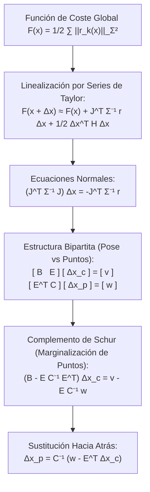
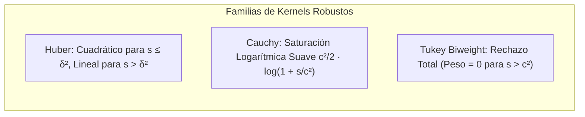

# 08. Optimización No Lineal, Grafos de Factores y Bundle Adjustment (Schur Complement)

---

## 🎯 Deconstrucción Conceptual (Protocolo Feynman)

Cualquier sistema moderno de SLAM (visual, inercial o LiDAR) transforma el problema de estimación continua en un problema masivo de **Mínimos Cuadrados No Lineales (*Nonlinear Least Squares*)**.

El objetivo es encontrar la configuración global de poses de cámara y posiciones 3D de marcas que mejor explique todas las observaciones visuales registradas a lo largo del tiempo, minimizando la discrepancia cuadrática (*error de reproyección*):



---

## 📐 Métodos de Optimización Numérica: GN y Levenberg-Marquardt

Sea el vector de parámetros conjunto $\mathbf{x} \in \mathbb{R}^M$ y el conjunto de residuos no lineales $\mathbf{r}_k(\mathbf{x}) \in \mathbb{R}^{d_k}$ con matriz de información $\boldsymbol{\Omega}_k = \boldsymbol{\Sigma}_k^{-1}$:

$$F(\mathbf{x}) = \frac{1}{2} \sum_{k=1}^K \mathbf{r}_k(\mathbf{x})^T \boldsymbol{\Sigma}_k^{-1} \mathbf{r}_k(\mathbf{x})$$

### 1. Algoritmo de Gauss-Newton (GN)
Aproximando la matriz Hessiana completa $\nabla^2 F(\mathbf{x})$ despreciando las derivadas de segundo orden de los residuos:

$$\mathbf{H} \approx \mathbf{J}^T \boldsymbol{\Sigma}^{-1} \mathbf{J}, \quad \mathbf{g} = \mathbf{J}^T \boldsymbol{\Sigma}^{-1} \mathbf{r}$$

Las **Ecuaciones Normales** definen el incremento de actualización:

$$\mathbf{H} \Delta \mathbf{x} = -\mathbf{g}$$

* Si $\mathbf{H}$ es semidefinida positiva o mal condicionada (zonas con poco paralaje o textura pobre), el paso $\Delta \mathbf{x}$ puede dispararse y provocar que la función de coste crezca drásticamente en lugar de disminuir.

---

### 2. Algoritmo de Levenberg-Marquardt (LM)
LM introduce un amortiguamiento adaptativo dinámico $\lambda$ (*damping parameter*):

$$(\mathbf{H} + \lambda \mathbf{D}) \Delta \mathbf{x} = -\mathbf{g}$$
donde $\mathbf{D} = \mathbf{I}$ o $\mathbf{D} = \text{diag}(\mathbf{H})$.

* **Comportamiento Dual:**
  * Si $\lambda \to \infty$: $\Delta \mathbf{x} \approx -\frac{1}{\lambda} \mathbf{g}$ (descenso por gradiente puro, paso corto pero garantizado en descenso).
  * Si $\lambda \to 0$: $(\mathbf{H}) \Delta \mathbf{x} \approx -\mathbf{g}$ (Gauss-Newton puro, convergencia cuadrática ultra-rápida).
* **Control de Paso mediante el Ratio de Ganancia $\varrho$:**
  $$\varrho = \frac{F(\mathbf{x}) - F(\mathbf{x} \boxplus \Delta \mathbf{x})}{L(\mathbf{0}) - L(\Delta \mathbf{x})}$$
  donde $L(\Delta \mathbf{x}) = F(\mathbf{x}) + \mathbf{g}^T \Delta \mathbf{x} + \frac{1}{2} \Delta \mathbf{x}^T \mathbf{H} \Delta \mathbf{x}$ es la aproximación cuadrática local.
  * Si $\varrho > 0$: El paso reduce el coste real. Se acepta el paso ($\mathbf{x} \leftarrow \mathbf{x} \boxplus \Delta \mathbf{x}$) y se reduce $\lambda$ dividiéndolo por un factor $\nu > 1$.
  * Si $\varrho \le 0$: El paso empeora el modelo. Se rechaza el incremento ($\mathbf{x}$ no se actualiza) y se incrementa $\lambda$ multiplicándolo por $\nu$.

---

## 🛡️ Funciones de Pérdida Robustas (M-Estimadores e IRLS)

Los mínimos cuadrados estándar penalizan los errores cuadráticamente ($\|r\|^2$), lo que significa que un único emparejamiento erróneo con error de 100 píxeles domina el gradiente por encima de 10.000 puntos correctos con error de 1 píxel.
Para neutralizar *outliers*, se reemplaza el coste cuadrático por una **función de pérdida robusta $\rho(s)$** donde $s = \mathbf{r}_k^T \boldsymbol{\Sigma}_k^{-1} \mathbf{r}_k$:

$$F_{\text{robust}}(\mathbf{x}) = \frac{1}{2} \sum_{k=1}^K \rho \left( \mathbf{r}_k(\mathbf{x})^T \boldsymbol{\Sigma}_k^{-1} \mathbf{r}_k(\mathbf{x}) \right)$$



### Implementación mediante Mínimos Cuadrados Ponderados Iterativos (IRLS)
El gradiente del residuo robusto equivale a multiplicar la matriz de información original por un peso escalar efectivo $w(s) = \rho'(s)$:

$$\boldsymbol{\Sigma}_{k, \text{eff}}^{-1} = w(s_k) \boldsymbol{\Sigma}_k^{-1}, \quad w_H(s) = \begin{cases} 1 & \text{si } s \le \delta^2 \\ \frac{\delta}{\sqrt{s}} & \text{si } s > \delta^2 \end{cases}$$
Esto permite resolver sistemas robustos utilizando el mismo solver lineal de Gauss-Newton recalculando los pesos $w(s_k)$ al inicio de cada iteración.

---

## 🏛️ Estructura del Problema Bundle Adjustment y Complemento de Schur

En el Bundle Adjustment clásico, existen $C$ cámaras con estados de pose $\mathbf{x}_c \in \mathbb{R}^{6C}$ y $P$ marcas tridimensionales $\mathbf{x}_p \in \mathbb{R}^{3P}$.
Las Ecuaciones Normales adoptan una estructura particionada por bloques:

$$\begin{bmatrix} \mathbf{B} & \mathbf{E} \\ \mathbf{E}^T & \mathbf{C} \end{bmatrix} \begin{bmatrix} \Delta \mathbf{x}_c \\ \Delta \mathbf{x}_p \end{bmatrix} = \begin{bmatrix} \mathbf{v} \\ \mathbf{w} \end{bmatrix}$$

* $\mathbf{B} = \mathbf{J}_c^T \boldsymbol{\Sigma}^{-1} \mathbf{J}_c \in \mathbb{R}^{6C \times 6C}$: Matriz de covarianza de cámaras (dispersa con bloques diagonales $6 \times 6$).
* $\mathbf{C} = \mathbf{J}_p^T \boldsymbol{\Sigma}^{-1} \mathbf{J}_p \in \mathbb{R}^{3P \times 3P}$: Matriz de puntos 3D.
* $\mathbf{E} = \mathbf{J}_c^T \boldsymbol{\Sigma}^{-1} \mathbf{J}_p \in \mathbb{R}^{6C \times 3P}$: Conexiones de covisibilidad cámara-punto.

> [!IMPORTANT]
> **El Secreto del Patrón Punta de Flecha (*Arrowhead Structure*):** La matriz $\mathbf{C}$ es **estrictamente diagonal por bloques de $3 \times 3$**. Esto se debe a que la observación de un punto 3D $j$ en una cámara es condicionalmente independiente de la observación de otro punto $k$. Invertir $\mathbf{C}$ cuesta exactamente $P$ inversiones de pequeñas matrices de $3 \times 3$, lo que requiere un tiempo estrictamente lineal $\mathcal{O}(P)$.

---

### La Marginalización de Puntos mediante el Complemento de Schur
Multiplicando la segunda fila por $\mathbf{E} \mathbf{C}^{-1}$ y restándola de la primera fila:

$$(\mathbf{B} - \mathbf{E} \mathbf{C}^{-1} \mathbf{E}^T) \Delta \mathbf{x}_c = \mathbf{v} - \mathbf{E} \mathbf{C}^{-1} \mathbf{w}$$

Definiendo la **Matriz Reducida de Cámaras**:

$$\mathbf{H}_{\text{red}} = \mathbf{B} - \mathbf{E} \mathbf{C}^{-1} \mathbf{E}^T \in \mathbb{R}^{6C \times 6C}$$

$$\mathbf{b}_{\text{red}} = \mathbf{v} - \mathbf{E} \mathbf{C}^{-1} \mathbf{w} \in \mathbb{R}^{6C}$$

#### Procedimiento de Resolución en Dos Pasos:
1. **Resolver las Cámaras:** Se resuelve el sistema simétrico y definido positivo $\mathbf{H}_{\text{red}} \Delta \mathbf{x}_c = \mathbf{b}_{\text{red}}$ mediante factorización de Cholesky dispersa (`CHOLMOD` / SuiteSparse).
2. **Sustitución Hacia Atrás para los Puntos 3D (*Back-substitution*):** Una vez calculados los incrementos de pose $\Delta \mathbf{x}_c$, los incrementos de todos los puntos 3D se obtienen de forma independiente y paralela en CPU/GPU:
   $$\Delta \mathbf{x}_p = \mathbf{C}^{-1} (\mathbf{w} - \mathbf{E}^T \Delta \mathbf{x}_c)$$

---

## 🧪 Mini-Test de Verificación Numérica del Complemento de Schur

El siguiente script en Python valida la equivalencia exacta entre la inversión densa del sistema completo de BA y la factorización desacoplada por Complemento de Schur:

```python
import numpy as np

def test_schur_complement_equivalence():
    np.random.seed(42)
    dim_c = 6 * 3  # 3 camaras (18 dof)
    dim_p = 3 * 5  # 5 puntos 3D (15 dof)
    
    # 1. Construir bloques del Hessiano
    # B es bloque de camaras (simetrico definido positivo)
    A_c = np.random.randn(dim_c, dim_c)
    B = A_c.T @ A_c + np.eye(dim_c) * 5.0
    
    # C es diagonal por bloques 3x3 para los 5 puntos
    C_blocks = []
    for _ in range(5):
        A_p = np.random.randn(3, 3)
        C_blocks.append(A_p.T @ A_p + np.eye(3) * 2.0)
    C = np.block([[C_blocks[i] if i == j else np.zeros((3, 3)) for j in range(5)] for i in range(5)])
    
    # E es el bloque cruzado
    E = np.random.randn(dim_c, dim_p)
    
    # Hessiano completo
    H = np.block([[B, E], [E.T, C]])
    
    # Vector gradiente b
    v = np.random.randn(dim_c)
    w = np.random.randn(dim_p)
    b = np.concatenate([v, w])
    
    # Solución Directa (Densa)
    delta_x_direct = np.linalg.solve(H, b)
    delta_c_direct = delta_x_direct[:dim_c]
    delta_p_direct = delta_x_direct[dim_c:]
    
    # Solución por Complemento de Schur
    # C_inv calculada eficientemente por bloques 3x3
    C_inv_blocks = [np.linalg.inv(blk) for blk in C_blocks]
    C_inv = np.block([[C_inv_blocks[i] if i == j else np.zeros((3, 3)) for j in range(5)] for i in range(5)])
    
    H_red = B - E @ C_inv @ E.T
    b_red = v - E @ C_inv @ w
    
    delta_c_schur = np.linalg.solve(H_red, b_red)
    delta_p_schur = C_inv @ (w - E.T @ delta_c_schur)
    
    # Verificación de invariantes: la solución de Schur debe ser idéntica a la directa
    assert np.allclose(delta_c_direct, delta_c_schur, atol=1e-8), "Discrepancia en cámaras de Schur"
    assert np.allclose(delta_p_direct, delta_p_schur, atol=1e-8), "Discrepancia en puntos de Schur"
    print("Schur Complement Bundle Adjustment Verified! Numerical residual:", np.linalg.norm(delta_c_direct - delta_c_schur))

if __name__ == "__main__":
    test_schur_complement_equivalence()
```
