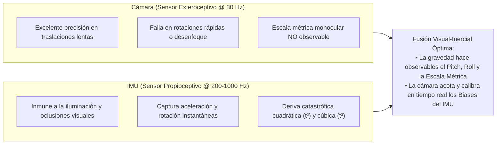
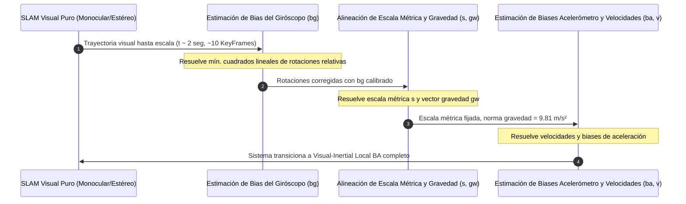

# 09. SLAM Visual-Inercial (VIO), Preintegración de IMU en Manifolds e Inicialización en 2 Segundos

---

## 🎯 Deconstrucción Conceptual (Protocolo Feynman)

La combinación de una **cámara** y una **Unidad de Medición Inercial (IMU)** constituye una de las sinergias sensoriales más potentes y elegantes de la robótica autónoma moderna:



---

## 📐 Cinemática del IMU y Modelo Estocástico de Biases

Un IMU triaxial típico (como el incorporado en la controladora Pixhawk 1 de Voyager 3) consta de un giróscopo y un acelerómetro:

### 1. Modelo de Medición del Giróscopo
$$\tilde{\boldsymbol{\omega}}_t = \boldsymbol{\omega}_t + \mathbf{b}_{g, t} + \boldsymbol{\eta}_{gd}$$
* $\boldsymbol{\omega}_t \in \mathbb{R}^3$: Velocidad angular verdadera en el marco del cuerpo.
* $\mathbf{b}_{g, t} \in \mathbb{R}^3$: *Bias* (desplazamiento de cero) del giróscopo.
* $\boldsymbol{\eta}_{gd} \sim \mathcal{N}(\mathbf{0}, \boldsymbol{\Sigma}_g)$: Ruido blanco gaussiano de medición.

### 2. Modelo de Medición del Acelerómetro
$$\tilde{\mathbf{a}}_t = \mathbf{R}_t^{bw} (\mathbf{a}_t^w - \mathbf{g}^w) + \mathbf{b}_{a, t} + \boldsymbol{\eta}_{ad}$$
* $\mathbf{a}_t^w = \ddot{\mathbf{p}}_t^w \in \mathbb{R}^3$: Aceleración lineal verdadera del vehículo en el marco inercial del mundo.
* $\mathbf{g}^w = [0, 0, -9.81]^T\text{ m/s}^2$: Vector de gravedad terrestre en el marco del mundo.
* $\mathbf{b}_{a, t} \in \mathbb{R}^3$: *Bias* del acelerómetro.
* $\boldsymbol{\eta}_{ad} \sim \mathcal{N}(\mathbf{0}, \boldsymbol{\Sigma}_a)$: Ruido blanco de aceleración.

### 3. Modelo Estocástico de Deriva de Biases (Brownian Motion)
Los biases no son constantes; derivan lentamente gobernados por procesos de paseo aleatorio (*Random Walk*):

$$\dot{\mathbf{b}}_{g, t} = \boldsymbol{\eta}_{bg}, \quad \dot{\mathbf{b}}_{a, t} = \boldsymbol{\eta}_{ba}$$
donde $\boldsymbol{\eta}_{bg} \sim \mathcal{N}(\mathbf{0}, \boldsymbol{\Sigma}_{bg})$ y $\boldsymbol{\eta}_{ba} \sim \mathcal{N}(\mathbf{0}, \boldsymbol{\Sigma}_{ba})$.

---

## ⚡ El Teorema de Preintegración de IMU en Manifolds (Forster et al. 2017)

### El Problema de la Integración Tradicional
Si integramos las ecuaciones de Newton entre el KeyFrame $i$ y el KeyFrame $j$:

$$\mathbf{p}_j = \mathbf{p}_i + \mathbf{v}_i \Delta t_{ij} - \frac{1}{2} \mathbf{g} \Delta t_{ij}^2 + \iint_{t \in [i, j]} \mathbf{R}_t (\tilde{\mathbf{a}}_t - \mathbf{b}_{a, t}) dt^2$$

> [!CAUTION]
> Cada vez que el optimizador de Bundle Adjustment ajusta la pose $\mathbf{R}_i$ o la posición $\mathbf{p}_i$ durante una iteración de Gauss-Newton, **habría que reintegrar numéricamente cientos de muestras de IMU entre cada par de KeyFrames**. Esto volvía al VIO intratable en tiempo real.

---

### La Solución: Preintegración en el Marco Local de $K_i$
Christian Forster, Luca Carlone, Frank Dellaert y Davide Scaramuzza (IEEE T-RO 2017) demostraron que multiplicando por $\mathbf{R}_i^T$, las medidas inerciales se desacoplan totalmente de la pose y la velocidad del mundo:

$$\begin{aligned}
\Delta \mathbf{R}_{ij} &\doteq \mathbf{R}_i^T \mathbf{R}_j = \prod_{k=i}^{j-1} \exp \left( (\tilde{\boldsymbol{\omega}}_k - \mathbf{b}_{g, i}) \Delta t \right) \\
\Delta \mathbf{v}_{ij} &\doteq \mathbf{R}_i^T (\mathbf{v}_j - \mathbf{v}_i - \mathbf{g} \Delta t_{ij}) = \sum_{k=i}^{j-1} \Delta \mathbf{R}_{ik} (\tilde{\mathbf{a}}_k - \mathbf{b}_{a, i}) \Delta t \\
\Delta \mathbf{p}_{ij} &\doteq \mathbf{R}_i^T \left( \mathbf{p}_j - \mathbf{p}_i - \mathbf{v}_i \Delta t_{ij} - \frac{1}{2} \mathbf{g} \Delta t_{ij}^2 \right) = \sum_{k=i}^{j-1} \left( \Delta \mathbf{v}_{ik} \Delta t + \frac{1}{2} \Delta \mathbf{R}_{ik} (\tilde{\mathbf{a}}_k - \mathbf{b}_{a, i}) \Delta t^2 \right)
\end{aligned}$$

> [!IMPORTANT]
> **El Invariante de Preintegración:** Los términos $\Delta \mathbf{R}_{ij}, \Delta \mathbf{v}_{ij}, \Delta \mathbf{p}_{ij}$ dependen **exclusivamente de las mediciones de IMU entre $i$ y $j$**. No cambian cuando las poses mundiales $(\mathbf{R}_i, \mathbf{p}_i, \mathbf{v}_i, \mathbf{R}_j, \mathbf{p}_j, \mathbf{v}_j)$ se actualizan en el solver.

---

### Actualización de Biases sin Reintegración (Jacobianos de Taylor de Primer Orden)
Cuando los valores de bias estimados varían ligeramente ($\mathbf{b} \leftarrow \mathbf{b} + \delta \mathbf{b}$), los valores preintegrados se actualizan instantáneamente mediante matrices Jacobianas precalculadas:

$$\begin{aligned}
\Delta \mathbf{R}_{ij}(\mathbf{b}_{g, i} + \delta \mathbf{b}_g) &\approx \Delta \mathbf{R}_{ij}(\mathbf{b}_{g, i}) \exp \left( \mathbf{J}_{\Delta R}^{g} \delta \mathbf{b}_g \right) \\
\Delta \mathbf{v}_{ij}(\mathbf{b}_{a, i} + \delta \mathbf{b}_a, \mathbf{b}_{g, i} + \delta \mathbf{b}_g) &\approx \Delta \mathbf{v}_{ij} + \mathbf{J}_{\Delta v}^{a} \delta \mathbf{b}_a + \mathbf{J}_{\Delta v}^{g} \delta \mathbf{b}_g \\
\Delta \mathbf{p}_{ij}(\mathbf{b}_{a, i} + \delta \mathbf{b}_a, \mathbf{b}_{g, i} + \delta \mathbf{b}_g) &\approx \Delta \mathbf{p}_{ij} + \mathbf{J}_{\Delta p}^{a} \delta \mathbf{b}_a + \mathbf{J}_{\Delta p}^{g} \delta \mathbf{b}_g
\end{aligned}$$

La matriz de covarianza de la preintegración $\boldsymbol{\Sigma}_{\Delta} \in \mathbb{R}^{9 \times 9}$ se propaga acumulativamente durante la captura a alta frecuencia.

---

## ⏱️ Inicialización Rápida en 2 Segundos (Campos et al. 2021)

Uno de los mayores hitos de **ORB-SLAM3** fue el algoritmo de inicialización inercial ultra-rápida, desacoplado en etapas lineales eficientes:



### 1. Estimación del Bias del Giróscopo ($\mathbf{b}_g$)
Dado que el giro visual entre KeyFrames consecutivos $\mathbf{R}_{ij}^{\text{vis}}$ es independiente de la escala métrica, se formula un sistema lineal para estimar $\mathbf{b}_g$:

$$\arg\min_{\mathbf{b}_g} \sum_{k=1}^N \left\| \log \left( (\mathbf{R}_{k, k+1}^{\text{vis}})^T \Delta \mathbf{R}_{k, k+1}(\mathbf{b}_g) \right) \right\|^2$$

### 2. Estimación de Escala Métrica ($s$) y Vector Gravedad ($\mathbf{g}^w$)
Relacionando la doble integración de aceleración con las traslaciones visuales $\mathbf{p}^{\text{vis}}$:

$$s \mathbf{p}_{k+1}^{\text{vis}} - s \mathbf{p}_k^{\text{vis}} - \mathbf{v}_k \Delta t - \frac{1}{2} \mathbf{g}^w \Delta t^2 = \mathbf{R}_k \Delta \mathbf{p}_{k, k+1}$$
* Resolviendo este sistema lineal de ecuaciones sobre los 10 primeros KeyFrames, se recupera el factor de escala monocular exacto $s$ y la dirección de la vertical física (restringiendo $\|\mathbf{g}^w\| = 9.81\text{ m/s}^2$).
* La transición de monocular a métrico se completa en menos de **2 segundos** desde el arranque del vehículo.

---

## 🧪 Mini-Test de Verificación de Preintegración de Rotaciones

El siguiente script en Python valida la preintegración discreta de rotaciones en $SO(3)$ y la corrección de primer orden mediante el Jacobiano de bias del giróscopo:

```python
import numpy as np

def hat_so3(w):
    return np.array([[0, -w[2], w[1]], [w[2], 0, -w[0]], [-w[1], w[0], 0]])

def exp_so3(w):
    theta = np.linalg.norm(w)
    if theta < 1e-7:
        return np.eye(3) + hat_so3(w)
    k = hat_so3(w / theta)
    return np.eye(3) + np.sin(theta) * k + (1.0 - np.cos(theta)) * (k @ k)

def test_imu_rotation_preintegration():
    dt = 0.01
    steps = 100
    
    # Perfil de velocidad angular constante
    omega_true = np.array([0.1, 0.2, -0.05])
    bg_nominal = np.array([0.01, -0.01, 0.02])
    delta_bg = np.array([0.001, 0.002, -0.001]) # Pequeña variación de bias
    
    # 1. Preintegración con bias nominal
    delta_R_nominal = np.eye(3)
    J_bg = np.zeros((3, 3))
    
    for _ in range(steps):
        omega_meas = omega_true + bg_nominal
        omega_corr = omega_meas - bg_nominal
        R_step = exp_so3(omega_corr * dt)
        
        # Propagación de Jacobiano: J_k+1 = R_step^T * J_k - I * dt
        J_bg = R_step.T @ J_bg - np.eye(3) * dt
        delta_R_nominal = delta_R_nominal @ R_step
        
    # 2. Preintegración exacta con el nuevo bias perturbado (bg_nominal + delta_bg)
    delta_R_true_perturbed = np.eye(3)
    for _ in range(steps):
        omega_meas = omega_true + bg_nominal
        omega_corr = omega_meas - (bg_nominal + delta_bg)
        R_step = exp_so3(omega_corr * dt)
        delta_R_true_perturbed = delta_R_true_perturbed @ R_step
        
    # 3. Corrección lineal por Jacobiano de Taylor: delta_R_approx = delta_R_nominal * exp(J_bg * delta_bg)
    delta_R_approx = delta_R_nominal @ exp_so3(J_bg @ delta_bg)
    
    # Verificación de invariantes: la aproximación por Jacobiano debe coincidir con la integración exacta
    residual = np.linalg.norm(delta_R_true_perturbed - delta_R_approx)
    assert residual < 1e-4, f"Fallo en Jacobiano de preintegración inercial: {residual}"
    print(f"IMU On-Manifold Preintegration Verified! Residual: {residual:.2e}")

if __name__ == "__main__":
    test_imu_rotation_preintegration()
```
