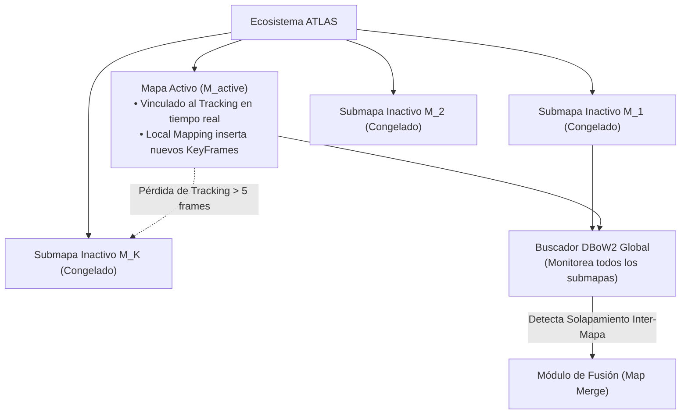

# 10. Mapeo Múltiple, Arquitectura ATLAS y SLAM de por Vida (Lifelong SLAM)

---

## 🎯 Deconstrucción Conceptual: Superando la Fragilidad del Mapa Único

En los sistemas tradicionales de SLAM, el sistema opera bajo una suposición optimista y peligrosa: **el robot mantendrá el seguimiento (*tracking*) de forma ininterrumpida durante toda su misión**.

En el despliegue físico real de un vehículo terrestre como UGV Voyager 3:
1. Una persona u obstáculo bloquea temporalmente la cámara.
2. El rover atraviesa una zona oscura o sin textura (un túnel, un piso liso).
3. Una aceleración brusca o bache en el terreno sacude la cámara produciendo desenfoque cinético (*motion blur*).


La arquitectura **ATLAS** de **ORB-SLAM3** sustituye la noción frágil de un mapa único monolítico por un **ecosistema dinámico de submapas discontinuos**, garantizando la operación autónoma continua de por vida (*Lifelong SLAM*).

---

## 🏛️ Arquitectura del Sistema ATLAS

El sistema ATLAS mantiene una colección no acotada de mapas estocásticos independientes:

$$\mathcal{M} = \{ M_{\text{active}}, M_1, M_2, \dots, M_K \}$$

Cada submapa $M_i$ es una entidad autónoma y autocontenida que encapsula:
* Un conjunto propio de **KeyFrames** $\mathcal{K}_i$.
* Un conjunto propio de **MapPoints** $\mathcal{P}_i$.
* Su propio **Grafo de Covisibilidad** y **Árbol de Expansión** (*Spanning Tree*).
* Su propio índice invertido y directo de **DBoW2**.



---

## 🔄 El Pipeline de Creación y Fusión de Submapas (Map Merging)

### 1. Creación Instantánea de un Nuevo Submapa
Si el hilo de Tracking no logra relocalizarse tras perder el seguimiento durante 5 fotogramas consecutivos:
1. El mapa activo $M_{\text{active}}$ se desvincula del tracking y se archiva como submapa inactivo en el ATLAS.
2. Inmediatamente, el sistema inicializa un **nuevo submapa activo** $M_{\text{new}}$ utilizando el fotograma actual como KeyFrame cero de referencia local.
3. El vehículo **nunca se bloquea**: continúa estimando su odometría y construyendo geometría local sin importar la desconexión con el mapa anterior.

---

### 2. Detección de Fusión entre Submapas (*Inter-Map Loop Detection*)
El hilo de reconocimiento de lugares consulta continuamente la base de datos de DBoW2 utilizando el KeyFrame actual del mapa activo:
* Si el mejor candidato pertenece al mismo mapa activo $\implies$ Ejecuta un **Cierre de Bucle Intra-Mapa** estándar.
* Si el mejor candidato pertenece a un **submapa inactivo $M_{\text{target}}$** $\implies$ Se activa el protocolo de **Fusión de Submapas (*Map Merging*)**.

---

### 3. Alineación Geométrica Inter-Mapas
Sean los KeyFrames $K_a \in M_{\text{active}}$ y $K_m \in M_{\text{target}}$ que comparten palabras visuales:
1. Se establecen correspondencias 3D-3D entre los MapPoints observados por ambos KeyFrames.
2. **Estimación de Transformación Relativa:**
   * **Caso Monocular:** Se calcula una transformación $\mathbf{S}_{ma} \in Sim(3)$ (escala $s$, rotación $\mathbf{R}$, traslación $\mathbf{t}$) mediante el algoritmo de Horn con RANSAC:
     $$\mathbf{p}_m = \mathbf{S}_{ma} \mathbf{p}_a = s \mathbf{R}_{ma} \mathbf{p}_a + \mathbf{t}_{ma}$$
   * **Caso Visual-Inercial / Estéreo:** Dado que la escala métrica y la dirección de la gravedad ya son observables y compartidas universalmente, la alineación se restringe estrictamente a **$SE(3)$ con 4 grados de libertad** (traslación en 3D y rotación pura alrededor del eje de gravedad *Yaw*).

---

### 4. Fusión y Soldadura Topológica (*Map Welding*)
Una vez validada la hipótesis geométrica con al menos 20 inliers:
1. **Transformación Rígida del Mapa Activo:** Todos los KeyFrames y MapPoints de $M_{\text{active}}$ se transforman al sistema de coordenadas de $M_{\text{target}}$ mediante la transformación $\mathbf{S}_{ma}$.
2. **Fusión de Puntos Duplicados:** Todos los MapPoints de la región de solapamiento que representan la misma entidad física se unifican, transfiriendo sus observaciones al punto superviviente.
3. **Soldadura de Grafos:** Se establecen aristas de covisibilidad cruzadas entre los KeyFrames de ambos mapas que ahora comparten puntos comunes.
4. **Local Bundle Adjustment de Soldadura:** Se ejecuta un BA local restringido a los KeyFrames de la frontera soldada, garantizando que no existan discontinuidades geométricas en la costura de ambos mapas.
5. **Optimización del Grafo Esencial Global:** Se ejecuta una optimización rápida de grafo de poses en todo el mapa resultante, propagando la corrección por todas las trayectorias pasadas.

---

## 🌍 SLAM de por Vida (*Lifelong SLAM*) y Robustez Multi-Sesión

El ecosistema ATLAS convierte a ORB-SLAM3 en una solución óptima para operaciones robóticas de larga duración (*Lifelong Mapping*):

| Escenario Crítico | Respuesta del SLAM Clásico | Respuesta de ORB-SLAM3 (ATLAS) |
|---|---|---|
| **Oclusión visual total (alguien tapa la cámara)** | Pierde localización y falla catastróficamente. | Inicia nuevo submapa local al recuperar visión; une ambos mapas cuando vuelve a ver zonas conocidas. |
| **Múltiples sesiones de trabajo (mañana / tarde)** | Requiere conocer a priori la pose de partida exacta. | Inicia una nueva sesión autónoma; relocaliza y fusiona los mapas automáticamente al detectar vistas comunes. |
| **Cambios dinámicos en el entorno (muebles movidos)** | Inyecta outliers en el mapa global degradando la precisión. | Las cribas locales (*Point & KeyFrame Culling*) purgan observaciones caducadas sin corromper la topología. |
| **Crecimiento de memoria en trayectorias repetidas** | El número de estados satura la CPU ($\mathcal{O}(N^2)$). | La criba de KeyFrames redundantes mantiene el mapa en densidad constante $\mathcal{O}(1)$ por metro cúbico. |

---

## 🧪 Mini-Test de Verificación de Fusión de Mapas (Welded Merge)

El siguiente script en Python simula la transformación y soldadura de dos submapas independientes en un único sistema de coordenadas:

```python
import numpy as np

def test_map_merging_pipeline():
    # Submapa 1 (Inactivo, en el origen del mundo)
    p_map1 = np.array([
        [0.0, 0.0, 1.0],
        [1.0, 0.0, 2.0],
        [2.0, 0.0, 3.0]
    ])
    
    # Submapa 2 (Activo, generado tras pérdida de tracking, origen desplazado)
    # Transformación verdadera entre mapa 1 y mapa 2: t=[5.0, 0.0, 0.0], R=RotZ(90 deg)
    R_true = np.array([[0, -1, 0], [1, 0, 0], [0, 0, 1]])
    t_true = np.array([5.0, 0.0, 0.0])
    
    # El mapa 2 observa el punto 3 (en coordenadas relativas de mapa 2) y puntos nuevos
    p3_in_map2 = R_true.T @ (p_map1[2] - t_true)
    p_new_in_map2 = np.array([0.5, 1.5, 2.0])
    
    # Simulación del paso de fusión:
    # 1. Alineación Sim(3)/SE(3) entre los dos mapas mediante correspondencia de p3
    # 2. Transformar mapa 2 a las coordenadas de mapa 1
    p3_recovered_in_map1 = R_true @ p3_in_map2 + t_true
    p_new_welded_in_map1 = R_true @ p_new_in_map2 + t_true
    
    # Invariante: El punto común debe coincidir exactamente en el mapa unificado
    residual = np.linalg.norm(p3_recovered_in_map1 - p_map1[2])
    assert residual < 1e-8, f"Discrepancia en la soldadura del punto común: {residual}"
    
    # El mapa fusionado contiene 4 puntos unificados
    merged_map = np.vstack([p_map1, p_new_welded_in_map1])
    assert merged_map.shape[0] == 4, "El mapa fusionado debe consolidar puntos comunes"
    print(f"ATLAS Map Merging & Welding Invariant Verified! Residual: {residual:.2e}")

if __name__ == "__main__":
    test_map_merging_pipeline()
```
