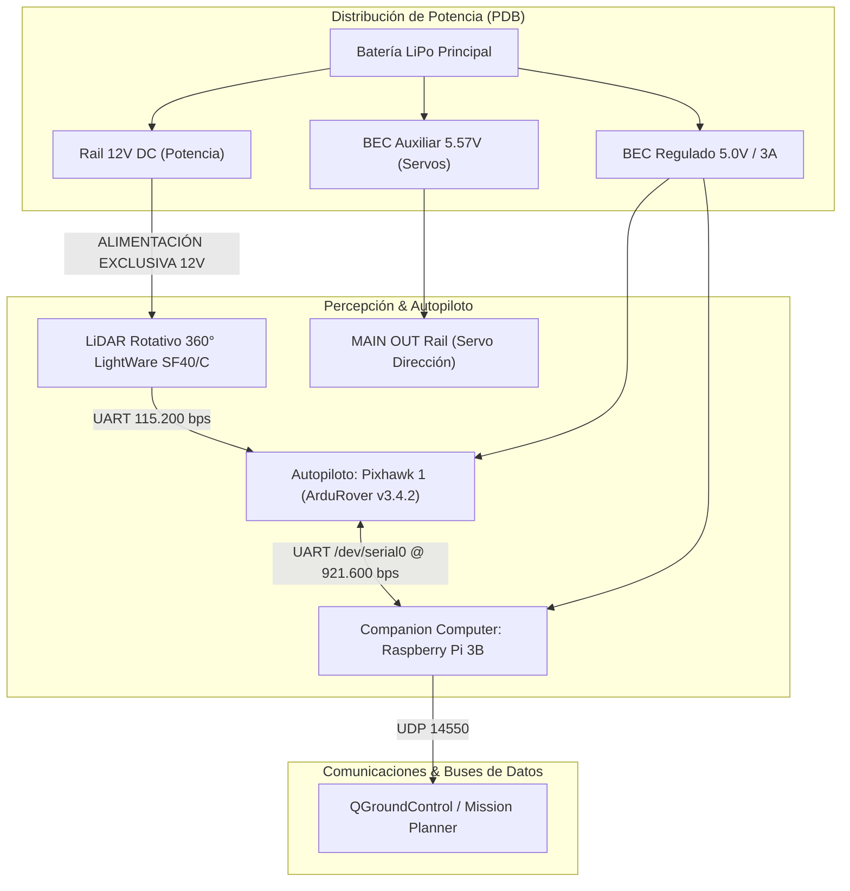
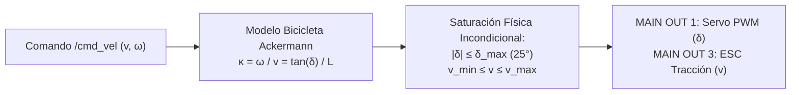
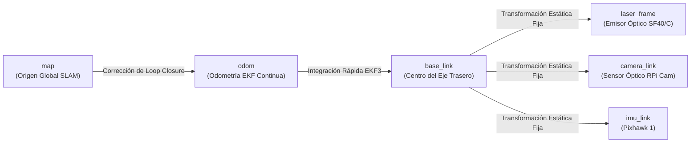

# 12. Guía de Integración Práctica para UGV Voyager 3

---

## 🚜 1. Identidad de la Plataforma y Especificaciones Físicas

El **UGV Voyager 3** (basado en el chasis robótico Fible ALTU del proyecto europeo H2020 RAWFIE) es un vehículo terrestre no tripulado diseñado para misiones de exploración, mapeo y navegación autónoma en interiores y exteriores.



---

## 🔒 Reglas Críticas de Seguridad Eléctrica y Hardware

> [!CAUTION]
> **REGLA DE ORO DEL LIDAR LIGHTWARE SF40/C:**
> El LiDAR SF40/C **DEBE alimentarse exclusivamente desde el rail regulado de 12V DC** del PDB.
> **ESTÁ ESTRICTAMENTE PROHIBIDO** conectar la línea de alimentación del LiDAR a los buses de 5V de la Raspberry Pi o de la Pixhawk. Una caída de tensión reiniciará la Raspberry Pi en pleno movimiento o quemará el puerto de alimentación de la Pixhawk.

1. **Alimentación de la Raspberry Pi 3B:** Requiere una fuente dedicada de $5.0\text{ V}$ con capacidad mínima de $2.5\text{ A}$ continuos para evitar throttling térmico o *under-voltage warnings* en los cuatro núcleos Cortex-A53.
2. **Rail de Servos Pixhawk (`MAIN OUT`):** El servo de dirección Ackermann en `MAIN OUT 1` demanda picos de corriente inductiva que no pueden suministrarse por el bus de la Pixhawk. El rail se alimenta a $5.57\text{ V}$ mediante un BEC auxiliar independiente.
3. **Watchdog de Seguridad (Deadman Switch):** Todo nodo de control que comande velocidad en `/cmd_vel` o mediante MAVROS debe incorporar un temporizador de seguridad: si no se actualiza la consigna en **$\le 300\text{ ms}$**, la velocidad del vehículo debe fijarse a cero ($v = 0$).

---

## 🚗 2. Cinemática Vehicular Ackermann

A diferencia de un robot diferencial (*Skid-Steer*), el UGV Voyager 3 posee dirección por eje directriz delantero gobernado por un servomotor y tracción en el eje trasero.



### A. Modelo Bicicleta Ackermann
Definiendo la batalla entre ejes $L \approx 0.35\text{ m}$ y el ángulo de dirección de las ruedas directrices delanteras $\delta$:

$$\kappa = \frac{\tan \delta}{L}, \quad R = \frac{1}{\kappa + \text{sign}(\kappa) \cdot \epsilon}$$
donde $\kappa$ es la curvatura de la trayectoria, $R$ es el radio de giro instantáneo, y $\epsilon = 10^{-7}$ es la guarda numérica para evitar división por cero cuando las ruedas se encuentran perfectamente alineadas ($\delta = 0$).

### B. Restricciones Físicas y No-Holonomía
1. **Velocidad Lateral Nula:** El vehículo no puede desplazarse lateralmente de forma instantánea:
   $$v_y = 0$$
2. **Giro en el Sitio Imposible:** El vehículo no puede girar sobre su propio eje en reposo:
   $$\omega \ne 0 \implies v_x \ne 0$$
3. **Ángulo Máximo de Dirección:** El recorrido mecánico del servomotor acota el giro:
   $$\delta_{\max} \approx 25^\circ \approx 0.4363\text{ rad} \implies R_{\min} = \frac{L}{\tan \delta_{\max}} \approx \frac{0.35}{\tan(0.4363)} \approx 0.75\text{ m}$$

---

## 📡 3. Árbol de Transformaciones TF2 y Tópicos Canónicos (REP 105)

El sistema ROS 2 en la Raspberry Pi 3B mantiene la cadena cinemática oficial de transformaciones:



### Tópicos Canónicos de la Arquitectura
* `/scan` (`sensor_msgs/msg/LaserScan`): Datos del LiDAR SF40/C filtrados en rango $[0.2, 20.0]\text{ m}$.
* `/mavros/imu/data` (`sensor_msgs/msg/Imu`): Telemetría inercial de la Pixhawk a $50\text{ Hz}$.
* `/mavros/local_position/odom` (`nav_msgs/msg/Odometry`): Odometría compuesta calculada por el EKF3 de ArduRover.
* `/cmd_vel` (`geometry_msgs/msg/Twist`): Consigna de navegación reactiva generada por el nodo Nearness Diagram.
* `/voyager/safety_state` (`std_msgs/msg/String`): Estado del supervisor de seguridad (`MANUAL`, `AUTONOMOUS`, `FAILSAFE`).

---

## 💻 4. Nodo Puente ROS 2: Ackermann Twist Converter con Watchdog

El siguiente nodo en ROS 2 (`rclpy`) implementa la conversión cinemática entre comandos Twist estándar y comandos Ackermann saturados, integrando el watchdog de 300 ms y la guarda numérica $\epsilon = 10^{-7}$:

```python
#!/usr/bin/env python3
import rclpy
from rclpy.node import Node
from geometry_msgs.msg import Twist
from std_msgs.msg import Header
import numpy as np

class VoyagerAckermannBridge(Node):
    def __init__(self):
        super().__init__('voyager_ackermann_bridge')
        
        # Parámetros físicos del UGV Voyager 3
        self.declare_parameter('wheelbase', 0.35)             # Batalla L en metros
        self.declare_parameter('max_steer_angle', 0.4363)      # 25 grados en radianes
        self.declare_parameter('max_linear_speed', 1.5)        # 1.5 m/s
        self.declare_parameter('watchdog_timeout_sec', 0.300)  # 300 ms de deadman
        
        self.L = self.get_parameter('wheelbase').value
        self.max_delta = self.get_parameter('max_steer_angle').value
        self.max_v = self.get_parameter('max_linear_speed').value
        self.timeout = self.get_parameter('watchdog_timeout_sec').value
        self.eps = 1e-7
        
        self.last_cmd_time = self.get_clock().now()
        
        # Subscripciones y Publicaciones
        self.sub_cmd = self.create_subscription(Twist, '/cmd_vel', self.cmd_callback, 10)
        self.pub_safe = self.create_publisher(Twist, '/voyager/cmd_vel_safe', 10)
        
        # Temporizador de Watchdog a 50 Hz
        self.timer = self.create_timer(0.02, self.watchdog_check)
        self.get_logger().info('Voyager 3 Ackermann Bridge & Watchdog initialized.')

    def cmd_callback(self, msg: Twist):
        self.last_cmd_time = self.get_clock().now()
        v = float(np.clip(msg.linear.x, -self.max_v, self.max_v))
        omega = float(msg.angular.z)
        
        # Cálculo de ángulo de dirección con guarda numérica
        if abs(v) > self.eps:
            curvature = omega / v
            delta = np.arctan(self.L * curvature)
        else:
            delta = 0.0
            
        # Saturación física estricta del servo
        delta_clamped = float(np.clip(delta, -self.max_delta, self.max_delta))
        
        # Reconstruir Twist físicamente factible
        safe_msg = Twist()
        safe_msg.linear.x = v
        # omega_recalculada = (v / L) * tan(delta)
        safe_msg.angular.z = (v / self.L) * np.tan(delta_clamped)
        self.pub_safe.publish(safe_msg)

    def watchdog_check(self):
        dt = (self.get_clock().now() - self.last_cmd_time).nanoseconds * 1e-9
        if dt > self.timeout:
            # Activación inmediata de parada de emergencia
            stop_msg = Twist()
            stop_msg.linear.x = 0.0
            stop_msg.angular.z = 0.0
            self.pub_safe.publish(stop_msg)

def main(args=None):
    rclpy.init(args=args)
    node = VoyagerAckermannBridge()
    try:
        rclpy.spin(node)
    except KeyboardInterrupt:
        pass
    finally:
        node.destroy_node()
        rclpy.shutdown()

if __name__ == '__main__':
    main()
```
