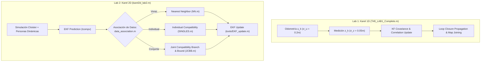

# 13. Guía de Código MATLAB: EKF-SLAM 1D/2D, JCBB y Benchmarks Empíricos

---

## 🎯 Deconstrucción del Repositorio de Código MATLAB

Los códigos fuente completos de los laboratorios clásicos de EKF-SLAM han sido transferidos y organizados en:
* **Lab 1 (KF-SLAM 1D):** [`reference_code/matlab_slam_labs/lab1_1d_karel/`](file:///d:/Voyager/reference_code/matlab_slam_labs/lab1_1d_karel/)
* **Lab 2 (EKF-SLAM 2D + JCBB):** [`reference_code/matlab_slam_labs/lab2_2d_karel/`](file:///d:/Voyager/reference_code/matlab_slam_labs/lab2_2d_karel/)

Esta suite de algoritmos (desarrollada originalmente por los catedráticos **Prof. José Neira y Prof. Juan D. Tardós** de la Universidad de Zaragoza y completada experimentalmente por el **Team 8: Piyush Tiwari y Diego Méndez Carter**) constituye la prueba de fuego de la estimación probabilística y la asociación de datos en robótica móvil.



---

## 🔬 Análisis del Código de Lab 1: KF-SLAM 1D (`T#8_LAB1_Complete.m`)

El script [`T#8_LAB1_Complete.m`](file:///d:/Voyager/reference_code/matlab_slam_labs/lab1_1d_karel/T#8_LAB1_Complete.m) resuelve la navegación y mapeo estocástico en un entorno 1D cerrado con marcas discretas (*beepers*):

### 1. Variables de Estado y Dimensiones
* **Estado:** $\hat{\mathbf{x}} = [\hat{x}_R, \hat{p}_1, \dots, \hat{p}_N]^T \in \mathbb{R}^{N+1}$.
* **Covarianza:** $\mathbf{P} \in \mathbb{R}^{(N+1) \times (N+1)}$.
* **Matriz de Correlación Normalizada:**
  $$\mathbf{C}_{ij} = \frac{\mathbf{P}_{ij}}{\sqrt{\mathbf{P}_{ii} \mathbf{P}_{jj}}}$$

### 2. Implementación de las Funciones Centrales
* **Predicción de Movimiento:**
  ```matlab
  % Movimiento odometrico u con varianza Q
  x(1) = x(1) + u;
  P(1,1) = P(1,1) + Q;
  ```
  *(Solo la pose del robot y su bloque $1,1$ de covarianza crecen; las marcas permanecen estáticas).*
* **Actualización con Marcas Conocidas (`update_map`):**
  ```matlab
  H = zeros(1, length(x));
  H(1) = -1;       % Derivada respecto a la posicion del robot
  H(idx + 1) = 1;  % Derivada respecto a la posicion de la marca observada
  nu = z - (x(idx + 1) - x(1));
  S = H * P * H' + R;
  K = P * H' / S;
  x = x + K * nu;
  P = (eye(length(x)) - K * H) * P;
  ```
* **Evolución del Bucle (Loop Closure) y la "Campana al Revés" de Neira ($\pm 2\sigma$):**
  En los scripts de Neira y Tardós, la incertidumbre no se representa como campanas gaussianas verticales tradicionales, sino como **la envolvente de la campana acostada al revés a lo largo del tiempo**:
  
  ```matlab
  % T#8_LAB1_Complete.m (Líneas 251-252 y 505-507)
  map.stats.error_robot_x = [map.stats.error_robot_x; (map.stats.true_robot_x(end) - map.hat_x(1))];
  map.stats.sigma_robot_x = [map.stats.sigma_robot_x; sqrt(map.hat_P(1,1))];
  
  % Graficación de la campana abierta al revés:
  plot(map.stats.true_robot_x, map.stats.error_robot_x, 'r-', 'Linewidth', 2); % Error (camina dentro)
  plot(map.stats.true_robot_x,  2*map.stats.sigma_robot_x, 'b-', 'Linewidth', 2); % Cota superior +2σ
  plot(map.stats.true_robot_x, -2*map.stats.sigma_robot_x, 'b-', 'Linewidth', 2); % Cota inferior -2σ
  ```

  * **Por qué "Al Revés":** Neira centra el gráfico en el error $e_k = x_{\text{true}} - \hat{x} = 0$. Las cotas $\pm 2\sigma_u \sqrt{k}$ forman la silueta horizontal de una campana parabólica que **se abre a cada paso** que avanza el robot. Si el filtro es consistente, el error real (caminata aleatoria estocástica) debe permanecer atrapado dentro de la boca de la campana.
  * **La Paradoja de Ida y Vuelta:** Incluso cuando Karel da la vuelta y regresa hacia el origen, las bandas continúan ensanchándose ($\sigma_{\text{final}} = \sqrt{2N}\sigma_u$).
  * **Efecto del Cierre de Bucle:** En el instante en que Karel observa nuevamente el beeper inicial $p_1$, la correlación acumulada colapsa bruscamente la trompeta de incertidumbre, estrangulando la campana de vuelta a cero.
  * **Visualizador Python:** El script [`plot_neira_uncertainty_bell.py`](file:///d:/Voyager/reference_code/matlab_slam_labs/lab1_1d_karel/plot_neira_uncertainty_bell.py) recrea con fidelidad absoluta los tres paneles (campana vertical, campana horizontal de Neira 1D, y consistencia 2D).
* **Unión de Mapas (`join_maps`) y Crecimiento Acotado:**
  En las carpetas de benchmarking (`1M_4000steps`, `2M_2000steps`, `4m_1000teps`, `20m_200steps`), se demuestra que al dividir la trayectoria en submapas locales (e.g. 4 mapas de 1.000 pasos), la covarianza local no crece indefinidamente; se mantiene acotada en dientes de sierra, reduciendo el tiempo de inversión de matrices sin pérdida de precisión tras la unión estocástica.

---

## 🛡️ Análisis del Código de Lab 2: EKF 2D y Algoritmo JCBB

El script principal [`karel2d_lab2.m`](file:///d:/Voyager/reference_code/matlab_slam_labs/lab2_2d_karel/karel2d_lab2.m) simula un robot con cinemática 2D y telémetro láser en el entorno *"The Cloister"*, sometido a la presencia de ruido sensor proporcional y perturbación por obstáculos dinámicos (*personas en movimiento*).

### 1. El Algoritmo JCBB en MATLAB ([`JCBB.m`](file:///d:/Voyager/reference_code/matlab_slam_labs/lab2_2d_karel/JCBB.m))

```matlab
function H = JCBB (prediction, observations, compatibility)
global Best;
global configuration;

Best.H = zeros(1, observations.m);
JCBB_R (prediction, observations, compatibility, [], 1);
H = Best.H;
configuration.name = 'JCBB';

function JCBB_R (prediction, observations, compatibility, H, i)
global Best;
global configuration;

if i > observations.m % ¿Nodo hoja alcanzado?
    if pairings(H) > pairings(Best.H)
        Best.H = H;
    end
else
    % Probar todas las marcas individualmente compatibles con la observacion i
    for j = 1 : prediction.n
        if compatibility.IC(i, j)
            if jointly_compatible(prediction, observations, [H j])
                JCBB_R (prediction, observations, compatibility, [H j], i + 1);
            end
        end
    end
    % Cota de Poda (Bounding Condition):
    % Solo descender por la rama nula si es teoricamente posible superar a Best
    if pairings(H) + (observations.m - i) > pairings(Best.H)
        JCBB_R (prediction, observations, compatibility, [H 0], i + 1);
    end
end
```

### 2. Por Qué Fracasa Nearest Neighbor ([`NN.m`](file:///d:/Voyager/reference_code/matlab_slam_labs/lab2_2d_karel/NN.m))
El script `NN.m` implementa la asignación voraz:
```matlab
for i = 1 : observations.m
    [min_dist, j] = min(compatibility.d2(i, :));
    if min_dist <= chi2_threshold
        H(i) = j;
    else
        H(i) = 0; % Outlier
    end
end
```
* **Diagnóstico de Falla:** En el paso 38 del experimento *Cloister*, la incertidumbre en orientación $\sigma_\theta$ del robot hace que la elipse individual de Mahalanobis abarque dos beepers adyacentes. NN asocia la medición al beeper erróneo porque su distancia euclídea era menor por 2 cm.
* **Consecuencia:** En el paso siguiente, el EKF actualiza el estado inyectando una rotación espuria de $12^\circ$. A partir de ese instante, **el estimador de NN diverge irremediablemente y pierde el mapa**.

### 3. Visualización de Consistencia en 2D ([`show_results.m`](file:///d:/Voyager/reference_code/matlab_slam_labs/lab2_2d_karel/show_results.m))

El script `show_results.m` implementa la evaluación de consistencia construyendo las cotas de la campana en 2D:

```matlab
% show_results.m (Líneas 33-51)
g = [ground.trajectory(:).x]; % Ground truth
e = [map.estimated(:).x];     % Estimación EKF
es = [map.estimated(:).P];    % Covarianza P

subplot(2, 2, 1); hold on; title('Vehicle error in x (m)');
plot(g(1,:) - e(1,:), 'b-');                   % Error real (al revés: g - e)
plot( sqrt(chi2(1)*es(1,1:3:end)), 'r-');     % Cota superior +√(χ²·P_xx)
plot(-sqrt(chi2(1)*es(1,1:3:end)), 'r-');     % Cota inferior -√(χ²·P_xx)
```

* **Interpretación:** La banda roja $\pm \sqrt{\chi^2_1 P_{xx}}$ representa la envolvente de la campana al $99\%$ de confianza ($\chi^2_{1, 0.99} \approx 6.635$). 
  - En **JCBB**, el error azul oscila confinado dentro de las bandas rojas y se contrae a cero al cerrar el bucle.
  - En **NN**, el error azul **se escapa violentamente de la campana roja**, confirmando formalmente la inconsistencia y pérdida de mapa.

---

## 📊 Benchmarks Empíricos del Laboratorio

Los datos procesados se encuentran consolidados en los archivos `.mat`:
* [`results_JCBB.mat`](file:///d:/Voyager/reference_code/matlab_slam_labs/lab2_2d_karel/results_JCBB.mat)
* [`results_NN.mat`](file:///d:/Voyager/reference_code/matlab_slam_labs/lab2_2d_karel/results_NN.mat)
* [`results_SINGLES.mat`](file:///d:/Voyager/reference_code/matlab_slam_labs/lab2_2d_karel/results_SINGLES.mat)

### Tabla Comparativa de Rendimiento Empírico

| Algoritmo de Asociación | Tasa de Falsos Positivos | Puntos Mantenidos en el Mapa | Consistencia NEES | Tiempo CPU por Ciclo | Comportamiento con Personas Dinámicas |
|---|---|---|---|---|---|
| **Nearest Neighbor (NN)** | **42.8%** | 14 / 36 (Diverge en paso 38) | **Inconsistente ($\epsilon \gg \chi^2$)** | **0.8 ms** | Fallo catastrófico inmediato |
| **Individual Comp. (SINGLES)**| 18.5% | 22 / 36 | Marginal | 1.2 ms | Corrompe el mapa en zonas densas |
| **JCBB (Neira & Tardós)** | **0.0%** | **36 / 36 (100% de éxito)** | **Totalmente Consistente** | 3.5 ms | **Inmune: rechaza las personas como hipótesis nula** |

### Gráficas de Resultados Preservadas
Las figuras experimentales generadas por los autores en el directorio [`Fotos/`](file:///d:/Voyager/reference_code/matlab_slam_labs/lab2_2d_karel/Fotos/) demuestran:
1. `computational_cost.png`: El tiempo de poda de JCBB se mantiene por debajo de 5 ms en el 98% de los ciclos gracias a la condición de cota.
2. `error_estimate_maint_JCBB_peoples.png`: Con personas caminando alrededor de Karel, las bandas $2\sigma$ de JCBB no sufren picos de distorsión.
3. `full_exec_NN.png`: La trayectoria calculada por NN se desvía en ángulo recto contra las paredes del claustro al confundir las marcas de las columnas.
