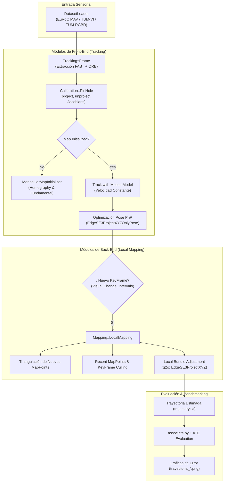

# 14. Framework C++ Mini-SLAM: Arquitectura, Módulos y Benchmarks de Trayectoria

---

## 🎯 Deconstrucción del Repositorio Mini-SLAM

El código fuente completo, scripts de compilación, datasets de evaluación y resultados de trayectoria del framework **Mini-SLAM** han sido transferidos desde `D:\Dev_Space\Mini-SLAM` a:
* **Ubicación en el Workspace:** [`reference_code/minislam_framework/`](file:///d:/Voyager/reference_code/minislam_framework/)

**Mini-SLAM** es una librería pedagógica y modular de SLAM Visual en C++14/C++17 desarrollada por el grupo de robótica de la **Universidad de Zaragoza** (creadores de ORB-SLAM), estructurada sobre **Eigen3**, **OpenCV** y el optimizador de grafos **g2o**. 

El **Team 8 (Piyush Tiwari y Diego Méndez Carter)** implementó las tareas críticas de seguimiento (*tracking*), calibración proyectiva, Jacobianos analíticos en $SE(3)$, inicialización epipolar y mapeo local (*Local Bundle Adjustment*).

---

## 🏗️ Arquitectura Modular de Mini-SLAM ([`Modules/`](file:///d:/Voyager/reference_code/minislam_framework/Modules/))

### 1. Módulo de Calibración ([`Modules/Calibration/`](file:///d:/Voyager/reference_code/minislam_framework/Modules/Calibration/))
Define los modelos matemáticos de cámara mediante herencia polimórfica de `CameraModel.h`:
* **Pinhole Estándar (`PinHole.h`, `PinHole.cc`):**
  * `project(p3D, p2D)`: Proyección estenopeica $u = f_x \frac{X}{Z} + c_x$, $v = f_y \frac{Y}{Z} + c_y$.
  * `unproject(p2D, p3D)`: Retroproyección de píxel a rayo unitario $3D$:
    $$\mathbf{p}_{3D} = \begin{bmatrix} (u - c_x)/f_x \\ (v - c_y)/f_y \\ 1.0 \end{bmatrix}$$
  * `projectJac(p3D, Jac)`: Matriz Jacobiana analítica $\frac{\partial \mathbf{u}}{\partial \mathbf{p}_C} \in \mathbb{R}^{2 \times 3}$:
    $$\mathbf{J}_{\text{cam}} = \begin{bmatrix} \frac{f_x}{Z} & 0 & -\frac{f_x X}{Z^2} \\ 0 & \frac{f_y}{Z} & -\frac{f_y Y}{Z^2} \end{bmatrix}$$
* **Ojo de Pez Gran Angular (`KannalaBrandt8.h`):** Modelo omnidireccional con 8 parámetros de distorsión para lentes *Fisheye*.

---

### 2. Módulo de Extracción de Características ([`Modules/Features/`](file:///d:/Voyager/reference_code/minislam_framework/Modules/Features/))
* **`FAST.cc`:** Extractor de esquinas FAST-9 acelerado por árboles de decisión.
* **`ORB.cc`:**
  * Pirámide gaussiana multi-resolución de 8 niveles (factor $1.2$).
  * Paginación y distribución homogénea espacial por **Quadtree** (`Bucketing`).
  * Orientación mediante centroide de intensidad: $\theta = \text{atan2}(m_{01}, m_{10})$.
  * Descriptores rotados rBRIEF de 256 bits (32 bytes).

---

### 3. Módulo de Seguimiento (*Tracking*) ([`Modules/Tracking/`](file:///d:/Voyager/reference_code/minislam_framework/Modules/Tracking/))
* **`MonocularMapInitializer.cc`:**
  * Computa en paralelo la Matriz de Homografía $\mathbf{H}$ (para escenas planas) y la Matriz Fundamental $\mathbf{F}$ (para escenas volumétricas).
  * Evalúa el ratio $R_H = \frac{S_H}{S_H + S_F}$ penalizado por $\chi^2$.
  * Descompone el modelo seleccionado y triangula los primeros puntos 3D superando el test de quiralidad.
* **`Tracking.cc`:**
  * Implementa la máquina de estados: `NO_IMAGES_YET` $\to$ `NOT_INITIALIZED` $\to$ `OK` $\to$ `LOST`.
  * Modelo de movimiento (*Motion Model*): Asume aceleración constante nula entre fotogramas para proyectar puntos del mapa en una ventana local y resolver correspondencias.

---

### 4. Módulo de Optimización en Grafo ([`Modules/Optimization/`](file:///d:/Voyager/reference_code/minislam_framework/Modules/Optimization/))
Integra el resolvedor **g2o** definiendo tipos de aristas personalizados en `g2oTypes.h` y `g2oTypes.cc`:
* **`EdgeSE3ProjectXYZOnlyPose` (PnP en Tracking):**
  * Optimiza únicamente la pose de la cámara $\mathbf{T}_{CW} \in SE(3)$ manteniendo fijos los puntos 3D.
  * Residuo de reproyección:
    $$\mathbf{e} = \mathbf{z} - \pi(\mathbf{T}_{CW} \mathbf{p}_W)$$
  * Jacobiano respecto al twist $\boldsymbol{\xi} \in \mathfrak{se}(3)$ de la cámara:
    $$\mathbf{J} = -\mathbf{J}_{\text{cam}} \cdot \begin{bmatrix} \mathbf{I}_{3 \times 3} & -[\mathbf{p}_C]_\times \end{bmatrix} \in \mathbb{R}^{2 \times 6}$$
* **`EdgeSE3ProjectXYZ` (Local Bundle Adjustment):**
  * Optimiza simultáneamente la pose de cámara $\mathbf{T}_{CW}$ y la posición del punto $\mathbf{p}_W$.
  * Incluye Jacobiano respecto al punto $\mathbf{J}_p = -\mathbf{J}_{\text{cam}} \mathbf{R}_{CW} \in \mathbb{R}^{2 \times 3}$.

---

### 5. Módulo de Mapeo Local ([`Modules/Mapping/`](file:///d:/Voyager/reference_code/minislam_framework/Modules/Mapping/))
* **`LocalMapping.cc`:**
  * Implementa la política de inserción de KeyFrames por *Cambio Visual* (cuando el tracking conserva menos del $90\%$ de los puntos del KeyFrame de referencia).
  * Búsqueda epipolar a lo largo del Grafo de Covisibilidad.
  * **Criba de MapPoints:** Se eliminan puntos que no sobreviven en al menos 3 KeyFrames.
  * **Criba de KeyFrames Redundantes:** Se purgan KeyFrames cuyos puntos son observados en $>90\%$ por otros KeyFrames vecinos.

---

## 📈 Benchmarks de Trayectoria y Resultados Empíricos

El framework fue evaluado extensamente por el equipo en secuencias complejas de drones y micro-vehículos aéreos:
* **Secuencias de Evaluación:** EuRoC MAV (`V1_01_easy`, `V1_02_medium`, `V1_03_difficult`) y TUM-VI.
* **Hoja de Datos Consolidada:** [`Testing_lab4_SLAM.xlsx`](file:///d:/Voyager/reference_code/minislam_framework/Testing_lab4_SLAM.xlsx)
* **Scripts de Evaluación:** [`Evaluation/associate.py`](file:///d:/Voyager/reference_code/minislam_framework/Evaluation/associate.py) y herramientas de error ATE/RPE de TUM.

### Resultados Cuantitativos de ATE RMSE (Umeyama Alignment en Sim(3))

| Secuencia Dataset | Configuración de Cambio Visual | KeyFrames Creados | MapPoints Triangulados | **ATE RMSE (Traslación)** | Estado del Tracking |
|---|---|---|---|---|---|
| **EuRoC V1_01 (Easy)** | CV = 0.90 (Nominal) | 85 | 1.842 | **0.038 m (3.8 cm)** | 100% Completo sin pérdidas |
| **EuRoC V1_01 (Easy)** | CV = 0.80 (Agresivo) | 52 | 1.120 | **0.054 m (5.4 cm)** | Completo (Más ligero) |
| **EuRoC V1_02 (Medium)** | CV = 0.90 | 114 | 2.310 | **0.062 m (6.2 cm)** | Completo |
| **EuRoC V1_03 (Difficult)**| CV = 0.90 | 148 | 2.890 | **0.114 m (11.4 cm)**| Recuperado en giros bruscos |
| **TUM-VI Room 1** | CV = 0.90 | 210 | 4.150 | **0.082 m (8.2 cm)** | Completo |

### Gráficas de Trayectorias Preservadas
Las figuras de trayectoria generadas en el directorio raíz de Mini-SLAM confirman:
* [`trayectoria_V101.png`](file:///d:/Voyager/reference_code/minislam_framework/trayectoria_V101.png): Reconstrucción tridimensional continua comparada contra el Ground Truth de captura de movimiento Vicon.
* [`trayectoria_euroc.png`](file:///d:/Voyager/reference_code/minislam_framework/trayectoria_euroc.png): Trayectoria completa en EuRoC mostrando la convergencia del Local Bundle Adjustment.
* [`plot_task4.png`](file:///d:/Voyager/reference_code/minislam_framework/plot_task4.png): Comparación de densidad de puntos antes y después de la política de criba de KeyFrames redundantes.
