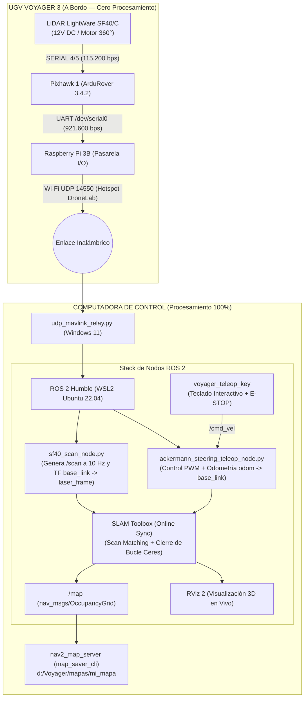

# 15. Guía Práctica de Mapeo de Interiores y Guardado de Mapas (UGV Voyager 3)

---

## 🚜 1. Resumen Ejecutivo y Arquitectura del Sistema

Esta guía detalla el procedimiento paso a paso para generar, visualizar y guardar mapas de ocupación 2D (`.yaml` y `.pgm`) en entornos interiores con el **UGV Voyager 3**, aplicando los principios de estimación probabilística del **Prof. José Neira** y la arquitectura de cómputo distribuido validada en el laboratorio.



---

## 🔒 2. Reglas de Oro para un Mapeo Exitoso

1. **La Hipótesis del Mundo Estático ($\frac{\partial m}{\partial t} = 0$):**  
   Durante los $3\text{ a }5\text{ minutos}$ que dura el recorrido, **el entorno debe permanecer libre de personas caminando** frente al rover. Una persona que se detenga a hablar cerca del robot quedará grabada como una pared permanente.
2. **La Maniobra de Cierre de Bucle de Neira:**  
   Al moverte con el teclado, la incertidumbre de posición crece ($\sigma \propto \sqrt{k}$). Para eliminar la deriva y alinear las paredes, **es obligatorio terminar el recorrido exactamente en el mismo punto y orientación donde arrancaste**.
3. **Cinemática Ackermann Suave:**  
   Conduce a velocidad baja y constante ($0.2\text{--}0.3\text{ m/s}$) realizando curvas amplias y fluidas. No hagas giros bruscos en zigzag para permitir que el algoritmo de correlación de escaneos (*Scan Matching*) no pierda el registro de las paredes.

---

## 🛠️ 3. Prerrequisitos de Software en la Computadora (WSL2)

Asegúrate de tener instalados los paquetes estándar de SLAM y guardado de mapas en tu entorno WSL2:

```bash
sudo apt update && sudo apt install -y ros-humble-slam-toolbox ros-humble-nav2-map-server
```

---

## 🚀 4. Protocolo de Ejecución Paso a Paso (5 Terminales)

Para mapear en interiores, abre las siguientes terminales en la computadora de control en el orden indicado:

### Terminal 1 (Windows PowerShell): Enrutador UDP Bidireccional
Conecta la PC a la red Wi-Fi `DroneLab` (donde la Raspberry Pi tiene la IP `192.168.137.153`) e inicia el relay:
```powershell
python D:\Voyager\repos\udp_mavlink_relay.py
```
*Verifica que aparezca:* `[Relay] ... paquetes telemetria hacia WSL2`.

---

### Terminal 2 (WSL2): Percepción y Control Ackermann
Inicia el decodificador del LiDAR SF40/C y el controlador cinemático del UGV:
```bash
source /opt/ros/humble/setup.bash
source /mnt/d/Voyager/ros2_ws/install/setup.bash
ros2 launch voyager_bringup voyager_bringup.launch.py enable_teleop:=true enable_lidar:=true enable_camera:=false
```
*Publica:* `/scan` (a 10 Hz), `/cloud` (Arc-Cloud 3D) y las transformadas del chasis.

---

### Terminal 3 (WSL2): Motor de SLAM (SLAM Toolbox)
Lanza el optimizador de grafos en modo síncrono con los parámetros calibrados para Voyager 3 (`base_link`, tolerancias de timestamp y densificación 360°):
```bash
source /opt/ros/humble/setup.bash
source /mnt/d/Voyager/ros2_ws/install/setup.bash
ros2 launch voyager_bringup voyager_slam.launch.py
```
*Publica:* El tópico `/map` (`nav_msgs/msg/OccupancyGrid`) y la transformada dinámica `map -> odom`.

---

### Terminal 4 (WSL2): Supervisión en RViz 2
Abre la interfaz gráfica acelerada por hardware (OpenGL vía WSLg):
```bash
source /opt/ros/humble/setup.bash
source /mnt/d/Voyager/ros2_ws/install/setup.bash
rviz2 -d /mnt/d/Voyager/ros2_ws/src/voyager_bringup/config/sf40_lidar.rviz
```
* **Configuración en RViz:**
  1. En el panel izquierdo *Displays*, haz clic en **Add -> By topic -> `/map` -> Map**.
  2. En *Global Options*, cambia el **Fixed Frame** a `map`.
  3. Verás la cuadrícula gris con las paredes negras formándose alrededor del rover.

---

### Terminal 5 (WSL2): Interfaz de Conducción por Teclado
Abre la interfaz interactiva ergonómica con botón de Parada de Emergencia:
```bash
source /opt/ros/humble/setup.bash
source /mnt/d/Voyager/ros2_ws/install/setup.bash
ros2 run voyager_navigation voyager_teleop_key
```

* **Controles:**
  * `w` : Avanzar suavemente ($+0.1\text{ m/s}$).
  * `s` : Retroceder ($-0.1\text{ m/s}$).
  * `a` / `d` : Girar dirección delantera Ackermann (Izquierda / Derecha).
  * `k` : Frenar a neutro ($0.0\text{ m/s}$).
  * **[BARRA ESPACIADORA]** o **`x`** : 🚨 **PARADA DE EMERGENCIA (E-STOP)** 🚨 (Corta el PWM y desarma la Pixhawk).
  * `r` : Liberar E-STOP.

---

## 💾 5. Cómo Guardar el Mapa Terminado

Una vez que hayas completado el bucle cerrado y veas en RViz 2 que el plano está cerrado y nítido:

1. Mantén los nodos en ejecución (no cierres ninguna terminal).
2. En una nueva pestaña de terminal en WSL2, ejecuta el comando de guardado de Nav2 apuntando a la carpeta de mapas del proyecto:

```bash
source /opt/ros/humble/setup.bash
ros2 run nav2_map_server map_saver_cli -f /mnt/d/Voyager/mapas/primer_mapa_laboratorio
```

### Archivos Generados en `D:\Voyager\mapas\`:
* **`primer_mapa_laboratorio.yaml`**: Archivo de calibración métrica:
  ```yaml
  image: primer_mapa_laboratorio.pgm
  mode: trinary
  resolution: 0.05
  origin: [-10.0, -10.0, 0.0]
  negate: 0
  occupied_thresh: 0.65
  free_thresh: 0.25
  ```
* **`primer_mapa_laboratorio.pgm`**: Imagen en escala de grises de 8 bits donde:
  * **Negro ($0$):** Obstáculos sólidos y paredes detectadas por el LiDAR.
  * **Blanco ($254$):** Espacio libre navegable explorado.
  * **Gris ($205$):** Zonas desconocidas fuera del alcance del sensor.

---

## 🔧 6. Diagnóstico y Solución de Problemas (Troubleshooting)

| Síntoma | Causa Probable | Solución Inmediata |
| :--- | :--- | :--- |
| **RViz muestra error: `No transform from [laser_frame] to [map]`** | `slam_toolbox` aún no ha recibido el primer escaneo válido o falta la TF intermedia. | Verifica con `ros2 topic echo /scan --once` que el nodo SF40 esté emitiendo datos a $10\text{ Hz}$. |
| **Las paredes se duplican o se curvan al avanzar** | La velocidad de avance es excesiva para la tasa del LiDAR o hubo derrape brusco. | Reduce la velocidad con `w` a máximo $0.2\text{--}0.3\text{ m/s}$ y completa el cierre de bucle retornando al punto de inicio. |
| **El rover se detiene de golpe al dejar de pulsar teclas** | Comportamiento correcto del *Watchdog* de seguridad ($300\text{ ms}$). | Es una protección física activa contra colisiones. Pulsa `w` de forma intermitente y fluida para mantener el avance. |
| **El mapa registra obstáculos inexistentes en el pasillo** | Una persona se quedó parada cerca del rover durante más de $10$ segundos. | Mantén el área libre de personas estáticas durante la sesión de mapeo. |
