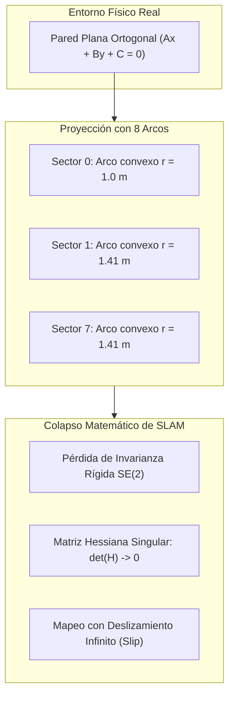
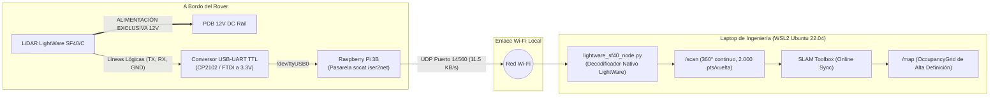

# 16. Análisis Arquitectónico del LiDAR LightWare SF40/C: Detección de Proximidad MAVLink vs. SLAM Denso 2D

---

## 🚜 1. Contexto Histórico y Génesis de la Plataforma (RAWFIE H2020)

Para entender las limitaciones del sistema de percepción actual del **UGV Voyager 3**, es imprescindible reconstruir la génesis de su diseño de ingeniería:

* **Proyecto Matriz:** **RAWFIE** (*Road-, Air- and Water-based Future Internet Experimentation*, iniciativa europea Horizon 2020).
* **Fabricante / Integrador:** Fible Technologies I.K.E. & Universidad de Atenas (UoA).
* **Misión Operacional de Diseño:** El Voyager 3 fue diseñado como un nodo robótico experimental todoterreno para **bancos de pruebas federados al aire libre** (*outdoor testbeds*). El vehículo debía ejecutar misiones de navegación autónoma basadas en **waypoints GPS globales** (coordenadas geodésicas en `SERIAL 3` con el receptor U-blox Neo-M8N) y reportar telemetría en tiempo real a un servidor central a través de la infraestructura celular **4G LTE** (Huawei E3372h) y el router de a bordo (**MikroTik RouterBOARD mAP 2nD**).
* **Ausencia Original de SLAM de Interiores:** La plataforma **nunca fue concebida para ejecutar SLAM 2D/3D en interiores**. La computadora de misión a bordo (Raspberry Pi 3 Model B, equipada con procesador Cortex-A53 de 32 bits y únicamente $1\text{ GB}$ de RAM en Raspbian Stretch) carecía de la capacidad computacional para ejecutar algoritmos de optimización de grafos de poses (*Pose Graph Optimization*) o filtrado bayesiano denso sin sufrir colapsos por *Out of Memory* (OOM).

---

## 🔍 2. El Cuello de Botella del LiDAR: Detección de Proximidad vs. Escaneo Denso

El sensor montado en el Voyager 3 es un **LightWare SF40/C**, un LiDAR rotativo 360° de alta gama con principio de medición de tiempo de vuelo pulsado (*Pulsed Time-of-Flight*, ToF a $905\text{ nm}$), con capacidad de muestreo de hasta **$20.000\text{ mediciones/segundo}$** y un alcance útil de $0.2\text{ a }100\text{ m}$.

Sin embargo, el pipeline actual degrada severamente el sensor debido a su conexionado:

```mermaid
flowchart LR
    subgraph SENSOR_FISICO ["Sensor Físico Real"]
        SF40["LiDAR SF40/C<br>20.000 mediciones/s<br>Barrido 360° continuo"]
    end

    subgraph CUELLO_DE_BOTELLA ["Cuello de Botella: Pixhawk 1 (ArduRover v3.4.2)"]
        PORT["Puerto GPS 2 (SERIAL 4)<br>UART 115.200 bps"]
        PRX["Driver AP_Proximity<br>(PRX_TYPE = 1)"]
        DOWN["Submuestreo a 8 Sectores<br>(Octantes de 45°)"]
        MAV["MAVLink DISTANCE_SENSOR<br>(Mensaje ID 132)"]
        
        PORT --> PRX --> DOWN --> MAV
    end

    subgraph PASARELA ["Raspberry Pi 3B"]
        RPI["MAVProxy UDP 14550<br>(Sin procesar)"]
    end

    subgraph ESTACION_ROS2 ["Laptop de Ingeniería (WSL2)"]
        NODE["sf40_scan_node.py<br>Genera Arc-Cloud sintético"]
        SLAM["SLAM Toolbox / Cartographer<br>(FALLO DE CONVERGENCIA)"]
        
        NODE -.-> SLAM
    end

    SF40 --> PORT
    MAV -->|"UART 921.6k (TELEM 2)"| RPI
    RPI -->|"Wi-Fi / 4G"| NODE
```



### El Rol Original: "Parachoques Virtual de Seguridad"
En el diseño de RAWFIE, el SF40/C se conectó directamente a la Pixhawk en el puerto **`GPS 2`** (puerto lógico **`SERIAL 4`**) para cumplir una única función crítica: **evitación autónoma de colisión de bajo nivel por hardware** (*Autonomous Collision Avoidance*), gobernada por los siguientes parámetros activos:

```ini
AVOID_ENABLE  = 3.0    # Evitación activa tanto en modo MANUAL como en misiones AUTO
AVOID_DIST_MAX = 5.0   # Seguimiento de obstáculos en un radio de 5.0 metros
AVOID_MARGIN   = 2.0   # Frenado o maniobra evasiva a menos de 2.0 metros
AVOID_BEHAVE   = 1.0   # Comportamiento 'Slide': esquivar el obstáculo bordeándolo
```

Para evitar chocar contra una roca o un árbol a campo abierto, una discretización perimetral de **8 sectores de $45^\circ$** es perfectamente suficiente. ArduPilot toma la distancia mínima de cada octante y frena el vehículo si un obstáculo invade el radio de seguridad, operando independientemente de la Raspberry Pi y de la red inalámbrica.

---

## 📐 3. Deconstrucción Matemática: Por qué el SLAM Falla con "Arcos" (Protocolo Feynman)

En la sesión del 31 de octubre de 2026 se desarrolló el nodo [`sf40_scan_node.py`](file:///d:/Voyager/ros2_ws/src/voyager_navigation/voyager_navigation/sf40_scan_node.py), el cual genera el algoritmo **Arc-Cloud 3D** interpolando 25 muestras por sector para visualizar abanicos circulares de $45^\circ$ en RViz 2. 

¿Por qué este enfoque es **inviable para SLAM 2D**?

### A. Geometría Real vs. Geometría Sintética
Una pared recta en el entorno real viene descrita por la ecuación de una línea:
$$\mathbf{n}^T \mathbf{p} + d = 0 \iff A x + B y + C = 0$$

El nodo sintetiza los puntos del escaneo como circunferencias concéntricas centradas en el sensor:
$$\mathbf{p}_i(\theta) = \begin{bmatrix} r_k \cos\theta \\ r_k \sin\theta \end{bmatrix}, \quad \theta \in \left[\theta_c - \frac{\pi}{8}, \theta_c + \frac{\pi}{8}\right]$$
donde $r_k$ es la única lectura escalar proporcionada por el mensaje `DISTANCE_SENSOR`.



### B. Colapso del Scan Matcher (Ceres / Gauss-Newton / ICP)
Los optimizadores de SLAM 2D (`slam_toolbox`, Cartographer) resuelven la transformación rígida $\mathbf{T} = [t_x, t_y, \Delta\theta]^T \in SE(2)$ entre escaneos sucesivos minimizando los residuos de distancia punto-a-línea o correlación espacial sobre la rejilla de ocupación $\mathcal{M}$:
$$\min_{\mathbf{T} \in SE(2)} \sum_{i=1}^N \rho \left( d(\mathbf{T} \mathbf{p}_i, \mathcal{M}) \right)$$

Al linealizar mediante series de Taylor:
$$\mathbf{H} \, \Delta \mathbf{T} = -\mathbf{b}, \quad \text{donde } \mathbf{H} = \sum_{i=1}^N \mathbf{J}_i^T \mathbf{\Omega}_i \mathbf{J}_i$$

* **Violación de la Invarianza $SE(2)$:** Al avanzar el vehículo en cinemática Ackermann una distancia $\Delta x$, la pared física no cambia, pero los arcos sintéticos **cambian de radio y orientación relativa al cuerpo del rover**. Dos escaneos sucesivos no coinciden mediante ninguna rototraslación euclidiana rígida.
* **Singularidad en la Dirección Tangencial:** Un arco circular posee simetría rotacional alrededor de su origen. El gradiente espacial del residuo en la dirección perpendicular al radio es idénticamente nulo:
  $$\frac{\partial d}{\partial \theta} \approx 0 \implies \det(\mathbf{H}) \to 0$$
  El sistema normal se vuelve **mal condicionado o singular**, impidiendo que Ceres converja y provocando un deslizamiento (*drift*) divergente.

### C. Estado del Arte: La Era de los Sonares (1990–2004)
En la literatura clásica, plataformas como el Pioneer 2DX utilizaban un anillo de 16 sonares Polaroid con haces de $30^\circ$, equivalente funcional a nuestro setup actual. Investigadores de primer nivel demostraron que el *scan matching* estándar es inviable bajo esta dispersión:
* **Tardós, Neira, Newman y Leonard (IJRR 2002):** En *"Robust Mapping and Localization in Indoor Environments Using Sonar Data"*, para hacer SLAM no usaron scan matching. Acumularon durante decenas de metros cientos de arcos y aplicaron la **Transformada de Hough y RANSAC sobre las tangentes comunes a los arcos** para reconstruir las paredes planas del entorno, aplicando posteriormente **EKF-SLAM** con la prueba de asociación de datos conjunta **JCBB (*Joint Compatibility Branch and Bound*)**.
* Los stacks modernos de ROS 2 (`slam_toolbox`, Nav2) asumen nubes densas continuas ($> 500$ rayos por vuelta); **no implementan modelos de haz acústico inverso ni extractores de tangentes de sonar**.

---

## 📡 4. Topología de Red y Diagnóstico del Puerto `TELEM 1`

### A. ¿Por qué `TELEM 1` está Vacío?
En autopilotos convencionales, `TELEM 1` aloja radios serie analógicas de largo alcance (SiK / RFD900 a 433/915 MHz a 57.600 bps).  
En el Voyager 3, los ingenieros **reemplazaron la telemetría serie tradicional por una red TCP/IP integral**:
* Toda la telemetría de la Pixhawk se canaliza a través de **`TELEM 2`** (`SERIAL 2`) hacia la Raspberry Pi a **$921.600\text{ bps}$** ($16\times$ más rápido que `TELEM 1`).
* `MAVProxy` en la Raspberry Pi convierte el flujo serie en paquetes **UDP/IP (puerto 14550)**.
* La Raspberry Pi se conecta por cable de red Ethernet RJ45 (`eth0`) al **router MikroTik mAP 2nD** (`192.168.1.1`).
* El módem **Huawei 4G LTE (E3372h)** está conectado al **puerto micro-USB del router MikroTik** en modo HiLink (`192.168.8.1`).

Por lo tanto, **que `TELEM 1` esté vacío es el comportamiento correcto de diseño**. Toda la comunicación viaja por red.

### B. ¿Qué Ocurriría si se Conecta el LiDAR a `TELEM 1`?
1. **Sin reconfigurar parámetros:** No funcionará en absoluto. El puerto `TELEM 1` está a $57.600\text{ bps}$ esperando paquetes MAVLink (`SERIAL1_PROTOCOL = 1`), mientras que el SF40/C transmite a $115.200\text{ bps}$ en protocolo binario propietario. Se producirán *framing errors* y descarte por CRC.
2. **Reconfigurando parámetros (`SERIAL1_PROTOCOL = 11`):** La Pixhawk volvería a leer el sensor, pero **no resolvería el problema de SLAM**, ya que el driver `AP_Proximity` de ArduRover seguiría filtrando la nube a los mismos 8 sectores de $45^\circ$.

---

## 🛠️ 5. Hoja de Ruta para SLAM Denso Real: El Bypass Físico (*Serial-over-IP*)

Para transformar el Voyager 3 en una plataforma de mapeo de alta precisión en interiores sin sobrecargar la Raspberry Pi 3B, la solución canónica de ingeniería consiste en **bypassear la Pixhawk para la señal de datos del sensor**:



### Protocolo de Conexionado Físico
1. **Desconexión:** Retirar el conector JST-GH de 6 pines del puerto **`GPS 2`** de la Pixhawk.
2. **Conexionado de Señal al Conversor USB-TTL:**
   * **Cable del Pin 3 de la Pixhawk (`TX` del LiDAR):** Conectar al pin **`RXD`** del conversor USB.
   * **Cable del Pin 2 de la Pixhawk (`RX` del LiDAR):** Conectar al pin **`TXD`** del conversor USB.
   * **Cable del Pin 6 de la Pixhawk (`GND` de Señal):** Conectar al pin **`GND`** del conversor USB.
3. **Aislamiento de Voltajes (CRÍTICO):**
   * > [!CAUTION]
     > **REGLA DE ORO DE SEGURIDAD ELÉCTRICA:**  
     > El LiDAR SF40/C **DEBE alimentarse incondicionalmente a 12V DC desde la PDB**.  
     > El pin **`VCC` (+5V / 3.3V) del conversor USB DEBE QUEDAR SUELTO / DESCONECTADO AL AIRE**. Conectar los 5V del USB de la Raspberry Pi causará un bucle de retorno de masa o cortocircuito destructivo.
   * Seleccionar el jumper lógico del conversor en **3.3V TTL**.

### Despliegue de Red Ultraligero en la Raspberry Pi 3B
Dado que la Raspberry Pi no ejecuta ROS 2, no procesa la geometría. Simplemente actúa como un **cable serie virtual inalámbrico** ejecutando en segundo plano:

```bash
# Reenvío serie transparente UDP hacia la laptop de control:
socat /dev/ttyUSB0,b115200,raw,echo=0 UDP:192.168.137.1:14560 &
```

* **Impacto en CPU de la RPi:** $< 0.5\%$ en un solo núcleo.
* **Ancho de banda consumido:** $\approx 11.5\text{ KB/s}$ ($0.09\text{ Mbps}$, menos del $5\%$ de la cámara de vídeo).
* **Resultado en la Computadora de Control:** El nodo ROS 2 en la laptop decodifica el protocolo binario completo de LightWare y publica un tópico `/scan` con resolución angular de $\approx 0.25^\circ$ ($1.000\text{ a }2.000$ puntos por ciclo), permitiendo que `slam_toolbox` genere mapas ortogonales cerrados con precisión milimétrica.

---

## 📊 6. Tabla Comparativa de Capacidades del Sistema

| Parámetro / Capacidad | Setup Original (RAWFIE / AP_Proximity) | Setup Intermedio (Arc-Cloud 3D en ROS 2) | Setup Objetivo (Bypass Físico USB-TTL) |
| :--- | :---: | :---: | :---: |
| **Conexión Física LiDAR** | Pixhawk `GPS 2` (`SERIAL 4`) | Pixhawk `GPS 2` (`SERIAL 4`) | **USB-UART en Raspberry Pi 3B** |
| **Protocolo de Enlace** | MAVLink `DISTANCE_SENSOR` | MAVLink `DISTANCE_SENSOR` | **Protocolo Nativo LightWare UART** |
| **Puntos Reales por Vuelta** | 8 | 8 (sintetizados a 600) | **$1.024\text{ a }2.048$ puntos reales** |
| **Resolución Angular** | $45.0^\circ$ | $45.0^\circ$ (interpolación suave) | **$0.18^\circ\text{ a }0.35^\circ$** |
| **Invarianza Geométrica** | Ninguna (conos de proximidad) | Rota (arcos convexos locales) | **Total (Planos y esquinas $SE(2)$)** |
| **Aptitud para SLAM 2D** | ❌ Nula | ❌ Falla (Scan Matcher singular) | ✅ **Excelente (`slam_toolbox` nativo)** |
| **Evitación de Obstáculos** | ✅ Activa en Pixhawk (Hardware) | ✅ Activa en ROS 2 (Nearness Diagram) | ✅ **Totalmente integrada en Nav2 / ND** |
| **Carga en Raspberry Pi** | Despreciable | Despreciable | **Despreciable ($11.5\text{ KB/s}$ socat)** |
