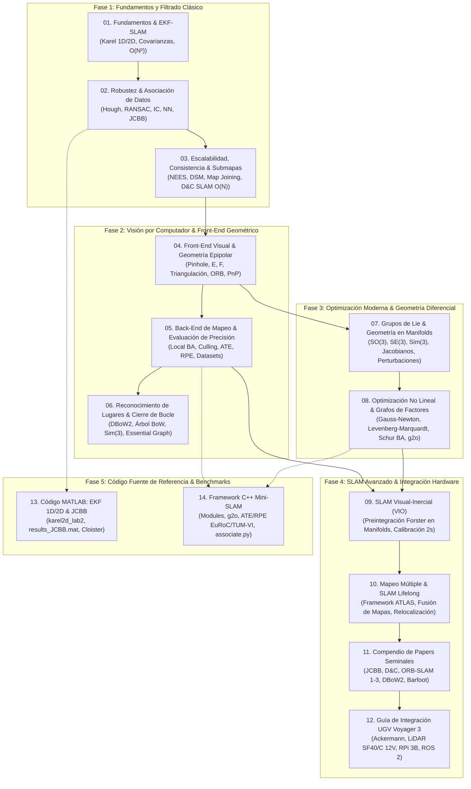

# Compendio Maestro de SLAM, Advanced SLAM y Visión Robótica

Bienvenido al compendio maestro de ingeniería, teoría matemática, arquitecturas algorítmicas, código fuente y papers seminales de **SLAM (Simultaneous Localization and Mapping)**, **Advanced SLAM (Visual-Inertial & Multi-Mapping)** y **Visión por Computador**, transferido y estructurado a partir del vault de investigación y las cátedras de la Universidad de Zaragoza (equipo de ORB-SLAM: Prof. Juan D. Tardós, José M. M. Montiel, Carlos Campos, Richard Elvira, Raúl Mur-Artal, Dorian Gálvez-López).

Este compendio deconstruye desde los principios físicos fundamentales hasta las implementaciones más avanzadas del estado del arte, formulado bajo el **Protocolo Feynman de Verificación**, la filosofía **Ponytail++ (Senior Minimalist Engineer)** y adaptado a las restricciones físicas de la plataforma **UGV Voyager 3** (cinemática Ackermann, LiDAR rotativo 360° LightWare SF40/C, Pixhawk 1 con ArduRover y Raspberry Pi 3B).

---

## 🗺️ Mapa Arquitectónico y Ruta Pedagógica



---

## 📚 1. Módulos Teóricos y de Fundamentos

| # | Archivo | Núcleo Teórico / Algorítmico | Referencia Cátedra / Papers |
|---|---|---|---|
| **01** | [`01_fundamentals_and_ekf_slam.md`](file:///d:/Voyager/documentation/slam_and_vision/01_fundamentals_and_ekf_slam.md) | Modelo estocástico 1D/2D, Karel the Robot, composición de errores, EKF-SLAM, matrices Jacobianas, evolución de la correlación, coste $\mathcal{O}(N^2)$. | Lesson 1 Unizar, Smith & Cheeseman 1986. |
| **02** | [`02_robustness_and_data_association.md`](file:///d:/Voyager/documentation/slam_and_vision/02_robustness_and_data_association.md) | Extracción de líneas (Split & Merge, Hough, RANSAC), compounding $\oplus$ e inversión $\ominus$ en 2D, elipses $\chi^2$, Nearest Neighbor vs JCBB. | Lesson 2 Unizar, Neira & Tardós (IEEE T-RO 2001). |
| **03** | [`03_scaling_accuracy_and_submapping.md`](file:///d:/Voyager/documentation/slam_and_vision/03_scaling_accuracy_and_submapping.md) | Inconsistencia de filtros, linearized errors, métrica NEES, Decoupled Stochastic Mapping (DSM), Map Joining, Divide & Conquer SLAM ($\mathcal{O}(N)$). | Lesson 3 Unizar, Paz et al. 2008, Castellanos 2004. |
| **04** | [`04_visual_slam_front_end_and_geometry.md`](file:///d:/Voyager/documentation/slam_and_vision/04_visual_slam_front_end_and_geometry.md) | Cámara pinhole, distorsión radial, matriz intrínseca $\mathbf{K}$, matriz esencial $\mathbf{E}$ y fundamental $\mathbf{F}$, detector FAST, rBRIEF, pirámide y quadtree, PnP. | Lesson 4.1-4.2 Unizar, Rublee 2011, Rosten 2006. |
| **05** | [`05_visual_slam_back_end_mapping_and_accuracy.md`](file:///d:/Voyager/documentation/slam_and_vision/05_visual_slam_back_end_mapping_and_accuracy.md) | Local Mapping, política de KeyFrames (*survival of the fittest*), Local Bundle Adjustment, Covisibility Graph, métricas ATE RMSE y RPE, benchmarks TUM/KITTI/EuRoC. | Lesson 4.3 & 4.5 Unizar, Strasdat 2010, Mur-Artal 2015. |
| **06** | [`06_place_recognition_and_loop_closing.md`](file:///d:/Voyager/documentation/slam_and_vision/06_place_recognition_and_loop_closing.md) | Bags of Binary Words (DBoW2), árbol léxico $k$-means, índice invertido/directo, candidatos coherentes, corrección de deriva de escala $Sim(3)$, Essential Graph. | Lesson 4.4 Unizar, Gálvez-López & Tardós 2012. |
| **07** | [`07_lie_groups_and_differential_geometry.md`](file:///d:/Voyager/documentation/slam_and_vision/07_lie_groups_and_differential_geometry.md) | Grupos de Lie $SO(3)$, $SE(3)$, $Sim(3)$, álgebras $\mathfrak{so}(3), \mathfrak{se}(3)$, operadores sombrero/cuña, fórmula de Rodrigues, BCH, perturbaciones locales $\Delta \boldsymbol{\xi}$. | Lesson 5.2 Unizar, Barfoot 2024, Sola 2018. |
| **08** | [`08_nonlinear_optimization_and_factor_graphs.md`](file:///d:/Voyager/documentation/slam_and_vision/08_nonlinear_optimization_and_factor_graphs.md) | Mínimos cuadrados no lineales, Gauss-Newton, Levenberg-Marquardt, kernels robustos (Huber/Cauchy), patrón punta de flecha, complemento de Schur, g2o. | Lesson 5.1 & 5.3 Unizar, Triggs 2000, Kümmerle 2011. |
| **09** | [`09_visual_inertial_slam_and_sensor_fusion.md`](file:///d:/Voyager/documentation/slam_and_vision/09_visual_inertial_slam_and_sensor_fusion.md) | Cinemática de IMU, biases aleatorios, preintegración en manifolds de $SO(3)$, Jacobianos y covarianzas, inicialización inercial ultra-rápida (2 seg), VI-BA. | Lesson 6.1 Unizar, Forster et al. (IEEE T-RO 2017). |
| **10** | [`10_multi_mapping_and_lifelong_slam.md`](file:///d:/Voyager/documentation/slam_and_vision/10_multi_mapping_and_lifelong_slam.md) | SLAM de por vida (*Lifelong*), arquitectura ATLAS de ORB-SLAM3, mapas activos/inactivos, fusión de submapas discontinuos, tolerancia a oclusiones prolongadas. | Lesson 6.2 Unizar, Campos et al. (IEEE T-RO 2021). |
| **11** | [`11_landmark_papers_compendium.md`](file:///d:/Voyager/documentation/slam_and_vision/11_landmark_papers_compendium.md) | Análisis crítico, formulación matemática y aportes de 12 papers clave: JCBB, Inverse Depth, D&C SLAM, Why Filter?, DBoW2, OctoMap, ORB-SLAM 1/2/3, Forster, Barfoot. | Colección de PDFs de investigación del laboratorio. |
| **12** | [`12_ugv_voyager_integration_guide.md`](file:///d:/Voyager/documentation/slam_and_vision/12_ugv_voyager_integration_guide.md) | Traducción al UGV Voyager 3: modelo cinemático Ackermann ($\kappa = \tan\delta / L$), LiDAR SF40/C (12V DC), EKF3 Pixhawk /dev/serial0, watchdog 300 ms, ROS 2. | Arquitectura Voyager 3, ROS 2 Galactic/Humble. |
| **13** | [`13_matlab_ekf_jcbb_benchmark_guide.md`](file:///d:/Voyager/documentation/slam_and_vision/13_matlab_ekf_jcbb_benchmark_guide.md) | Deconstrucción del código MATLAB: EKF 1D/2D, script `karel2d_lab2.m`, `JCBB.m`, fallo catastrófico de `NN.m`, datasets `.mat` y análisis con personas dinámicas. | Laboratorios 1 y 2 de SLAM (Unizar). |
| **14** | [`14_minislam_architecture_and_benchmarks.md`](file:///d:/Voyager/documentation/slam_and_vision/14_minislam_architecture_and_benchmarks.md) | Deconstrucción del framework C++ Mini-SLAM: Módulos (Calibration, Tracking, Mapping, g2o), tareas del Team 8, evaluación en EuRoC/TUM-VI y ATE RMSE. | Framework Mini-SLAM (Unizar). |
| **15** | [`15_guia_practica_mapeo_interiores.md`](file:///d:/Voyager/documentation/slam_and_vision/15_guia_practica_mapeo_interiores.md) | Guía práctica de mapeo en interiores para UGV Voyager 3: 5 terminales sincronizadas, hipótesis mundo estático, cierre de bucle de Neira y guardado con Nav2. | Procedimiento de laboratorio, ROS 2 Humble. |
| **16** | [`16_analisis_arquitectura_lidar_sf40c_slam_vs_proximidad.md`](file:///d:/Voyager/documentation/slam_and_vision/16_analisis_arquitectura_lidar_sf40c_slam_vs_proximidad.md) | Análisis arquitectónico del LiDAR SF40/C: génesis RAWFIE, cuello de botella AP_Proximity MAVLink (8 arcos), fallo de Scan Matching (Ceres), topología de red TELEM 1/2 y hoja de ruta bypass USB-TTL (Serial-over-IP). | Arquitectura de percepción Voyager 3, SLAM vs Proximidad. |

---

## 💻 2. Repositorios de Código Fuente y Benchmarks Transferidos

Los códigos fuente reales y los datos empíricos de simulación y vuelo se encuentran organizados en [`reference_code/`](file:///d:/Voyager/reference_code/):

```
D:\Voyager\reference_code\
├── matlab_slam_labs/
│   ├── lab1_1d_karel/                  # Lab 1: KF-SLAM 1D (T#8_LAB1_Complete.m, pasos 1M a 20M)
│   └── lab2_2d_karel/                  # Lab 2: EKF-SLAM 2D (karel2d_lab2.m, JCBB.m, NN.m, SINGLES.m)
│       ├── tools/                      # Transformaciones tcomp, tinv, elipses, EKF_prediction, EKF_update
│       ├── data/ & Fotos/              # Resultados .mat (results_JCBB, results_NN) y gráficas de coste
└── minislam_framework/                 # Framework C++ Mini-SLAM completo
    ├── Modules/                        # Calibration, Features, Map, Mapping, Matching, Optimization, Tracking
    ├── Apps/                           # Ejecutables para EuRoC, TUM-RGBD y TUM-VI
    ├── Evaluation/                     # associate.py, herramientas de evaluación de trayectoria
    ├── Lab3/ & T8_lab4/                # Código implementado y validado por Team 8
    ├── Testing_lab4_SLAM.xlsx          # Hoja consolidada de benchmarks de ATE RMSE
    └── trayectoria_*.png               # Gráficas de trayectoria 3D vs Ground Truth Vicon
```

---

## 🎓 3. Ingeniería de Diapositivas de Cátedra y Prácticas

En el subdirectorio [`lectures_engineering/`](file:///d:/Voyager/documentation/slam_and_vision/lectures_engineering) se preserva y deconstruye el contenido diapositiva a diapositiva de las presentaciones y prácticas originales de la Universidad de Zaragoza:

* [`lecture_01_fundamentals.md`](file:///d:/Voyager/documentation/slam_and_vision/lectures_engineering/lecture_01_fundamentals.md): Ingeniería de `SLAM L1 Fundamentals.pdf` (77 slides).
* [`lecture_02_robustness.md`](file:///d:/Voyager/documentation/slam_and_vision/lectures_engineering/lecture_02_robustness.md): Ingeniería de `SLAM L2 Robustness.pdf` (136 slides).
* [`lecture_03_scaling_and_accuracy.md`](file:///d:/Voyager/documentation/slam_and_vision/lectures_engineering/lecture_03_scaling_and_accuracy.md): Ingeniería de `SLAM L3 Scaling and Accuracy.pdf` (73 slides).
* [`lecture_04_visual_slam.md`](file:///d:/Voyager/documentation/slam_and_vision/lectures_engineering/lecture_04_visual_slam.md): Ingeniería de Lección 4 completa (`4.1 Visual SLAM`, `4.2 Tracking`, `4.3 Mapping`, `4.4 Place Recognition`, `4.5 Accuracy` — 171 slides).
* [`lecture_05_optimization_and_lie_groups.md`](file:///d:/Voyager/documentation/slam_and_vision/lectures_engineering/lecture_05_optimization_and_lie_groups.md): Ingeniería de Lección 5 (`5.1 Optimization`, `5.2 Lie Groups`, `5.3 Optimization in Visual SLAM` — 66 slides).
* [`lecture_06_visual_inertial_and_multimap.md`](file:///d:/Voyager/documentation/slam_and_vision/lectures_engineering/lecture_06_visual_inertial_and_multimap.md): Ingeniería de Lección 6 (`6.1 Visual-Inertial`, `6.2 Multi-Mapping` — 62 slides).
* [`labs_engineering_compendium.md`](file:///d:/Voyager/documentation/slam_and_vision/lectures_engineering/labs_engineering_compendium.md): Deconstrucción de los 4 laboratorios de Team 8 (Karel 1D KF-SLAM, Karel 2D EKF-SLAM con JCBB, Tracking Visual PnP y Mapping Local BA).

---

## ⚡ Enfoque y Rigor Matemático

Todos los documentos cumplen los siguientes principios innegociables:
1. **KaTeX Nativo ($$...$$):** Todas las variables y ecuaciones se definen con sus unidades dimensionales en el SI.
2. **Sin Cajas Negras:** Todo algoritmo incluye deconstrucción conceptual, árbol de decisiones o diagrama Mermaid, y pseudocódigo explícito.
3. **Mini-Tests Unitarios:** Verificación numérica y pruebas de casos límite embebidas para validar invariantes geométricos e integraciones.
4. **Anclaje Físico en Voyager 3:** El software nunca se abstrae de la realidad física: límites de corriente, alimentación de 12V del LiDAR, no-holonomía vehicular y latencias de transporte UART.
