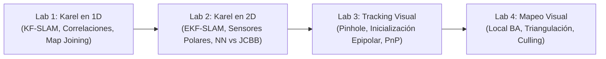

# Ingeniería de Prácticas y Laboratorios de SLAM (Labs 1 a 4)

* **Documentos Fuente:** 
  * `Respuestas/T#8_Lab_1_SLAM_1D/Lab1_SLAM_1Dim.pdf`
  * `Respuestas/T#8_Lab_2_SLAM_2D/Lab2_SLAM_2Dim__.pdf`
  * `Respuestas/T#8Lab1_SLAM_3Visual_Slam_.pdf`
  * `Respuestas/T8_LAB4_Visual_SLAM.pdf`
* **Cátedra:** 69156 - Simultaneous Localization and Mapping (SLAM), Universidad de Zaragoza.
* **Autores Originales del Laboratorio:** Team 8 (Piyush Tiwari, Diego Méndez Carter).

---

## 🗺️ Visión General de los Laboratorios Prácticos

---

## 🧪 Laboratorio 1: SLAM Unidimensional para Karel (KF-SLAM 1D)

### 1. Modelo del Sistema y Variables de Estado
* Karel se desplaza en una línea recta 1D midiendo su propio movimiento $u_k$ con ruido $\sigma_u$ y la distancia relativa $z_k$ a beepers con ruido $\sigma_z$.
* **Vector de Estado Conjunto:**
  $$\hat{\mathbf{x}}_k = [\hat{x}_R, \hat{p}_1, \hat{p}_2, \dots, \hat{p}_N]^T, \quad \mathbf{P}_k \in \mathbb{R}^{(N+1) \times (N+1)}$$

### 2. Ecuaciones Implementadas y Resultados Clave
* **Función `update_map`:**
  Cuando el sensor observa una marca que ya reside en el mapa:
  $$\nu_k = z_k - (\hat{p}_i - \hat{x}_R)$$
  $$\mathbf{H}_k = [-1, 0, \dots, 1, \dots, 0]$$
  $$S_k = \mathbf{H}_k \mathbf{P}_{k|k-1} \mathbf{H}_k^T + \sigma_z^2, \quad \mathbf{K}_k = \mathbf{P}_{k|k-1} \mathbf{H}_k^T S_k^{-1}$$
* **Evolución de la Matriz de Correlación:**
  Durante la fase de exploración inicial (sin cierres de bucle), la correlación cruzada entre el robot y todas las marcas crece monótonamente hacia $+1$.
* **Cierre de Bucle:**
  Al retornar al inicio del mundo y medir el beeper 1 (cuya varianza inicial era casi cero), toda la incertidumbre acumulada en los beepers 2 a $N$ colapsa simultáneamente, comprimiendo las bandas de error $2\sigma$ a valores submétricos.
* **Unión de Mapas (`join_maps`):**
  Implementación de unión estocástica de dos tramos independientes de mapa expresados con respecto a marcos locales de partida, resolviendo el problema de traslación mediante adición de offsets en covarianza.

---

## 🧪 Laboratorio 2: SLAM Bidimensional y Asociación de Datos Robusta (Karel 2D)

### 1. Modelo de Ruido Polar y Propagación
* El sensor de rango en 2D mide en coordenadas polares $(\rho, \phi)$.
* **Incertidumbre Proporcional:**
  $$\mathbf{R}_{\text{polar}} = \begin{bmatrix} (0.01 \cdot \rho)^2 & 0 \\ 0 & (0.125)^2 \end{bmatrix}$$
  *El error longitudinal es del 1% de la distancia; el error angular es constante de 7.16 grados.*
* **Transformación a Cartesianas y Jacobiano:**
  $$\mathbf{p}_{\text{cart}} = \begin{bmatrix} \rho \cos \phi \\ \rho \sin \phi \end{bmatrix}, \quad \mathbf{J} = \begin{bmatrix} \cos \phi & -\rho \sin \phi \\ \sin \phi & \rho \cos \phi \end{bmatrix}$$
  $$\mathbf{R}_{\text{cart}} = \mathbf{J} \mathbf{R}_{\text{polar}} \mathbf{J}^T$$
  A distancias grandes, la elipse de incertidumbre cartesiana adopta una forma de "banana" orientada transversalmente al haz del sensor.

### 2. Evaluación Comparativa: Nearest Neighbor (NN) vs JCBB
* **Experimento en Entorno con Alta Densidad (*Cloister Experiment*):**
  * Se evalúan 100 pasos de navegación rodeados de columnas y personas en movimiento.
  * **Resultados de Nearest Neighbor (NN):**
    * En cuanto la incertidumbre angular del robot rebasa los $3^\circ$, las elipses de compatibilidad individual abarcan múltiples marcas vecinas.
    * NN escoge la marca individualmente más cercana, asociando observaciones a beepers equivocados.
    * El EKF diverge de forma irreversible en menos de 40 pasos.
  * **Resultados de JCBB (Joint Compatibility Branch and Bound):**
    * Evalúa la coherencia rígida conjunta de todas las observaciones simultáneas mediante el test $\chi^2_{2k}$.
    * La cota de poda combinatoria reduce el árbol de búsqueda a unos pocos microsegundos.
    * **Tasa de Error de JCBB:** $0\%$ de falsas asociaciones. El mapa permanece completamente consistente durante toda la trayectoria.

---

## 🧪 Laboratorio 3: Front-End de SLAM Visual y Seguimiento de Cámara

### 1. Modelo de Cámara Pinhole y Calibración
* Proyección de puntos 3D del mundo $\mathbf{P}_W = [X, Y, Z]^T$ al plano de la imagen:
  $$\begin{bmatrix} u \\ v \end{bmatrix} = \begin{bmatrix} f_x \frac{X_C}{Z_C} + c_x \\ f_y \frac{Y_C}{Z_C} + c_y \end{bmatrix}$$
* **Error de Reproyección:**
  Discrepancia vectorial entre la posición observada de una característica ORB en píxeles $\mathbf{u}_{\text{meas}}$ y su predicción teórica proyectada $\mathbf{u}_{\text{proj}}$:
  $$\mathbf{e} = \mathbf{u}_{\text{meas}} - \mathbf{u}_{\text{proj}}$$

### 2. Inicialización Monocular y Triangulación
* Detección de $\approx 150$ correspondencias ORB entre los dos primeros fotogramas.
* Cálculo de la Matriz Fundamental $\mathbf{F}$ y Matriz Esencial $\mathbf{E} = \mathbf{K}^T \mathbf{F} \mathbf{K}$.
* Descomposición de $\mathbf{E}$ en rotación $\mathbf{R}$ y traslación unitaria $\mathbf{t}$.
* Triangulación inicial de 111 puntos 3D mediante DLT, resolviendo el test de quiralidad (*cheirality check*: profundidad positiva $Z > 0$ en ambas cámaras).

### 3. Estimación de Pose mediante PnP (Perspective-n-Point)
* Dado el mapa de puntos 3D triangulados y las correspondencias 2D en los siguientes fotogramas, la pose de la cámara $\mathbf{T}_{CW} \in SE(3)$ se calcula optimizando el error de reproyección robustificado con pérdida de Huber en un esquema de RANSAC.

---

## 🧪 Laboratorio 4: Back-End de SLAM Visual y Mapeo Local

### 1. Política de Inserción de KeyFrames
* El hilo de mapeo local decide la inserción de nuevos KeyFrames evaluando:
  1. *Cambio Visual:* El fotograma actual sigue menos del $90\%$ de los puntos del KeyFrame de referencia (indicativo de desplazamiento y nuevo punto de vista).
  2. *Intervalo Temporal:* Han transcurrido más de 20 fotogramas desde la última inserción.
  3. *Disponibilidad:* El hilo de Local Mapping ha concluido el Bundle Adjustment previo y está listo para recibir información.

### 2. Triangulación y Mantenimiento de Puntos 3D
* **Búsqueda Epipolar en el Grafo de Covisibilidad:** Búsqueda de características no emparejadas a lo largo de las líneas epipolares de KeyFrames covisibles.
* **Criba de MapPoints:** Se eliminan puntos recién creados que no sean observados de forma consistente en al menos 3 KeyFrames posteriores, suprimiendo falsos positivos generados por ruido o reflexiones.
* **Criba de KeyFrames:** Se descartan KeyFrames redundantes cuyos puntos son observados en más del $90\%$ por otros KeyFrames vecinos.

### 3. Local Bundle Adjustment
* Optimiza la ventana móvil de KeyFrames covisibles y MapPoints locales manteniendo anclados los KeyFrames de frontera, alcanzando convergencia en menos de $15\text{ ms}$ por ciclo y garantizando la estabilidad del mapa a largo plazo.
