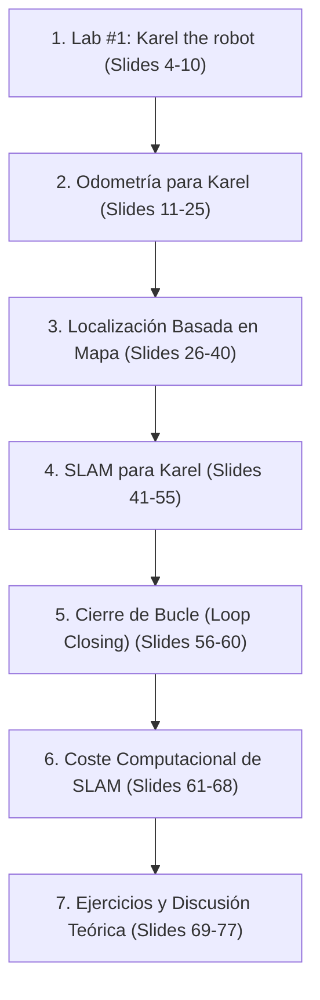

# Ingeniería de Presentación: Lección 1 — Fundamentos de SLAM (L1)

* **Documento Fuente:** `Lesson 1 Slam from scratch/SLAM L1 Fundamentals.pdf` (77 diapositivas)
* **Cátedra:** 69156 - Simultaneous Localization and Mapping (SLAM), Universidad de Zaragoza.
* **Docente:** Prof. Juan D. Tardós.

---

## 🗺️ Mapa de Contenidos y Estructura de la Presentación

---

## 🔍 Deconstrucción Slide a Slide y Análisis Matemático

### Sección 1: Karel the Robot en 1D (Slides 4–10)
* **Entorno Experimental:** Robot en mundo unidimensional con marcas puntuales (*beepers*).
* **Sensores:**
  1. *Odómetro:* Mide su propio desplazamiento $u$ con ruido gaussiano $\sigma_u$.
  2. *Sensor de Rango:* Mide la distancia relativa $z$ a los beepers dentro de su campo visual con ruido $\sigma_z$.
* **Misión:** Mapear la ubicación de todos los beepers sin mapa previo y sin referencia global absoluta.

---

### Sección 2: Odometría en 1D, Campana Gaussiana y Trompeta de Incertidumbre (Slides 7–25)
* **El Modelo de Error Gaussiano (Slides 7–10):**
  A cada comando de movimiento $u_k$, el robot se desplaza con un error aleatorio no observable $\tilde{u}_k \sim \mathcal{N}(0, \sigma_u^2)$.
* **La Campana que se Aplana y se Abre con Cada Paso (Slides 9–13):**
  * En $k=1$: La PDF $p(x_1)$ es una campana gaussiana centrada en $\mu = 1\text{m}$ con desviación $\sigma_1 = \sigma_u$.
  * En $k=2$: La PDF $p(x_2)$ se centra en $\mu = 2\text{m}$ con desviación $\sigma_2 = \sqrt{2}\sigma_u$. La campana se ensancha en anchura y su pico se reduce a $\frac{1}{\sqrt{2}}$ del original.
  * En el paso $k$: La campana se aplana con altura máxima $\propto 1/\sqrt{k}$ y su base se ensancha $\propto \sqrt{k}$.
* **La Trompeta de Incertidumbre ($\pm 2\sigma$ Envelope) y la Construcción "Al Revés" de Neira (Slides 14–15, 24):**
  * En vez de graficar campanas verticales a lo largo del suelo, **Neira la pone al revés**: gira el sistema $90^\circ$ sobre el eje del tiempo/distancia ($k$), centrando el eje vertical en el error $e_k = x_{\text{true}} - \hat{x} = 0$.
  * Las cotas $\pm 2\sigma_k = \pm 2\sigma_u \sqrt{k}$ forman la **boca de la campana que se abre horizontalmente a cada paso** que avanza el robot.
  * Si el filtro es consistente, la caminata aleatoria del error real permanece dentro de la boca de la campana el $95.45\%$ del tiempo.
  * *Ver deconstrucción y gráfica tripartita completa en [`neira_uncertainty_bell_and_error.png`](file:///d:/Voyager/documentation/slam_and_vision/images/neira_uncertainty_bell_and_error.png) y script [`plot_neira_uncertainty_bell.py`](file:///d:/Voyager/reference_code/matlab_slam_labs/lab1_1d_karel/plot_neira_uncertainty_bell.py)*.
* **Paradojas y Propiedades Fundamentales:**
  1. *Pasos Cortos vs Pasos Largos (Slides 14–15):*
     * 10.000 pasos de 0.1 m acumulan una incertidumbre final distinta que 100 pasos de 10 m, dependiendo de si el modelo de ruido del odómetro es aditivo constante o proporcional al recorrido.
  2. *La Paradoja de Ida y Vuelta ("Back and Forth", Slide 24):*
     * Si Karel avanza 500 m y luego retrocede 500 m regresando al punto de partida, **la incertidumbre NO disminuye**. Al contrario, la varianza acumulada se duplica ($\sigma^2 = \sum \sigma_u^2 = 2 \cdot 500 \cdot \sigma_u^2$). La odometría jamás puede recuperarse de la acumulación de error por sí sola.
* **Propiedad Fundamental de Combinaciones Lineales (Slides 11–13):** Para variables gaussianas independientes $x_1 \sim \mathcal{N}(\hat{x}_1, \sigma_1^2)$ y $x_2 \sim \mathcal{N}(\hat{x}_2, \sigma_2^2)$, la combinación lineal $y = a x_1 + b x_2$ es exactamente gaussiana:
  $$\hat{y} = a \hat{x}_1 + b \hat{x}_2, \quad \sigma_y^2 = a^2 \sigma_1^2 + b^2 \sigma_2^2 + 2 a b \sigma_{12}$$
* **Inicialización (*Bootstrapping*, Slide 16):** En el origen, la función Delta de Dirac se modela como el límite de una Gaussiana cuando la varianza $\sigma^2 \to 0$:
  $$x_0 \sim \mathcal{N}(0, \epsilon), \quad \epsilon \approx 10^{-6}$$
* **Estimación de la Trayectoria Completa y Clonación Estocástica (Slides 17–23):**
  Mantiene en el vector de estado la pose del robot en cada instante temporal pasado, construyendo la **Matriz de Correlación** densa $\mathbf{C}_{ij} \to 1$.
* **Conclusión Innegociable ("Take-Home Message", Slide 24):**
  *La odometría pura deriva inevitablemente y su incertidumbre siempre crece.* Sólo una observación exteroceptiva (SLAM / Mapa) puede detener o contraer la apertura de la trompeta.

---

### Sección 3: Localización Basada en Mapa (Slides 26–40)
* Si la posición del beeper $P$ se conoce a priori sin error ($\sigma_P^2 = 0$):
  $$z_k = P - x_k + v_k, \quad v_k \sim \mathcal{N}(0, \sigma_z^2)$$
* Predicción de la medición: $\hat{z}_k = P - \hat{x}_{k|k-1}$.
* Innovación: $\nu_k = z_k - \hat{z}_k$.
* Covarianza de innovación: $S_k = \sigma_{x_{k|k-1}}^2 + \sigma_z^2$.
* Ganancia de Kalman: $K_k = \frac{\sigma_{x_{k|k-1}}^2}{S_k}$.
* Actualización:
  $$\hat{x}_{k|k} = \hat{x}_{k|k-1} + K_k \nu_k, \quad \sigma_{x_{k|k}}^2 = (1 - K_k) \sigma_{x_{k|k-1}}^2$$
* **Límite Asintótico:** La varianza de posición del robot queda acotada por la precisión del sensor.

---

### Sección 4: SLAM para Karel (Slides 41–55)
* El robot desconoce las posiciones de los beepers. Debe estimar simultáneamente $[x_R, p_1, p_2, \dots, p_N]^T$.
* **Mapeo Exploratorio:**
  * Al avanzar descubriendo nuevos beepers, el error y la varianza de cada nuevo beeper son mayores que el anterior.
  * **"Bad News #1":** Durante la fase de exploración en línea recta hacia adelante, **el SLAM se comporta exactamente como una forma de odometría**. La incertidumbre absoluta de todo el mapa crece con la distancia.
  * **"Good News #1":** A pesar del crecimiento absoluto, las distancias relativas entre beepers vecinos se conocen con una precisión extrema gracias a las correlaciones cruzadas $\mathbf{P}_{ij} \to 1$.

---

### Sección 5: Cierre de Bucle (*Loop Closing*) (Slides 56–60)
* Cuando Karel regresa al origen y reobserva el beeper $p_1$:
  * La innovación $\nu$ contiene el error acumulado de todo el viaje.
  * Dado que la correlación cruzada entre $p_1$ y todos los demás beepers $p_k$ es cercana a $+1$, la ganancia de Kalman $K$ propaga la corrección retroactivamente a lo largo de todo el mapa.
  * **Resultado:** La incertidumbre de todos los beepers colapsa instantáneamente al nivel de precisión del primer beeper.

---

### Sección 6: Coste Computacional y Unión de Mapas (Slides 61–68)
* La actualización de la covarianza:
  $$\mathbf{P}_{k|k} = \mathbf{P}_{k|k-1} - \mathbf{K}_k \mathbf{S}_k \mathbf{K}_k^T$$
  posee un coste cuadrático ineludible $\mathcal{O}(N^2)$.
* **Sequential Map Joining:** Formulación de clonación estocástica para unir dos mapas locales independientes $M_A$ y $M_B$ mediante transformaciones relativas, reduciendo el coste en tramos aislados.

---

## 📝 Ejercicios Resueltos de la Cátedra (Slides 69–77)

### Ejercicio 1: Odometría Perfecta ($\sigma_u = 0$)
* **Pregunta:** ¿Es posible hacer SLAM si la odometría no tiene ruido? ¿Cómo es la matriz de covarianza?
* **Solución Feynman:** Si $\sigma_u = 0$, la pose del robot se conoce exactamente en todo instante ($x_{R,k} = \sum u_k$). Por tanto, la estimación de cada landmark es un problema desacoplado e independiente de mapeo con localización conocida. Las correlaciones cruzadas $\mathbf{P}_{ij}$ son exactamente cero; la matriz de covarianza del mapa es puramente diagonal:
  $$\mathbf{P}_{\text{map}} = \text{diag}(\sigma_{z1}^2, \sigma_{z2}^2, \dots, \sigma_{zN}^2)$$

### Ejercicio 2: Sensor de Rango Perfecto ($\sigma_z = 0$)
* **Pregunta:** ¿Qué ocurre si el sensor mide la distancia exacta a los landmarks?
* **Solución Feynman:** Si $\sigma_z = 0$, en el instante en que el robot observa simultáneamente dos marcas, la distancia relativa entre ellas se conoce con certeza matemática absoluta. El mapa queda fijado como un sólido rígido perfecto; la única incertidumbre remanente es la pose global del conjunto rígido respecto al origen del mundo.
