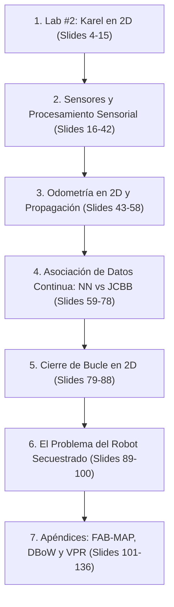

# Ingeniería de Presentación: Lección 2 — Robustez y Asociación de Datos (L2)

* **Documento Fuente:** `Lesson 2 Robustness/SLAM L2 Robustness.pdf` (136 diapositivas)
* **Cátedra:** 69156 - Simultaneous Localization and Mapping (SLAM), Universidad de Zaragoza.
* **Docente:** Prof. Juan D. Tardós, José Neira.

---

## 🗺️ Mapa de Contenidos y Estructura de la Presentación

---

## 🔍 Deconstrucción Slide a Slide y Formulación Rigurosa

### Sección 1: Karel en 2D y el Entorno de Simulación (Slides 4–15)
* El robot Karel evoluciona a un plano 2D con pose $\mathbf{x}_R = [x, y, \theta]^T$.
* **Modelo del Sensor en Coordenadas Polares:**
  $$\mathbf{z}_{\text{polar}} = \begin{bmatrix} \rho \\ \phi \end{bmatrix} + \mathbf{v}, \quad \mathbf{R}_{\text{polar}} = \begin{bmatrix} \sigma_\rho^2 & 0 \\ 0 & \sigma_\phi^2 \end{bmatrix}$$
  donde el ruido de rango es proporcional a la distancia ($\sigma_\rho = 0.01 \cdot \rho$) y el ruido angular es constante ($\sigma_\phi = 0.125\text{ rad} \approx 7.16^\circ$).
* **Transformación Polar a Cartesiana:**
  $$\mathbf{p}_{\text{sensor}} = \begin{bmatrix} \rho \cos \phi \\ \rho \sin \phi \end{bmatrix}$$
  $$\mathbf{J}_{\text{pol2cart}} = \begin{bmatrix} \cos \phi & -\rho \sin \phi \\ \sin \phi & \rho \cos \phi \end{bmatrix} \implies \mathbf{P}_{\text{cart}} = \mathbf{J}_{\text{pol2cart}} \mathbf{R}_{\text{polar}} \mathbf{J}_{\text{pol2cart}}^T$$
  *Las elipses de incertidumbre se orientan transversalmente a la línea de visión a medida que $\rho$ aumenta.*

---

### Sección 2: Sensores y Procesamiento: Extracción de Características (Slides 16–42)
* **Telémetros Láser 2D:** Nube de puntos angular densa.
* **Algoritmos de Segmentación de Líneas:**
  * **Split-and-Merge:** Partición recursiva por distancia ortogonal máxima $d_{\max} > \epsilon$. Rápido ($\mathcal{O}(N \log N)$), pero sensible al ruido en esquinas.
  * **Transformada de Hough:** Parametrización normal $r = x \cos \theta + y \sin \theta$. Acumulador en grilla discreta $(r, \theta)$. Extremadamente robusta a oclusiones, pero con dispersión por discretización.
  * **RANSAC:** Muestreo de 2 puntos mínimos. Iteraciones requeridas para $99\%$ de éxito con fracción $\gamma$ de outliers:
    $$K = \frac{\log(1 - 0.99)}{\log(1 - (1 - \gamma)^2)}$$
    Ajusta la línea óptima descartando puntos dinámicos (personas en movimiento).

---

### Sección 3: Álgebra de Odometría en 2D (Slides 43–58)
* **Operador de Composición ($\oplus$):**
  $$\mathbf{x}_{AC} = \mathbf{x}_{AB} \oplus \mathbf{x}_{BC} = \begin{bmatrix} x_1 + x_2 \cos \theta_1 - y_2 \sin \theta_1 \\ y_1 + x_2 \sin \theta_1 + y_2 \cos \theta_1 \\ \theta_1 + \theta_2 \end{bmatrix}$$
* **Operador de Inversión ($\ominus$):**
  $$\ominus \mathbf{x} = \begin{bmatrix} -x \cos \theta - y \sin \theta \\ x \sin \theta - y \cos \theta \\ -\theta \end{bmatrix}$$
* **Propagación Linealizada:**
  $$\mathbf{P}_{AC} \approx \mathbf{J}_{1\oplus} \mathbf{P}_{AB} \mathbf{J}_{1\oplus}^T + \mathbf{J}_{2\oplus} \mathbf{P}_{BC} \mathbf{J}_{2\oplus}^T$$
* **Elipse de Incertidumbre y Test $\chi^2$:**
  $$D^2 = \mathbf{e}^T \mathbf{P}^{-1} \mathbf{e} \le \chi^2_{2, 0.95} = 5.991$$
  Define el contorno del $95\%$ de probabilidad para una distribución bidimensional.

---

### Sección 4: Asociación de Datos Continua: NN vs JCBB (Slides 59–78)
* **La Ilusión de Compatibilidad Individual (IC):**
  $$D_{ij}^2 = \boldsymbol{\nu}_{ij}^T \mathbf{S}_{ij}^{-1} \boldsymbol{\nu}_{ij} \le \chi^2_{2, \alpha}$$
* **Por Qué Falla Nearest Neighbor (NN):**
  * NN asigna $\arg\min D_{ij}^2$ de forma codiciosa e independiente.
  * Cuando la orientación $\theta_R$ del vehículo tiene incertidumbre alta, las elipses individuales crecen y se solapan con múltiples marcas.
  * NN escoge marcas contradictorias que violan la rigidez geométrica del mundo físico.
* **Compatibilidad Conjunta (Joint Compatibility - JC):**
  $$\boldsymbol{\nu}_H = \begin{bmatrix} \boldsymbol{\nu}_{1, j_1} \\ \vdots \\ \boldsymbol{\nu}_{k, j_k} \end{bmatrix}, \quad \mathbf{S}_H = \mathbf{H}_H \mathbf{P} \mathbf{H}_H^T + \mathbf{R}_H$$
  $$D_H^2 = \boldsymbol{\nu}_H^T \mathbf{S}_H^{-1} \boldsymbol{\nu}_H \le \chi^2_{2k, \alpha}$$
* **Algoritmo JCBB (Neira & Tardós 2001):**
  * Búsqueda en Árbol de Interpretación.
  * **Cota de Poda:** $\text{length}(H) + (m - i) \le \text{length}(\text{Best}) \implies \text{PODA INMEDIATA}$.
  * Demostrado experimentalmente: JCBB mantiene cero errores de asociación bajo condiciones donde NN falla en el $100\%$ de los casos.

---

### Sección 5: El Problema del Robot Secuestrado (Slides 89–100)
* **Definición:** El robot es transportado a una posición desconocida dentro de un mapa previo.
* **Doble Interrogante:**
  1. *¿Está el robot dentro del mapa conocido?* (Detección de hipótesis).
  2. *Si es así, ¿cuál es su pose exacta $(x, y, \theta)$?* (Relocalización global).
* **Solución Geométrica:** Búsqueda en el espacio de correspondencias mediante constelaciones invariantes de distancias inter-marcas y emparejamiento por RANSAC / Hashing geométrico.

---

### Sección 6: Apéndices: Reconocimiento Visual de Lugares (Slides 101–136)
* Introducción a modelos probabilísticos generativos para imágenes: **FAB-MAP (Cummins & Newman 2008)** utilizando árboles Chow-Liu para modelar dependencias de palabras visuales.
* Evolución hacia métodos directos más rápidos y escalables: **DBoW + Campos Aleatorios Condicionales (CRF) 3D** (Cadena et al., IEEE T-RO 2012), logrando cero falsos positivos en secuencias urbanas complejas.
