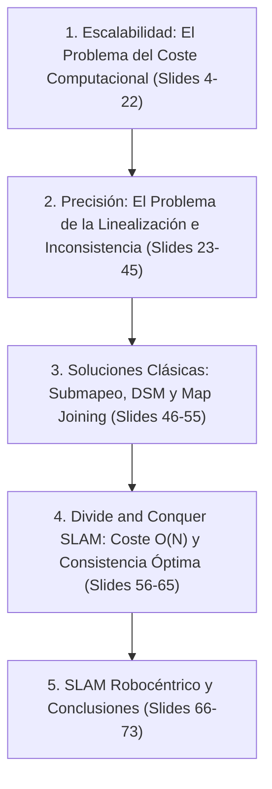

# Ingeniería de Presentación: Lección 3 — Escalabilidad y Precisión (L3)

* **Documento Fuente:** `Lesson3/SLAM L3 Scaling and Accuracy (1).pdf` (73 diapositivas)
* **Cátedra:** 69156 - Simultaneous Localization and Mapping (SLAM), Universidad de Zaragoza.
* **Docente:** Prof. Juan D. Tardós, José A. Castellanos, Lina M. Paz.

---

## 🗺️ Mapa de Contenidos y Estructura de la Presentación

---

## 🔍 Deconstrucción Slide a Slide y Análisis Teórico

### Sección 1: El Cuello de Botella Computacional del EKF (Slides 4–22)
* **Estructura del Estado:**
  $$\mathbf{x} = \begin{bmatrix} \mathbf{x}_v \\ \mathbf{p}_1 \\ \vdots \\ \mathbf{p}_N \end{bmatrix} \in \mathbb{R}^{3 + 2N}, \quad \mathbf{P} = \begin{bmatrix} \mathbf{P}_{vv} & \mathbf{P}_{v1} & \cdots & \mathbf{P}_{vN} \\ \mathbf{P}_{1v} & \mathbf{P}_{11} & \cdots & \mathbf{P}_{1N} \\ \vdots & \vdots & \ddots & \vdots \\ \mathbf{P}_{Nv} & \mathbf{P}_{N1} & \cdots & \mathbf{P}_{NN} \end{bmatrix}$$
* **Análisis de Complejidad por Fase:**
  1. *Predicción de Movimiento:* Sólo el robot cambia. $\mathbf{F} = \text{diag}(\mathbf{F}_v, \mathbf{I}_{2N})$.
     $$\mathbf{P}_{vv} \leftarrow \mathbf{F}_v \mathbf{P}_{vv} \mathbf{F}_v^T + \mathbf{Q}, \quad \mathbf{P}_{vi} \leftarrow \mathbf{F}_v \mathbf{P}_{vi}$$
     Coste: $\mathcal{O}(N)$ operaciones.
  2. *Actualización de Medición:* Al medir una sola marca $i$, el vector de ganancia $\mathbf{K} \in \mathbb{R}^{(3+2N) \times 2}$ es **completamente denso**.
     $$\mathbf{P} \leftarrow \mathbf{P} - \mathbf{K} \mathbf{S} \mathbf{K}^T$$
     Cada uno de los $(2N+3)^2$ elementos de la matriz de covarianza debe actualizarse.
     **Coste Ineludible:** $\mathcal{O}(N^2)$ por observación. Si se actualizan $m$ marcas por paso, el coste asciende a $\mathcal{O}(m N^2)$.
* **Impacto en Tiempo de Ejecución:** Para $N = 100$ marcas, el tiempo de ciclo es de $\approx 5\text{ ms}$; para $N = 1.000$ marcas, supera los $500\text{ ms}$; para $N = 10.000$ marcas, requiere más de $50\text{ segundos}$ por ciclo, imposibilitando el tiempo real.

---

### Sección 2: La Crisis de Linealización y la Inconsistencia (Slides 23–45)
* **Definición de Consistencia:** Un filtro es estadísticamente consistente si sus estimaciones no están sesgadas ($\mathbb{E}[\mathbf{e}] = \mathbf{0}$) y su matriz de covarianza calculada $\mathbf{P}$ cubre fielmente el error cuadrático medio real:
  $$\mathbf{P}_k \ge \mathbb{E}[(\mathbf{x}_k - \hat{\mathbf{x}}_k)(\mathbf{x}_k - \hat{\mathbf{x}}_k)^T]$$
* **Métrica NEES (Normalized Estimation Error Squared):**
  $$\epsilon_k = (\mathbf{x}_k - \hat{\mathbf{x}}_k)^T \mathbf{P}_k^{-1} (\mathbf{x}_k - \hat{\mathbf{x}}_k)$$
  Bajo hipótesis de normalidad, $\epsilon_k \sim \chi^2_{\dim(\mathbf{x})}$.
* **La Patología del "Filtro Optimista":**
  * Los Jacobianos $\mathbf{F}_k$ y $\mathbf{H}_k$ se evalúan sobre la pose estimada $\hat{\mathbf{x}}$, que contiene un error angular desconocido respecto a la verdad terreno $\mathbf{x}_{\text{true}}$.
  * Matemáticamente, la orientación global del mundo $\theta_0$ es un grado de libertad no observable (el mapa puede rotar rígidamente sin alterar ninguna medición sensorial interna).
  * Sin embargo, debido a la linealización imperfecta, el EKF calcula numéricamente una reducción de varianza en el subespacio nulo. **El filtro cree falsamente que conoce la orientación absoluta del mundo**.
  * Las compuertas de validación de innovación $\chi^2$ se contraen erróneamente, rechazando observaciones verdaderas. El filtro diverge de forma catastrófica.

---

### Sección 3: Técnicas de Submapeo Clásicas (Slides 46–55)
* **Decoupled Stochastic Mapping (DSM - Leonard & Feder 2001):**
  * Divide el mapa en regiones locales acotadas de tamaño constante $k$.
  * Descarta o comprime las correlaciones entre submapas desconectados.
  * Desventaja: Pierde información cruzada en cierres de bucle globales.
* **Sequential Map Joining (Newman 2000):**
  * Construye submapas secuenciales $M_1, M_2, \dots$ en marcos de referencia locales.
  * Al pasar de un submapa al siguiente, se unen mediante las marcas comunes de frontera.
  * Reduce el coste en tramos locales, pero la unión final sigue acumulando errores secuenciales.

---

### Sección 4: Divide and Conquer SLAM (D&C SLAM - Paz et al. 2008) (Slides 56–65)
* **Estructura en Árbol Binario de Submapas:**
  * Construye mapas locales de nivel 0 con $k$ marcas ($k \approx 20$).
  * En lugar de unirlos secuencialmente a una raíz común, los mapas adyacentes se combinan por pares: $M_1 + M_2 \to M_{1-2}$, $M_3 + M_4 \to M_{3-4}$, y luego $M_{1-2} + M_{3-4} \to M_{\text{Global}}$.
* **Demostración de Complejidad Amortizada $\mathcal{O}(N)$:**
  * El coste de unir dos mapas de tamaño $m$ es $\mathcal{O}(m^3)$.
  * En un recorrido de longitud $N$, el número de submapas en el nivel $l$ es $\frac{N}{k 2^l}$.
  * El coste total sumado en todos los niveles es:
    $$\sum_{l=0}^{\log_2(N/k)} \frac{N}{k 2^l} \mathcal{O}((k 2^l)^3) = \mathcal{O}(N)$$
* **Por Qué D&C Resuelve Simultáneamente la Inconsistencia:**
  * Los submapas locales de tamaño $k$ cubren desplazamientos muy cortos, donde el error angular del vehículo es casi cero ($\Delta \theta \approx 0$).
  * **Las linealizaciones dentro de cada submapa local son casi exactas.**
  * Al unir dos submapas, la transformación relativa se computa utilizando todas las marcas de solapamiento en un único paso cerrado, evitando la degradación continua del subespacio no observable.

---

### Sección 5: SLAM Robocéntrico (Castellanos et al. 2004) (Slides 66–73)
* **Cambio de Paradigma de Coordenadas:**
  En vez de expresar todas las marcas del mundo con respecto a un origen inercial estático $[0, 0, 0]^T$, **el mapa se formula expresando todas las marcas en el sistema de coordenadas móvil del propio robot**.
* **Resultado:**
  * La pose del robot en su propio sistema es siempre exactamente cero: $\mathbf{x}_R \equiv [0, 0, 0]^T$.
  * La incertidumbre angular no se acumula sobre la referencia de las marcas.
  * Las pruebas de consistencia NEES demostraron que el SLAM robocéntrico se mantiene dentro de los límites teóricos del test $\chi^2$ durante recorridos de miles de metros.
