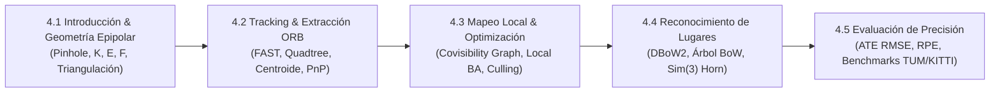

# Ingeniería de Presentación: Lección 4 — SLAM Visual Completo (L4.1 a L4.5)

* **Documentos Fuente:** 
  * `4.1 Visual_SLAM.pdf` (27 diapositivas)
  * `4.2 Tracking.pdf` (64 diapositivas)
  * `4.3 Mapping.pdf` (18 diapositivas)
  * `4.4 Place_Recognition.pdf` (37 diapositivas)
  * `4.5 Accuracy.pdf` (25 diapositivas)
* **Cátedra:** 69156 - Simultaneous Localization and Mapping (SLAM), Universidad de Zaragoza.
* **Docentes:** Prof. Juan D. Tardós, José M. M. Montiel, Raúl Mur-Artal, Dorian Gálvez-López, Richard Elvira.

---

## 🗺️ Mapa Integrado de la Lección 4

---

## 🔍 Deconstrucción Módulo a Módulo

### 4.1 Introducción al SLAM Visual y Geometría Proyectiva
* **Sensor:** Cámara monocular, estéreo o RGB-D.
* **Modelo Pinhole con Intrínsecos:**
  $$\begin{bmatrix} u \\ v \\ 1 \end{bmatrix} = \frac{1}{Z_C} \begin{bmatrix} f_x & 0 & c_x \\ 0 & f_y & c_y \\ 0 & 0 & 1 \end{bmatrix} \begin{bmatrix} X_C \\ Y_C \\ Z_C \end{bmatrix}$$
* **Geometría Epipolar de Dos Vistas:**
  $$\mathbf{x}_2^T \mathbf{E} \mathbf{x}_1 = 0, \quad \mathbf{E} = [\mathbf{t}]_\times \mathbf{R}$$
  $$\mathbf{u}_2^T \mathbf{F} \mathbf{u}_1 = 0, \quad \mathbf{F} = \mathbf{K}^{-T} \mathbf{E} \mathbf{K}^{-1}$$
  * Permite validar correspondencias visuales proyectando la línea epipolar $\mathbf{l}_2 = \mathbf{F} \mathbf{u}_1$.
* **Triangulación (DLT):** Resuelve la posición 3D intersecando rayos ópticos mediante SVD. Exige paralaje $\theta > 1.0^\circ$ para evitar profundidades espurias.

---

### 4.2 Seguimiento Visual (*Tracking*) y Características ORB
* **Detector FAST-9:** Comprueba si 9 píxeles contiguos en una circunferencia de 16 píxeles son más brillantes o más oscuros que el centro. Optimizado con árboles de decisión ID3.
* **Pirámide de Escala:** 8 niveles con factor de escala 1.2 para detectar características invariantes al tamaño y distancia.
* **Quadtree Bucketing:** Distribución homogénea de esquinas dividiendo recursivamente la imagen en cuadrantes, reteniendo sólo la esquina de mayor respuesta de Harris por celda.
* **Orientación por Centroide de Intensidad:**
  $$\mathbf{C} = \left( \frac{m_{10}}{m_{00}}, \frac{m_{01}}{m_{00}} \right), \quad \theta = \text{atan2}(m_{01}, m_{10})$$
* **Descriptor rBRIEF:** 256 tests binarios rotados según $\theta$. Matching ultra-rápido mediante distancia de Hamming (`__builtin_popcount` de XOR).
* **Pipeline de Tracking:**
  1. *Track with Motion Model:* Predice la pose actual asumiendo velocidad constante $\mathbf{T}_{k} = \mathbf{v}_k \mathbf{T}_{k-1}$.
  2. *Track Local Map:* Proyecta los puntos del mapa local en el fotograma actual y busca correspondencias en radios acotados por $\chi^2$.
  3. *Optimización de Pose (PnP + RANSAC):* Minimiza el error de reproyección minimizando la pérdida robusta de Huber.

---

### 4.3 Mapeo Local (*Local Mapping*)
* **Arquitectura de Supervivencia del Más Apto (*Survival of the Fittest*):**
  * Inserción generosa de KeyFrames para mantener el tracking durante giros rápidos.
  * Criba estricta de MapPoints (*Point Culling*): se eliminan puntos vistos en $<25\%$ de las predicciones o por $<3$ KeyFrames.
  * Criba de KeyFrames redundantes (*KeyFrame Culling*): se borran KeyFrames cuyos puntos son observados en $>90\%$ por otros 3 KeyFrames vecinos.
* **Estructuras Topológicas de Grafo:**
  * *Covisibility Graph:* Nodos = KeyFrames. Aristas entre dos KeyFrames si comparten $\ge 15$ puntos comunes. Peso = número de puntos compartidos.
  * *Essential Graph:* Subgrafo conexo más ligero formado por el Árbol de Expansión (*Spanning Tree*), aristas de cierre de bucle y aristas de covisibilidad fuertes ($\ge 100$ puntos).
* **Local Bundle Adjustment (Local BA):**
  Optimiza el KeyFrame actual, sus vecinos covisibles y todos sus puntos 3D observados, manteniendo fijos los KeyFrames de anclaje de frontera.

---

### 4.4 Reconocimiento de Lugares y Cierre de Bucle (*Place Recognition*)
* **DBoW2 (Bags of Binary Words):**
  * Árbol de vocabulario $k$-means de $1.000.000$ de palabras visuales.
  * Ponderación TF-IDF: favorece palabras raras y altamente discriminativas.
  * Índice invertido para consultas de similitud en $<5\text{ ms}$.
  * Índice directo para acelerar el matching 2D-2D de características.
* **Cierre de Bucle y Corrección de Escala en $Sim(3)$:**
  * En SLAM monocular, la deriva de escala acumula un error en 7 DoF ($s, \mathbf{R}, \mathbf{t}$).
  * Alineación mediante el método de Horn en $Sim(3)$:
    $$\mathbf{S} = \begin{bmatrix} s \mathbf{R} & \mathbf{t} \\ \mathbf{0} & 1 \end{bmatrix}$$
  * Fusión de puntos duplicados a ambos lados del bucle.
  * Propagación de corrección de escala a lo largo del Grafo Esencial (*Essential Graph Optimization*).

---

### 4.5 Evaluación de Precisión (*Accuracy & Benchmarks*)
* **ATE (Absolute Trajectory Error):**
  Alinea la trayectoria estimada con el Ground Truth mediante la transformación de Umeyama y calcula el RMSE de traslación:
  $$\text{ATE}_{\text{RMSE}} = \sqrt{\frac{1}{N} \sum_{i=1}^N \|\text{trans}(\mathbf{Q}_i^{-1} \mathbf{S} \mathbf{P}_i)\|^2}$$
* **RPE (Relative Pose Error):**
  Mide la deriva de odometría por segundo o por metro recorrido.
* **Resultados en Datasets de Referencia:**
  * *TUM RGB-D:* Precisión milimétrica ($<1\text{ cm}$ en trayectorias de oficina).
  * *KITTI:* Trayectorias automotrices de varios kilómetros con error de deriva $<1\%$ de la distancia recorrida.
  * *EuRoC MAV:* Trayectorias aéreas agresivas con aceleraciones violentas resueltas con error $<3\text{ cm}$ en modo Visual-Inercial.
