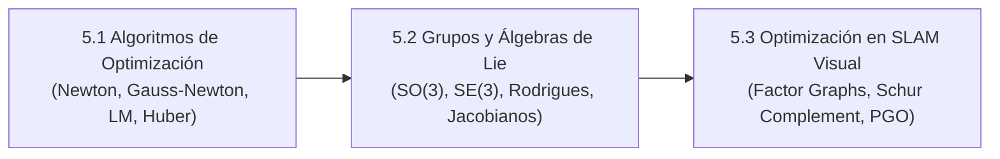

# Ingeniería de Presentación: Lección 5 — Optimización y Grupos de Lie (L5.1 a L5.3)

* **Documentos Fuente:** 
  * `5.1 Optimization.pdf` (20 diapositivas)
  * `5.2 Lie_Groups.pdf` (26 diapositivas)
  * `5.3 Optimization_in_SLAM.pdf` (20 diapositivas)
* **Cátedra:** 69156 - Simultaneous Localization and Mapping (SLAM), Universidad de Zaragoza.
* **Docente:** Prof. Juan D. Tardós.

---

## 🗺️ Mapa Integrado de la Lección 5

---

## 🔍 Deconstrucción Slide a Slide y Análisis Algorítmico

### 5.1 Algoritmos de Optimización No Lineal
* **Formulación de Mínimos Cuadrados Ponderados:**
  $$F(\mathbf{x}) = \frac{1}{2} \sum_{i=1}^M \mathbf{r}_i(\mathbf{x})^T \boldsymbol{\Sigma}_i^{-1} \mathbf{r}_i(\mathbf{x})$$
* **Comparativa de Resolvedores Clásicos:**
  1. *Descenso por Gradiente:* $\Delta \mathbf{x} = -\alpha \mathbf{g}$. Convergencia lineal lenta; zigzaguea en valles estrechos.
  2. *Método de Newton:* $\mathbf{H} \Delta \mathbf{x} = -\mathbf{g}$. Convergencia cuadrática, pero requiere segundas derivadas analíticas $\nabla^2 r$ costosas y potencialmente indefinidas.
  3. *Gauss-Newton:* Aproxima $\mathbf{H} \approx \mathbf{J}^T \boldsymbol{\Sigma}^{-1} \mathbf{J}$. Las Ecuaciones Normales son:
     $$\mathbf{H} \Delta \mathbf{x} = -\mathbf{J}^T \boldsymbol{\Sigma}^{-1} \mathbf{r}$$
     Asume que los residuos son pequeños o casi lineales cerca del mínimo.
  4. *Levenberg-Marquardt:* Amortiguamiento adaptativo dinámico:
     $$(\mathbf{H} + \lambda \mathbf{D}) \Delta \mathbf{x} = -\mathbf{g}$$
     El parámetro $\lambda$ interpola continuamente entre descenso por gradiente ($\lambda \to \infty$) y Gauss-Newton ($\lambda \to 0$), regulado por el ratio de ganancia cuadrática $\varrho$.
* **Pérdidas Robustas (M-Estimadores):**
  * Pérdida de Huber:
    $$\rho(s) = \begin{cases} s & s \le \delta^2 \\ 2 \delta \sqrt{s} - \delta^2 & s > \delta^2 \end{cases}$$
  * Implementación elegante mediante Mínimos Cuadrados Ponderados Iterativos (IRLS): se recalcula el peso escalar efectivo $w(s) = \rho'(s)$ al inicio de cada iteración, manteniendo intacto el resolvedor lineal.

---

### 5.2 Grupos y Álgebras de Lie en Robótica
* **Por Qué los Espacios Euclidianos Fallan en Rotaciones:**
  * Si $\mathbf{R}_1, \mathbf{R}_2 \in SO(3)$, la suma matricial $\mathbf{R}_1 + \mathbf{R}_2 \notin SO(3)$.
  * Los ángulos de Euler sufren de bloqueo de cardán (*gimbal lock*).
  * Los cuaterniones poseen una restricción cuadrática de norma unitaria $\|\mathbf{q}\| = 1$.
* **El Grupo de Rotaciones $SO(3)$ y su Álgebra $\mathfrak{so}(3)$:**
  * Álgebra $\mathfrak{so}(3)$: matrices antisimétricas $3 \times 3$ parametrizadas por el vector de rotación $\boldsymbol{\omega} \in \mathbb{R}^3$:
    $$[\boldsymbol{\omega}]_\times = \begin{bmatrix} 0 & -\omega_3 & \omega_2 \\ \omega_3 & 0 & -\omega_1 \\ -\omega_2 & \omega_1 & 0 \end{bmatrix}$$
  * **Fórmula de Rodrigues (Mapa Exponencial de $SO(3)$):**
    $$\exp([\boldsymbol{\omega}]_\times) = \mathbf{I} + \frac{\sin \theta}{\theta} [\boldsymbol{\omega}]_\times + \frac{1 - \cos \theta}{\theta^2} [\boldsymbol{\omega}]_\times^2, \quad \theta = \|\boldsymbol{\omega}\|$$
* **El Grupo de Movimiento Rígido $SE(3)$ y su Álgebra $\mathfrak{se}(3)$:**
  * Parametrizado por el vector *twist* $\boldsymbol{\xi} = [\boldsymbol{\rho}, \boldsymbol{\phi}]^T \in \mathbb{R}^6$.
* **Perturbaciones en Manifolds:**
  * *Perturbación Derecha (Marco Local de Cámara):* $\mathbf{T} \leftarrow \mathbf{T} \exp(\Delta \boldsymbol{\xi}^\wedge)$.
  * **Jacobiano del Punto respecto a la Perturbación Local:**
    $$\frac{\partial (\mathbf{T} \mathbf{p})}{\partial \boldsymbol{\xi}} = \begin{bmatrix} \mathbf{I}_{3 \times 3} & -[\mathbf{p}_C]_\times \end{bmatrix} \in \mathbb{R}^{3 \times 6}$$
    *Este Jacobiano depende únicamente de las coordenadas de la cámara local $\mathbf{p}_C$, eliminando cualquier dependencia de la distancia al origen global del mundo.*

---

### 5.3 Optimización en SLAM Visual: Grafos de Factores y Schur Complement
* **Representación como Grafo de Factores Bipartito:**
  * Nodos de Variable: Poses de cámara $\mathbf{T}_i \in SE(3)$ y Puntos 3D $\mathbf{p}_j \in \mathbb{R}^3$.
  * Nodos de Factor: Aristas de error de reproyección conectando una cámara y un punto:
    $$\mathbf{e}_{ij} = \mathbf{u}_{ij} - \pi(\mathbf{T}_i \mathbf{p}_j)$$
* **Estructura del Hessiano en Bundle Adjustment:**
  $$\begin{bmatrix} \mathbf{B} & \mathbf{E} \\ \mathbf{E}^T & \mathbf{C} \end{bmatrix} \begin{bmatrix} \Delta \mathbf{x}_c \\ \Delta \mathbf{x}_p \end{bmatrix} = \begin{bmatrix} \mathbf{v} \\ \mathbf{w} \end{bmatrix}$$
  * $\mathbf{B}$: Matriz de cámaras (bloques $6 \times 6$).
  * $\mathbf{C}$: Matriz de puntos 3D. **Es estrictamente diagonal por bloques de $3 \times 3$**, porque las observaciones de puntos distintos son condicionalmente independientes dadas las poses de cámara.
* **El Truco del Complemento de Schur (Marginalización Analítica de Puntos):**
  $$(\mathbf{B} - \mathbf{E} \mathbf{C}^{-1} \mathbf{E}^T) \Delta \mathbf{x}_c = \mathbf{v} - \mathbf{E} \mathbf{C}^{-1} \mathbf{w}$$
  * Como $\mathbf{C}$ es diagonal por bloques, calcular $\mathbf{C}^{-1}$ cuesta únicamente invertir $P$ matrices de $3 \times 3$ ($\mathcal{O}(P)$ operaciones).
  * Se resuelven primero las cámaras mediante Cholesky disperso sobre $\mathbf{H}_{\text{red}} = \mathbf{B} - \mathbf{E} \mathbf{C}^{-1} \mathbf{E}^T$.
  * Luego, los incrementos de todos los puntos 3D se obtienen en paralelo por sustitución hacia atrás:
    $$\Delta \mathbf{x}_p = \mathbf{C}^{-1} (\mathbf{w} - \mathbf{E}^T \Delta \mathbf{x}_c)$$
* **Optimización de Grafo de Poses (Pose Graph Optimization - PGO):**
  Cuando el mapa contiene miles de puntos, se ignoran los puntos 3D y se optimizan únicamente las aristas relativas de pose $\mathbf{T}_{ij}$ entre KeyFrames adyacentes y de cierre de bucle, resolviéndose en decenas de milisegundos en frameworks como `g2o` o `Ceres`.
