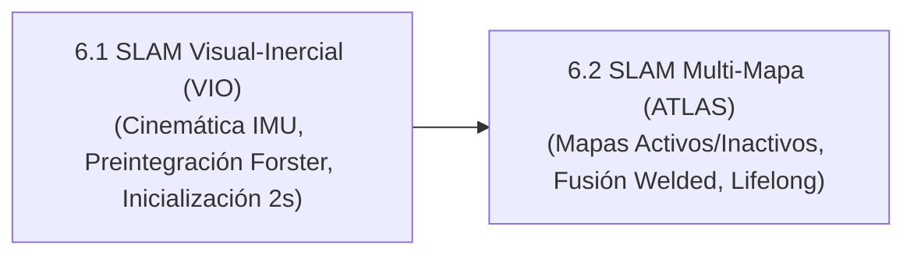

# Ingeniería de Presentación: Lección 6 — SLAM Visual-Inercial y Multi-Mapeo (L6.1 & L6.2)

* **Documentos Fuente:** 
  * `6.1 Visual_Inertial.pdf` (41 diapositivas)
  * `6.2 Multi_Mapping.pdf` (21 diapositivas)
* **Cátedra:** 69156 - Simultaneous Localization and Mapping (SLAM), Universidad de Zaragoza.
* **Docentes:** Prof. Juan D. Tardós, Carlos Campos, Richard Elvira.

---

## 🗺️ Mapa Integrado de la Lección 6

---

## 🔍 Deconstrucción Slide a Slide y Análisis Algorítmico

### 6.1 SLAM Visual-Inercial (VIO)
* **La Limitación Monocular y la Complementariedad Inercial:**
  * En SLAM monocular, la escala métrica **NO es observable**; el sistema sufre deriva de escala en trayectorias largas y falla ante rotaciones puras (sin paralaje) o desenfoque por movimiento.
  * El IMU (giróscopo + acelerómetro) mide a alta frecuencia ($200\text{--}1000\text{ Hz}$), es inmune a la iluminación y percibe la aceleración gravitatoria $\mathbf{g}^w$, haciendo observables el cabeceo (*pitch*), alabeo (*roll*) y la **escala métrica absoluta**.
* **El Teorema de Preintegración de IMU en Manifolds (Forster et al. 2017):**
  * La integración tradicional de las ecuaciones de Newton entre KeyFrames depende de la pose inercial del mundo, exigiendo reintegrar cientos de muestras de IMU cada vez que el optimizador modifica una pose de cámara.
  * **La Formulación Relativa:** Forster et al. demostraron que multiplicando por $\mathbf{R}_i^T$, las mediciones inerciales se preintegran en el **marco de referencia local del KeyFrame inicial $K_i$**:
    $$\begin{aligned}
    \Delta \mathbf{R}_{ij} &= \prod_{k=i}^{j-1} \exp \left( (\tilde{\boldsymbol{\omega}}_k - \mathbf{b}_{g, i}) \Delta t \right) \\
    \Delta \mathbf{v}_{ij} &= \sum_{k=i}^{j-1} \Delta \mathbf{R}_{ik} (\tilde{\mathbf{a}}_k - \mathbf{b}_{a, i}) \Delta t \\
    \Delta \mathbf{p}_{ij} &= \sum_{k=i}^{j-1} \left( \Delta \mathbf{v}_{ik} \Delta t + \frac{1}{2} \Delta \mathbf{R}_{ik} (\tilde{\mathbf{a}}_k - \mathbf{b}_{a, i}) \Delta t^2 \right)
    \end{aligned}$$
  * Estos deltas son **invariantes a las poses del mundo $(\mathbf{R}_i, \mathbf{p}_i)$**.
  * Cuando los biases varían ($\mathbf{b} \leftarrow \mathbf{b} + \delta \mathbf{b}$), los valores preintegrados se actualizan instantáneamente mediante Jacobianos analíticos de primer orden sin reintegrar las muestras de aceleración y giro.
* **Inicialización Inercial Ultra-Rápida en 2 Segundos (Campos et al. 2021):**
  1. *SLAM Visual Puro:* Opera durante 2 segundos construyendo un mapa visual hasta escala ($\approx 10$ KeyFrames).
  2. *Estimación de Bias de Giróscopo ($\mathbf{b}_g$):* Resuelve un sistema lineal de mínimos cuadrados que alinea las rotaciones visuales con las deltas inerciales $\Delta \mathbf{R}$.
  3. *Estimación de Escala ($s$) y Vector Gravedad ($\mathbf{g}^w$):* Resuelve un sistema lineal cerrado de aceleración, forzando la restricción física $\|\mathbf{g}^w\| = 9.81\text{ m/s}^2$.
  4. *Estimación de Biases de Acelerómetro ($\mathbf{b}_a$) y Velocidades:* Se ajustan conjuntamente, transicionando de forma transparente al pipeline completo de **Visual-Inertial Local BA**.

---

### 6.2 Mapeo Múltiple y Arquitectura ATLAS
* **La Realidad Operativa del Robot:**
  * Oclusiones visuales, personas cruzando frente a la cámara, pérdida temporal de textura o sacudidas violentas provocan la pérdida irremediable del seguimiento (*tracking loss*).
  * Los sistemas clásicos se congelan, derivan a ciegas o descartan el mapa acumulado.
* **La Arquitectura ATLAS en ORB-SLAM3:**
  * El sistema mantiene un conjunto dinámico de submapas discontinuos:
    $$\mathcal{M} = \{ M_{\text{active}}, M_1, M_2, \dots, M_K \}$$
  * Cada submapa almacena sus propios KeyFrames, MapPoints, Grafo de Covisibilidad y base de datos DBoW2.
  * **Creación Transparente de Submapas:** Si el tracking se pierde durante $>5$ fotogramas, el mapa actual se archiva como submapa inactivo $M_{\text{inactive}}$ y el sistema inicializa inmediatamente un nuevo mapa activo $M_{\text{active}}$ con el fotograma corriente. **El vehículo nunca detiene su odometría ni su misión de navegación.**
* **Protocolo de Fusión de Submapas (*Map Merging*):**
  1. *Detección Inter-Mapa:* El hilo de reconocimiento de lugares detecta similitud de palabras visuales DBoW2 entre el KeyFrame del mapa activo y un submapa inactivo archivado.
  2. *Alineación Geométrica RANSAC:*
     * Monocular: Alineación en $Sim(3)$ (escala $s$, rotación $\mathbf{R}$, traslación $\mathbf{t}$).
     * Visual-Inercial / Estéreo: Alineación en $SE(3)$ con gravedad compartida (4 DoF: traslación 3D + rotación en Yaw).
  3. *Soldadura de Frontera (*Welded BA*):* Se transforman las poses del mapa activo al marco del mapa destino, se fusionan los MapPoints duplicados en la zona de solapamiento y se ejecuta un Bundle Adjustment local en la costura de ambos mundos.
  4. *Optimización Global del Grafo Esencial:* La corrección topológica se propaga por todo el mapa unificado, consolidando ambos submapas en una representación continua de por vida (*Lifelong SLAM*).
